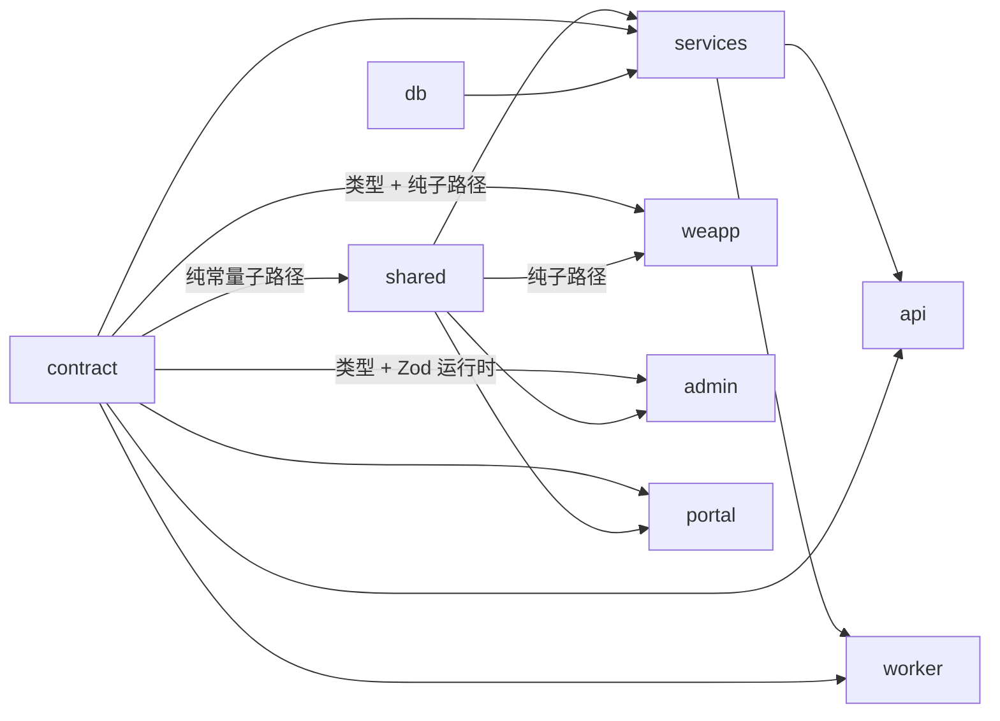
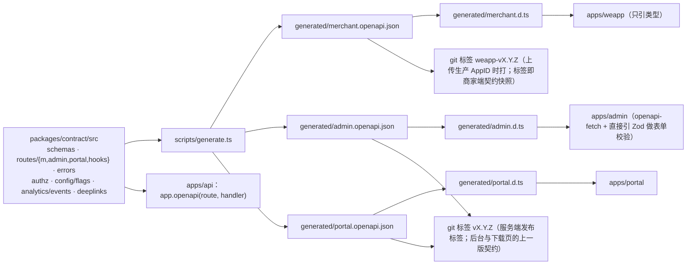
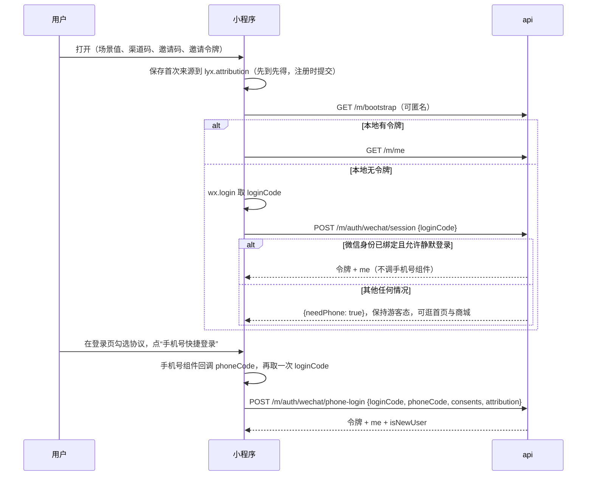
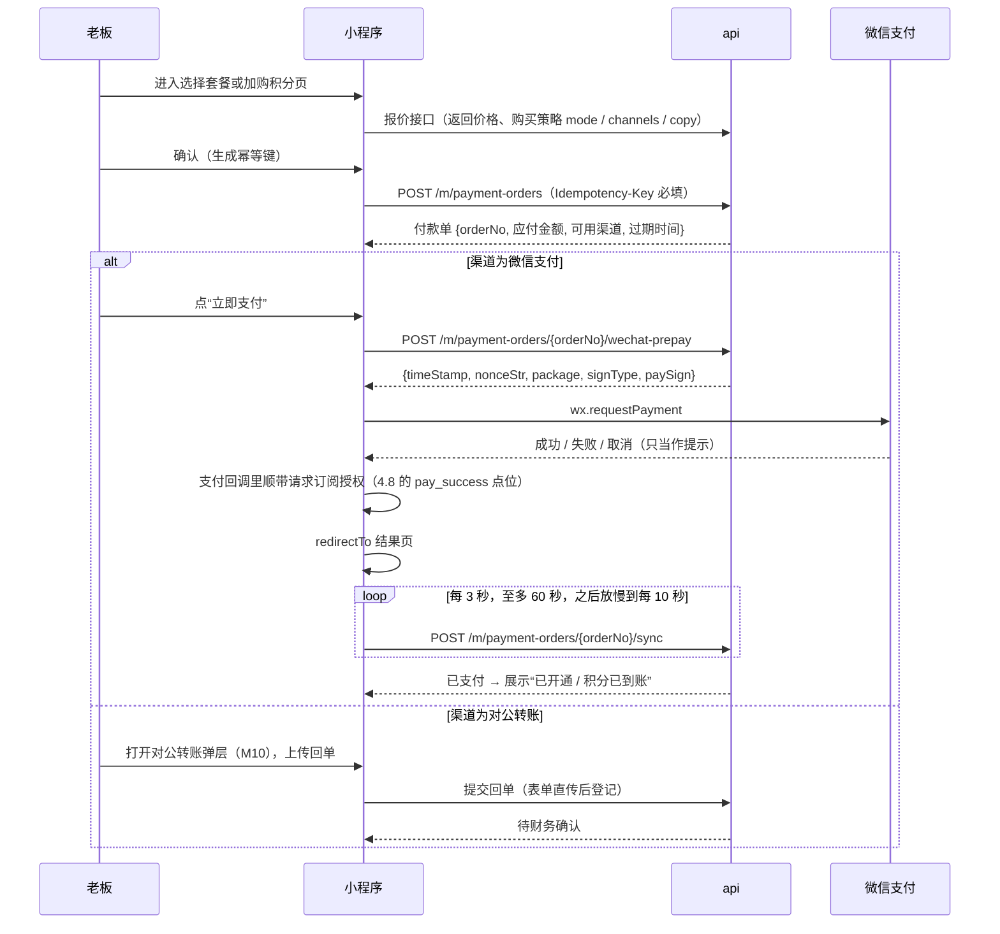
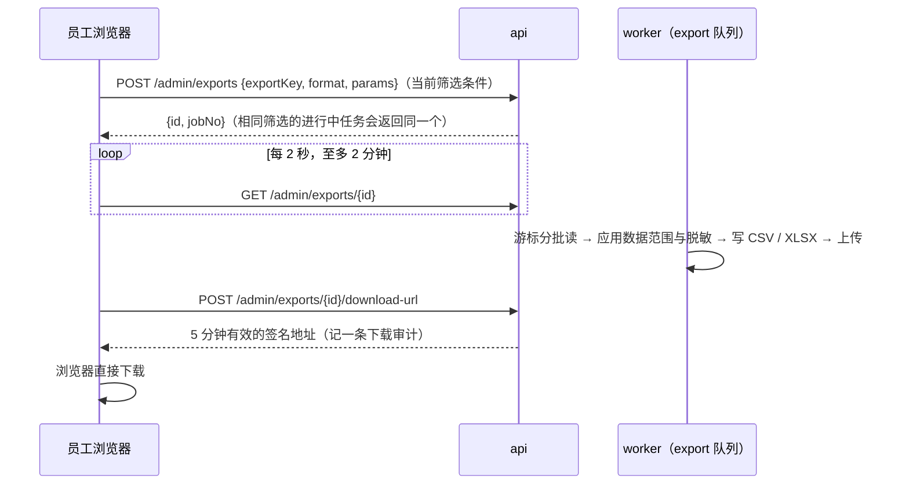
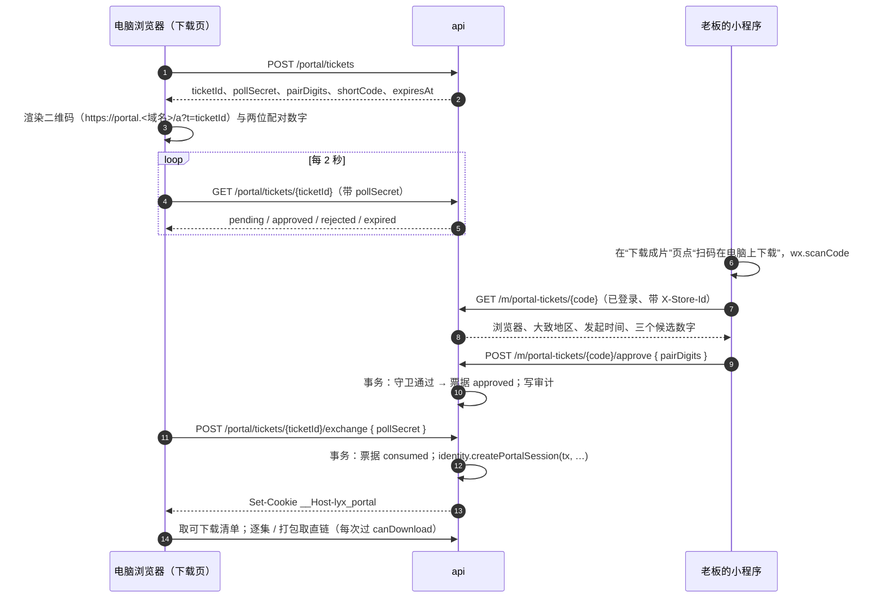
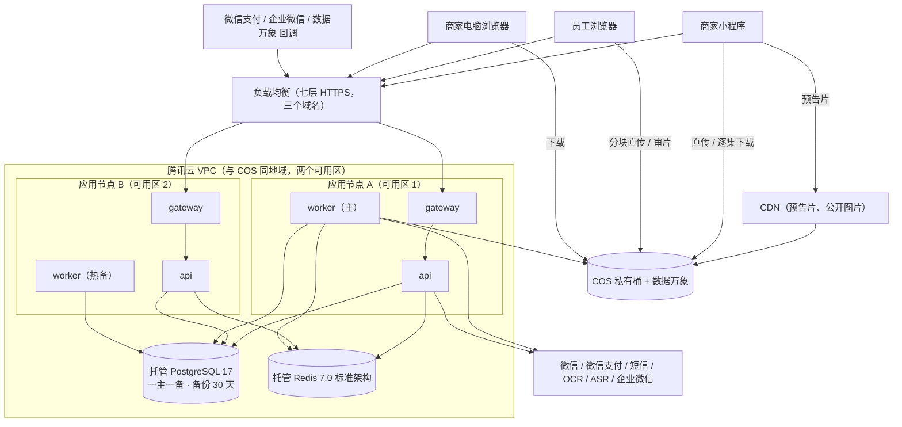
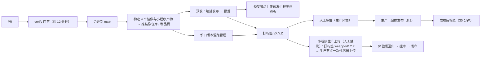

# D7 平台工程 · 详细设计（修订稿 v2）：工程结构、两端前端架构、部署运维、可观测与质量保障

> 「狸有戏」V1.0 子系统设计。原稿于 2026-10-02 提交评审，结论为“需修订”（0 条 blocker、9 条 major、13 条 minor）；本稿同日修订。**本稿是完整设计，可独立阅读**，章节结构与原稿一致；相对原稿的改动列在第 0 节末，逐条处理结果见文末“附二：评审意见处理表”。
>
> **出处约定**：【PRD §x】= `scratchpad/src/PRD.md`；【原型 merchant/X】【原型 admin/X】= `slim/` 下对应画板；【画板】= 两份 `canvas.json`；【调研 ref-arch §x】【ref-ops】【ext-stack】【ext-media】【ext-wechat】【proto-*】= `research/` 下调研报告；【参考工程 路径】= `timavia-liyo-project`；【核实 file-2】等 = 任务书给出的外部结论核实编号（confirmed 直接采信，partially 以更正为准），【核实 额外发现·主题】= 同一批核实结果里“额外发现”中的对应条目；【今日核对】= 我在 2026-10-02 自行打开官方页面确认的内容，附 URL；【实测 npm】= 我在 2026-10-02 用 `npm view <包> time` 取到的发布日期；【评审 M1】【评审 m4】= `design/d7-platform.critique.md` 的条目；【D1】–【D6】= 同目录下同批的六份设计；【默认】= PRD 与原型都没写、本设计给出的默认处理（做成参数或易改），需拍板的汇总在第 16 节；【推断】= 没有直接出处的工程判断，上线前需验证。
>
> **与同批设计的边界**：本设计管“骨架、两端前端、部署、观测、质量”，并且是集成方：`kernel`（事务、幂等、单号、装配）归本设计。服务端的表、状态机与接口归各领域设计：账本 D1、支付 D2、订购交付 D3、身份权限 D4、媒体 D5、通知文书配置数据 D6。写到登录、上传、播放、下载、埋点、导出、开关时，本设计只规定**端上怎么做**，接口与表以对应设计为准。**版本说明**：D2 已有修订稿（`d2-payment.md`）；D4、D5 的修订稿今天以分片形式存在（`_d4v2parts/`、`_d5v2parts/`），本稿引用 D2、D4、D5 时一律按其修订稿；D1、D3、D6 今天只有原稿。D4 修订稿与 D6 原稿里引用的“D7 定义的 `client_flag` / `analytics_event` / `export_job` / 主键用 UUID v7 / 下载页扫码票据”出自本设计更早的草稿，与原稿、本稿都不一致——逐项澄清在第 13 节。
>
> **本设计拥有的表（6 张）**：`worker_lease`、`alert_event`、`ops_invariant_run`、`ops_invariant_violation`、`idempotency_record`（全仓统一的幂等表，3.1）、`portal_ticket`（下载页扫码票据，第 6 节；D4 修订稿指定归本设计）。原稿的 `job_run` 已删除（周期任务改用 D3 的定时器行，7.6、9.3）。另向 D3 提出两处增量：`timer.result` 列与 `event_redelivery` 表（7.3），归 D3 的 `timers`、`events` 模块。

---

## 0. 一页结论

1. **仓库**：新仓库 `liyoxi`，pnpm 10 monorepo，作用域 `@liyoxi/*`，技术前缀统一用 `lyx`。五个应用（`weapp`、`admin`、`portal`、`api`、`worker`）+ 五个包（`contract`、`db`、`services`、`shared`、`config`）。依赖方向与 `services` 内的模块分层用 **dependency-cruiser 进 CI 强制**。
2. **契约**：Zod → 三份 OpenAPI（商家端 / 后台 / 下载页）→ 三份类型。**小程序每次上传生产 AppID 时打一个 git 标签 `weapp-vX.Y.Z`，标签即契约快照**，从上传那一刻（提审之前）起就受 `contract:compat` 保护；后台与下载页对“上一个服务端发布标签”做同样的检查。枚举值与事件类型“先声明、下一个版本再写入”。
3. **版本**：全部精确锁定，且**锁定值必须已发布满 7 天**（与 `minimumReleaseAge` 一致）。Node 24（≥24.19）、pnpm 10.34.5、TypeScript 5.9.3、Prisma 7.10.0、PostgreSQL 17、BullMQ 6.3.8、Taro 4.2.1 + React 18.3.1 + NutUI 3.0.20（小程序）、React 19.3.0 + Vite 8.3.1 + antd 6.6.5（后台）、ESLint 10.11.0。
4. **小程序**：6 个主包页 + 9 个分包共 49 个路由，覆盖 47 个画板；主包 ≤1.5MB 进 CI 门禁。请求层统一处理门店上下文头、幂等键、各类“交互式恢复”（续期、协议、版本过低）的单飞。成片逐集下载落**临时文件**（不占 200MB 用户目录配额）。样片在小程序内默认不内嵌播放（D5 修订稿的开关），改为“存相册查看 / 电脑端预览”。
5. **后台**：56 个画板归成 7 种页面骨架、约 20 个共享构件；权限按 D4 的“模块等级 + 权限点 + 数据范围”消费；与接口同源部署；导出只有异步任务一条路。新增两个无画板的系统页：开关管理（D6 提出）、系统健康（告警与不变量违规的只读列表与认领）。
6. **下载页**：V1.0 必做，5 个页面。登录方式统一为“电脑显示二维码，老板在小程序里扫码确认”（D4、D5 修订稿一致的方向），票据表 `portal_ticket` 由本设计给出；会话在 PostgreSQL（D4）。
7. **部署**：腾讯云单地域，两台应用节点（各跑 gateway + api + worker + mediatool）+ 一台预发节点，托管 PostgreSQL 高可用 + 托管 Redis（通过兼容性验证后）。worker 用**数据库租约做热备单活**。发布由 CI 里的编排脚本经远程命令通道分步执行：预置静态资源 → 迁移 → worker → api 滚动；回滚顺序相反且有前置条件。**预发不持有任何生产级资金凭据与生产发版凭据**。
8. **“Redis 丢了不丢业务”落到每一个机制上**：周期任务是数据库里的定时器行（不用 BullMQ 的调度器）；出站事件的重投有状态、有上限、先查队列再决定；限流在 Redis 不可用时降级为进程内计数；自建 Redis 这条退路是“每节点一个、只给本机 worker 用”。
9. **观测**：结构化日志进云日志；错误监控三端走 Sentry 协议并经自有域名转发（转发与业务请求隔离）；指标不建 Prometheus，由 worker 每分钟跑 SQL 探针并直接告警到企业微信，外部拨测兜底。上线首月只对 P1 与资金相关的 P2 即时通知。
10. **质量**：纯函数、服务层连真库、接口、契约 diff、**新旧版本混跑冒烟**、后台端到端、小程序真机清单七层；账务必须有模型测试、并发测试与回放测试；预发用**独立商户号**做小额实付（付款这一步必须人工，其余自动）。
11. **与基线的分歧（3 条，第 14 节）**：下载页从“可选”改为 V1.0 必做；小程序分块上传只承诺 ≤100MB；worker 单活用租约自动接管。

**相对原稿的主要变化**

| 主题 | 原稿 | 本稿 | 触发 |
|---|---|---|---|
| 周期任务 | BullMQ Job Scheduler + `job_run` 互斥 | D3 的定时器行 + “长任务模式” + 每分钟对账式补登记；删除 `job_run` | 评审 M1 |
| 出站事件重投 | 超 15 分钟无条件换 `jobId` 重投 | 先查队列状态；失败集合里的不自动重投；每（事件 × 订阅者）至多 3 次、间隔递增 | 评审 M2 |
| 契约快照 | 发布后由 CI 提交快照文件 | 上传生产 AppID 时打标签，标签即快照；后台与下载页也纳入 | 评审 M3、M5 |
| 静态资源 | gateway 镜像带上一版资源 | 发布第一步把新资源预置到两台节点的共享目录，再滚动切入口页 | 评审 M4 |
| 迁移与回滚 | “代码回滚始终安全” | 回滚有前置条件；删列改 `@ignore` 三步；枚举先声明后写入；CHECK 用 `NOT VALID`；新旧混跑冒烟；回滚顺序 api → worker | 评审 M5 |
| 逐集下载 | 写用户目录 | 写临时文件；真机不通时的降级模式由服务端参数切换 | 评审 M6 |
| Redis 不可用时的限流 | 登录类接口拒绝 | 进程内计数、限额减半（与 D4 一致） | 评审 M7 |
| 预发的凭据 | 默认共用商户号；生产上传密钥放预发节点 | 预发独立商户号；生产上传在生产节点上的一次性容器执行；自动退款任务三道硬保护 | 评审 M8 |
| 集成约定 | 引导接口、幂等、删除权限三处悬空 | 引导接口响应由本设计定义；幂等统一为一张表一个机制；删除权限按进程拆（与 D5 修订稿一致） | 评审 M9 |
| 下载页登录 | 链接 + 提取码（按 D5 原稿） | 扫码确认（按 D4、D5 修订稿），`portal_ticket` 归本设计 | 同批修订 |
| 版本锁定 | 多个版本发布不足 7 天 | 10 个包各退到满 7 天的最新补丁 | 评审 m4 + 实测 |
| 密钥、租约、备份、探活、告警 | 见各节 | 密钥只走文件；租约独立连接与看门狗；备份改为 worker 周期任务流式上传；`/readyz` 不查库；事件型告警自动恢复 | 评审 m2、m5–m8 |

---

## 1. 目标、约束与不做什么

### 1.1 目标

| # | 目标 | 可检验的标准 |
|---|---|---|
| G1 | 3–6 人的团队能在一个仓库里同时开发小程序、后台、接口而不互相踩 | 新人按 README 30 分钟内跑起本地全套；任何越界依赖在 CI 失败 |
| G2 | 接口只有一份定义，两端类型自动同步，破坏性变更在合并前被拦住 | `contract:check` 与 `contract:compat` 两道门禁 |
| G3 | 账务代码的每一次改动都被性质测试与并发测试覆盖 | 账本、支付、订购三个模块的测试在 CI 必跑，随机种子可复现 |
| G4 | 发布不停机、有条件可回滚、不在生产机上构建 | 发布期间外部拨测、后台入口页与全部静态资源、商家端匿名接口的逐秒探测均无失败（8.2）；回滚的前置条件由规则 E1 与新旧混跑冒烟保证（8.3、8.4）|
| G5 | 钱与积分出问题时有人知道，且“多久知道”有明确口径 | 按 9.3 的分类：回调、履约、积压类 ≤5 分钟；账面不一致 ≤15 分钟；与微信侧的差异次日 11:00 前。第 9.4 节告警清单全部接通并演练过一次 |
| G6 | 平台规则变化（虚拟支付、类目、自动播放）时不发版也能止损 | 3.2 的开关与 D2 的购买入口策略改配置即生效，端上不需要发版 |
| G7 | Redis 的数据全部丢失后业务自己恢复，不需要人工补登记 | 7.3 验证第 6 项：worker 不重启的前提下，七条队列与全部周期任务 30 分钟内继续，无积分或金额错误 |

### 1.2 约束

| 约束 | 来源 | 对本设计的含义 |
|---|---|---|
| 首屏 ≤2 秒（4G）；核心接口 P95 ≤500ms；可用性 ≥99.9% | 【PRD §10.1】 | 主包体积门禁；首页聚合接口；api 双实例 + 托管库；可用性以外部拨测为准（第 16 节 Q5 需确认口径）；“核心接口”的清单与上线前的基线测量见 10.6 第 16 项 |
| 图片 ≤5MB 先压缩；视频 ≤200MB 且断点续传；另有“相册视频 500MB” | 【PRD §10.1、§6.16.3】 | 两处数字冲突，且 >100MB 在小程序内无官方保证路径【核实 file-4、file-5】；上限做成服务端参数 |
| 后台 Chrome / Edge 最新版，≥1366×768 | 【PRD §10.1】 | 桌面优先，不做移动适配 |
| 每日备份保留 30 天；操作日志 ≥3 年 | 【PRD §10.2-5、§7.12-5】 | 托管库备份 30 天 + 异地逻辑备份；日志表不在本设计 |
| 小程序单次下载 ≤200MB、并发 10、切后台 5 秒中断；本地用户文件与缓存合计 ≤200MB、临时文件 ≤4GB | 【核实 file-1、file-2、file-7】 | 成片只能逐集下载，且落临时文件而不是用户目录（4.11）；上传下载期间要占用前台 |
| 小程序请求域名须 ICP 备案 | 【核实 misc-4、msg-7】 | 错误上报、埋点都走自有 API 域名 |
| 小程序锁在 React 18 / Vite 4，后台用 React 19 / Vite 8 | 【核实 fe-1、fe-6】 | 两端各装各的 React；共享包不得依赖 React |
| 虚拟支付定性不确定；类目误选会锁死支付或播放 | 【核实 vpay-4、vpay-7、cat-1】 | 购买入口、渠道、视频入口做成服务端开关；预留纯图文形态 |
| 团队小、熟 TypeScript / React / Taro | 任务前提 | 不引 Kubernetes、不引 Prometheus、不引第二种语言；能用一条 SQL 解决的不建服务 |

### 1.3 不做什么

- **不建 Kubernetes、服务网格、独立网关产品**：两台机器 + Docker Compose + 云负载均衡。
- **不建 Prometheus / Grafana / ELK / 数仓**：日志进云日志服务，指标用 SQL 探针，报表查业务库。
- **不做小程序自动化 UI 测试**：真机清单 + 关键路径的预发回归（参考工程同样没有【调研 ref-ops §1.14】，投入产出比低）。
- **不做 H5 / App / PC 版商家端**：电脑端只有一个只读的“下载页”（下载与预览），没有下单、支付与任何确认操作。
- **不做实时推送**：后台角标、通知铃用 60 秒轮询【调研 proto-admin-a §13.5】。
- **不做多语言、暗色模式、主题切换。**
- **不为 V1.1 / V2.0 写实现**：只留路由位、开关键、队列名与镜像入口（第 15 节）。
- **不做“提审版本专属”的功能开关**：理由见 3.2。
- **不用 BullMQ 的调度器（Job Scheduler）**：周期任务的定义与状态都在数据库里（7.6）。
- **下载页不做“全部下载到文件夹”与“链接 + 提取码”**：理由见第 6 节。

---

## 2. 仓库与分层

### 2.1 目录

```
liyoxi/
  apps/
    weapp/      商家端小程序        Taro 4.2 · React 18 · NutUI 3.0 · Zustand 5
    admin/      运营后台 SPA        React 19 · Vite 8 · antd 6 · TanStack Router/Query · openapi-fetch
    portal/     商家电脑端下载页     React 19 · Vite 8 · antd 6（5 个页面）
    api/        Hono 4 服务端       /api/v1/m/*  /api/v1/admin/*  /api/v1/portal/*  /api/v1/hooks/*  /livez /readyz /health
    worker/     出站事件中继循环 + 定时器扫描循环 + BullMQ 消费者 + 周期任务登记表（recurring.ts）+ 探针；运维 CLI
  packages/
    contract/   Zod schema + 路由定义 + 错误码 + 能力点与权限点 + 开关键 + 埋点事件 → generated/*.openapi.json、*.d.ts；released/retired.json
    db/         prisma/schema.prisma + migrations/ + createPrismaClient
    services/   业务逻辑唯一落点（按领域分模块，见 2.3）+ providers + testing
    shared/     纯函数：计价、取整、周期、状态机表、工作日、购买入口策略、金额格式化、上传登记表
    config/     tsconfig 预设（base / node-lib / node-app / web-react19 / taro-react18）、eslint 片段
  infra/
    compose/    local.yml（pg / redis）· node.yml（生产与预发节点：gateway / api / worker / mediatool）
    docker/     server / gateway / mediatool / weapp-uploader 四个 Dockerfile · nginx/*.conf
    deploy/     orchestrate.mjs（发布编排）· node-step.sh（节点步骤）· systemd 单元 · check-env · runbook 脚本；test/（脚本的测试，沿用参考工程做法）
    ci/         check-mp-size.mjs · contract-compat.mjs · db-constraints.mjs · migration-lint.mjs · mixed-version-smoke.mjs · p95.mjs · layers.json
    bootstrap/  node-init.sh（节点初始化）· buckets.mjs + buckets.json（桶的 CORS / 生命周期 / 版本控制 / 访问策略，声明式）· 手工项核对表
  docs/         00–11 编号文档 + adr/NNNN-*.md（一条一文件）+ AGENTS.md
  .dependency-cruiser.cjs · eslint.config.js · pnpm-workspace.yaml · .npmrc · vitest.config.ts
```

与基线的差别只有两处补充：`/api/v1/portal/*` 路由组（下载页用，D5 同样提出）；`packages/config` 多两份 tsconfig 预设（两个 React 大版本各一份）。

**云资源不只靠控制台手工配置**【评审 m11】。原稿把负载均衡规则、安全组、4 个桶 × 2 个环境的 CORS / 生命周期 / CDN 鉴权、日志主题、远程命令、凭据全部交给“控制台 + 核对表”，预发与生产必然漂移，节点坏了也没有可重复的重建步骤。不上完整的基础设施即代码，但 `infra/bootstrap/` 至少提供两样并进仓库：节点初始化脚本（装容器运行时与日志采集、建目录、装 systemd 单元、预置静态资源）与桶配置脚本（用云的命令行工具把 `buckets.json` 应用到指定环境，带 `--check` 只比对不修改）。验收方式：用脚本把预发节点重建一次、把桶配置对预发重放一次（10.6 第 18 项）；之后每月对生产跑一次 `--check` 查漂移。负载均衡、安全组、CDN 鉴权这些一次性配置仍然手工，但逐项写进核对表并附导出的配置。

### 2.2 包依赖方向与工具化强制



箭头从被依赖的一方指向依赖它的一方。`shared` 与 `contract` 的方向按开发计划 第 4.2 节 Q4 改写（见文末勘误）：`contract` 在最底下，不依赖任何工作区包。

规则（左列是规则，右列是谁来拦）：

| # | 规则 | 强制手段 |
|---|---|---|
| D1 | `shared` 的工作区依赖只许 `contract`，且只引它的纯常量子路径（经任何路径都到不了 Zod 运行时）；不依赖 `db`、`services` 与应用；不 import `node:*`、不 import `react` | dependency-cruiser |
| D2 | `contract` 不依赖任何工作区包；不 import `react`、`@prisma/*` | dependency-cruiser |
| D3 | `db` 只被 `services` import；`api`、`worker`、三个前端的**源码**不得 import `@liyoxi/db`、`@prisma/client`、`pg` | dependency-cruiser + ESLint `no-restricted-imports`（编辑器即时提示） |
| D4 | `api`、`worker` 只经 `@liyoxi/services` 的公开入口拿业务能力；路由与任务处理器里不得出现 `prisma.` 调用 | dependency-cruiser（禁 import）+ 代码评审 |
| D5 | 三个前端不得 import `@liyoxi/services`、`@liyoxi/db` | 包清单里不声明（pnpm 严格隔离下 import 即构建失败）+ dependency-cruiser |
| D6 | `weapp` 只能 import `@liyoxi/contract` 的 `types/*`、`errors`、`authz`（能力点常量）、`config/flags`、`analytics/events`、`deeplinks` 这几个纯常量子路径和 `@liyoxi/shared` 的纯子路径；不得 import Zod 运行时 | 两个包的 `exports` 只开这些子路径给 `weapp` 用；dependency-cruiser 兜底 |
| D7 | `services` 内部：模块之间只能 import 对方的 `index.ts`；依赖方向按 2.3 的分层 | dependency-cruiser（正则捕获组规则） |
| D8 | `services/providers/*` 的驱动实现只在装配处（`kernel/context.ts`）被 import；领域模块只依赖 `providers/types` | dependency-cruiser |
| D9 | 全仓禁 `axios`；小程序禁 `window / document / localStorage / fetch`；服务端禁 `console.log` | ESLint（照搬【参考工程 eslint.config.js】） |
| D10 | 无循环依赖 | dependency-cruiser `no-circular` |

**备选与取舍**：(a) 只用 ESLint 的 `no-restricted-imports`——能即时提示，但表达不了“模块 A 只能进模块 B 的 index”“无环”这类图规则；(b) `eslint-plugin-boundaries`——对 ESLint 10 的兼容今天没有核实，而 ESLint 9 已 EOL【核实 ver-3】；(c) dependency-cruiser——独立于 ESLint，规则是一份 JS 配置，能出依赖图给评审看。选 (c) 为主、(a) 为辅。参考工程规划里写了要校验却始终没接【调研 ref-arch §1.3】，所以这次在建仓第一个 PR 就把 `pnpm depcheck` 放进 CI。dependency-cruiser 的版本在建仓当天从 npm 实测后精确锁定（本次调研未核）。

`.dependency-cruiser.cjs` 的核心片段（示意，路径即规则）：

```js
forbidden: [
  { name: 'contract-is-leaf', from: { path: '^packages/contract/' },
    to: { path: '^packages/(?!contract/)|^apps/' } },
  { name: 'shared-is-pure', from: { path: '^packages/shared/src' },
    to: { path: '^(packages/(db|services)|apps)/|^node:|^react' } },
  { name: 'shared-no-zod', from: { path: '^packages/shared/' },
    to: { path: 'node_modules/zod', reachable: true } },
  { name: 'db-only-from-services', from: { pathNot: '^packages/(services|db)/' },
    to: { path: '^packages/db/|@prisma/client|^pg$' } },
  { name: 'fe-no-server', from: { path: '^apps/(weapp|admin|portal)/' },
    to: { path: '^packages/(services|db)/' } },
  { name: 'weapp-no-zod', from: { path: '^apps/weapp/' }, to: { path: 'node_modules/zod' } },
  { name: 'module-public-api', from: { path: '^packages/services/src/([^/]+)/' },
    to: { path: '^packages/services/src/([^/]+)/(?!index\\.ts$)', pathNot: '^packages/services/src/$1/' } },
  { name: 'providers-via-types', from: { path: '^packages/services/src/(?!providers|kernel|testing)' },
    to: { path: '^packages/services/src/providers/(?!types)' } },
  { name: 'no-circular', from: {}, to: { circular: true } },
  // 分层规则见 2.3，配置加载时读 infra/ci/layers.json，按层表展开成若干条 forbidden
]
```

片段只示意写法。落地的规则名与正则以仓库根的 `.dependency-cruiser.cjs` 为准：`shared-is-pure` 在那里拆成 `shared-only-contract`、`shared-no-node`、`shared-no-react` 三条；`weapp-no-zod` 与 `shared-no-zod` 一样用可达性；`module-public-api` 除各模块的 `index.ts` 外另放行 `providers/types.ts`（D8 要领域模块引它）；每条规则同时匹配“解析后的路径”与“解析不了时留下的包名”两种写法（包清单没声明的工作区包在 pnpm 隔离下解析不了）。

**包形态**沿用参考工程：工作区包 `exports` 直接指向 `src/*.ts`，开发期零构建；`api`、`worker` 用 tsup 打包并把 `@liyoxi/*` 内联【调研 ref-arch §1.4】。因此 `apps/api/package.json` 仍需声明 `pg`、`bullmq` 等第三方运行时依赖（打包后要能解析到），这不违反 D3——D3 约束的是源码 import。

**两个 React 大版本共存**：`apps/weapp` 装 React 18.3.1，`apps/admin`、`apps/portal` 装 React 19.3.0；`.npmrc` 保持 pnpm 默认隔离（不开 `shamefully-hoist`、不把 `react` 加进 `public-hoist-pattern`）；`@types/react` 分别是 18 与 19；`packages/shared`、`packages/contract` 不依赖 React（D1、D2）【核实 fe-1】。

### 2.3 `packages/services` 的领域模块与调用规则

模块名沿用各领域设计已经用的目录名（D1–D6），本设计只补它们没覆盖的四个（`kernel`、`content`、`portal`、`ops`）并规定层次。

| 层 | 模块（`packages/services/src/<目录>`） | 职责 | 设计出处 |
|---|---|---|---|
| L0 横切 | `kernel` | 事务单元 `Tx`（含超时与错误映射，8.3）、时钟、幂等表 `idempotency_record`（3.1）、业务单号、服务上下文装配 | 本设计；`biz_sequence` 的定义在 D3 |
| L0 | `events`、`timers`、`flow`、`sla` | 出站事件表与中继、定时器表与扫描、`transition()` 与状态历史、时限与工作日历 | D3 §19–22 |
| L0 | `authz`、`audit`、`security` | Actor 与断言、数据范围谓词、审计写入、加密与脱敏、限流器、回调验签框架 | D4 |
| L0 | `config` | 字典、参数、站点配置、特性开关、配置缓存 | D6 §4 |
| L0 | `providers` | 外部能力接口 + 驱动 + “未配置”实现 | 基线 7 |
| L1 基础 | `identity`、`tenant`、`staff`、`approval` | 商家账号与令牌；主体、门店、成员、邀请；员工与会话；统一审批单 | D4、D3 §17 |
| L1 | `media` | 文件登记与上传、媒体任务、播放与下载授权、门店素材与理解流水线、OCR | D5 |
| L1 | `notify`、`docs` | 通知中心；协议、同意记录、授权书 | D6 §2–3 |
| L1 | `portal` | 下载页扫码票据 `portal_ticket`（第 6 节）；会话由 `identity` 创建与校验 | 本设计 |
| L1 | `content` | 短剧库：剧目、剧集、许可与版权、上架校验（D3 以 `content.assertOrderable` 引用；六份设计都没有展开，见第 13 节）| — |
| L2 资金 | `billing` | 价目、订阅、积分账本、计价；付款单、支付渠道、退款、对账、发票 | D1、D2 |
| L3 履约 | `order`、`ad`、`delivery`、`publish`、`support` | 选剧单与订购；广告；交付工单；发布与核验；客服工单 | D3 |
| L4 读侧 | `workbench`、`reports`、`analytics`、`exports` | 待办与角标聚合；报表；埋点入库；导出任务 | D3 §23、D6 §5 |
| L4 | `ops` | 健康检查、worker 租约与看门狗、周期任务登记与补登记、探针、告警、不变量校验的调度 | 本设计第 7、9 节 |

调用规则：

1. **同步调用只能向下**：L3 → L2 → L1 → L0；L4 可以读任何层。同层之间按白名单调用，白名单写在 `infra/ci/layers.json`，初始内容只有 D3 流程里必需的几条：`order → ad`、`order → delivery`、`delivery → ad`、`delivery → publish`；L1 内 `identity → tenant`、`staff → approval`、`portal → identity`。新增一条要改这个文件并过评审。
2. **向上的影响走出站事件**：下层在事务里写 `outbox_event`，上层模块在自己的目录里登记订阅者，由 worker 中继后幂等消费（D3 §20）。下层不 import 上层。
3. **下层需要调用上层逻辑且必须同事务时用端口**：下层定义接口，上层在装配时注册实现。已有的三处都是这种形态：`approval` 的各类审批执行器、`timers` 的到期处理器、`events` 的订阅者，都由领域模块注册。订阅者或处理器要读上层数据时，同样由上层注册解析函数，而不是反向 import。
4. **事务句柄显式传递**：改库的服务函数第一个参数是 `tx: Tx`（D1、D3 已这样约定）；只有“用例函数”（被路由或任务处理器直接调用的那一层）可以调用 `kernel.tx.run()` 开事务；事务超时由 `tx.run` 显式设置（8.3），带幂等键的用例经 `tx.run(ctx, …)` 把幂等行与业务写放进同一个事务（3.1）。`Tx` 是带品牌的类型，普通 Prisma 客户端传不进去——参考工程用同样的手法把“咨询锁必须在事务里拿”钉死【调研 ref-arch §2.9】。
5. **事务内不调外部服务**：`kernel.tx.run()` 用 `AsyncLocalStorage` 标记“在事务中”；所有 Provider 的入口检查这个标记，测试环境下直接抛错，生产环境记一条 error 日志并报错误监控。微信下单、手机号换取这类“必须同步”的调用写成“先调外部、再开事务”或三段式（D2、D4 已如此）。
6. **业务时间由应用时钟传入**：服务函数取时间只用注入的 `clock.now()`，业务 SQL 里不写 `now()`（列默认值与租约这类基础设施除外）。这样测试能拨动时钟，周期与到期逻辑才测得了。
7. **装配按域拆**：`kernel/context.ts` 只做基础设施（env、logger、Prisma、Redis、providers、队列），业务服务由各模块的 `buildXxx(deps)` 装配后汇总。参考工程的 `context.ts` 已 668 行、25 个成员全在一个文件里【调研 ref-arch §2.3】，本项目域更多，一开始就拆。
8. **路由与任务处理器是薄壳**：取参 → 调一个用例函数 → 回包；任务处理器只把 `retry / failed` 翻译成抛错（沿用参考工程 ADR-019）。

分层用 dependency-cruiser 强制：`layers.json`（模块 → 层 + 同层白名单）生成对应的 forbidden 规则；新增模块必须先登记层，否则 CI 失败。

**为什么这样分**：层数只有 5 层，评审时能一眼看完；钱（L2）不依赖履约（L3），所以履约侧怎么改都动不到账本；读侧（L4）单独成层，报表与工作台的慢查询不会被写进交易模块。备选是“每个模块完全独立、只经事件通信”，对这个规模过重——订购提交要同步冻结积分，走事件就丢了单事务。

### 2.4 契约先行链路与两端类型生成



做法（沿用参考工程的“接口三步走”【调研 ref-arch §2.1】，改五处）：

1. **三份文档分开生成**。后台接口面不出现在商家端文档里；`hooks` 不出文档。生产环境不挂 Swagger UI，预发挂在后台登录态之后【调研 ref-ops §5.3】。
2. **按角色区分的响应 schema 是出站闸门**。实现归 D4（`respondByRole`：按观察者角色选 schema 并 `parse`，Zod 默认丢弃未声明的键；该角色没有对应视图即 403）。本设计把它接进门禁：D4 的“店员可见字段黄金文件”与“店员身份扫全部 `/m` 接口查禁用键名”两条测试进 verify 流水线，失败即阻断。
3. **在役版本兼容性检查（`contract:compat`）**【评审 M3、M5】。
   - **快照就是 git 标签，不另存文件**。生成物 `generated/*.openapi.json` 本来就提交在仓库里（`contract:check` 保证它与源码一致），所以任意标签上的契约都能用 `git show <标签>:packages/contract/generated/merchant.openapi.json` 取到。CI 的契约任务检出时带上全部标签。
   - **商家端的在役版本** = 全部 `weapp-v*` 标签，减去 `packages/contract/released/retired.json` 里登记的版本。`weapp-vX.Y.Z` 由“小程序生产上传”工作流在**上传生产 AppID 的那一步**打在对应提交上（8.5）——此时还没有提审，但从这一刻起该版本的契约已受保护，审核期间 `main` 上的任何改动都要与它兼容。原稿在“发布后”才入库快照，审核的 1–7 天是无保护窗口；也不再需要机器人绕过分支保护去提交文件。
   - **摘除**只有一条路：PR 修改 `retired.json`（写明版本、原因、日期）。两种情形：审核被拒或放弃发布的版本；把 `client.min_version` 提到某版本之上后，低于它的版本。在役版本超过 4 个时 CI 给出提醒（不失败）。
   - **后台与下载页**对“最近一个服务端发布标签 `vX.Y.Z`”做同样的比较（只比这一个）：滚动发布窗口里、以及员工没刷新页面时，浏览器里跑的是上一版前端。
   - **判定为破坏的变更**：删路径或方法；请求新增必填字段；响应删字段或把必有字段改成可空；请求枚举删值；响应枚举加值而该字段未标记 `x-open-enum`（标了的字段，端上必须对未知值有兜底展示，由类型强制：生成的类型是 `已知值 | (string & {})`）。
   - 确需破坏时，在同一个 PR 里把对应版本写进 `retired.json`，并在发布检查表里登记“上线后把 `client.min_version` 提到新版本”（旧版客户端收到 `CLIENT_OUTDATED` 提示升级）。
   - 实现是一个约 250 行的结构化比较脚本（`infra/ci/contract-compat.mjs`），不引新依赖。
4. **路由元数据与启动自检**。每条路由在契约里声明：`x-auth`（`public / optional / user / member`，缺省 `member`）与 `x-capability`（商家端）或 `x-permission`（后台）——这三项由 D4 定义；本设计再加三项：`x-idempotent`（`required / natural / none`，写路由必填）、`x-idempotent-by`（`natural` 时必填，写出承担去重的唯一约束名）与 `x-rate-limit`（限流档位）。契约自测检查声明齐全，并核对 `x-idempotent-by` 指向的约束在 `db-constraints` 清单里存在；`apps/api` 启动时核对“声明了什么就挂了什么中间件”，漏挂即启动失败。参考工程的五条契约自测（路由必须进 `allRoutes`、错误码三表同源等【调研 ref-arch §2.1】）照搬。
5. **枚举值、事件类型、定时器类型、队列任务名“先声明，下一个版本再写入”**（规则 E1，细则与自动化证据在 8.3）。契约里的 Zod enum 既是端上认识的取值，也是服务端出站 `parse` 认识的取值；新值在版本 N 只进入读路径，版本 N+1 才允许写出。

全仓通用约定（`contract/src/common.ts` 与 `docs/03-data-model.md`）：

| 项 | 约定 |
|---|---|
| 主键 | `bigint generated always as identity`，接口以十进制字符串传输（沿用参考工程 ADR-009）。D2 修订稿、D3、D5 修订稿、D6 按此书写；D1 记作 `uuid`（“随全仓约定”）；**D4 修订稿改成了 UUID v7 并称依据是本设计——这是对旧草稿的引用，本设计的约定始终是 `bigint`**（第 13 节第 2 项，需架构师定一次）。无论选哪种，接口里都是字符串，契约与两端代码不受影响，只影响 `schema.prisma` 的列类型，所以必须在第一条迁移之前定。不可枚举性靠别的手段：对外凭证（邀请令牌、下载页票据、上传登记）用随机令牌；商家端按 id 取资源一律带租户范围（D4 的 `StoreScope`） |
| 表名与枚举 | 表名单数 snake_case；枚举用 `text + CHECK`，取值在 `packages/contract` 以 Zod enum 为唯一来源；时间一律 `timestamptz` |
| 金额 / 积分 / 比例 | 整数；金额字段以 `Fen` 结尾（列名 `_fen`，单行 `int`、聚合 `bigint` 在边界转字符串，D2 修订稿）；积分以 `Points` 结尾；比例为万分比整数、以 `Bp` 结尾（D1） |
| 时间 | 时刻用 ISO 8601 带偏移；“哪一天”用 `YYYY-MM-DD`，由服务端按 `Asia/Shanghai` 算好再下发 |
| 分页 | 后台列表 `page / pageSize`（默认 20，上限 100）+ `sort`；商家端与日志类用游标 `cursor / limit` |
| 成功体 / 失败体 | `{ code: 0, message: "ok", data }` / `{ code, error, message, details? }`：`error` 是符号名，`code` 是数值；HTTP 状态按语义（沿用 ADR-012）|
| 操作人类型 | 以 D4 修订稿为准：`merchant / staff / portal / system`（V1.1 加 `partner`）；老板还是店员记在角色快照里（`owner / clerk`）。D5 修订稿写的是 `user / staff / system / partner`，合并时统一（第 13 节）|
| 可做什么 | 列表与详情的 DTO 带 `actions: string[]`（当前观察者此刻可执行的动作），端上只据此显示按钮，不自己推状态机【调研 ref-ops §1.12】 |

**错误码**：各设计用符号名，数值段由契约统一分配。唯一来源是 `contract/src/errors.ts`（符号、数值、HTTP 状态、默认文案四列同源）。端上逻辑只按符号常量判断，数值只用于日志与排障。

| 符号（跨端通用的部分） | HTTP | 数值 | 端上统一处理 |
|---|---|---|---|
| `VALIDATION_FAILED` | 400 | 40001 | 按 `details[{path,message}]` 就地标红 |
| `AUTH_REQUIRED` | 401 | 40101 | 小程序：续期并重放一次；后台与下载页：跳登录页 |
| `SESSION_REVOKED` | 401 | 40102 | 清会话，回登录页 |
| `PERMISSION_DENIED` / `ROLE_FORBIDDEN` | 403 | 40301 | 提示；后台重拉 `/admin/auth/me` |
| `NOT_A_MEMBER` | 403 | 40302 | 重拉 `/m/me`，回到门店选择 |
| `STEP_UP_REQUIRED` | 403 | 40304 | 弹再验证框，通过后重放 |
| `FEATURE_DISABLED` | 403 | 40306 | 刷新开关，隐藏入口 |
| `VERSION_CONFLICT` / `STATE_NOT_ALLOWED` | 409 | 40901 / 40902 | 刷新后重试；提示“已被处理” |
| `IDEMPOTENCY_KEY_REUSED` | 409 | 40903 | 换键（同一个键换了请求内容）|
| `IDEMPOTENCY_IN_PROGRESS` | 409 | 40904 | 只会出现在“三段式”用例（3.1）：1 秒后重试，至多 5 次 |
| `CLIENT_OUTDATED` | 426 | 42601 | 引导更新 |
| `CONSENT_REQUIRED` | 428 | 42801 | 弹协议确认，同意后重放 |
| `RATE_LIMITED` | 429 | 42901 | 退避 |
| `INTERNAL` / `PROVIDER_UNAVAILABLE` / `UPSTREAM_TIMEOUT` | 500 / 503 / 504 | 50000 / 50001 / 50002 | 重试提示 |
| `BUSY` | 503 | 50003 | 锁等待超时、事务超时、死锁重试失败都映射到它（8.3）；端上自动重试一次 |

领域错误的数值段：41xxx 身份与租户（D4）、43xxx 套餐与积分（D1）、44xxx 支付与发票（D2）、45xxx 订购与交付（D3）、46xxx 媒体与发布（D5、D3）、47xxx 通知、文书、配置、数据（D6）、48xxx 后台权限与审批（D4）。服务端 `message` 一律写成能直接给用户看的话，端上对未特殊处理的领域错误直接提示它【调研 ref-ops §1.4】。

### 2.5 命名与换名清单

参考工程也叫“狸有戏”，技术名占用了 `liyo`【调研 ref-ops §0-1】。从模板拷代码时按下表整体替换；CI 加一条检查：出现 `liyo` 而不是 `liyoxi` 即失败。

| 对象 | 参考工程 | 本项目 |
|---|---|---|
| 仓库 / 根包名 | `timavia-liyo-project` / `liyo` | `liyoxi` / `liyoxi` |
| 包作用域 | `@liyo/*` | `@liyoxi/*`（`weapp`、`admin`、`portal`、`api`、`worker`、`contract`、`db`、`services`、`shared`、`config`） |
| 小程序目录 | `apps/mobile` | `apps/weapp` |
| Redis 键前缀 | 无前缀（`rl:*`、`wechat:access_token:*`） | 一律 `lyx:{env}:`，如 `lyx:prod:rl:*`、`lyx:prod:wx:token:<appid>`、`lyx:prod:cfg:ver:*`（D6 的配置版本号键） |
| BullMQ | 默认前缀 `bull`；队列 `ai-tasks / push / maintenance / downloads / render` | `prefix: "lyx:{env}:bull"`；队列登记表（`kernel/queue/names.ts`）：`events`、`timers`（D3）、`notify`、`docs`、`export`、`maintenance`（D6）、`media`（D5）；V1.1 预留 `render`。前缀不同，即使误连同一个 Redis 也不会互相消费 |
| worker 存活 | Redis 心跳键 `liyo:worker:hb:<name>` | 库表 `worker_lease`（7.6）|
| JWT | `iss=liyo-identity`、`aud=liyo` | `iss=lyx`、`aud=lyx-m`（D4） |
| 后台 cookie / 防跨站头 | `__Host-liyo_admin` / `x-liyo-admin: 1` | `__Host-lyx_admin` / `X-LYX-Admin: 1`（D4）；下载页 `__Host-lyx_portal` / `X-LYX-Portal: 1` |
| 小程序本地存储键 | `liyo.accessToken` 等 | `lyx.accessToken`、`lyx.refreshToken`、`lyx.storeId`、`lyx.anonymousId`、`lyx.bootstrap`、`lyx.attribution`、`lyx.track.queue`、`lyx.uploads`、`lyx.downloads.<releaseId>` |
| 样式变量 / mixin | `$liyo-*` / `liyo-*` | `$lyx-*` / `lyx-*` |
| 进程 / 容器 | PM2 `liyo-api`、`liyo-worker` | 容器 `lyx-gateway`、`lyx-api`、`lyx-worker`、`lyx-mediatool`，各由一个 systemd 单元管理（7.4）；不再用 PM2 |
| 镜像 | — | `liyoxi/server`（api、worker、迁移、CLI 同一镜像不同命令）、`liyoxi/gateway`（nginx + 后台与下载页静态产物）、`liyoxi/mediatool`（D5 的隔离容器）、`liyoxi/weapp-uploader`（小程序上传）|
| 目录 | `/opt/liyo` | `/opt/liyoxi`（compose 文件、节点步骤脚本、`static/` 静态资源目录；不放代码、不放明文密钥）；密钥在内存盘 `/run/liyoxi/secrets/` |
| 数据库 / 角色 | 库 `liyo`、用户 `liyo` | 库 `liyoxi`；角色 `lyx_migrator`（DDL，只在发布流程里用）、`lyx_app`（DML；对审计类表只有 INSERT / SELECT）、`lyx_archiver`（分区归档，D4）、`lyx_readonly`（备份与排障） |
| 测试 schema | `test_services`、`test_api` | `test_<包名>`，`resetDatabase` 只认 `test_*`（沿用）。**勘误（W0-05b）**：已改为按库隔离，库名 `lyx_test_<包>_<会话标识>_<worker 编号>`，守卫只认 `lyx_test_` 前缀，见第 10.1 节末的勘误注 |
| Compose 项目与本地端口 | `liyo`；5432 / 6379 / 3000 | `liyoxi`；PostgreSQL 5442、Redis 6389、API 3100、后台 5183、下载页 5184（同一台开发机可同时跑两个项目） |
| COS 桶 | `liyo-prod-<appid>`（公有读） | `lyx-{env}-{secure,asset,media,pub}-<appid>`（D5 §3.1）；另加异地备份桶 `lyx-{env}-backup-<appid>`（7.8） |
| 日志主题 / 错误监控项目 | — | `lyx-{env}-app`、`lyx-{env}-gateway`；`lyx-api`、`lyx-worker`、`lyx-admin`、`lyx-weapp`、`lyx-portal` |
| 业务单号 | — | 原型示例：`LYX` 订购单、`FK` 付款单、`GG` 广告、`JF` 交付工单、`KF` 客服工单、`TK` 退款、`TZ` 积分调整、`RZ` 日志、`DC` 导出任务【调研 proto-merchant-a §0.3、proto-admin-e §1.10】；生成器在 `kernel`（D3 的 `biz_sequence`）|
| 环境变量 | `STUDIO_*`、`RENDER_*`、`OPENROUTER_*` 等 | 删除；新增 `WXPAY_*`、`COS_*`、`CI_*`、`WECOM_*`、`OCR_*`、`OBS_*`，以及 D4 附录 C 的密钥与安全阈值；全部经 `loadEnv()` 的 Zod 校验，敏感项只认 `*_FILE` 形式（7.5），成组变量“成对校验，半配即启动失败”（沿用 ADR-058） |

### 2.6 精确锁定的版本清单与升级策略

所有依赖写精确版本（无 `^`），提交 lockfile，CI 用 `--frozen-lockfile`。

**锁定规则（修订）**：锁定值 = 建仓当天“该大版本线上**已发布满 7 天**的最新补丁”。原稿同时写了 `minimumReleaseAge: 10080` 和若干发布不足 7 天的版本，两者自相矛盾【评审 m4】；我今天逐个取了发布日期【实测 npm】，不足 7 天的不止评审点到的 3 个，而是 10 个，下表已全部退到满 7 天的最新补丁（截止线 2026-09-25）。建仓日若晚于今天，按同一规则重取；含安全修复而必须提前使用的版本，逐个写进 `minimumReleaseAgeExclude` 并在 PR 里说明。

**运行时与工具链**

| 依赖 | 锁定 | 依据与说明 |
|---|---|---|
| Node.js | `24.x`，`engines: ">=24.19.0 <25"`；镜像 `node:24-slim` 固定摘要 | 24 于 2026-10-20 转维护期、支持到 2028-04-30；26 于 2026-10-28 成为 LTS【核实 ver-1】。≥24.19 是为了内置 argon2 的稳定接口【核实 misc-7】。CI 另跑一条 Node 26 的非阻塞任务，V1.0 提测前定是否切换（Q8） |
| pnpm | `10.34.5`（`packageManager` 字段） | 12 才发布一个多月且对未识别设置直接报错；10 线仍在发补丁【核实 ver-8】。10.34.6 发布于 2026-09-28，满 7 天后再升【实测 npm】 |
| TypeScript | `5.9.3` | 7.x 没有旧编程接口，`openapi-typescript`、`typescript-eslint` 无法工作【核实 ver-2】 |
| ESLint / typescript-eslint / react-hooks 插件 | `10.11.0` / `8.70.1` / `7.1.1` | ESLint 9 已于 2026-08-06 EOL；`eslint-plugin-react` 的 peer 不含 10 且有运行时报错，**不装**【核实 ver-3】。`typescript-eslint` 8.71.0 发布于 09-28，退一个版本【实测 npm】 |
| Prettier / commitlint / husky / lint-staged | 与参考工程同版本 | 【调研 ref-arch §1.1】 |
| Vitest | `4.1.11` | 5.0 刚发布一个月【核实 ver-8】。`apps/admin` 用 Vite 8 构建，而 Vitest 4 自带的 Vite 版本可能不同——后台单测不加载 `@vitejs/plugin-react`（用 esbuild 的 JSX 转换），建仓时实测；不通则仅 `apps/admin` 单独用 Vitest 5 |
| Playwright | `1.63.0` | 【调研 ext-stack §2.3】 |
| tsup / tsx | `8.5.1` / `4.23.13` | tsup 已不积极维护，记为技术债，tsdown 到 1.0 再换【核实 ver-8】 |
| dependency-cruiser / fast-check | `18.4.0` / `4.10.2` | 【实测 npm】（18.5.0 发布于 09-30，不满 7 天）。测试用的数据库用 CI 服务容器与本地 Compose，不引 Testcontainers |

**服务端**

| 依赖 | 锁定 | 依据与说明 |
|---|---|---|
| hono / @hono/zod-openapi / @hono/node-server | `4.13.9` / `1.6.3` / `2.1.1` | 【核实 ver-9】；hono 4.13.10–12、node-server 2.1.3 都不满 7 天【实测 npm】 |
| zod | `4.6.5` | 【核实 ver-9】 |
| openapi-typescript / openapi-fetch / openapi-react-query | `7.13.0` / `0.17.0` / `0.5.4` | 同批发布【核实 fe-10】 |
| prisma / @prisma/client / @prisma/adapter-pg | 全部 `7.10.0` | `prisma@latest` 指向 8.0.0-rc.19，裸装会错配【核实 ver-4】 |
| pg | `8.23.0` | 8.23.1 发布于 09-30【实测 npm】 |
| PostgreSQL | **17.x**（本地、CI、预发、生产同一大版本） | Prisma 7 官方支持 17 与 18【核实 ver-5】；腾讯云两者都有【核实 inf-1】。选 17：发布已两年、云上内核跟得紧；18 的新特性本项目用不上。备选 18 也可（Q7） |
| bullmq / ioredis | `6.3.8` / `6.0.0` | 6.3.9–6.3.11 不满 7 天【实测 npm】；`ioredis` 须显式安装【核实 ver-7】。**不使用 Job Scheduler**（周期任务在数据库里，7.6）|
| Redis | 托管“兼容 Redis 7.0”标准架构；本地与 CI 用 `redis:7.4-alpine` | BullMQ 官方 CI 只测 Redis 6 / 7 与 Valkey 8【核实 ver-10】 |
| jose / pino | `6.2.12` / `10.3.1` | 【调研 ext-stack §1.1】 |
| @sentry/node | `10.75.3`（v10 线） | 与小程序侧 `sentry-miniapp@1.20.4` 依赖的 `@sentry/core` 10.x 同线；11.x 才发布 9 天【核实 额外发现·监控】 |
| @react-pdf/renderer / write-excel-file / csv-stringify | `4.9.0` / `4.1.1` / `6.8.3` | 【核实 misc-6】；csv-stringify 6.9.0 发布于 09-25 当天，退一个版本【实测 npm】；不装 npm 上的 `xlsx`（有两个高危漏洞且无修复版）【核实 fe-9】 |
| miniprogram-ci | `2.1.31` | 【调研 ext-stack §7.5】；registry 上已有 2.1.47（2026-09-18）【实测 npm】，建仓时评估是否跟到它 |

**小程序**

| 依赖 | 锁定 | 依据与说明 |
|---|---|---|
| `@tarojs/*` 全家桶 | `4.2.1` | 参考工程已在用；4.3.0 才发布三天，出两个补丁后再跟【核实 fe-1】 |
| react / react-dom / @types/react | `18.3.1` / `18.3.1` / `18.3.x` | Taro 的 peer 是 `react ^18`【核实 fe-1】 |
| @nutui/nutui-react-taro / icons | **显式** `3.0.20` / `3.0.2` | `latest` 指向鸿蒙变体 `3.0.23-cpp`【核实 fe-2】 |
| vite / @vitejs/plugin-react（仅小程序） | `4.5.14` / `4.7.0` | Taro 4 的 peer 是 `vite ^4`【核实 额外发现·Taro 构建链】 |
| zustand | `5.0.15` | 【核实 fe-10】 |
| cos-wx-sdk-v5 | `1.8.0` | npm latest；显式设 `SimpleUploadMethod: 'putObject'`【核实 file-5】 |
| sentry-miniapp | `1.20.4` | 体积超预算则换自研上报器（4.13） |

**后台与下载页**

| 依赖 | 锁定 | 依据与说明 |
|---|---|---|
| react / react-dom | `19.3.0` | 【核实 fe-7】 |
| vite / @vitejs/plugin-react | `8.3.1` / `6.1.1` | 【核实 fe-6】；8.3.2 发布于 10-01【实测 npm】 |
| antd / @ant-design/icons | `6.6.5` / `6.3.4` | ProComponents 稳定版不支持 antd 6，**不引**【核实 fe-3、fe-4】 |
| @tanstack/react-router / react-query | `1.170.39` / `5.103.2` | 1.170.41 与 5.104.0 都不满 7 天【实测 npm】 |
| echarts | `6.1.0`，**不装 `echarts-for-react`** | 该包 2026-05-19 被投毒发布过恶意版本；自写 30 行封装【核实 fe-8、额外发现·供应链】 |
| dayjs / cos-js-sdk-v5 | 随 antd 的版本 / `1.10.1` | 【核实 cos-5】 |
| hls.js | **V1.0 不装** | D5 修订稿把预告片改成两档 MP4（§7.1），后台审片也是 MP4；评估 HLS 时再引入 |

**升级策略**

1. 每月第一周做一次依赖巡检（一个人半天）：同大版本内的补丁与次版本合并为一个 PR，过全量门禁后合入。巡检同样遵守“满 7 天”规则。
2. 下列依赖**禁止自动升级大版本**，只在约定的时间点人工评估：TypeScript（等 `openapi-typescript` 支持 6.0）、Prisma（8 正式版发布满 3 个月）、Taro（4.3 出两个补丁后）、NutUI（4.0 正式版）、pnpm（11 / 12，2027 年一季度再看）、Vitest（5.1 之后）、Sentry（11 线稳定后三端一起升）、Node（26 成为 LTS 满两个月后在预发跑一周）。
3. 升级小程序侧任何依赖后必须重跑主包体积检查与真机冒烟清单（10.6）。
4. 文档与代码不许漂移：`AGENTS.md` 的技术栈表由脚本从各 `package.json` 生成，CI 比对。

### 2.7 供应链与仓库安全

2026-05 的 npm 投毒事件波及过图表类依赖【核实 额外发现·供应链】，本项目含支付密钥，按以下做：

- `pnpm-workspace.yaml`：`onlyBuiltDependencies` 白名单（prisma、esbuild、@swc/core、@tarojs/binding、sharp 等，照参考工程），其余依赖不跑安装脚本；`minimumReleaseAge: 10080`（单位分钟，发布未满 7 天的版本不安装；该设置 pnpm 10.16 加入【今日核对 https://pnpm.io/settings/dependency-resolution 】），2.6 的锁定清单按同一规则取值，两者不再矛盾；`trustPolicy: no-downgrade`（10.21 加入，同页）。
- CI：`pnpm install --frozen-lockfile`；`pnpm audit --prod`（高危阻断）；gitleaks 扫密钥；lockfile 与 `pnpm-workspace.yaml` 的改动走 CODEOWNERS 指定的两人评审。
- 构建机与生产机分离：生产机不装 Node 工具链、不访问 npm；镜像按摘要拉取。
- 密钥不进仓库、不进镜像、不进小程序与后台构建产物（前端只注入 `TARO_APP_*` / `VITE_*` 的非敏感值）。

---

## 3. 三个前端共用的运行时约定

### 3.1 请求头与幂等键

| 头 | 谁带 | 含义 |
|---|---|---|
| `Authorization: Bearer <access>` | 小程序 | 商家身份（D4）；后台与下载页用 cookie 会话，不带此头 |
| `X-Store-Id` | 小程序 | 当前门店上下文；`x-auth: member` 的路由必带，服务端逐请求校验成员关系，主体由门店推出（D4）|
| `X-Client-Platform`、`X-Client-Version`、`X-Env-Version` | 小程序 | 平台（`ios / android / harmony / windows / mac / devtools`）、小程序版本号、`develop / trial / release`；用于开关求值、购买入口策略、最低版本判断与日志（D6 §4.4、D2 §10.3）。后台与下载页只带 `X-Client-Version`（构建号）|
| `X-Request-Id` | 三端 | 端上生成的 UUID。**服务端只接受 UUID 格式（36 个字符），不符合即丢弃并重新生成**，避免把任意字符串写进日志与出站事件【评审 m10】；沿用后写入日志、出站事件与任务，回包头原样返回；报错提示里带后 8 位 |
| `Idempotency-Key` | 三端的写请求 | 见下；≤128 个字符，字符集 `[A-Za-z0-9:_-]` |
| `X-LYX-Admin: 1` / `X-LYX-Portal: 1` | 后台 / 下载页的非 GET 请求 | 防跨站请求（配合 `SameSite=Strict` 的 `__Host-` cookie 与 `Origin` 校验，D4）|

**幂等键的生成与复用（端上规则，三端一致）**

1. 键属于“用户的一次意图”，不属于一次 HTTP 请求。进入确认页或打开确认弹层时生成 `ik = <动作名>:<uuid>`，存在页面状态里。
2. 该意图下的所有重试（双击、超时重发、401 续期后的重放、协议同意或再验证后的重放、弱网重试）复用同一个键。
3. 意图结束（成功、用户改了表单内容后重新提交、离开页面）时丢弃；改了内容必须换键，否则服务端返回 `IDEMPOTENCY_KEY_REUSED`。
4. 契约里标 `x-idempotent: required` 的路由不带键直接 400。标 `natural` 的路由靠业务唯一约束（契约里用 `x-idempotent-by` 写出约束名），不要求带键。

**服务端：全仓一张表、一个机制**【评审 M9】

原稿只说“记录在 PostgreSQL”，而同批设计里至少有四种写法：D2 原稿的 `idempotency_key` 表、D3 的 `idempotency_record`（并发请求阻塞在唯一索引上）、D4 邀请的 `client_request_id`、D5 业务表各自的 `idempotency_key` 列。统一如下，归 `kernel`：

**`idempotency_record`**

| 字段 | 类型 | 约束 | 说明 |
|---|---|---|---|
| scope | text | PK(1)，NOT NULL | 路由的 `operationId`，如 `m.order.submit` |
| actor_key | text | PK(2)，NOT NULL | `<操作人类型>:<id>`，如 `merchant:812`、`staff:45`、`portal:<会话 id>` |
| key | text | PK(3)，NOT NULL | `Idempotency-Key` 请求头 |
| request_hash | text | NOT NULL | `sha256(方法 + 路径参数 + 规范化后的请求体)` |
| state | text | NOT NULL，CHECK in (`done`,`in_progress`) | 单事务用例提交时即为 `done`；`in_progress` 只用于三段式用例 |
| locked_until | timestamptz | 可空 | 仅三段式：本次处理的占用到期时间 |
| result | jsonb | 可空 | 用例函数的返回值（角色裁剪**之前**的 DTO）；重放时由路由层重新按观察者角色裁剪 |
| created_at / expires_at | timestamptz | NOT NULL | `expires_at = created_at + 24 小时`；`INDEX(expires_at)`，每小时清理一次 |

**单事务用例（绝大多数写接口）**：幂等行与业务写在同一个事务里。

```
kernel.tx.run(ctx, fn):                       # ctx.idem 由幂等中间件放入：{ scope, actorKey, key, requestHash }
  BEGIN
  若 ctx.idem：
     INSERT INTO idempotency_record(scope, actor_key, key, request_hash, state, expires_at)
            VALUES (…, 'done', now() + '24 hours') ON CONFLICT DO NOTHING
     -- 同键的并发事务在这一句上阻塞，直到对方提交或回滚；等待超过 lock_timeout（3 秒）→ BUSY，端上自动重试
     没插入（已有一条已提交的记录）：
        request_hash 不同            → IDEMPOTENCY_KEY_REUSED
        state = 'done'               → 不执行 fn，直接返回已存的 result（对路由透明；回包头加 Idempotent-Replayed: true）
        state = 'in_progress'        → 见“三段式”
  result = fn(tx)
  若 ctx.idem：UPDATE idempotency_record SET result = $result WHERE (scope, actor_key, key) = …
  COMMIT
  fn 抛错 → 整个事务回滚，幂等行一并消失
```

性质：

- **并发语义是“阻塞”而不是“处理中”**（采用 D3 的写法）：第二个请求等第一个提交后读到同一份结果，端上不需要轮询。
- **只持久化成功**。业务失败随事务回滚，不留记录：同一个键可以直接重试，修正输入后也可以用同一个键（D3 的语义）。
- **中间件顺序固定**：请求 id → 访问日志 → 版本门槛 → 鉴权 → 成员关系 → 协议同意 → 再验证 → 开关 → 限流 → 幂等上下文 → 入参校验 → 处理器。401 / 403 / 426 / 428 / 429 / 400 都发生在幂等行落库之前，所以“同意协议后重放”“再验证后重放”用同一个键不会拿到旧的失败结果。
- **防漏用**：标了 `required` 的路由，处理器成功返回后若 `ctx.idem.used` 仍为假（用例没有经 `tx.run(ctx, …)` 开事务），测试环境直接抛错，生产环境记 error 并触发告警。

**三段式用例**（事务外必须调外部服务；V1.0 由 D2 标注：微信预下单、退款执行）：

```
① tx1：INSERT 幂等行 state = 'in_progress', locked_until = now + 30 秒；连同业务“意图”一起提交
② 调外部服务（外部侧自带幂等：微信下单按 out_trade_no、退款按 out_refund_no）
③ tx2：写业务结果；UPDATE 幂等行 state = 'done', result
重复请求遇到 in_progress：
   locked_until 未到 → IDEMPOTENCY_IN_PROGRESS（端上 1 秒后重试，至多 5 次）
   locked_until 已过（上一次的进程崩溃了）→ 条件更新抢到占用后从 ② 续做（三段式用例必须写成可续做）
```

**自然幂等**（`x-idempotent: natural`）：D4 的创建邀请（`(inviter_member_id, client_request_id)` 唯一）、接受邀请（令牌 + 状态守卫）、D5 的上传登记（`client_token`）、本设计的票据确认（状态守卫）等。它们不经幂等表，契约里用 `x-idempotent-by` 指出承担去重的约束，CI 核对约束存在。

**备选与取舍**：(a) 幂等行单独一个事务先提交、再跑业务——能返回“处理中”，但进程崩溃后要靠超时接管，且失败响应是否缓存会与协议 / 再验证的重放冲突；只留给三段式。(b) 放 Redis——违反“Redis 不存业务真相”。(c) 各模块各建一列——启动自检无法判定，端上重试语义不统一。

### 3.2 启动引导与服务端开关

**引导接口的响应由本设计定义**【评审 M9：原稿与 D6 互指对方为准，没有人给出 schema】。小程序冷启动与回到前台超过 5 分钟时调 `GET /api/v1/m/bootstrap`（`x-auth: optional`）：

```ts
// packages/contract/src/routes/m/bootstrap.ts
BootstrapResponse = z.object({
  serverTime: z.string(),                         // ISO 8601；端上据此校正时钟（埋点时间、倒计时）
  minClientVersion: z.string(),                   // 低于它的版本进入“请更新”页
  flags: z.record(ClientFlagKey, FlagValue),      // exposed_to = 'client' 的开关按本次请求上下文求值后的结果
  versions: z.object({ dict: z.number(), site: z.number(), agreement: z.number() }),   // 配置版本号：没变就不重拉
  uploadLimits: z.object({ weappVideoMaxMb: z.number(), imageMaxMb: z.number() }),      // 覆盖上传登记表里的默认上限
  download: z.object({ weappSaveMode: z.enum(['temp', 'user_dir']) }),                  // 逐集下载的落盘方式（4.11）
  copy: z.record(CopyKey, z.string()),            // 文案覆盖：只下发与代码内默认值不同的键
  support: z.object({ mode: z.enum(['wecom_kf', 'contact']), corpId: z.string().optional(), kfUrl: z.string().optional() }),
  degraded: z.array(z.enum(['flags', 'consents', 'subscribe', 'copy'])),   // 哪几块取数失败、用了默认值
  // 以下三项登录后才有；匿名请求为 null
  pendingConsents: z.array(z.object({ agreementKey: z.string(), version: z.string(), title: z.string() })).nullable(),
  subscribePlan: z.record(SubscribePoint, z.array(z.string())).nullable(),             // 各点位此刻要请求的模板 id（至多 3 个）
  context: z.object({ storeId: z.string().nullable() }).nullable(),                    // 服务端记住的当前门店；完整成员关系在 /m/me
});
```

| 字段 | 数据来源（实现在各自模块，用例函数 `workbench.bootstrap` 只负责拼装）|
|---|---|
| `serverTime`、`minClientVersion`、`degraded` | 本设计（`minClientVersion` 即开关 `client.min_version` 的求值结果）|
| `flags`、`versions`、`copy`、`support` | D6：`flags.evaluate(ctx)`、配置缓存的版本号、站点配置 |
| `uploadLimits`、`download` | D5 的参数（`upload.weapp_video_max_mb` 等），经 D6 的参数服务读取 |
| `pendingConsents` | D6 的协议与同意记录 |
| `subscribePlan` | D6 §2.9 的点位清单（已排序、去掉冷却中的槽位）|
| `context` | D4（`PUT /m/me/current-store` 记住的选择）|

拼装规则：各块独立取数、互不拖累——某一块抛错时该块取“保守默认值”（开关取登记表里的默认值、`subscribePlan` 取空、`pendingConsents` 取空并依赖 `CONSENT_REQUIRED` 兜底），并把块名写进 `degraded`；整个接口只在全部失败时才返回 5xx。购买策略不在这里（由报价接口返回，见下）。

端上规则：

- 结果存 `bootstrap` store 并落本地（`lyx.bootstrap`）。接口失败时用上次缓存；再没有就用代码内的默认值——每个开关的默认值都取“保守”的一侧。
- 开关是提示，不是防线：服务端对受开关控制的路由同样拦截并返回 `FEATURE_DISABLED`（D6）；端上收到后刷新引导数据并隐藏入口。
- 字典、首页与商城配置按 `versions` 缓存：版本号没变就不重新拉取。

**开关的存储与求值**在 D6（`feature_flags` 表：键、默认值、有序规则；规则条件为平台、客户端版本、环境、主体白名单；登记表在 `packages/contract/config/flags.ts`）。本设计不另建表，只登记前端要消费的键。键名以下表为准（D5 修订稿把视频开关拆成了三个；D6 原稿的叫法合并时改掉）：

| 统一键名 | 默认 | 其他设计里的旧叫法 | 端上表现 |
|---|---|---|---|
| `weapp.video.trailer.enabled` | 开 | D5 原稿 `weapp.video.enabled`；D6 `video.in_miniprogram` | 关：接口不返回预告片地址，商城与详情只有海报与剧情简介（纯图文形态）【核实 cat-1、cat-3】 |
| `weapp.video.sample.enabled` | **关** | 同上 | 关：样片确认页不内嵌播放器，改为“保存样片到相册查看”与“在电脑上预览”两个出口（4.10）。样片就是完整的第 1 集，被认定为“微短剧播出服务”的风险最高（D5 修订稿 §7.4）|
| `weapp.video.ad.enabled` | 开 | 同上 | 关：广告详情不内嵌播放器，出口同上 |
| `weapp.trailer.autoplay` | **关** | D6 `trailer.autoplay` | 关：点击播放。规范禁止多媒体自动播放【核实 msg-5】 |
| `weapp.trailer.feed` | **关** | — | 关：不提供“预告片模式”（M05）入口，只有列表与详情页内播放 |
| `release.*`（`release.partner`、`release.notice_faq`、`release.trial_episodes` 等） | 关 | D6 | V1.1 功能的入口与路由 |
| `client.min_version` | `0.0.0` | 本设计新增 | 低于该版本的请求得到 `CLIENT_OUTDATED`，端上引导更新 |
| `notify.wx.enabled`、`analytics.ingest.enabled`、`export.enabled` 等 | 开 | D6（通道急停）| 关：端上不再请求订阅授权 / 不再上报埋点 / 隐藏导出按钮 |

三个 `weapp.video.*` 开关互相独立：被要求整改预告片时，不会连带关掉广告预览。

**开关怎么改**：后台提供一个只对超级管理员开放的开关管理页（`/sys/flags`，D6 §4.4 的主张；一个 `QueryTablePage` + 编辑抽屉，约 1 人日），每次修改写审计并触发一条 P3 播报。原稿主张“V1.0 只用命令行”，这一点改为同意 D6：开关的主要用途是被平台要求整改时立刻下线某个入口，那一刻需要的是有权限的负责人在后台点一下。命令行保留为后台不可用时的兜底。

**购买入口不走通用开关**：端上只认报价接口返回的购买策略（D2 修订稿 §10.3 的 `getPurchasePolicy` 结果：`mode`、`showPrice`、`channels[]`、`copy`），不自己判断平台与金额。D6 的 `purchase.entry` 与之重复，合并时以 D2 为准。

**文案**：登录按钮、“制作档位”、AI 标识、套餐与积分的称呼这类合规敏感的文案不写死在页面里，集中在 `src/copy/` 并可被服务端下发的文案键覆盖（D2 的 `copy`、引导接口的 `copy`），改文案不必发版。

**开关不做什么**：没有“是否处于提审中”这个维度，也不按审核员身份、IP 或账号区分。微信官方规范把“简单加内容规避、隐藏路径对抗”列为处罚对象【调研 ext-wechat §3.3】；D2、D5 也都写明“不用于对审核与线上展示不同内容”。开关的用途只有两种：默认关闭高风险表现；出事时对某个平台或版本**全量**关停某个入口而不必等发版审核。D6 的规则里有“环境（开发版 / 体验版 / 正式版）”与“版本号”条件，只用于内部测试与灰度，不得用来让送审版本与线上版本表现不同。

---

## 4. 商家端小程序（apps/weapp）

工程骨架整体沿用参考工程的小程序基础设施层（构建配置、三层样式、构件库、`request / auth / privacy / authorize / album / subscribe / refresh / usePolling`）【调研 ref-ops §5.1】，以下只写与参考工程不同、或本产品特有的部分。服务端接口以 D2、D4、D5、D6 为准，这里写端上怎么接。

### 4.1 页面与分包（对照 47 个画板与 M 编号）

底部导航用微信原生 tabBar（Taro 4.2 的 Vite 编译器不产出 `custom-tab-bar`【调研 ref-ops §1.13-1】）：首页、短剧商城、选剧单、我的【PRD §8】。

| 包 | 路由 | 画板 → 页面编号 | 谁能进 |
|---|---|---|---|
| **主包** | `pages/home` | Main → M02 | 游客 / 老板 / 店员（店员是简化版，见 4.6） |
| | `pages/mall` | Mall → M04 | 全部 |
| | `pages/cart` | Cart → M08 | 老板；店员看到“仅老板可订购”空态 |
| | `pages/mine` | Mine → M32 | 登录后 |
| | `pages/login` | Login → M01 | 游客 |
| | `pages/agreement` | —（新增：协议正文，登录前可读） | 全部 |
| | 组件 `StoreSwitcher` | StoreSwitch → M47（弹层） | 登录后 |
| `sub/catalog` | `search`、`trailer`、`detail` | Search → M03、Trailer → M05（受 `weapp.trailer.feed` 控制，默认关）、Detail → M06 | 全部 |
| `sub/order` | `checkout`、`result`、`orders`、`order-detail`、`plan`、`sample`、`launch-record`、`my-dramas` | Checkout → M09、PayResult → M11、Orders → M20、OrderDetail → M21、Plan → M22、Sample → M23、LaunchRecord → M24、MyDramas → M33 | 老板 |
| `sub/publish` | `tasks`、`downloads`、`accounts`、`portal-approve` | Publish → M28、Accounts → M26（含 M27 弹层）；`downloads`（逐集下载管理 + “扫码在电脑上下载”入口）与 `portal-approve`（下载页扫码后的确认页，第 6 节）为新增 | 老板 |
| `sub/billing` | `wallet`、`plan-pick`、`topup`、`ledger`、`invoices`、`contracts` | Wallet + WalletExpired → M43（一页两态）、PlanPick → M44（含 M10 对公转账弹层与付款结果）、TopUp → M45、Ledger → M46、Invoices → M35、Contracts → M34 | 老板 |
| `sub/profile` | `profile`、`basic`、`store`、`service`、`cert`、`review`、`stores`、`store-add`、`staff-profile` | Profile → M12、ProfileBasic → M13、ProfileStore → M14、ProfileService → M15、ProfileCert → M16、ProfileReview → M17、Stores → M48、StoreAdd → M49、StaffProfile → M56 | 老板；`staff-profile` 仅店员 |
| `sub/asset` | `lib`、`upload`、`detail`、`uploader` | AssetLib → M50、AssetUpload → M51、AssetDetail → M52；`uploader`（大文件上传中心）为新增 | 老板 / 店员 |
| `sub/ad` | `ads`、`ad-detail` | Ads → M18（含 M42 弹层）、AdDetail → M19 | 老板 |
| `sub/service` | `service`、`ticket`、`messages`、`settings` | Service → M29（含 M30 弹层）、Ticket + TicketDone → M31（一页两态）、Messages → M36；`settings`（退出登录、注销、隐私协议、通知设置、已授权的电脑）为新增 | 登录后 |
| `sub/member` | `members`、`invite`、`join` | Members → M53、Invite → M54、Join → M55 | `join` 游客可进；其余老板（店员只读 `members`） |

合计 49 个路由：47 个画板里 3 个不是独立路由（StoreSwitch 是弹层，WalletExpired、TicketDone 是状态），另加 5 个新增页（协议正文、逐集下载、下载页扫码确认、上传中心、设置）。PRD 说的“49 个页面”里 M10、M27、M30、M42、M47 以弹层或页内区块呈现【PRD §8】。M11“结果页”在原型里订购成功是页面、付款成功是弹层【调研 proto-merchant-a D10】；【默认】统一成 `sub/order/result?type=order|payment` 一个页面，付款流程里用 `redirectTo` 进入（弹层在支付回调后容易被原生支付界面盖住状态）。

分包划分的三条理由：

1. **按“谁、在什么时候用”切**：游客只会用主包 + `sub/catalog`；店员只会用主包 + `sub/asset` + `sub/profile`（一个页）+ `sub/member`；老板的资金页（`sub/billing`）与履约页（`sub/order`、`sub/publish`）分开。
2. **重依赖只进一个分包**：`cos-wx-sdk-v5` 只在 `sub/asset` 里。建档（M14）与广告需求（M42）要传视频时，跳到 `sub/asset/uploader`，用页面间事件通道把结果带回。原因：被多个分包引用的模块会被打包器抬进主包【调研 ref-ops §1.3】。≤20MB 的图片、录音、文档走表单直传（D5 的 `post` 通道），不需要 SDK，工具函数留在主包。
3. **冷启动落地页所在的分包要小**：`sub/member`（邀请卡片落地）与 `sub/publish`、`sub/order`（订阅消息落地）不放大组件。

分包预下载：`home → [sub/catalog, sub/order]`；`mall → [sub/catalog]`；`mine → [sub/billing, sub/profile]`；`cart → [sub/order]`。`lazyCodeLoading: "requiredComponents"`。站内消息、订阅消息、工单事件用到的落地页路径集中登记在 `contract/src/deeplinks.ts`，服务端（D6 的深链）与小程序共用同一份常量，改路径即编译失败——参考工程的落地路径写死在服务端，改页面要记得两边一起改【调研 ref-ops §1.9】。

### 4.2 主包体积预算

微信硬上限是主包 2MB、总包 30MB；本项目把主包红线定在 **1.5MB**（参考工程 9 个主包页实测 984KB【调研 ref-ops §1.3】）。

| 组成 | 预算（KB） | 控制手段 |
|---|---|---|
| Taro 运行时 + React 18 + 垫片 | 520 | 不可压；升级 Taro 后复测 |
| NutUI | 160 | 只保留 7 个组件（Button / Switch / Popup / ActionSheet / Dialog / TextArea / Loading），样式在唯一入口逐个引入 |
| 请求、登录、上下文、引导、埋点、订阅、深链 | 90 | 只放主包页与全局都用到的 |
| 错误上报 | 80 | `sentry-miniapp` 超出则换自研上报器（约 5KB，见 4.13） |
| 版式构件（卡片、列表行、状态标签、短剧卡、积分价、弹层、空态、加载态、门店切换） | 140 | 图标用 CSS mask，不用图标字体 |
| 6 个主包页 | 220 | |
| `@liyoxi/contract`、`@liyoxi/shared` 的纯子路径 | 40 | 只引错误码、事件名、金额格式化、上传登记表 |
| 图片（tabBar 图标 8 张、分享卡、字标） | 80 | 其余图片走 CDN |
| 余量 | 170 | |
| **合计** | **1,500** | |

门禁：CI 每次构建小程序后运行 `infra/ci/check-mp-size.mjs`，口径与参考工程一致（`dist` 总量减 `dist/sub`）；主包 >1,500KB 或任一分包 >800KB 即失败，并在 PR 里打印各分包体积与上次的差值。品牌字体不进包（放对象存储，`loadFontFace` 异步加载，失败回落系统字体）。

### 4.3 状态管理

Zustand，一个 store 一个文件；服务端数据不引入 TanStack Query（主包体积、且它的“窗口聚焦刷新”模型与小程序的 `didShow` 生命周期对不上），沿用参考工程的“修订号刷新”写法。

| store | 内容 | 持久化 |
|---|---|---|
| `session` | 访问令牌、刷新令牌、用户概要 | 令牌存本地；用户概要只在内存 |
| `context` | `GET /m/me` 返回的成员关系：主体概要、可访问门店、各门店里的角色（`owner / clerk`）；当前门店；`contextRev` | 仅 `currentStoreId` |
| `bootstrap` | 引导接口返回的开关、版本号、待同意协议、订阅授权清单、上传上限、文案 | 整体缓存，回前台超过 5 分钟刷新 |
| `badges` | 选剧单数量、待办数、未读消息数 | 否；`didShow` 时比对修订号后重拉 |
| `uploads` | 上传队列（`fileId`、`clientToken`、进度、状态） | 仅未完成项的续传信息 |
| `downloads` | 逐集下载队列与每集状态（键含 `releaseId`） | 是；换手机后由服务端的保存回报记录重建 |

规则：

- 列表刷新靠修订号（`markStale(key)` / `revisionOf(key)`），不在 `didShow` 里无条件重拉【调研 ref-ops §1.12】。所有键都带门店维度：`orders:<storeId>`。
- **切换门店**是纯客户端行为（D4 §5.1）：更新 `currentStoreId` → `contextRev + 1` → 清空所有带门店维度的修订号与页面缓存 → 重拉首页聚合与角标 → `PUT /m/me/current-store` 记住选择 → 上报 `store_switch`。主体级数据（钱包、发票、合同）不随门店变。
- “能不能做”由服务端 DTO 的 `actions` 决定，端上不复制状态机。

### 4.4 请求层

在参考工程 `request.ts`（155 行）【参考工程 apps/mobile/src/utils/request.ts】基础上补六件事：门店上下文头、幂等键、超时与受控重试、并发闸、按符号名的统一错误处置、**交互式恢复的单飞**。

```
request(path, { method, data, auth = true, idempotencyKey?, timeout? }):
  1. 等并发闸：业务请求同时最多 6 个（共 10 个并发额度，留 4 个给上传下载）       【核实 file-2】
  2. 组头：X-Client-Platform / X-Client-Version / X-Env-Version、X-Request-Id（新生成的 UUID；重放时沿用）、
          X-Store-Id（有当前门店时）、Authorization（auth 且本地有令牌时）、Idempotency-Key（调用方传入时）
  3. 发请求：timeout 默认 15 秒；带幂等键的写请求 30 秒
  4. 网络失败：GET 自动重试 1 次（间隔 800ms）；带幂等键的写请求自动重试至多 2 次（1s、3s）；
               不带幂等键的写请求不重试，直接报“网络异常”
  5. 读回包：先看 body.error（符号名），没有 body 再看 HTTP 状态（双通道）
     成功（code == 0）        → 返回 data
     AUTH_REQUIRED            → await recoverOnce('refresh', doRefresh)；成功则带原 X-Request-Id 与幂等键重放一次；
                                 失败且“本次确实带了令牌” → 清会话、reLaunch 登录页
     SESSION_REVOKED          → 清会话、reLaunch 登录页
     NOT_A_MEMBER             → await recoverOnce('me', reloadMe)；当前门店失效则回到门店选择并提示
     CONSENT_REQUIRED（428）  → await recoverOnce('consent', askConsentAndSubmit)；同意 → 重放；拒绝 → 抛 ApiError
     CLIENT_OUTDATED          → recoverOnce('outdated', showUpdatePrompt)（wx.getUpdateManager）；不重放
     FEATURE_DISABLED         → recoverOnce('bootstrap', reloadBootstrap)；返回上一页
     IDEMPOTENCY_IN_PROGRESS  → 1 秒后重试，至多 5 次（只有三段式用例会返回它，3.1）
     BUSY                     → 600ms 后重试 1 次
     其他                     → 抛 ApiError(error, code, message, status, details, requestId)

recoverOnce(kind, fn):              # 同一类恢复在途时，后来者共用同一个 Promise
  if (!pending[kind]) pending[kind] = fn().finally(() => delete pending[kind])
  return pending[kind]
```

- **所有会弹框或会改全局状态的恢复都走 `recoverOnce`**【评审 m10】：首页并发的 5 个请求同时收到 `CONSENT_REQUIRED` 时只弹一次协议确认，结果由 5 个请求共享；`CLIENT_OUTDATED`、`NOT_A_MEMBER` 同理。原稿只有 401 续期做了单飞。用户拒绝协议后 30 秒内不再重复弹出。
- “只有带着凭证发出去仍被拒才清登录态”的判断照搬参考工程，防止某个接口忘带令牌导致死循环。
- 弱网下续期请求可能被重发：D4 的令牌轮换在行锁内进行，并对上一枚刷新令牌留 60 秒重试宽限，所以重发不会把自己踢下线；端上不需要额外处理。
- 类型全部来自 `@liyoxi/contract/types/merchant`；页面里不手写接口类型。
- `app.json` 的 `networkTimeout` 显式设置为 `request 30 秒、uploadFile 300 秒、downloadFile 600 秒`（小程序默认都是 60 秒【核实 file-2】；取值与 D5 修订稿 §5.5 一致），单次调用再按文件大小传 `timeout`。

### 4.5 登录、冷启动与邀请卡片

接口与规则在 D4 §3–4，端上流程如下：



要点：

- **手机号组件只在需要时出现**：它每次成功收费 0.03 元，体验额度用完且没买资源包时直接不可用【核实 msg-3】。老用户静默登录；退出登录后须重新验证手机号才恢复静默登录（D4）。端上捕获 `errno === 1400001`（额度不足）并上报，触发 P1 告警（9.4 第 16 条）。等到额度耗尽才告警太晚——那时所有新登录都失败，而本产品没有别的登录方式（D4 不做短信登录）：上线前预购资源包，探针按“已购额度 − 累计成功次数”做余量告警【评审 m12】。
- **退出登录**在 `settings` 页（规范要求必须提供【核实 额外发现·12.6】）：调 `POST /m/auth/logout`，清本地令牌与上下文，回首页游客态。
- **登录按钮文案与图标**：【默认】“手机号快捷登录”，不带“微信”字样与微信标识【核实 msg-4】；文案可被下发的文案键覆盖。
- **来源追踪**：渠道码、邀请码从启动参数或小程序码 `scene` 读出，随登录请求的 `attribution` 提交，由服务端首触落库；端上不自报“来源类型”【PRD §6.1-4】。
- **协议重新同意**：`me.pendingConsents` 非空时先弹确认；漏弹由 `CONSENT_REQUIRED` 兜底（4.4）。

**邀请卡片**（M54 → M55；D4 §4 的邀请接口）：

1. 老板进入邀请页时即调 `POST /m/invitations` 创建邀请（幂等；令牌、24 小时有效、占一个成员名额），再点“发送给微信好友”（`<Button openType="share">`）。`onShareAppMessage` 返回 `path = /sub/member/join/index?t=<令牌>` 与 `imageUrl`（必须是路径，不能是 base64；端上 Canvas 现画，失败回落固定图，沿用参考工程 ADR-057）。页面配置里要写 `enableShareAppMessage: true`，否则不报错地退回默认卡片【调研 ref-ops §1.10】。
2. 受邀者点卡片冷启动到 `join`：`GET /m/invitations/{token}`（公开接口）取邀请摘要；已使用、已撤回、已过期分别显示对应说明。
3. 未登录：勾选协议 → 手机号登录（同上，`consents` 的场景为加入）；已登录则不再弹手机号组件。然后 `POST /m/invitations/{token}/accept`（带幂等键）→ 重拉 `/m/me` → 进入店员首页。
4. 微信没有“卡片过期”或“只能某人打开”的能力【调研 ext-wechat §7.4】；有效性完全由服务端判断。

### 4.6 门店上下文与店员视角

- 当前门店写在 `context` store，随每个请求以 `X-Store-Id` 发出；服务端逐请求断言成员关系（端上传什么都不可信）。
- 角色来自 `/m/me` 的成员关系。端上用它做两件事：路由守卫（4.1 表的“谁能进”，不满足时 `redirectTo` 到说明页）与构件级显隐（`<RoleGate role="owner">`）。真正的隔离在服务端：店员没有能力点的资源直接 403；有店员视图的资源只返回裁剪后的字段（D4 §5）。
- **店员能看到什么**以 D4 为准：门店档案（无证照号与证照图）、首页与“我的”聚合（无套餐积分卡、无订单与发布入口）、成员列表（无手机号）、短剧目录（与游客一致：有标价，无折后实扣与余额）、门店类消息、门店素材。
- **店员的导航**：原生 tabBar 不能按角色增减，原型的店员页也没有底部导航【调研 proto-merchant-b D22】。【默认】四个 tab 不变：店员的首页是“素材需求 + 上传入口 + 我上传的”；商城可逛；选剧单显示“仅老板可订购”的空态；“我的”只有门店、成员、消息、客服、设置。需产品确认（Q11）。
- 同一手机号可加入同一主体下多家门店【PRD §6.16.2】：切换门店弹层（M47）列出我能进的门店及各自角色。
- V1.1 的“代操作”（服务商、管理员）：请求层预留 `X-On-Behalf-Of` 头的位置，V1.0 不发送、服务端不识别。

### 4.7 支付

接口与状态机在 D2 §4；购买入口与可用渠道由报价接口返回的策略决定（D2 §10.3），端上不自己判断平台、金额与上限。



- **以服务端状态为准**：`requestPayment` 返回成功只切到“确认中”；`sync` 让服务端主动查单并尝试入账（D2 限流为每单每 3 秒一次），结果页只显示服务端状态。
- 用户取消或失败：付款单保持待支付，结果页给“继续支付”（重新取调起参数）与策略允许的其他渠道；过期后置灰。
- 策略为 `offline_contract` 或 `hidden` 时页面不出现价格货架、支付按钮与任何购买引导（D2）；这两种模式下端上只展示当前套餐状态。
- 调起方式封装在一个 `PayLauncher` 模块里：V1.0 只有 `wechat_jsapi` 一个分支；`wechat_virtual` 是另一个调起接口与另一套签名【核实 额外发现·虚拟支付是独立资金流】，届时加分支，不动页面。这条退路能否走通，取决于“只选『商业服务 > 广告/设计』类目时能否开通虚拟支付”，现行文档未写类目门槛但没有验证过【核实 vpay 额外发现】，列入 10.6 第 7 项实测【评审 m12】。
- 支付相关文案（套餐与积分的称呼、按钮文字、协议名称）取策略里的文案键，不写死（是否改成“去虚拟化”表述是 D2 的待拍板项）。

### 4.8 订阅消息授权

规则约束：一次授权只发一条；一次最多请求 5 个模板且标题不能相同；只能由点击或支付回调触发；不得强制、不得利诱【核实 msg-1、额外发现·5.21】。点位表、模板槽位、额度账本与降级都在 D6 §2.9；端上只做一件事——在用户本来就要点的按钮上顺带请求，并如实上报结果。

```ts
// src/utils/subscribe.ts
withSubscribe(point: SubscribePoint, handler: () => Promise<void>): () => void
```

1. 引导接口返回的 `subscribePlan[point]` 是该点位此刻要请求的模板 id（服务端已排好序、去掉冷却中的槽位，每次至多 3 个）；清单为空或 `notify.wx.enabled` 关闭时直接执行 `handler`，不出现任何入口——模板没过审不阻塞上线。
2. 点击处理函数的**第一句**同步调用 `wx.requestSubscribeMessage`，中间不能隔 `await`，否则弹不出来【调研 ref-ops §1.9】；所以模板 id 必须来自已在内存里的引导数据，不能临时请求。
3. 无论用户接受还是拒绝、接口成功还是失败，都继续执行 `handler`。
4. 结果（每个模板 `accept / reject / ban / filter`）连同端上生成的 `reportId` 上报 `POST /m/notify/subscribe-results`，成功后刷新引导数据里的 `subscribePlan`。
5. 16 个点位的键（`profile_submit`、`pay_success`、`order_submit`、`plan_confirm`、`sample_confirm`、`package_download`、`link_submit` 等）作为常量登记在 `contract`，页面只引用常量。支付成功这个点位在 `wx.requestPayment` 的成功回调里调用（平台允许支付回调触发）。

### 4.9 上传

服务端的登记、凭证、确认、入库与清扫在 D5 §5；上传登记表（各场景的选择方式、上限、预处理、通道）是 `@liyoxi/shared/uploads` 里的一份数据，服务端、契约、端上共用。端上的模块结构：

```
src/utils/upload/
  register.ts     POST /m/uploads（用途、文件名、大小、MIME、clientToken）→ { fileId, mode: post | multipart, key, 凭证, chunkSize, … }
  post.ts         表单直传（wx.uploadFile），≤20MB；在主包
  multipart.ts    cos-wx-sdk-v5 分块续传；只在 sub/asset 分包里被引用
  queue.ts        队列：先入列表再上传、逐项进度、失败点格重试、顺序传不并发        【调研 ref-ops §1.6】
  precheck.ts     体检：扩展名、大小、时长、图片逐级降质压缩（80 → 60 → 40）；不过的不进列表，弹窗汇总原因
```

**通道由服务端在登记时决定**（D5）：≤20MB 走表单直传，其余走分块。端上不自选，只按返回的 `mode` 执行。

**分块上传的端上实现**

```
1. clientToken = sha1(storeId | 分类 | size | durationMs | 宽×高 | 首 256KB 的 md5)   # D5 §5.5；同一文件重选得到同一个值
2. register：服务端按 clientToken 复用未完成的登记，返回同一个写入区对象键（续传才成立）
3. new COS({ SimpleUploadMethod: 'putObject',                                   【核实 file-5】
            getAuthorization: cb => POST /m/uploads/{fileId}/sts → cb(临时密钥) })   # 30 分钟有效，可续签
4. cos.uploadFile({ Bucket, Region, Key, FilePath, ChunkSize: 4MB,
                   ChunkParallelLimit: 2, FileParallelLimit: 1, onProgress })
   —— SDK 默认 3×3 会占掉 9 个并发额度，业务接口会排队                          【核实 额外发现·SDK 默认并发】
5. 成功后 POST /m/uploads/{fileId}/complete；业务提交时引用 fileId
6. 失败或中断：保留队列项；回到前台或用户点“继续”时从第 3 步重来，SDK 按对象键列出已传分块并比对后续传
```

- **视频上限只承诺 100MB**。SDK 的分块读取用 `readFile(position, length)`，微信对 `readFile` 的官方限制是“单个文件大小上限为 100M”，更大的文件能否分段读没有一手来源【核实 file-4、file-5】。上限是服务端参数（`upload.weapp_video_max_mb`），真机验证通过一档放开一档；超限时端上依次尝试：以压缩方式选片（`sizeType: ['compressed']`【核实 file-6】）→ `wx.compressVideo` → 提示“视频较大，请发给服务经理代传”（D5 §5.5）。
- **前台占用**：切后台 5 秒未完成的请求会被中断【核实 file-2】。上传页 `setKeepScreenOn(true)`，页面顶部固定提示“上传中请勿切出”；`onAppHide` 时把状态标为“已暂停”，`onAppShow` 自动续传。小程序重启后临时文件不保证还在【核实 file-7】，用户重新选同一个视频即可接上。
- **流量提示**：蜂窝网络下 >50MB 的文件上传前二次确认。
- **对外口径**：“断点续传”指前台内断网或失败后自动续传、杀进程后重选同一文件可续传；不支持切到后台继续上传（D5 的默认处理）。
- **域名**：各桶默认域名同时登记到 request 与 uploadFile 合法域名（4.15）。
- 本地开发连开发环境的 COS 桶做分块；服务端单测用假的存储 Provider（D5 另允许 MinIO 走表单直传通道）。

### 4.10 视频播放

播放地址的签发、码率档位、CDN 鉴权与开关在 D5 修订稿 §7：V1.0 的预告片是**两档 MP4**（`sd` 480×854、`hd` 720×1280）经 CDN 鉴权分发，样片与广告是 COS 预签名 MP4；HLS 是不达标时的后续评估项，V1.0 端上不实现 HLS。端上封装一个 `<LyxVideo playable={...}>` 组件，四处共用（预告片 M05 / M06、样片 M23、广告 M19、素材 M52）：

| 行为 | 做法 |
|---|---|
| 取地址 | 列表与详情接口随数据返回 `{ playableId, durationMs, posterUrl, sources: [{ quality, url, width, height, bitrateKbps }], expiresAt, autoplay, muted }`；过期或播放报错时调 `GET /m/playables/{id}/play` 换新 |
| 选档与降档 | `wx.getNetworkType` 为 Wi-Fi 或 5G 取 `hd`，其余取 `sd`；播放中 `waiting` 事件 10 秒内出现两次则换到 `sd` 并从当前进度续播，同时上报 `playback_fallback`（机型、系统、基础库、网络、档位）|
| 自动播放 | 只认返回的 `autoplay`（默认 false）。首帧展示封面与播放按钮；移动网络下首次播放前提示流量【PRD §8.3-5】 |
| 关闭视频形态 | 对应的 `weapp.video.*.enabled` 关闭时接口不返回 `sources`，组件只渲染海报与替代出口；页面结构不变 |
| 单实例 | 同一时刻只有一个视频在播；页面隐藏即暂停 |
| 弹层 | 弹层打开时把 `<Video>` 换成封面图（原生组件层级最高会盖住弹层）【调研 ref-ops §1.13】 |
| 尺寸 | 9:16 容器的宽高用设备像素行内计算，不用 `aspect-ratio` |
| 区间标注 | 样片与广告的自绘进度条 + 广告位标记，用 `createVideoContext().seek()`（数据来自 D5 §7.5）|
| 首帧度量 | 记录从点击播放到首个 `timeupdate` 的毫秒数，上报 `trailer_first_frame`（网络类型、机型、档位）|
| AI 标识 | 画面内的标识由转码或剪辑环节压入（D5、质检）；组件在播放器下方加一行文字标识，文案可配【核实 pub-6】 |

**样片确认页在“样片不内嵌播放”时的形态**（`weapp.video.sample.enabled` 默认关，D5 修订稿 §7.4）：页面展示封面、时长、广告位标记（文字列表：出现时间、类型）、质检摘要，以及两个按钮——

1. “保存样片到相册查看”：`POST /m/order-items/{id}/sample/download` 取水印版的 15 分钟直链，之后与成片逐集下载走同一套代码（4.11），存完提示“已保存到相册”。
2. “在电脑上预览”：引导到下载页的样片预览页（第 6 节），入口文案与成片下载的“扫码在电脑上下载”一致。

确认与“提出修改意见”仍在小程序里提交；因为没有播放器，修改意见里的时间点改为手动选择（分、秒两个滚轮）。开关打开后页面恢复为内嵌播放器 + 点击进度条取时间点。两种形态是同一个页面的两个分支，都随 V1.0 交付——这样无论开关是关着上线，还是日后被迫关闭，交付主流程都不停。

预告片模式（M05）默认不开放（`weapp.trailer.feed`）；打开时用“下一部”按钮切换（原型如此【调研 proto-merchant-a D6】），不做全屏竖滑的信息流，商城不出现“更新至第 N 集”“播放量”这类短剧平台的元素【核实 额外发现·微短剧判定口径】。

### 4.11 按集下载存相册

整部剧 36–80 集、1.9–5.4GB【原型 merchant/Publish、admin/Delivery】，而小程序单次下载上限 200MB、zip 进不了相册【核实 file-1】。所以小程序里**没有“打包下载”**，只有逐集队列；整部下载走电脑端（第 6 节）。规则与接口在 D5 修订稿 §8；发布任务页（M28）的“下载”按钮进入 `sub/publish/downloads`，页面顶部并列两个入口：“扫码在电脑上下载（推荐）”和“存到手机相册”。

**落盘位置：临时文件，不是用户目录**【评审 M6】。原稿照搬参考工程把文件写到用户目录（`USER_DATA_PATH`）。参考工程这样做是因为它的成片只有十几 MB【参考工程 album.ts 注释】；本项目单集目标 ≤100MB、上限 200MB，而“本地缓存文件与本地用户文件合计最多 200MB”【核实 file-7】——并发 2 时两集各 100MB 就到了上限，一集失败留下残留时更早触发。临时文件的额度是运行时 4GB【核实 file-7】，够用。因此：`wx.downloadFile` 不传 `filePath`，拿到 `tempFilePath` 后直接交给 `saveVideoToPhotosAlbum`，存完用 `FileSystemManager.unlink` 尽力删除（删不掉也无妨，微信会按 4GB / 2GB 的规则回收）。与 D5 修订稿 §8.2 一致。

未决点与降级：参考工程的注释写着“扩展名决定相册认不认它是视频”，而不传 `filePath` 时临时路径是否带 `.mp4` 扩展名、`saveVideoToPhotosAlbum` 是否接受，没有一手来源，列入 D5 的真机验证 P4。为了验证不通过时不必发版，落盘方式由引导接口下发（`download.weappSaveMode`，默认 `temp`）：

| 模式 | 落盘 | 并发 | 单集上限 | 何时用 |
|---|---|---|---|---|
| `temp`（默认）| 临时文件 | 2 | 200MB（微信单次下载上限）| P4 通过 |
| `user_dir`（降级）| `USER_DATA_PATH/dl/<集号>.mp4` | **1** | **150MB**，更大的集只能在电脑端下载 | P4 证明临时路径存不进相册时由服务端切换；进入页面时先清空 `dl/` 目录里的残留 |

**每一集的端上状态机**

| 当前 | 事件 | 新状态 | 守卫 | 副作用 |
|---|---|---|---|---|
| `idle` | 加入队列 | `queued` | 已有相册写入授权（没有则先走授权）；降级模式下该集 ≤150MB | — |
| `queued` | 轮到它 | `signing` | 在跑的数量 < 并发数 | `POST /m/order-items/{id}/downloads/episodes/{no}` → 15 分钟有效的直链与 `logId`（服务端校验下载授权并留痕）|
| `signing` | 取到地址 | `downloading` | — | `downloadFile`（不传 `filePath`）；`timeout = clamp(大小 ÷ 100KB/s, 120 秒, 900 秒)`，不超过直链的 15 分钟有效期（D5 修订稿 §8.2）|
| `signing` | 授权已过期或被替换 | `blocked` | — | 提示“下载授权已过期”，给“重新生成”按钮（D5 的 `regrant`）|
| `downloading` | 下载完成 | `saving` | — | `saveVideoToPhotosAlbum({ filePath: tempFilePath })` |
| `saving` | 保存成功 | `saved` | — | 删除本地文件；持久化“已存相册”；`POST /m/downloads/ack`（`logId`、已保存）|
| `downloading` / `saving` | 失败 | `failed` | 已自动重试 3 次（每次换新地址）| 按原因分类给一句话与出口：无权限 → 去设置；隐私指引未同意；空间不足；网络；超时（建议连 Wi-Fi）；`exceed max file size`（建议电脑端下载）；删除本地残留 |
| `downloading` | 小程序切后台被中断 | `queued` | — | 回前台后自动重新排队（整集重下）|
| `failed` | 点重试 | `queued` | — | — |

规则：

- 开始前提示“共 N 集、约 X GB，建议在 Wi-Fi 下进行，请保持小程序在前台”；运行中 `setKeepScreenOn(true)`。
- 每集存完立刻删本地文件：边存边删，不让临时文件堆到清理线。
- 进度按集记在本地（键含 `releaseId`），重进页面只下未完成的集；补发后（新的成片包）页面默认只勾选“有变更的集”（D5 的 `changed_episodes`），旧包的本地进度作废。
- “7 天有效”是业务上的下载授权而不是地址的有效期（基线 5）；`package_download` 埋点由服务端在签发地址时产生（D5、D6），端上不报。
- 成片规格的硬性要求（H.264 + AAC 的 mp4、`moov` 前置、单集 ≤200MB、目标 ≤100MB）在 D5 的上传体检与质检清单里；官方只保证 mp4 能存相册，H.265 在 iOS 上的表现需真机验证【核实 file-3】。
- 下载域名必须在 downloadFile 合法域名里，漏配在真机上是静默失败【调研 ref-ops §1.8】——发布检查表里有这一项，预发真机必测。
- 样片的“保存到相册查看”（4.10）复用这套状态机，队列里只有一项。

### 4.12 埋点

事件归属、批量接口与表在 D6 §5.1：26 个事件里 19 个由服务端从出站事件派生，端上只报 7 个纯行为事件——`app_launch`、`profile_step_save`、`store_switch`、`mall_view`、`trailer_play`、`drama_detail_view`、`share_click`，外加扩展事件 `banner_click`、`playback_fallback`、`trailer_first_frame`。服务端拒收端上冒充的服务端事件。

端上 SDK（`src/utils/track.ts`，约 120 行）：

```
track(name, props):
  按 contract/analytics/events 的类型检查 name 与 props（编译期）
  入内存队列：{ id: uuid, ts: Date.now(), name, props, storeId }
  满 10 条、或距上次上报 5 秒、或 onHide / onUnload → flush()

flush():
  取出至多 50 条 → POST /m/events/batch
     { sentAt, anonymousId, sessionId, clientVersion, platform, scene, events }
  返回 200 → 这批全部移除（被拒绝的也移除，重试没有意义）
  网络失败或 5xx → 放回队列并写入本地 lyx.track.queue（至多 200 条，超出丢最旧的）；下次启动先补报
```

- `anonymousId` 在本机首次启动时生成并持久化（`lyx.anonymousId`），游客事件靠它串起来，登录后由服务端关联到用户；`sessionId` 每次冷启动一个。
- 公共属性里与身份有关的（用户、角色、主体、门店、城市、品类）全部由服务端按会话与门店上下文填，端上不传也不可信。
- 属性里不放手机号、证照号；事件各自的 schema 是 `strict` 的，多带字段会被拒。
- We分析基础版同时开着（免费、白拿平台流量数据【核实 misc-5】）；至多用 `wx.reportEvent` 报 3–5 个关键转化点做量级核对（D6 §5.5）。

### 4.13 错误上报

小程序不能直连 sentry.io（域名未备案）【核实 misc-4】。三端统一用 Sentry 协议，经自有域名转发：

- `sentry-miniapp@1.20.4`，`tunnel` 指向 `https://api.<域名>/api/v1/m/telemetry/envelope`（本设计新增的平台类接口，`x-auth: optional`）；后台与下载页走各自同源的 `/api/v1/admin/telemetry/envelope`、`/api/v1/portal/telemetry/envelope`。上游选哪种见 9.2。
- **转发与业务请求隔离**【评审 m13】。端上错误激增往往发生在系统已经有问题的时候，转发不能再占住 api 的处理能力：

```
POST …/telemetry/envelope:
  1. 检查：体积 ≤200KB；项目在白名单内；限流（登录用户每分钟 30 条；匿名按 IP 每分钟 10 条）
     —— 限流走 Redis，Redis 不可用时用进程内计数（7.3），不放开
  2. 入进程内有界队列（200 条；满了丢弃最新的并计数）
  3. 立即回 202，不等上游
后台循环（每实例并发 2）：
  取一条 → POST 上游，超时 2 秒 → 失败即丢弃（不重试）
  熔断：10 秒内失败 ≥5 次 → 打开 60 秒，期间入队的全部直接丢弃
  上游未配置：只写一条结构化日志（未配置不崩溃）
  丢弃数、熔断状态每分钟写一条 { evt: 'telemetry.forward' } 日志
```

- `beforeSend` 清洗：去掉请求体、令牌、形如手机号与统一社会信用代码的字符串；用户标识只带 id。
- 自动捕获：`onError`、`onUnhandledRejection`、页面不存在、接口 5xx 与网络错误（带 `X-Request-Id`）、`requestPayment` 非取消类失败、上传与下载的失败分类、手机号组件额度不足。
- `release` = 小程序版本号，`environment` = `develop / trial / release`。
- 体积超预算或库在 Taro Vite 构建下有兼容问题时，换成自研上报器：把上面这些钩子收集的错误以同一个转发接口上报为 Sentry envelope（约 5KB）。参考工程评估过但没落地【调研 ref-ops §1.14】，建仓第一周验证并定案。

### 4.14 隐私与提审相关配置

| 项 | 配置 | 依据 |
|---|---|---|
| 隐私总开关 | `__usePrivacyCheck__: true`；调任何隐私接口前走 `ensurePrivacyAuthorized()` | 【调研 ref-ops §1.10】 |
| 隐私保护指引要勾的项 | 手机号；选中的照片或视频；摄像头；麦克风；相册（仅写入）；剪切板；选择的聊天文件；位置（地图选点）| 按代码里实际调用逐项勾；没勾的调用回 errno 112，开发版与体验版同样受约束 |
| `requiredPrivateInfos` | `chooseLocation`（门店地址地图选点）；**先在后台申请通过再写进数组**，否则整包上传失败 | 【参考工程 app.config.ts 注释】 |
| `permission` | `scope.record`、`scope.camera`、`scope.userLocation` 各带说明文案 | |
| 最低基础库 | 后台设为 2.32.3（隐私接口的要求）；对应的微信版本以后台“基础库版本分布”为准 | 【调研 ref-ops §1.1】；PRD 写“微信 8.0 及以上” |
| 类目 | 「商业服务 > 广告/设计」；不选「工具 > 企业管理 / 办公」「文娱 > *」「深度合成 > *」 | 【核实 vpay-5、vpay-6、cat-1】 |
| 登录 | 提供微信授权登录；按钮无“微信”字样与标识；提供退出登录 | 【核实 msg-4、额外发现·12.6】 |
| 账号注销 | `settings` 页提供自助注销入口与后果说明（接口在 D4）| 【调研 ref-ops §1.10】 |
| 自动播放 | 关 | 【核实 msg-5】 |
| AI 表述 | “制作模型”在端上显示为“制作档位”；AI 提炼的要点加“AI 生成”标识；文案可配 | 【核实 cat-5】；是否触发深度合成类目需法务确认 |
| 订单发货管理 | 若被纳入，由服务端在履约后上报（D2 §10.4 的开关）；提审清单里核对是否命中 | 【核实 额外发现·发货信息管理】 |
| 客服 | 【默认】`wx.openCustomerServiceChat`（微信客服，企业微信接待）；前提是小程序与企业微信同主体，否则退回 `open-type="contact"` | 【核实 wc-6】 |
| 服务经理二维码 | `<image show-menu-by-longpress>` 展示企业微信「联系我」二维码 | 【核实 wc-2】 |
| 扫码 | 下载页登录用 `wx.scanCode` 读取电脑屏幕上的普通二维码（第 6 节）；提审说明里写明用途 | 【推断】该接口不在隐私接口清单内，提审时核对 |
| 构建配置 | `project.config.json` 的 `appid` 由脚本按环境生成，不手改；开发者工具只导入 `apps/weapp` | |

提审材料清单与往返记录放 `docs/plan/platform-config.md`，每个“已配”后面写依据（截图或日期），没核对的写“待核”——沿用参考工程核对表的写法。

### 4.15 合法域名清单

域名只接受已备案的 HTTPS 域名，不能写父域名通配【核实 msg-7】。桶与域名的划分在 D5 §3.1、§3.4；下表是小程序后台要登记的结果（预发 AppID 登记预发对应的那一套）。`<域名>` 待定（Q2）；`<内容域>` 是 D5 修订稿 §3.4 建议的独立注册域，承载用户上传文件的读取，与后台、接口域名不同站——万一某个对象被浏览器当成页面执行，它拿不到后台的 cookie。独立域要另行备案，赶不上时退到主域子域。

| 类型 | 域名 | 用途 |
|---|---|---|
| request | `api.<域名>` | 业务接口、埋点、错误上报转发 |
| request + uploadFile | `asset`、`media`、`secure` 三个桶的默认域名（`lyx-prod-<桶>-<appid>.cos.<地域>.myqcloud.com`）| 客户端上传：分块请求走 `wx.request`，表单直传走 `wx.uploadFile`【核实 额外发现·域名白名单】 |
| downloadFile | `dl.<内容域>`（`media` 桶的自定义源站域名）| 逐集下载成片、保存样片到相册 |
| downloadFile | `f.<内容域>`（`asset` 桶的自定义源站域名）| 文档类素材预览（下载后 `openDocument`）|
| downloadFile | `secure` 桶的读域名 | 授权书、发票 PDF（下载后 `openDocument`）|
| socket / 业务域名 | 无 | 不用长连接，不用 web-view |

`<image>`、`<video>` 的地址预期不需要登记（海报与预告片走 `media.<域名>` 的 CDN）；这一点与自定义源站域名上的预签名都在 D5 的真机验证项 P8 里。域名一旦调整，要同步改这张表与小程序后台，两边不同步真机上静默失败。“每月可修改次数”的说法今天没有官方出处【核实 额外发现·监控】，在小程序后台界面核实后写进核对表。

---

## 5. 运营管理后台（apps/admin）

### 5.1 工程形态

- React 19 + Vite 8 + antd 6 的纯单页应用；不引 ProComponents、Refine、Umi（稳定版都不支持 antd 6 或与本仓工具链冲突【核实 fe-4、fe-5】【调研 ext-stack §2.2】），自建约 20 个业务构件（5.3）。
- **与接口同源**：`admin.<域名>/` 返回静态产物，`admin.<域名>/api/v1/admin/*` 由同一个 gateway 反代到 api。会话 cookie 用 `__Host-lyx_admin`（HttpOnly、Secure、SameSite=Strict），写请求带 `X-LYX-Admin: 1` 并校验 `Origin`，全程不开 CORS（D4 §6，沿用参考工程 ADR-063 的安全模型）。gateway 在 `admin.<域名>` 上只放行 `/api/v1/admin/*`，在 `api.<域名>` 上拒绝 `/api/v1/admin/*`——两个接口面按域名隔离。
- 备选是把静态产物放对象存储 + CDN：省一个容器，但入口页与接口不同源，要么开 CORS、要么再配一层回源规则，会话 cookie 的 `__Host-` 前缀也用不了。后台只有几十个用户，没有分发压力，选同源。
- 目录：`src/routes/`（TanStack Router 文件路由，一个画板一个路由文件）、`src/components/`（共享构件）、`src/features/<模块>/`（页面私有组件与查询封装）、`src/lib/`（请求客户端、权限、格式化、字典）。
- 构建产物带内容哈希，`index.html` 不缓存；每次构建写入构建号。接口在回包头返回 `X-Admin-Build`，与页面不一致时顶部提示“后台已更新，请刷新”——滚动发布期间浏览器里的旧页面仍可用：接口对上一版前端的兼容由 `contract:compat` 对上一个发布标签把守（2.4），新旧两版静态资源在发布第一步就预置到两台节点（7.4）。

### 5.2 路由与菜单（对照 56 个画板）

菜单 13 个一级模块，与权限矩阵的 13 个模块一一对应【PRD §3.3】【调研 proto-admin-e §1.7】。“骨架”列见 5.3。

| 菜单（模块键） | 路由 | 画板 | 骨架 | 版本 |
|---|---|---|---|---|
| 工作台 `workbench` | `/` | Main | 仪表盘 | V1.0 |
| 短剧库 `drama` | `/dramas` | Dramas | 筛选表格 | V1.0 |
| | `/dramas/$id` | DramaEdit（基础、许可、版权、商业信息、剧集） | 详情页签 + 批量上传 | V1.0 |
| 套餐与积分 `billing` | `/billing/plans` | Plans | 配置页（含试算器） | V1.0 |
| | `/billing/point-packs` | PointPacks | 筛选表格 + 柱状图 | V1.0 |
| | `/billing/params` | Params | 配置页 | V1.0 |
| | `/billing/pricing` | Pricing | 筛选表格 + 调价抽屉 | V1.0 |
| | `/billing/accounts` | PointAccounts | 筛选表格 + 流水抽屉 | V1.0 |
| 商家 `merchant` | `/merchants` | Merchants | 筛选表格 | V1.0 |
| | `/merchants/$storeId` | MerchantDetail | 详情页签 | V1.0 |
| | `/merchants/review` | Review | 审核工作台（并排比对） | V1.0 |
| 订单 `order` | `/orders` | Orders（订购单 / 付款单两个页签） | 筛选表格 + 状态筛选条 + 抽屉 | V1.0 |
| | `/orders/$orderNo` | OrderDetail | 详情页签 | V1.0 |
| | `/orders/receipts` | Receipts | 审核工作台 | V1.0 |
| | `/orders/renewals` | Renewals | 主从页 | V1.0 |
| 交付 `delivery` | `/delivery/tickets` | Tickets | 筛选表格 | V1.0 |
| | `/delivery/tickets/$ticketNo` | TicketDetail（11 步进度、5 个页签、侧栏） | 详情页签 | V1.0 |
| | `/delivery/ad-tasks` | AdTasks | 审核工作台 | V1.0 |
| 发布 `publish` | `/publish/deliveries` | Delivery | 审核工作台（清单门控） | V1.0 |
| | `/publish/calendar` | Calendar | 月历页 | V1.0 |
| | `/publish/verify` | Verify | 审核工作台（清单门控） | V1.0 |
| | `/publish/accounts` | Accounts | 审核工作台（并排比对） | V1.0 |
| | `/publish/overdue` | Overdue | 筛选表格 + 指标卡 | V1.0 |
| | `/publish/patrol` | Patrol | 主从页（清单门控） | V1.0 |
| | `/publish/offline` | Offline | 审核工作台（清单门控） | V1.0 |
| | `/publish/data-entry` | DataEntry | — | V1.1 |
| 客服 `service` | `/service/tickets` | Service | 筛选表格 | V1.0 |
| | `/service/tickets/$ticketNo` | ServiceDetail | 详情页签（会话流） | V1.0 |
| 财务 `finance` | `/finance/payments` | Payments | 筛选表格 + 指标卡 | V1.0 |
| | `/finance/refunds` | Refunds | 审核工作台（两步确认） | V1.0 |
| | `/finance/credit-adjust` | CreditAdjust | 筛选表格 + 审批弹层 | V1.0 |
| | `/finance/invoices` | Invoices | 审核工作台 | V1.0 |
| | `/finance/reconcile` | Reconcile | 筛选表格 + 指标卡 + 差异弹层 | V1.0 |
| | `/finance/settle` | FinSettle | — | V1.1 |
| 报表 `report` | `/reports/overview`、`/reports/points` | RptOverview、RptPoints | 报表页 | V1.0 |
| | `/reports/{dramas,delivery,ads,service,partners}` | RptDramas、RptDelivery、RptAds、RptService、RptPartners | — | V1.1 |
| 运营 `ops` | `/ops/home` | OpsHome | 配置页（拖拽排序 + 预览） | V1.0 |
| | `/ops/mall` | OpsMall | 配置页 | V1.0 |
| | `/ops/agreements` | OpsAgreements | 主从页 | V1.0 |
| | `/ops/templates` | OpsTemplates | 主从页 | V1.0 |
| | `/ops/notice` | OpsNotice | — | V1.1 |
| 系统 `system` | `/sys/staff` | SysStaff | 筛选表格 | V1.0 |
| | `/sys/roles` | SysRoles | 主从页（权限矩阵） | V1.0 |
| | `/sys/dict` | SysDict | 主从页（树形表格） | V1.0 |
| | `/sys/params` | SysParams | 配置页 | V1.0 |
| | `/sys/logs` | SysLogs | 主从页（变更前后对比） | V1.0 |
| 渠道 `channel` | `/partners`、`/partners/{review,levels,binding,settle}` | Partners、PartnerReview、PartnerLevels、PartnerBinding、PartnerSettle | — | V1.1 |

合计 56 个画板：V1.0 实现 43 个，V1.1 的 13 个只在菜单登记表里占位（标 `release` 键，对应 D6 的 `release.*` 开关；V1.0 不实现页面、不显示菜单，服务端路由同样关闭）。另有七个无画板的页面：登录、首次改密、第二因子验证、403、404，以及系统模块下的开关管理 `/sys/flags`（3.2）与系统健康 `/sys/health`（9.3），后两个都是一个 `QueryTablePage`。

菜单登记表（`src/lib/menu.ts`）是菜单、面包屑、路由守卫、角标的唯一来源：`{ key, title, path, module, release, badgeKey? }`。角标数来自 `GET /admin/nav/badges`（D6；每 60 秒轮询一次，窗口不可见时暂停），全局搜索调 `GET /admin/search?q=`（商家、订单号、工单号前缀匹配）。

### 5.3 布局与共享构件

56 个画板归成 7 种骨架【调研 proto-admin-a §0.3、proto-admin-d §0、proto-admin-e §2.4】，每种骨架一个页面级构件，页面只填“查询、列定义、详情内容、动作”：

| 骨架（构件） | 结构 | 用到的画板数（V1.0） |
|---|---|---|
| 筛选表格 `QueryTablePage` | 状态筛选条（带计数）+ 筛选栏 + 表格 + 分页 + 导出 + 行操作 | 13 |
| 审核工作台 `QueueWorkbench` | 左队列（330–360px）+ 右详情 + 清单勾选 + 底部动作条 | 9 |
| 主从页 `MasterDetailPage` | 左列表 + 右详情面板 | 7 |
| 详情页签 `DetailPage` | 页头 + 进度 / 状态 + 页签内容 + 侧栏卡片 | 5 |
| 配置页 `ConfigPage` | 分组表单 + 脏状态 + “保存 / 恢复默认”栏 | 5 |
| 报表页 `ReportPage` | 月份切换 + 指标卡 + 图表 + 口径说明 | 2 |
| 仪表盘、月历 | 各 1 个专用页面 | 2 |

**`QueryTablePage`**（筛选表格）

- 筛选条件、页码、排序、当前页签全部进 URL 查询参数；参数用 TanStack Router 的 `validateSearch` 校验，直接复用契约里该列表的查询 Zod schema——刷新、分享链接、浏览器后退都不丢筛选。
- 服务端分页，默认每页 20 条（可选 10 / 20 / 50；原型示例是 10 条）；翻页时保留上一页数据避免闪烁。
- 列定义里声明 `mask`（手机号、证照号等默认脱敏展示，接口本身就返回脱敏值；有“查看明文”权限的点击后单独请求并留痕）。
- 导出按钮内置（5.6），按权限显示。

**`QueueWorkbench`**（左队列 + 右详情 + 清单勾选）——成片交付、链接核验、账号核验、下架核查、广告任务、资质审核、对公收款、退款、发票 9 个页面同构，是最值得抽象的一块：

```tsx
<QueueWorkbench
  tabs={[{ key: 'pending', label: '待核验', countKey: 'pending' }, { key: 'done', label: '已处理' }]}
  queue={(search) => api.queryOptions('get', '/admin/publish/verify-tasks', { params: { query: search } })}
  itemKey={(t) => t.id}
  renderItem={(t) => <QueueCard title={t.storeName} sub={t.dramaTitle} sla={t.sla} />}
  detail={(id) => <VerifyDetail id={id} />}
  checklist={{ dict: 'verify.checklist', requireAll: true }}
  actions={[
    { key: 'pass', label: '核验通过', can: 'publish.verify', primary: true, needsChecklist: true, run: passVerify },
    { key: 'reject', label: '需补充', can: 'publish.verify', dialog: ReasonDialog, dict: 'verify.reject_reason', run: rejectVerify },
  ]}
  autoAdvance
/>
```

行为约定：

1. 当前页签、选中项、搜索词进 URL（`?tab=&id=&q=`）。
2. 清单项来自数据字典（可配置），`needsChecklist` 的动作在全部勾选前置灰；勾选状态只在本地，提交时把勾选结果一并发给服务端留痕。
3. 动作提交带幂等键与该条记录的 `version`。服务端用“带状态条件的更新”保证只有一个人能处理成功；另一个人收到 40901 / 40902 时，构件提示“已被 XX 处理”，刷新队列并自动跳到下一条。V1.0 不做“领取 / 锁定”——队列每类只有个位数到几十条，冲突极少。
4. `autoAdvance`：处理完自动选中下一条；队列空时显示空态。
5. 队列每 30 秒静默刷新一次计数，不打断正在看的详情。

**其余共享构件**

| 构件 | 说明 | 主要使用处 |
|---|---|---|
| `AppShell` | 侧边菜单（权限过滤 + 角标）、面包屑、全局搜索、通知铃、用户菜单、全局提示 | 全部 |
| `FilterBar`、`StatusTabs`、`StatusTag` | 筛选栏；带计数的状态筛选条；统一状态色（成功绿、进行中蓝、待处理橙、错误红、结束灰【PRD §8.3-4】），状态 → 颜色与文案的映射表来自 `@liyoxi/shared` 的状态机表 | 全部列表 |
| `SlaTag` | 今日截止 / 已超时 / 已逾期三级着色；截止时间由服务端算好下发 | 队列与列表 |
| `Timeline` | 操作人分三类：系统、员工、商家；支持“变更前 / 变更后”折叠块 | 工单、订单、审核、日志 |
| `StepProgress` | 11 步交付进度 | TicketDetail、OrderDetail |
| `ApprovalDialog` | 通过：影响预览（积分、金额的前后值）+ 备注；驳回：原因（字典）+ 说明必填 | 积分调整、退款、延长、资质 |
| `ConfirmAction` | 二次确认。普通：确认文案；敏感：再输入一次关键值（金额或单号后 4 位），并把操作人看到的关键值随请求提交给服务端做回显校验（D4 §7.5，不一致返回 `CONFIRM_MISMATCH`）；财务执行类：先过“再验证”（见 5.5）| 退款执行、确认到账、禁用员工、下架 |
| `ReasonDialog` | 原因单选 / 多选 + 说明，选项来自字典 | 驳回、退回、撤销 |
| `CompareTable` + `ImageViewer` | 证照原图与识别字段并排、差异高亮；图片放大、旋转、多图切换 | 资质审核、账号核验、对公收款 |
| `UploadField` | 图片、PDF、单个视频直传；类型、大小、尺寸校验；进度、重试、替换 | 多处 |
| `BatchUploader` | 批量视频：`cos-js-sdk-v5` 分块并发续传（文件并发 3、分块并发 3）；按文件名自动匹配集数；失败单文件重试；对接 D5 §5.6 的批量上传接口（`/admin/upload-batches`），提交后由服务端按清单核对集数、大小、时长、分辨率 | 剧集管理、样片、成片 |
| `VideoPreview` | 9:16 竖屏容器；MP4 用原生 `<video>`（V1.0 的预告片、样片、广告、成片都是 MP4，不引 `hls.js`）；打开时现取短时签名地址；可定位到时间点；画面上叠一层半透明“内部审片 · 工号”文字 | 工单、广告、短剧、素材 |
| `MediaPreview` | 图片组、视频、音频、PDF、文本的统一预览 | 素材、证照、回单 |
| `MoneyText`、`PointsText`、`MaskedText` | “¥” + 千分位，整数不带小数、非整数保留两位小数【PRD §8.3-3】；积分整数千分位；“＋ / −”；脱敏展示【PRD §8.3-3】。格式化函数在 `@liyoxi/shared/format`，小程序共用 | 全部 |
| `MoneyInput`、`PointsInput`、`BpInput` | 输入元、内部存分：**按字符串拆分解析**（整数部分 × 100 + 小数部分右补零），不用浮点乘 100【评审 m10】；积分只收整数；比例输入百分数、存万分比 | 表单 |
| `DictSelect`、`StaffSelect`、`StoreSelect` | 字典项；员工（显示在办量与推荐标记）；商家门店远程搜索 | 表单与筛选 |
| `KpiCard`、`Chart` | 指标卡；ECharts 薄封装（按需引入折线、柱状、饼图，约 30 行，不用 `echarts-for-react`）| 工作台、报表、积分包 |
| `MonthCalendar` | antd `Calendar` 自定义单元格 + 右侧当日面板；无拖拽 | 上线日历 |
| `DirtyGuard` | 配置页与长表单的未保存提醒（路由拦截 + 关闭页面拦截）| 配置页、短剧编辑 |
| `ExportButton` | 5.6 | 列表 |
| `Can`、`useCan`、`useModuleLevel` | 5.4 | 全部 |

约 20 个构件，预计一名工程师两周做完骨架与构件，之后每个页面是“填空”。这是不引 ProComponents 的代价，也是可控的代价。

### 5.4 权限指令（菜单 / 按钮）

权限模型、权限点登记表与服务端判定在 D4 §7：**13 个模块 × 4 个等级（无 / 查看 / 本人任务 / 编辑）+ 敏感操作权限点（可带“仅主管”）+ 数据范围（本人 / 本组 / 全部）**，登记表在 `packages/contract/src/authz/admin-permissions.ts`，服务端中间件与后台前端引用同一份常量，写错键名即编译失败。前端只消费结果：

```
GET /admin/auth/me →
{ staff: { id, name, roleKey }, isLead,
  moduleLevels: { workbench: 'e', drama: 'n', order: 'v', delivery: 'o', ... },   // n 无 / v 查看 / o 本人任务 / e 编辑
  actions: ['refund.approve', 'refund.execute', ...],                             // 已开启的敏感操作权限点
  dataScope: 'own' | 'group' | 'all' }
```

| 层 | 做法 |
|---|---|
| 菜单 | `AppShell` 按 `moduleLevels[m] !== 'n'` 过滤；V1.1 菜单按 `release.*` 开关过滤 |
| 路由 | 每个路由文件的 `beforeLoad` 调 `requireModule('finance', 'v')`；不满足跳 403 页 |
| 页面只读 | `useModuleLevel(m)` 为 `v` 时：表单禁用、写操作按钮不渲染 |
| 按钮 | `<Can action="refund.execute">…</Can>`；一般写操作用 `<Can module="order" level="e">` |
| 本人任务 | 等级 `o` 时列表接口由服务端只返回本人的任务；前端不做过滤，只把“负责人”筛选项隐藏 |
| 数据范围 | 完全在服务端查询里生效（D4 的 `DataScope`）；前端只在筛选栏展示“本人 / 本组 / 全部”中可选的那几项 |

规则：

- 前端的权限只影响“显示什么”，接口每次请求即时鉴权。角色或权限被修改后“下次刷新生效”【原型 admin/SysRoles】：前端在收到 `PERMISSION_DENIED` 时重新拉取 `/admin/auth/me` 并刷新菜单。
- 契约里每条 `/admin` 路由都声明了 `x-permission`；CI 有一条测试：遍历菜单登记表与各页面声明的“本页用到的接口”，检查这些接口的权限要求不高于进入该页面所需的权限（避免“进得了页面却满屏 403”）。

### 5.5 数据请求与缓存

- 客户端：`openapi-fetch` 的 `createClient<paths>()`（类型来自 `@liyoxi/contract/generated/admin`）+ `openapi-react-query`；`credentials: 'same-origin'`。一个中间件统一加 `X-Client-Version`、`X-Request-Id`、非 GET 的 `X-LYX-Admin: 1` 与幂等键。
- 统一错误处置（按符号名）：`AUTH_REQUIRED` / `SESSION_REVOKED` → 记住当前地址后跳登录页；**`STEP_UP_REQUIRED`** → 弹出再验证框（动态口令或企业微信扫码）→ `POST /admin/auth/step-up` → 自动重放原请求；并发的多个请求共用同一个再验证框，跳登录页同理只跳一次（与小程序的 `recoverOnce` 同一写法）【评审 m10】（D4：资金、账号、权限、导出类权限点要求近 10 分钟内验证过）；`VALIDATION_FAILED` → 把 `details` 映射到表单字段；`CONFIRM_MISMATCH`（二次确认回显的值与服务端当前值不一致）→ 刷新详情后让操作人重新确认；`VERSION_CONFLICT` / `STATE_NOT_ALLOWED` → 提示并使相关查询失效；5xx → 全局提示并带 `X-Request-Id` 后 8 位。
- 查询缓存策略：

| 数据 | 策略 |
|---|---|
| 列表 | `staleTime` 30 秒；窗口重新聚焦时刷新；翻页保留上一页数据 |
| 队列与角标 | 30 / 60 秒轮询；窗口不可见时暂停 |
| 详情 | `staleTime` 0（进入即取最新）；带 `version`，提交时回传 |
| 字典、参数元数据、菜单权限 | `staleTime` 10 分钟；保存后主动失效 |
| 写操作之后 | 按“资源标签”失效（如退款执行后失效 `refunds`、`payments`、`badges`）；**涉及钱与积分的写操作不做乐观更新**，等服务端结果 |

- 表单提交按钮在请求期间禁用；幂等键随弹层 / 页面的一次打开生成（3.1）。
- 后台可以直接 import 契约里的 Zod schema 做表单校验（Web 打包环境没有小程序的限制）。

### 5.6 导出

PRD 要求“所有列表支持筛选、分页和导出”【PRD §7】。导出任务的表（`export_jobs`）、状态机、登记表、脱敏与留痕规则在 D6 §5.4：**只有一条路——异步任务**，不做“小数据同步、大数据异步”两套；同一份查询构造器既给列表用也给导出用，保证“导出的就是看到的”；默认脱敏，明文导出需要权限点与原因；申请与每次下载都写审计；worker 执行时按发起人**当时**的权限与数据范围重查，发起人已被禁用或降权则任务失败（D4 修订稿 §8.5）。

前端只有一个构件 `ExportButton`，内置在 `QueryTablePage` 里：



构件行为：

1. 只对“在导出登记表里有定义、且当前员工有对应权限”的列表显示；`export.enabled` 关闭时隐藏。【默认】V1.0 先登记原型里出现导出按钮的列表（订单、工单、对账、收款、日志等）。
2. 点击后弹出一个小面板：格式（默认 CSV，UTF-8 带 BOM；财务对账类默认 XLSX）、是否脱敏（无 `export.unmasked` 权限时不可选；选明文须填原因并触发再验证）。
3. 多数任务几秒内完成，完成即自动下载；超过 2 分钟的转入页头的“导出记录”抽屉，完成时后台铃铛提醒（D6 的 `s.export_ready`）。
4. `EXPORT_CONCURRENCY_LIMIT`、`EXPORT_ROW_LIMIT` 两个错误直接提示服务端文案。
5. 前端不引入任何 Excel 库：生成在服务端（`write-excel-file` 与 `csv-stringify`），npm 上的 `xlsx` 有高危漏洞且无修复版【核实 fe-9】。V1.1 的 Excel 导入同样走“上传 + 异步任务”，解析库届时选型。

### 5.7 表单规范

| 项 | 规范 |
|---|---|
| 校验 | 以契约 Zod schema 为准：提交前 `safeParse`，把 `issues` 按路径映射到 antd Form 字段；服务端返回 40001 时同样按 `details[].path` 映射。字段级的即时校验（必填、长度）用 antd 规则，不另写一套业务规则 |
| 金额 | 输入“元”（最多两位小数），提交“分”（整数），换算按字符串拆分而不是浮点乘 100（浮点下 `0.29 × 100` 是 28.999…）；显示用 `MoneyText`。积分只允许非负整数。比例输入百分数，提交万分比 |
| 时间 | 展示与输入都按 `Asia/Shanghai`；“日期”字段提交 `YYYY-MM-DD`，由服务端解释成当天 00:00 或 24:00（按字段语义），前端不拼时刻（参考工程因 `new Date("2026-10-08")` 差 8 小时出过问题【调研 ref-arch §6.3-24】）|
| 原因与说明 | 驳回、退回、调整、代改档案必须选原因（字典）并填说明；字数计数器 |
| 二次确认 | 普通写操作一次确认；敏感操作用 `ConfirmAction`（再输入关键值）；财务“审批”与“执行”是两个按钮、两次确认【原型 admin/Refunds】 |
| 防重复提交 | 提交中按钮禁用 + 幂等键 |
| 未保存提醒 | 配置页与长表单用 `DirtyGuard` |
| 乐观锁 | 可多人编辑的对象提交时带 `version`；冲突提示“内容已被他人修改”并给出“查看最新”|
| 草稿 | 短剧编辑是唯一的长表单：分页签保存，每个页签一个接口；剧集上传与表单保存互不阻塞 |
| 影响预览 | 调价、调参数、调整积分、延长有效期在提交前调用服务端的“试算 / 预览”接口展示前后值；前端不自己算（计价纯函数在 `@liyoxi/shared`，但余额、冻结等只有服务端知道）|
| 无障碍与反馈 | 表单错误就地显示；操作结果用顶部可关闭的提示；空态、加载态、出错重试是构件自带的三态 |

### 5.8 登录与第二因子（前端部分）

以 D4 §6 为准：手机号 + 密码 + 动态口令（TOTP），企业微信扫码作为可选的等效第二因子，短信只用于下发一次性激活码；会话存在 PostgreSQL，认证链路不依赖 Redis。原型画的是“账号密码 + 短信验证码”【原型 admin/SysStaff、SysLogs】，这一差异在 D4 的冲突清单里。前端的页面与流程：

| 页面 | 内容 |
|---|---|
| 登录 | 手机号 + 密码 → `POST /admin/auth/login`；需要第二因子时进入下一步 |
| 第二因子 | 输入 6 位动态口令（或恢复码）→ `POST /admin/auth/mfa`；开启企业微信扫码时多一个扫码页签 |
| 激活 | 新员工凭短信里的一次性激活码设置密码 → 绑定动态口令（展示二维码与恢复码，要求当场验证一次）|
| 再验证弹层 | 任意页面收到 `STEP_UP_REQUIRED` 时弹出（5.5）|
| 账号被锁 / IP 不允许 | `ACCOUNT_LOCKED`、`IP_NOT_ALLOWED` 的说明页 |

登录页不区分“账号不存在”与“密码错误”；空闲 60 分钟或登录满 12 小时后会话失效（D4 的部署配置），前端在下一次请求收到 `AUTH_REQUIRED` 时带着当前地址回登录页。

---

## 6. 电脑端下载页（apps/portal）的最小形态

**为什么要有**：一部剧 36–80 集、几个 GB；小程序里只能逐集存相册，而抖音创作者平台、视频号助手都有电脑端批量上传。让商家在电脑上下载才是整部剧发布的现实路径【调研 ext-wechat §7.2】。D4、D5 的修订稿都把它列为 V1.0 必做，本设计同意（第 14 节）。它不涉及任何支付，不触碰“引导至网站完成支付”的禁令【核实 vpay-3】。D5 修订稿还给它加了第二项职责：样片与广告的**只读预览**——因为样片在小程序内默认不内嵌播放（3.2）。

**登录方式（修订）**：原稿按 D5 原稿采用“链接 + 6 位提取码”。D4、D5 的修订稿都改成了“电脑显示二维码，老板在小程序里扫码确认”，理由是提取码方案里“持有链接与提取码的任何人”都能下载，绕过了“仅老板可下载”，而且老板被更换或禁用时会话撤不掉（D5 修订稿 §8.3、D4 修订稿 §3.7）。本稿改为扫码确认。两份修订稿都把票据表指给了对方或本设计（D5：“由 D4 落地”；D4：“票据表归 D7”），所以**票据表、票据接口与端上流程由本设计给出**；会话表与每请求校验归 D4（`portal_session`，存 PostgreSQL），下载内容与授权判定归 D5（`canDownload`）。

二维码用**普通二维码**（内容是一个网址），由小程序页面里的 `wx.scanCode` 读取——不需要调用微信服务端接口生成小程序码（D4 修订稿自己注明“生成指向未发布页面的小程序码是否可行没有一手来源”），也不占用小程序码的生成配额。



**`portal_ticket`**

| 字段 | 类型 | 约束 | 说明 |
|---|---|---|---|
| id | bigint | PK，identity | 内部主键；`portal_session.source_ref` 指向它 |
| public_id | text | NOT NULL，UNIQUE | 16 字节随机数的 base64url（22 个字符）；写在二维码与轮询地址里 |
| short_code | text | NOT NULL；部分唯一索引 `UNIQUE(short_code) WHERE status = 'pending'` | 8 位 Crockford Base32；扫不出码时手动输入 |
| poll_secret_hash | text | NOT NULL | `sha256(pollSecret)`；`pollSecret` 是 32 字节随机数，只存在发起的那个浏览器的内存里 |
| pair_digits | text | NOT NULL，CHECK 长度 = 2 | 两位配对数字，显示在电脑屏幕上 |
| status | text | NOT NULL，CHECK in (`pending`,`approved`,`rejected`,`consumed`) | “已过期”不落状态，判定时比较 `expires_at` |
| created_at / expires_at | timestamptz | NOT NULL | `expires_at = created_at + portal.ticket_ttl_sec`（默认 120 秒，参数）|
| ip / user_agent | inet / text | NOT NULL | 发起的浏览器；确认页展示的“大致地区”由 IP 推出 |
| approved_by_user_id / entity_id / store_id | bigint | 可空 | 确认人与授权范围 |
| approved_at / consumed_at | timestamptz | 可空 | |
| exchange_attempts | smallint | NOT NULL 默认 0 | 换取会话的尝试次数 |

索引：`INDEX(created_at)`（清理用）。保留 7 天后由维护任务删除（已确认过的票据另有审计记录）。

**状态机**

| 当前 | 事件 | 新状态 | 守卫 | 副作用 |
|---|---|---|---|---|
| — | 电脑端创建 | `pending` | 每 IP 每分钟 ≤10 张（D4 的限流）| — |
| `pending` | 老板确认 | `approved` | 未过期；操作人是 `X-Store-Id` 所属主体的**老板**（能力点 `portal.authorize`）；提交的 `pairDigits` 与票据一致 | 记确认人、主体、门店、时间；写审计（D4，操作人 = 老板，附电脑的 IP 与浏览器）|
| `pending` | 配对数字不一致 | `rejected` | — | 一次即作废；小程序提示“数字不一致，请在电脑上刷新二维码后重试” |
| `pending` | 老板点“拒绝” | `rejected` | — | — |
| `pending` | 超过 `expires_at` | （视为已过期）| — | 不改状态；页面自动申请新票据（连续 10 次后停止，改为“点击刷新”）|
| `approved` | 电脑端换取会话 | `consumed` | `approved_at` 距今 ≤60 秒；`sha256(pollSecret)` 相符（常量时间比较）| 同一事务调用 D4 的 `identity.createPortalSession`；`Set-Cookie` |
| `approved` | 密钥不符，或尝试 >5 次，或超过 60 秒 | `rejected` | — | 作废；提示重新扫码 |

**接口**（票据类归本设计；路径沿用 D4 修订稿附录 A 的写法，D5 修订稿写作 `/portal/login-tickets`、`/m/portal-logins`，合并时统一成下表）

| 方法与路径 | 鉴权 | 幂等 | 说明 |
|---|---|---|---|
| `POST /api/v1/portal/tickets` | 匿名 | `none` | 返回 `{ ticketId, pollSecret, pairDigits, shortCode, expiresAt }` |
| `GET /api/v1/portal/tickets/{ticketId}` | 请求头 `X-Poll-Secret` | — | 只返回状态，不返回任何身份信息；每票据每分钟 ≤60 次 |
| `POST /api/v1/portal/tickets/{ticketId}/exchange` | 请求体带 `pollSecret` | `natural`（状态守卫）| 成功即建立会话 |
| `GET /api/v1/m/portal-tickets/{code}` | `member` + 能力点 `portal.authorize` | — | `code` 是二维码里的 `ticketId` 或手输的 `shortCode`；返回 `{ browser, regionHint, createdAt, expiresAt, pairChoices: [三个两位数] }` |
| `POST /api/v1/m/portal-tickets/{code}/approve` | 同上 | `natural`（状态守卫）| 请求体 `{ pairDigits }` |
| `POST /api/v1/m/portal-tickets/{code}/reject` | 同上 | `natural` | |
| `GET /api/v1/m/portal-sessions`、`DELETE /api/v1/m/portal-sessions/{id}` | `member`（老板）| — | “已授权的电脑”列表与撤销（D4）|

**为什么要配对数字**：防止老板被人诱导去扫别人屏幕上的码。确认页不直接显示“是否允许”，而是给三个数字让老板点选电脑屏幕上的那一个（与常见的登录号码匹配同理），并写明“你正在允许一台电脑下载本店成片”、浏览器与大致地区。它挡不住“连数字一起发给老板”的社工，所以会话本身也收得很窄：只读、只有下载与预览、可随时撤销。

**会话**（D4 的 `portal_session`）：`__Host-lyx_portal` cookie（HttpOnly、Secure、SameSite=Strict）+ 非 GET 请求带 `X-LYX-Portal: 1` 并校验 `Origin`；每请求校验“会话未吊销未过期、确认人仍是该主体的有效老板”；老板被禁用、被更换、注销、退出登录时同事务吊销。时长两份修订稿不一致（D4：2 小时绝对过期；D5：闲置 2 小时或确认起 12 小时），【默认】取 D5 的口径并做成参数（下载几个 GB 再逐集发布，2 小时不够用），由架构师合并时定（Q20）。

**本设计负责的应用本身**

| 项 | 做法 |
|---|---|
| 技术栈 | 与后台相同（React 19 + Vite 8 + antd 6），单独的 Vite 应用，产物约几百 KB；不与后台共用登录态与路由 |
| 页面（5 个）| ① `/` 扫码登录页：二维码、配对数字、倒计时、“扫不出来？在小程序里输入代码 XXXX-XXXX”；② `/items` 可下载清单：该门店名下可下载的订购项（剧名、集数、授权到期时间）与待确认的样片、广告；③ `/items/:id` 成片下载：逐集下载、打包下载、发布清单（复制 / 下载）；④ `/preview/:kind/:id` 样片 / 广告只读预览：水印版播放器、广告位标记、时长，并写明“请回到小程序确认或提出修改意见”；⑤ 会话失效说明页（回到扫码页）。另有 `/a` 落地页：有人用微信“扫一扫”而不是小程序里的按钮扫了码时，提示“请打开狸有戏小程序 › 发布任务 › 下载 › 扫码在电脑上下载” |
| 逐集下载 | 点击即取 15 分钟直链（D5 的 `/portal/order-items/{id}/downloads/episodes/{no}`），浏览器直接下载，文件名由预签名地址的响应头参数给出 |
| 打包下载 | D5 的 `ensureZip`：ZIP 就绪则返回 3 小时直链（浏览器原生断点续下）；未就绪显示“正在打包，约需几分钟”并轮询；失败显示“重试”，逐集下载始终可用 |
| **不做“全部下载到文件夹”**【评审 m11】 | 原稿与 D5 修订稿都列了 Chrome / Edge 的目录选择接口。它需要跨源 `fetch` 对象存储并流式写盘，要为它配 COS 的 CORS 与 CSP 的 `connect-src`，而 ZIP + 浏览器原生断点续下已经覆盖同一需求。V1.0 去掉；D5 修订稿的页面内容清单需同步（第 13 节）|
| 发布清单 | 合集名称、每集标题、话题、简介，一键复制；另给一份文本文件 |
| 不放什么 | 价格、套餐、购买入口、任何付款引导；注册；确认样片与提交修改意见（只读）；上传（V1.1 的扩展位）|
| 部署 | 静态产物随 gateway 发布（7.4），域名 `portal.<域名>`，同源反代 `/api/v1/portal/*`；`noindex`、`Referrer-Policy: no-referrer`、严格 CSP（脚本只允许同源；媒体允许 `dl.<内容域>`）|
| 观测 | 与后台相同的错误上报；登录与下载留痕在服务端（D4 的审计、D5 的 `delivery_download_log`）|

**小程序侧**新增一个页面与两个入口：`sub/publish/portal-approve`（扫码后的确认页：浏览器、地区、三个候选数字、“允许 / 拒绝”）；`sub/publish/downloads` 与样片确认页上的“扫码在电脑上下载 / 预览”按钮（`wx.scanCode`，解析出 `t` 参数后进入确认页；提供“手动输入代码”）；`settings` 页的“已授权的电脑”列表与撤销。店员扫码直接提示“仅老板可授权”。

**待验证**（D5 的 P11）：`wx.scanCode` 扫电脑屏幕上的普通二维码在 iOS、安卓上的识别成功率（屏幕亮度、摩尔纹）。不达标时手输代码就是主路径，流程不变。

**备选**：链接 + 提取码作为降级入口并存（D4 修订稿的写法）。D4 保留它的理由是“小程序码接口可能不可用”；改用普通二维码 + `wx.scanCode` + 手输代码后，这个理由不存在了，而并存意味着多一张表、多一种不绑定身份的会话来源。【默认】V1.0 不做提取码入口（Q20）。

---

## 7. 部署与环境

### 7.1 环境与小程序版本的对应

| 环境 | 接口域名 | 小程序 | 数据与外部服务 | 用途 |
|---|---|---|---|---|
| 本地 | `localhost:3100` | 开发者工具（预发 AppID，勾“不校验合法域名”） | Compose 里的 PostgreSQL 17、Redis 7.4；COS 用开发桶 `lyx-dev-*`；支付、短信、OCR 等默认用假 Provider，可切到预发配置 | 开发、单测 |
| CI | — | 仅构建与体积检查 | 服务容器 PostgreSQL 17、Redis 7.4；全部假 Provider | 门禁 |
| 预发 | `api-stg.<域名>`、`admin-stg.<域名>`、`portal-stg.<域名>` | **预发专用 AppID** 的开发版与体验版 | 独立 VPC、独立托管 PostgreSQL（小规格）、独立 Redis、独立桶 `lyx-stg-*`；**独立的**微信支付商户号（小额实付，见 10.7）；真实短信与订阅消息（`miniprogram_state=trial`）；独立的企业微信测试应用 | 联调、回归、发布演练、真机验证 |
| 生产 | `api.<域名>`、`admin.<域名>`、`portal.<域名>` | 生产 AppID：体验版 = 发布候选（指向生产接口，仅内部测试主体使用）；正式版 | 第 7.2 节 | 对外服务 |

**为什么预发用独立 AppID**（需业务去注册并认证第二个小程序，Q1）：(1) 两套后端共用一个 AppID 会互相顶掉 `access_token`【调研 ref-ops §5.4】。稳定版接口 `stable_token` 与普通接口互相隔离、能缓解【今日核对 https://developers.weixin.qq.com/miniprogram/dev/OpenApiDoc/mp-access-token/getStableAccessToken.html 】，但订阅模板、合法域名、手机号组件的 1,000 次体验额度、体验成员仍然挤在一起；(2) 送审版本必须指向生产接口，体验版槽位只有一个，联调与发布候选会抢；(3) 支付与积分的测试数据不应进生产库。若短期内拿不到第二个 AppID：退化为“同一 AppID，体验版在联调期指向预发、发布前一天切到生产”，两套后端都用稳定版 token 接口，这是有风险的临时方案。

### 7.2 拓扑与云资源清单



| 资源 | 规格（早期） | 说明 |
|---|---|---|
| 应用节点 ×2 | CVM 2 核 4GB、50GB 云盘，分属两个可用区，各绑一个固定公网 IP（出站用） | 每台跑 4 个容器：`lyx-gateway`、`lyx-api`、`lyx-worker`、`lyx-mediatool`（D5 修订稿的隔离容器，上限 1 核 1GB）。参考工程实测 api、worker 各约 265MB 常驻【调研 ref-ops §2.4】，4GB 足够。固定出口 IP 是企业微信“可信 IP”的硬要求【核实 wc-5】。用 CVM 而不是轻量应用服务器：轻量与云数据库默认内网不通【核实 inf-8】 |
| 预发节点 ×1 | CVM 2 核 4GB，独立 VPC，固定公网 IP | 跑预发全套；只持有预发 AppID 的小程序上传密钥。**不持有任何生产凭据**：生产小程序上传在生产节点 B 上以一次性容器执行（8.5），预发用独立商户号（10.7）|
| 负载均衡 | 生产 1 个（七层，HTTPS 443，按域名转发到两台节点的 8080）；预发 1 个（按量） | 健康检查 `GET /readyz`，5 秒一次，连续 2 次失败摘除、2 次成功恢复 |
| PostgreSQL | 云数据库 PostgreSQL 17，双机高可用（一主一备、同步复制），2 核 4GB，100GB 云盘，备份保留 30 天 | 与应用同 VPC 内网访问【核实 inf-1、inf-8】；预发用同版本的小规格实例 |
| Redis | 云数据库 Redis 7.0 标准架构（主从），1GB | 通过 7.3 的验证后采用；`maxmemory-policy` 保持默认的 `noeviction`，**不要按厂商建议改成 `allkeys-lru`**【核实 inf-2】 |
| 对象存储 | 4 个桶（`secure`、`asset`、`media`、`pub`，D5 §3.1）+ 数据万象；另有异地备份桶 1 个 | 分桶、域名与生命周期在 D5；导出文件与 CI 制品放 `secure` 桶的专用前缀 |
| CDN 与读域名 | `media.<域名>`（CDN → `pub` 桶：预告片、海报、Banner；回源鉴权 + CDN 鉴权）；`dl.<域名>`、`f.<域名>` 是 `media`、`asset` 桶的自定义源站域名，不走 CDN（D5 §3.4）| 【核实 cos-3】 |
| 镜像仓库 | 容器镜像服务，四个仓库：`liyoxi/server`、`liyoxi/gateway`、`liyoxi/mediatool`、`liyoxi/weapp-uploader` | 生产机只从这里拉 |
| 日志 | 云日志服务：每环境一个日志集，`app`、`gateway` 两个主题，保留 180 天 | 9.1 |
| 密钥 | 凭据管理服务：每环境一份应用密钥；微信支付商户私钥、`lyx_migrator` 口令、小程序上传密钥各自单列并分权 | 7.5 |
| 监控 | 云监控（主机、数据库、Redis、负载均衡的基础指标与告警）+ 云拨测（外部探活） | 9.3 |
| 远程命令通道 | 自动化助手（在节点上执行预登记的发布命令，无需开放 SSH） | 【今日核对 https://cloud.tencent.com/document/product/1340/50752 、https://cloud.tencent.com/document/product/1340/52676 】 |
| 其他 | 短信、OCR、录音文件识别、邮件推送、企业微信自建应用 | 各 Provider 的开通清单在 `docs/plan/platform-config.md` |

**部署形态的备选与取舍**

| 方案 | 适合 | 为什么不选 / 选 |
|---|---|---|
| 单机（参考工程现状）| 闭测 | 每次发布有中断、没有冗余，达不到 99.9%【调研 ref-ops §5.5 C1】 |
| **两台云服务器 + Docker Compose + 负载均衡（选）** | 两三个服务、3–6 人团队 | 没有要学的新平台；滚动发布用一个 300 行以内的脚本就能做；故障面小。代价是没有自动扩缩——本产品的流量在可见的未来用不上 |
| 托管 Kubernetes | 多服务、要弹性、有专人运维 | 学习与运维成本远高于收益；V2.0 出现自动合成这类弹性负载时再评估【调研 ext-stack §7.4】 |
| Serverless 容器 | 想要多实例又不想管机器 | worker 是常驻进程（中继循环、定时扫描），且需要固定出口 IP；计费与保活策略要逐项确认，不省心 |

**地域**：与 COS 同地域（基线 9）。【默认】上海：参考工程的 COS 在上海、产品齐全、多可用区；试点城市（原型示例是成都）到上海的延迟对接口无感，媒体走 CDN。

节点上另有第四个容器 `mediatool`（图中未画）：它没有网卡，只经与 worker 共享的目录和 Unix 套接字被调用（D5 修订稿 §6.6）。

**安全组**：应用节点入站只放行负载均衡到 8080（来源网段按 M0 实测的转发与健康检查来源配置；官方文档写健康检查源 IP 为负载均衡的 VIP 或 `100.64.0.0/10`【今日核对 https://cloud.tencent.com/document/product/214/6097 】）；22 端口不对公网开放（日常经控制台登录或远程命令通道）；数据库与 Redis 只放行应用节点安全组。

**gateway（nginx）要点**：

- TLS 在负载均衡终止，gateway 监听 8080。
- 真实客户端 IP：`set_real_ip_from <负载均衡的转发源网段>; real_ip_header X-Forwarded-For; real_ip_recursive on;`，向后传 `X-Real-IP $remote_addr` 并**覆盖**（不是追加）`X-Forwarded-For`；api 按 D4 的“可信代理跳数”取值（此时跳数为 1）。官方文档的口径是：负载均衡与后端用短连接时，后端看到的源 IP 就是客户端 IP；用长连接时要从 `X-Forwarded-For` 取【今日核对 https://cloud.tencent.com/document/product/214/3728 】。转发源网段文档没有写明，**不能想当然填 VPC 网段**（原稿的写法）：填错了，`real_ip` 模块不信任该头，所有请求的来源都变成负载均衡的地址，按 IP 的限流、后台 IP 白名单、审计里的 IP 全部失真【评审 m7】。M0 用 D4 的 `GET /admin/sys/debug/client-ip` 实测后把网段写进 nginx 模板、安全组与 D4 的 `TRUSTED_PROXY_CIDRS`（10.6 第 15 项）。参考工程取转发头第一跳，可被客户端伪造绕过按 IP 的限流【调研 ref-arch §2.8】。
- 按域名隔离接口面：`api.<域名>` 只放行 `/api/v1/m/`、`/api/v1/hooks/`、`/health`、`/readyz`；`admin.<域名>` 放行静态资源与 `/api/v1/admin/`；`portal.<域名>` 放行静态资源、`/api/v1/portal/` 与授权书验真页 `/v/`（D6，建议挂在这里，见第 13 节）。其余 404。
- 请求体上限 2MB（回调路由 1MB）；大文件一律直传 COS。反代读超时 35 秒（api 自身 30 秒超时）。
- 静态资源：`/assets/` 从宿主机目录取、入口页从镜像取（7.4）；带哈希的文件长缓存；`index.html` 不缓存；安全响应头（含 CSP：脚本只允许同源，媒体与图片允许本项目的 COS 与 CDN 域名）在 gateway 设置，接口的安全头由 api 设置，两边不重复（参考工程出现过重复 HSTS 头【调研 ref-ops §2.5-16】）。
- 访问日志输出 JSON（含 `request_id`、`request_time`、`upstream_response_time`、`status`），用于算 P95 与 5xx 率。
- 可选：后台域名的来源 IP 白名单（D4 的 `ADMIN_IP_ALLOWLIST`，默认空，Q9）。

### 7.3 Redis：托管还是自建、BullMQ 兼容性验证、丢数据后的自愈

Redis 在本系统里只承担三件事：BullMQ 的执行通道、限流计数、缓存（微信 `access_token`、配置版本号）。业务真相都在 PostgreSQL（基线 2、3）；商家、后台、下载页三类会话也都在 PostgreSQL（D4 修订稿），认证不依赖 Redis。**周期任务的调度定义也不在 Redis**（7.6）——原稿把它交给 BullMQ 的 Job Scheduler，Redis 清空后没有任何代码会重新登记，这一点已改掉【评审 M1】。

| 方案 | 优点 | 问题 | 结论 |
|---|---|---|---|
| A. 托管 Redis 7.0 标准架构（主从 + Proxy） | 主从自动切换；不用运维；约 76 元/月（1GB，非官方口径【调研 ext-media §10.3】） | BullMQ 没有对腾讯云 Redis 的兼容性声明；标准架构带 Proxy，阻塞命令与断连重连需实测；厂商开发准则写着“禁止将 Redis 当作消息队列使用”（定位声明，不是技术封禁）；只查到周期性 RDB，未见可配 AOF【核实 inf-2】 | **首选，以验证通过为前提** |
| B. 自建 Redis 7.4，**每个应用节点一个本机容器**（不持久化、不复制） | 与 BullMQ 官方 CI 一致；完全可控；没有“放在哪台节点”的单点问题 | 多一个容器；节点重启或主备切换时队列内容丢失——由 PostgreSQL 自愈（本节下文），本来就是设计前提 | 验证不过时的退路，且**只承载队列**：限流与缓存仍用托管实例（都是最普通的命令，不存在兼容性疑问） |
| C. BullMQ 6 的 PostgreSQL 后端 / pg-boss | 去掉队列对 Redis 的依赖 | 前者 2026-09 才公告【核实 额外发现·BullMQ 6 PG 后端】；后者团队没用过 | 不采用；一年后可复评 |

集群架构不用：腾讯云集群架构要求 Lua 里的键都来自 KEYS 数组，而 BullMQ 的脚本在 Lua 内拼键【核实 inf-2】。

**方案 B 的确切形态**【评审 m3】：原稿只写了“单机容器”，没说放在哪台节点——放在节点 A 上，A 宕机后 B 的 worker 拿到了租约却没有 Redis 可连。改为：两台节点各起一个 `lyx-redis-queue` 容器，只监听本机；**只有本机的 worker 连它**；api 在方案 B 下不直接入队（配置 `QUEUE_DIRECT_ENQUEUE=false`），所有任务都由主 worker 的扫描循环从数据库里发现并入队（出站中继 1 秒、定时器 20 秒、通知与导出与媒体任务的扫描间隔从 60 秒调到 10 秒）。主备切换后，新的主 worker 面对的是一个空队列，靠同一套扫描把在途任务重新入队。因为真相在 PostgreSQL，不需要 Redis 复制。代价是通知、导出的起步延迟从“立即”变成至多 10 秒。

**验证清单（M0，在预发的托管实例上做，约 2 人日）**

| # | 验证项 | 通过标准 |
|---|---|---|
| 1 | BullMQ 6.3.8 基本面：入队与消费 1 万条、延迟任务、指数退避重试、队列级限速、优先级、暂停与恢复、按 `jobId` 查任务状态 | 全部行为与本地 Redis 7.4 一致（不验 Job Scheduler：本设计不用）|
| 2 | 长时间空闲的阻塞连接：worker 空转 60 分钟后入队一条 | 1 秒内被消费；期间无静默断连（Proxy 空闲超时、ioredis 保活）|
| 3 | 主从切换：处理过程中在控制台触发切换 | worker 30 秒内自动恢复；无卡死任务；消费者幂等保证无重复副作用 |
| 4 | 参数与命令：`noeviction` 为默认；不使用 `CONFIG`、`HELLO`（RESP3）；BullMQ 启动时的 `INFO` 检查能通过 | 无启动告警或报错 |
| 5 | 写满：把实例写到上限 | 写命令报错而不是淘汰键；限流中间件按设计降级；内存告警提前触发 |
| 6 | **数据全丢后的自愈**：在各队列都有在途任务时对预发实例执行清空，**worker 不重启、租约不易主** | 30 分钟内全部继续且无任何积分或金额错误：`events`（出站事件重投）、`timers`（定时器与**全部周期任务**）、`notify`、`docs`、`export`（D6 的扫描）、`media`（D5 的 `media_job` 租约）逐个核对 |
| 7 | 延迟：VPC 内 BullMQ 单次操作 | P99 <20ms |

第 6 项是硬要求，范围比原稿宽：原稿只验了出站事件与定时器，现在覆盖全部七条队列，并明确“worker 不重启”这个前提——调度若只在进程启动或租约易主时登记，这个场景下就不会自愈。

**出站事件的重投**【评审 M2】

D3 的 `outbox_event` 用 `published_at` 记“已投递”，各订阅者是否处理完记在 `event_consumption`。Redis 丢数据后，已投递但未被消费的任务不会自己回来，需要一条重投扫描。原稿写的是“已投递超过 15 分钟仍未消费即换 `jobId` 重投”，有两个问题：D3 的任务 8 次重试合计约 10.6 分钟，15 分钟仍未消费的事件要么是任务丢了、要么是**已经重试耗尽躺在失败集合里等人处理**，原稿分不出这两种；也没有“已重投过几次”的记录，外部服务故障多久，它就循环重投多久。改为先查队列再决定，并记录次数：

```
events.redeliver   # 周期任务，每 5 分钟（7.6）；Redis 不可达则本轮整体跳过
  候选 = 已投递超过 15 分钟、未超过 7 天，且存在“登记了却没有消费记录”的订阅者的（事件, 订阅者），每轮至多 500 对
  对每一对：
     jobId = 'evt-' + eventId + '-' + subscriber                       # 就是中继当初用的那个
     state = events 队列里该 jobId 的状态；没有这个任务则为 missing
     waiting / delayed / active / prioritized → 不动（还在正常重试）
     failed     → 不自动重投。UPSERT event_redelivery(state = 'exhausted')；
                  ops.alerts.raise('outbox.exhausted', 指纹 = 事件类型 + 订阅者, P1)（同指纹只开一条告警）
     completed  → 任务完成却没有消费记录，属于异常：raise('outbox.completed_without_consumption', P2)，
                  删除该任务后按 missing 处理
     missing    → r = event_redelivery 行（没有则 count = 0）
                  r.count ≥ 3            → state = 'gave_up'；raise('outbox.gave_up', P1)，转人工
                  now < r.next_at        → 跳过
                  否则 用**原 jobId** 重新入队；count + 1；next_at = now + [15 分钟, 1 小时, 4 小时][count]
```

**`event_redelivery`**（稀疏表：只有发生过重投或耗尽的才有行；归 D3 的 `events` 模块，本设计提出）

| 字段 | 类型 | 约束 | 说明 |
|---|---|---|---|
| event_id | bigint | PK(1)，FK → `outbox_event` | |
| subscriber | text | PK(2) | |
| count | smallint | NOT NULL 默认 0 | 已自动重投的次数 |
| last_at / next_at | timestamptz | 可空 | 上次重投时间；下次最早可重投时间 |
| state | text | NOT NULL，CHECK in (`retrying`,`exhausted`,`gave_up`,`resolved`) | 订阅者消费成功后由消费事务置 `resolved`（存在该行时）|
| note | text | 可空 | 人工处理说明 |

规则：

- **原 `jobId` 直接复用**。任务真丢了的话，同名任务已不存在，不会被去重吞掉；只有“失败集合里还躺着同名任务”时才需要换名，而这种情况恰恰不该自动重投。
- 人工重投走 CLI `outbox:retry --event <id> [--subscriber <s>]`：任务在失败集合里 → 调用该任务的重试（回到等待队列，重试次数重置）；任务不存在 → 用原 `jobId` 入队；同时把 `event_redelivery` 置回 `retrying`、`count` 清零。D3 §20.2 第 4 条“人工重投必须换 `jobId`”相应修改。
- 订阅者遇到**不认识的事件类型**（只会出现在回滚或违反规则 E1 时，8.3）：不丢弃、不标完成、不消耗重试次数，延后 5 分钟再试，持续 24 小时后进入失败集合。
- 回放测试“外部服务故障 30 分钟”与“Redis 清空”各一条（10.4 的 R7、R8）。

**Redis 客户端配置与不可用时的行为**【评审 M7】

| 连接用途 | ioredis 配置 | Redis 不可用时 |
|---|---|---|
| BullMQ Worker（worker 进程）| `maxRetriesPerRequest: null`（BullMQ 的要求）、允许离线队列 | 任务延后，恢复后由扫描补上 |
| BullMQ 入队（api 进程，方案 A）| `enableOfflineQueue: false`、`commandTimeout: 500ms`、`maxRetriesPerRequest: 1` | 入队立即失败，不拖住请求；由 worker 的扫描兜底（各模块都以数据库行为准）|
| 限流与缓存（api 进程）| `enableOfflineQueue: false`、`commandTimeout: 200ms`、`maxRetriesPerRequest: 0`、`connectTimeout: 1000ms`；连续失败后熔断 5 秒 | 见下 |

不设这些参数时，Redis 不通的表现是请求**挂起**而不是降级，所以它们是降级设计的一部分，由 `loadEnv()` 之后的装配代码写死，不做成可配置。

- **限流**：降级为进程内固定窗口计数，每实例各算各的，**限额减半**；不放开、也不整体拒绝（与 D4 一致）。原稿写的是“登录与发短信类接口拒绝”——Redis 出故障正是需要有人登录后台处理的时候，那样写会把商家新登录、店员接受邀请、员工登录一起挡掉，而账号锁定、短信日上限、每日邀请数本来就以 PostgreSQL 为准（D4），费用与爆破风险已有兜底。
- **认证**：照常（三类会话都在 PostgreSQL）。
- **配置缓存**：退化为 60 秒过期（D6 §4.6）。
- **任务**：延后执行，恢复后补上。
- **错误上报转发**：限流走进程内计数（4.13）。

### 7.4 容器化与镜像

| 镜像 | 内容 | 入口 |
|---|---|---|
| `liyoxi/server` | `apps/api/dist`、`apps/worker/dist`（tsup 产物，内联 `@liyoxi/*`）、生产依赖、`packages/db/prisma`（schema 与迁移）、`prisma` 命令行、授权书用的静态中文字体（TTF）、**PGDG 源的 `pg_dump` 17 客户端**、`age` 加密工具。**不含 ffmpeg**（见 `mediatool`）| `node apps/api/dist/server.js` / `node apps/worker/dist/index.js` / `node apps/api/dist/check-env.js` / `prisma migrate deploy` / `node apps/worker/dist/cli.js …` |
| `liyoxi/gateway` | nginx + 后台与下载页**当前版本**的静态产物（`index.html` 与带哈希的资源）+ 配置模板 | nginx |
| `liyoxi/mediatool` | D5 修订稿 §6.6 的隔离容器：钉死版本的 ffmpeg / ffprobe + 约两百行的 Node 服务；`network_mode: none`、不注入任何密钥、只与 worker 共享一个 `/work` 目录 | Unix 套接字上的 HTTP 服务 |
| `liyoxi/weapp-uploader` | `miniprogram-ci` 与上传脚本；只在上传小程序时以一次性容器运行（8.5）| 上传脚本 |

- api、worker、迁移、运维 CLI 用同一个镜像：保证四者永远是同一份代码与同一份 Prisma schema，也只需构建一次。
- **`pg_dump` 的主版本必须 ≥ 数据库主版本**，否则直接拒绝执行；Debian 12 自带的客户端是 15，所以镜像里显式装 PGDG 的 17 客户端，CI 在构建后执行 `pg_dump --version` 并断言主版本等于 `infra/compose` 里声明的数据库主版本【评审 m6】。
- 基础镜像固定摘要（`node:24-slim`、`nginx:stable-alpine`）；容器以非 root 用户运行、根文件系统只读（`/tmp` 为内存盘）、`--init`；镜像标签用 `sha-<12 位提交号>`，部署按摘要拉取。
- 字体随镜像分发：`@react-pdf/renderer` 只支持 TTF 与 WOFF、不支持可变字体【核实 额外发现·PDF】，生产机没有系统中文字体是参考工程踩过的坑【调研 ref-ops §2.5-10】。
- 节点上保留最近 5 个版本的镜像，回滚不依赖镜像仓库可用。
- 不再使用 PM2。参考工程“改了 `.env` 线上却没生效一整天”“`dump.pm2` 明文存密钥”“生产机构建被 OOM 打断”三类事故【调研 ref-ops §2.5】在“CI 出镜像 + 容器重建”下不存在。

**静态资源：先在两台节点预置，再滚动切入口页**【评审 M4】

原稿让 gateway 镜像带上一版的资源，以为“新旧文件在两台节点上都能取到”。这只对了一半：还没升级的那台节点的旧镜像里没有**新**文件。滚动窗口内（至少 3–4 分钟），员工刷新后台，入口页由已升级的节点返回，接着请求 `/assets/app-<新哈希>.js` 被轮询到未升级的节点 → 404 → 白屏；懒加载的路由分片与商家可见的下载页同理，而外部拨测只探 `/health`，发现不了。改为：

1. 每台节点有一个宿主机目录 `/opt/liyoxi/static/{admin,portal}/assets/`，只读挂载进 gateway 容器；nginx 的 `/assets/` 从这个目录取，入口页 `index.html` 从镜像里取。
2. 发布的第一步（早于迁移、早于任何容器重启）在**两台节点**上各执行一次“预置”：用新 gateway 镜像起一个一次性容器，把镜像里的 `assets/` 以“不覆盖已有文件”的方式拷进宿主机目录（文件名带内容哈希，不会冲突）。
3. 预置完成后做资源冒烟：从新旧两个入口页与各自的构建清单（Vite 的 `manifest.json`，含全部懒加载分片）里取出资源列表，对两台节点**分别**逐个请求，全部 200 才继续。
4. 之后才滚动更新 gateway 与 api，切换入口页。此时任何一台节点都同时有新旧两版资源。
5. 目录里的文件保留 60 天后清理（按最后一次被“预置”触碰的时间）；回滚时旧资源还在，不需要额外动作。节点重建时由初始化脚本对“当前与上一个”两个镜像各做一次预置。

备选：带哈希的资源放 `pub` 桶走 CDN，gateway 只返回入口页。它对节点数不敏感，但跨源的模块脚本要求对象存储返回 CORS 头、CSP 的 `script-src` 要放开 CDN 域名、`pub` 桶的 CDN 鉴权要按后缀排除脚本与样式，而且后台从此多依赖一个 CDN。两台节点的规模下选宿主机目录；节点数超过 4 台时换成 CDN。

**节点上的进程管理**【评审 m2、m5】

节点上的 Compose（`infra/compose/node.yml`）有四个服务：`lyx-gateway`、`lyx-api`、`lyx-worker`、`lyx-mediatool`（方案 B 时多一个 `lyx-redis-queue`）。日志驱动 `json-file`（20MB × 5）并由日志采集器读取；`stop_grace_period: 60s`。

- **Compose 的重启策略设为 `no`，生命周期交给 systemd**：每个服务一个单元 `lyx-<服务>.service`——`ExecStartPre` 取密钥（7.5）→ `ExecStart` 以前台方式 `docker compose up <服务>` → `Restart=always`、`RestartSec=3`。原稿用 `unless-stopped`，开机时 Docker 守护进程会先于“取密钥的单元”拉起旧容器，而内存盘上的密钥文件已经随重启清空。
- **进程自己退出，由 systemd 重启**：Docker Compose 不会重启“不健康”的容器，只重启退出的。所以 api 与 worker 各有一个进程内看门狗（7.6、9.5），判定自己不健康时记一条 error 日志后退出。容器的 `HEALTHCHECK` 仍然保留，但只用于 `docker ps` 里给人看。
- 【推断】开机自启、进程自退、`docker kill` 三种情形下 systemd 都能按“取密钥 → 起容器”的顺序恢复，M0 在预发节点实测。

### 7.5 配置与密钥

- **非敏感配置**（环境名、域名、日志级别、功能参数）：仓库里的 `infra/compose/env/{stg,prod}.env`，随发布生效。
- **敏感配置只走文件，不走环境变量**【评审 m5】。原稿把密钥取到内存盘后用 `env_file` 注入容器，而 `env_file` 的内容会在创建容器时写进容器配置、由 Docker 持久化在宿主机磁盘上，`docker inspect` 也能读到——“密钥只在内存盘”并不成立。改为：
  - 密钥存凭据管理服务。`fetch-secrets` 把每一项写成内存盘上的一个文件（`/run/liyoxi/secrets/<名称>`，权限 0400，属主为容器内的运行用户），只读挂载到容器的 `/run/secrets/`。
  - 环境变量里只出现文件路径（`DATABASE_URL_FILE=/run/secrets/database_url` 这种写法）；`loadEnv()` 对每个敏感项只认 `*_FILE`，直接给了明文值即启动失败。
  - 节点通过实例角色读取本环境的密钥——节点上没有长期访问密钥。【推断】凭据服务的接口细节在 M0 验证；兜底方案是节点上权限 0600 的文件 + 云盘加密。
- **凭据分权**：

| 凭据 | 谁能读 | 说明 |
|---|---|---|
| 应用密钥（`lyx_app` 的数据库口令、JWT 密钥、各 Provider 密钥、COS 的 `signer` / `sts-issuer` / `worker` 三把子账号密钥）| 本环境的节点实例角色 | api 容器只挂 `signer`、`sts-issuer`；`worker` 密钥只挂给 worker 容器；`mediatool` 一把都没有（D5 修订稿 §3.7）|
| 微信支付商户私钥与 APIv3 密钥 | 本环境的节点实例角色 | 单列一项；**预发用独立商户号**，预发节点上没有生产商户的任何凭据（10.7）|
| `lyx_migrator` 的数据库口令（DDL 权限）| **只有发布角色** | 节点实例角色读不到。发布编排在生产审批通过后签发一个 15 分钟的临时凭证，随“迁移”这一步下发给一次性迁移容器，容器用它读取口令，进程退出即失效。这样应用节点被攻破拿不到 DDL 权限，D4“审计表只追加”的数据库层保证才成立。【推断】临时凭证的最短有效期与远程命令参数是否留存在 M0 验证；兜底：口令仍单独存放，对“非发布窗口的读取”配置云审计告警（P1）|
| `lyx_readonly` 的口令 | 节点实例角色（仅 worker 容器挂载）| 逻辑备份与排障用 |
| 小程序代码上传密钥 | 预发 AppID 的在预发节点；**生产 AppID 的只在生产环境的凭据服务里**，由一次性上传容器读取（8.5）| 原稿把生产上传密钥放在预发节点【评审 M8】 |
| 备份解密私钥 | **不在任何服务器上** | 离线保管，两人各持一份（公司密码库 + 封存的纸质副本），恢复演练时才取用；服务器上只有公钥 |

- **数据库角色**：`lyx_app`（应用，DML；对审计类表只有 INSERT / SELECT）、`lyx_migrator`（DDL，只在迁移容器里用）、`lyx_archiver`（分区归档，D4）、`lyx_readonly`（备份与排障）。
- **启动校验**：全部配置只经 `loadEnv()`（Zod）；成组的项成对校验（如微信支付的商户号、证书序列号、私钥、APIv3 密钥、公钥 ID 缺一即启动失败）；启动时打印一行 `providers ready` 汇总各外部能力是否已配置（只打印状态，不打印值）——这行日志是核对线上配置的事实源【调研 ref-arch §2.4】。发布编排在迁移之前先用新镜像跑一遍 `check-env`。
- **轮换**：JWT 密钥支持“当前 + 上一把”；微信支付同时接受平台证书与微信支付公钥两种验签身份（按回调头里的序列号选）【核实 pay-1】；轮换步骤写进 `docs/plan/runbook.md`，每半年演练一次。
- **构建期密钥**：GitHub 环境里只放三样——镜像仓库的推送凭证、发布角色的调用凭证（只能触发预登记的远程命令、只读负载均衡的后端健康状态，8.2）、错误监控的源码映射上传令牌。生产环境的发布任务需要人工审批。

### 7.6 worker 单活：数据库租约热备；周期任务

基线要求 worker 单活。单活如果靠“只在一台机器上启动”，那台机器一挂，出站中继与定时器就停到有人发现为止。做法：**两台节点都跑 worker 容器，谁持有数据库租约谁干活**。

**`worker_lease`**

| 字段 | 类型 | 约束 | 说明 |
|---|---|---|---|
| name | text | PK | 固定一行 `primary` |
| holder | text | NOT NULL | `<节点名>:<启动时生成的 uuid>` |
| version | text | NOT NULL | 镜像标签 |
| acquired_at | timestamptz | NOT NULL | 本任期开始时间 |
| heartbeat_at | timestamptz | NOT NULL | 最近一次续约（用数据库时间，避免两台机器时钟不一致）|
| probe_at | timestamptz | 可空 | 探针最近一次跑完的时刻（`/health` 的 `probeAgeSec` 读它）|

```
续约（每 10 秒；用专用连接，不进业务连接池，该连接 statement_timeout = 3 秒，断开即重连）：
  UPDATE worker_lease
     SET holder = $me, version = $ver, heartbeat_at = clock_timestamp(),
         acquired_at = CASE WHEN holder = $me THEN acquired_at ELSE clock_timestamp() END
   WHERE name = 'primary'
     AND (holder = $me OR heartbeat_at < clock_timestamp() - interval '30 seconds')
  影响 1 行 → lastOk = 本机单调时钟；之前不是主 → 成为主：启动出站中继循环、定时器扫描循环、
               探针与周期任务补登记循环、各队列的 Worker
  影响 0 行且之前是主 → demote()

看门狗（独立的 setInterval，每 1 秒；只读本地变量，不等待任何查询返回）：
  是主 且 单调时钟 − lastOk > 20 秒        → demote()：立刻停各循环、暂停各队列 Worker（不再领新任务）
  本次触发比预期晚了 10 秒以上（事件循环卡死）→ 记 error 日志，process.exit(1)
  是主 且 某个循环连续 2 个周期没有进展    → 记 error 日志，process.exit(1)

收到 SIGTERM：停循环 → 关闭 Worker（等在途任务，至多 30 秒）→ 把自己的 heartbeat_at 改成很早的时间（主动让出）→ 退出
```

- 主机宕机后备机最迟约 40 秒接任（30 秒租约 + 10 秒轮询）；主动让出时约 10 秒。
- **健壮性细节**【评审 m2】：原稿的续约与探针、中继、各队列处理器共用同一个 10 连接的池，自停判断写在 `await` 之后——探针并行占满连接、或查询挂起时，续约排队且自停逻辑根本不执行。现在续约用专用连接，自停判断在独立的看门狗里按本机单调时钟计算。会长时间占住事件循环的工作不在主线程做：PDF 渲染、XLSX / CSV 生成、`pg_dump` 管道都放子进程（各带内存上限），媒体解析在 `mediatool` 容器。
- 极端情况下（主实例整个进程冻结超过 30 秒后又恢复）会有至多几秒两个实例同时工作。这不影响正确性：中继与定时器扫描用 `FOR UPDATE SKIP LOCKED`，消费者幂等，发放与扣减有唯一约束（基线 3）。**租约只是为了减少重复劳动与保持并发上限准确，不是正确性的前提**——并发测试里专门有“两个 worker 同时扫描”的用例（10.3）。
- `/health` 读这张表给出 `worker: ok | down`（`heartbeat_at` 超过 60 秒即 down）。

**备选**：(a) 手工切换——依赖人；(b) 两台同时全量工作（双活）——正确性上可行，但队列并发上限（如 PDF 生成并发 1）要按实例数折算，且与基线表述不一致；(c) PostgreSQL 会话级咨询锁——连接池下容易误释放，也不便观察。选租约表。

**周期任务：定时器行，不用 BullMQ 的调度器**【评审 M1】

同一件事原稿与同批设计有三种做法：D3 §21.4 用定时器行（键 `{kind}:{计划时刻}`，自带认领租约与重新认领）；D6 写“定时任务全部用 `upsertJobScheduler`”；原稿用 Job Scheduler + `job_run` 的唯一约束互斥。后两种都把调度定义放在 Redis，违反基线 3；原稿的 `job_run` 还有一个洞——主实例插入“运行中”后崩溃，接任者重试时被唯一约束挡住，这一格永远停在“运行中”。统一为 D3 的机制，本设计补三处：

1. **一张登记表**（`apps/worker/src/recurring.ts`，纯数据，可单测），合并 D3 的 `RECURRING` 与原稿的“应有任务表”：

```ts
{ kind, cron | everyMinutes, tz: 'Asia/Shanghai', mode: 'tx' | 'job',
  leaseSec, maxAttempts, deadlineMin, missSeverity: 'P1' | 'P2' | 'P3', catchUp: boolean, envs?: ('stg' | 'prod')[] }
```

| kind（归属）| 节奏 | 模式 | 完成期限 | 漏跑级别 |
|---|---|---|---|---|
| `billing.sweep.daily`（D1：发放与清零扫描）| 每日 00:00 | job | 60 分钟 | P1 |
| `recon.wechat.daily`（D2：账单下载与对账）| 每日 10:30 | job | 当日 14:00 | P1 |
| `backup.pgdump`（本设计，7.8）| 每日 03:10 | job | 3 小时 | P1 |
| `invariant.full` / `invariant.quick`（本设计调度，检查项归各模块，9.6）| 每日 03:30 / 每 10 分钟 | job | 3 小时 / 30 分钟 | P2 |
| `events.redeliver`（7.3）| 每 5 分钟 | job | 20 分钟 | P2 |
| `report.daily`、`notify.reconcile`、`analytics.partitions`（D6）| 以 D6 为准 | job | 以 D6 为准 | P2 |
| `media.sweep`（D5：清扫与清除）| 每 10 分钟 | job | 30 分钟 | P2 |
| `order.pending_start_sweep`、`patrol.weekly_generate`、`calendar.coverage_check`（D3）| 以 D3 为准 | tx | 以 D3 为准 | P2 / P3 |
| `ops.retention`（本设计：过期的幂等行、票据、已恢复的告警、已触发的周期定时器行）| 每小时 | tx | — | P3 |
| `ops.cert_check`（本设计：证书剩余天数）| 每日 09:00 | job | — | P3 |
| `stg.pay.autorefund`（本设计，10.7）| 每 5 分钟，**`envs: ['stg']`** | job | — | — |

   节奏 ≤1 分钟的（出站中继、定时器扫描、通知扫描、探针）是主 worker 进程内的循环，不建定时器行，直接量它们所扫的表的滞后（9.4）。D3 登记表里的 `flow.health_check` 与 `invariant.check` 由本设计的探针与不变量框架取代。

2. **每分钟对账式补登记**（不依赖“上一次执行完再登记下一次”这条链）：

```
ensureRecurring()        # 主 worker 每 60 秒，与探针同一个循环；只读写数据库，不碰 Redis
  对登记表里适用于本环境的每一项 r：
     next = r 的下一个计划时刻；timers.arm(kind = r.kind, key = r.kind + ':' + next, fireAt = next)     # 已存在即无操作
     若 r.catchUp：last = r 最近一个已到的计划时刻；
        不存在 key = r.kind + ':' + last 的行（任何状态都算存在）→ timers.arm(…, key 同上, fireAt = now)
```

   D3 的写法是“worker 启动时和每次执行完成后登记下一次”——某一格最终失败（重试耗尽）或被人误删时，链就断了，要等进程重启。每分钟补登记后，链断不了；`catchUp` 只补最近一格（处理器都是“按当前状态扫描”，跑一次即追平，D3 的原意）。

3. **长任务模式（`mode: 'job'`）**。D3 的定时器处理器在一个数据库事务里执行并持有该行的行锁，适合几十毫秒的状态迁移；对账要下载账单、备份要跑几分钟、发放扫描要逐主体处理，既不能放进一个事务，也不能在事务里调外部服务（2.3 第 5 条）。长任务模式把“认领”与“执行”分开：

```
timers 队列的处理器，kind 登记为 job 模式时：
  tx：SELECT … FOR UPDATE；status = 'dispatched' 且 attempts = 任务携带的 attempt 才继续；
      UPDATE lease_until = now() + r.leaseSec；COMMIT                         # 认领确认，事务到此结束
  续租：每 r.leaseSec ÷ 3 执行 UPDATE timer SET lease_until = now() + r.leaseSec
        WHERE id = ? AND status = 'dispatched' AND attempts = ?；影响 0 行 → 通知处理器中止（已被接管或取消）
  result = await handler({ scheduledFor, signal })    # 事务外执行；处理器按业务键幂等，自己开小事务
  tx：UPDATE timer SET status = 'fired', fired_at = now(), result = $result WHERE id = ? AND attempts = ?
  处理器抛错 → UPDATE timer SET last_error = …, lease_until = now() + 退避（1、5、15、30、60 分钟）
               行保持 dispatched，退避到期后被扫描循环重新认领（attempts + 1）；超过 r.maxAttempts → failed 并告警
  进程崩溃   → 没有人续租，租约到期后被重新认领
```

   需要 D3 的 `timer` 表增加一列 `result jsonb`（运行摘要：处理条数、备份对象键与大小等）。**原稿的 `job_run` 表删除**：互斥、重试、失败状态由定时器行承担，摘要写在 `result` 列与一条 `{ evt: 'job.done' }` 日志里；告警“周期任务漏跑”直接量定时器表（9.4 第 12 条）。长任务不在事务里，所以“恰好一次”靠处理器自身的业务键幂等（D1、D2 的周期任务本来就按“周期 × 主体”“账单日”做唯一约束）。

### 7.7 域名与证书

| 域名 | 用途 |
|---|---|
| `api.<域名>` | 商家端接口、回调、埋点与错误上报转发 |
| `admin.<域名>` | 后台页面与后台接口（同源） |
| `portal.<域名>` | 下载页与其接口（同源）；授权书验真页 `/v/` |
| `media.<域名>` | CDN → `pub` 桶：预告片、海报、Banner |
| `dl.<内容域>` / `f.<内容域>` | `media` / `asset` 桶的自定义源站域名：成片下载与样片播放 / 素材读取（D5 修订稿 §3.4；独立注册域，赶不上备案时退到主域子域）|
| `*-stg.<域名>` | 预发对应的三个域名 |

- 域名必须已备案；云厂商从阿里云换到腾讯云需要在腾讯云做接入备案。企业微信的可信域名、回调域名要求“域名备案主体与企业微信认证主体相同或有关联关系”【核实 额外发现·主体一致性】。沿用 `timavia.com` 的子域名最快，独立品牌域名则要把备案排进 M0（Q2）。
- 证书放在负载均衡与 CDN 上，由云的证书服务签发与托管。探针每天检查各域名证书剩余天数，<21 天告警（参考工程在证书上踩过签发失败的坑【调研 ref-ops §2.5-7】）。
- 微信支付回调地址、企业微信回调地址、数据万象回调地址都落在 `api.<域名>/api/v1/hooks/*`；回调路由不套用户限流，按来源各自验签或校验不可猜的令牌，并且“回调只当提醒，状态以回查为准”【核实 cos-8、pay-4】。

### 7.8 备份与恢复演练

| 对象 | 备份方式 | 保留 | 恢复方式 | 目标 |
|---|---|---|---|---|
| PostgreSQL（主手段） | 托管库自动全量 + 日志备份 | 30 天 | 按时间点克隆出新实例，核对后切换连接地址或把数据迁回【核实 inf-1】 | 节点故障：自动主备切换，数据零丢失（同步复制）；误操作：恢复到任意时间点，丢失 <5 分钟 |
| PostgreSQL（异地逻辑备份） | worker 的周期任务 `backup.pgdump`（每日 03:10，见下）| 每日 35 天；每月 1 日的保留 13 个月 | 用离线保管的私钥解密后导入空实例 | 账号或地域级事故的最后手段；最多丢 24 小时 |
| 对象存储 `secure` 桶（证照、合同、发票、回单） | 版本控制（非当前版本保留 90 天，D5 修订稿 §3.1）；跨地域复制到备份桶 | 随业务保留期 | 取历史版本 | 误删可恢复 |
| 对象存储 `asset`、`media` 桶（素材、原片、成片） | 不做异地副本（TB 级，成本翻倍）；版本控制，非当前版本保留 30 天（D5 修订稿）| 30 天 | 取历史版本 | 程序缺陷或误操作造成的删除 30 天内可恢复 |
| 对象存储 `pub` 桶（预告片转码产物、海报）| 不备份 | — | 从源文件重建 | — |
| Redis | 不备份 | — | 清空后由 PostgreSQL 自愈（7.3 第 6 项） | — |
| 配置与密钥 | 仓库 + 凭据管理服务的版本历史 | — | — | — |

**对象存储的删除权限按进程拆**【评审 M9】。原稿写“应用的访问策略没有删除权限，删除只由生命周期规则或单独的运维角色执行”，而 D5 的清扫与清除任务（含商家注销后的素材清除——这是个人信息删除义务）必须能删对象，两者不能同时成立。以 D5 修订稿 §3.7 的三把子账号密钥为准，本设计补两道闸：

- **api 进程没有任何删除权限**（`signer`：读 + 写入区的写；`sts-issuer`：只能签发临时密钥）。面向公网的进程被攻破或出缺陷，删不了任何对象。
- **只有 worker 进程持有可删除的密钥**（`worker`）。清除任务加一道“单次运行删除数上限”：每次运行删除的正式区对象数超过上限（【默认】500 个，参数）即停止本轮、把余下的留到下一轮，并触发 P2 告警由人确认是不是预期中的批量清除。
- 兜底是桶的版本控制：被删的对象在 30 天（`secure` 90 天）内可恢复。恢复步骤写进运维手册并纳入恢复演练（D5 的 P13）。
- 备份桶单独一把密钥：worker 对它只有“写入新对象”的权限，没有读、没有删；桶开版本控制，保留期由生命周期规则执行。

**逻辑备份任务**【评审 m6】

原稿由节点 B 上的 systemd 定时器执行，有四个问题：节点 B 停机当天没有备份；镜像里的 `pg_dump` 版本没有保证；用只读角色执行却要写运行记录；容器根文件系统只读，中间文件无处落。改为 worker 的周期任务（7.6 的长任务模式，自然有租约、重试、漏跑告警，且跟着主 worker 走而不绑定某台节点）：

```
backup.pgdump（租约 30 分钟并续租；最多 3 次）:
  子进程管道，不落盘：
     pg_dump -Fc --no-owner（以 lyx_readonly 连接）
       | age -r <备份公钥>
       | 流式分块上传到 lyx-{env}-backup-<appid>/daily/<YYYY-MM-DD>.dump.age
  上传完成后 HEAD 对象：大小不小于最近一次成功备份的 50%，否则判失败并告警（防止导出了一个空库）
  每月 1 日的那一份另复制到 monthly/ 前缀
  运行摘要 { key, bytes, seconds, pgDumpVersion } 写入 timer.result（由 worker 用 lyx_app 写，不需要只读角色写表）
```

- 备份桶在另一个地域；对象用公钥加密，**解密私钥不在任何服务器上**（7.5）。
- 早期数据量小，直接对主实例导出；增长期改到只读实例。
- 探针另有一条“最近一次成功的逻辑备份距今 >26 小时 → P1”（9.4 第 20 条），与“周期任务漏跑”互为冗余。

两点要在 M0 实测并写进文档：(1) 把备份保留调到 30 天后，“任意时间点恢复”的窗口是 30 天还是只有最近 7 天——官方文档自相矛盾【核实 inf-1】；若只有 7 天，“30 天内每日一个恢复点”仍满足 PRD 的字面要求，更早的精确时间点靠逻辑备份近似。(2) 克隆恢复的实际耗时。

**恢复演练**（上线前一次，之后每季度一次，半天）：

1. 选一个时间点，克隆出新实例，记录耗时。
2. 在克隆实例上跑全量不变量校验（9.6），并与生产同一时刻的每日快照比对行数与余额合计。
3. 取出离线私钥，把最近一份逻辑备份解密后导入预发的空库，跑 `prisma migrate status` 与不变量校验；演练结束后私钥放回。
4. 在预发的 `asset` 桶里删除一批对象，再按手册从历史版本恢复。
5. 按 D2 修订稿 §9.5 的手册处理单号流水（按时间点恢复后把当日各前缀的流水整体上跳）。
6. 把结果、耗时、遇到的问题写入 `docs/plan/runbook.md` 的演练记录。

### 7.9 容量与月度成本估算

量级假设取自媒体调研【调研 ext-media §2】：早期数百商家、约 100 单/月、每单成片约 3GB；增长期约 10 倍。价格除注明者外为刊例价估算，**签约前用官方价格计算器复核**。

| 项 | 早期（数百商家） | 增长期（约 10 倍） | 依据 |
|---|---|---|---|
| 应用节点 | 2 × 2 核 4GB ≈ 300–500 元 | api 2 × 4 核 8GB + worker 2 × 2 核 4GB ≈ 1,200–2,000 元 | 【推断】 |
| 预发节点 | ≈ 150–250 元 | 同左 | 【推断】 |
| 负载均衡（生产 + 预发） | ≈ 60–120 元 | ≈ 150–300 元 | 【推断】 |
| PostgreSQL 生产 | 2 核 4GB 双机 ≈ 420 元 | 4 核 16GB 双机 + 只读实例 ≈ 1,500–2,500 元 | 【调研 ext-media §10.3，第三方口径】 |
| PostgreSQL 预发 | ≈ 100–200 元 | 同左 | 【推断】 |
| Redis | 1GB 主从 ≈ 76 元（+ 预发 ≈ 40 元） | 4GB ≈ 300 元 | 同上 |
| 对象存储 | 首月约 1TB ≈ 120 元，第 12 个月约 4.6TB ≈ 543 元 | 约 40TB ≈ 4,700 元（做归档生命周期后约 2,500–3,500 元） | 标准存储 0.118 元/GB/月【核实 cos-9】 |
| 下载与播放流量 | 成片下载 450GB + 预告片 135GB ≈ 210–270 元 | ≈ 2,100–2,800 元 | COS 外网下行约 0.5 元/GB；CDN 0.21 + 回源 0.15 元/GB【核实 cos-9、额外发现·CDN 回源】 |
| 数据万象（转码、打包、审核） | ≈ 50–100 元 | ≈ 300–600 元 | 【核实 cos-2、cos-7】 |
| 日志服务 | ≈ 50–100 元 | ≈ 200–400 元 | 【推断】 |
| 错误监控 | SaaS ≈ 200 元；自托管则 + 一台 4 核 16GB ≈ 600–800 元 | 同左 | 【调研 ext-stack §7.1】 |
| 短信、OCR、转写、模型、手机号组件 | ≈ 100–300 元 | ≈ 800–1,500 元 | 【核实 inf-3、inf-4、inf-5、msg-3】 |
| **合计** | **约 1,900–2,700 元/月，随存储累积在年末升到约 2,300–3,100 元/月** | **约 9,500–16,500 元/月** | |

读法：

1. 早期的钱主要花在“托管库 + 两台节点”，这是 99.9% 与账务安全的底线，比单机自建每月多约 800–1,000 元。
2. 增长期的大头是存储与流量，取决于“成片在使用期结束后保留多久”这条业务规则（媒体设计的待拍板项）。
3. 计算资源在可见的未来不是瓶颈：峰值请求量是个位数到几十每秒，两台 2 核节点的余量在一个数量级以上。先垂直升级数据库，再加只读实例给报表，最后才是加节点。

---

## 8. 持续集成、发布与数据库迁移

### 8.1 流水线



代码托管与流水线沿用 GitHub + GitHub Actions（团队现状）。构建在 GitHub 托管的执行机上完成；生产机不访问 GitHub、不访问 npm。分支模型：`feat/*`、`fix/*` → PR → `main`（不直接推）；发布只从 `main` 打标签；热修从标签拉分支。`v*` 与 `weapp-v*` 两类标签设为受保护标签，只有发布工作流与维护者能创建。

**verify 门禁（每个 PR 必过，按顺序）**

| # | 步骤 | 拦什么 |
|---|---|---|
| 1 | `pnpm install --frozen-lockfile` | lockfile 漂移 |
| 2 | `prisma validate`；对 CI 的 PostgreSQL 17 跑全部迁移；`db-constraints`（库内实际约束与约束清单比对，D1 §4.7 的要求）；`migration-lint`（8.3） | 表结构与迁移问题 |
| 3 | ESLint；dependency-cruiser；Prettier；换名检查（出现 `liyo` 非 `liyoxi` 即失败） | 规范与越界依赖 |
| 4 | `typecheck`（含小程序、后台、下载页） | 类型错误 |
| 5 | Vitest：纯函数 → 服务层连真库 → 接口层（10.1） | 行为回归；账务性质测试与并发测试、D4 的店员可见字段黄金文件与禁用键扫描都在这一步 |
| 6 | `contract:check`（重新生成后与提交的生成物逐字节一致）；`contract:compat`（商家端对全部在役 `weapp-v*` 标签，后台与下载页对最近一个 `v*` 标签，2.4） | 契约漂移与破坏性变更 |
| 7 | 构建 server、gateway、mediatool、weapp-uploader 四个镜像与 weapp 产物；小程序体积检查；镜像内 `pg_dump` 主版本断言 | 构建失败、主包超限、备份工具版本不符 |
| 8 | `pnpm audit --prod`（高危阻断）；gitleaks | 已知漏洞、密钥入库 |

**合并到 `main` 后必过、阻断发布（不阻断 PR）**

| 任务 | 内容 |
|---|---|
| **新旧版本混跑冒烟**（约 6 分钟）| 8.3 第 9 条：上一个发布标签的镜像对“已迁移到 HEAD、并由 HEAD 代码写过数据”的库跑读写冒烟。这是“N 与 N−1 能共存、回滚是安全的”唯一的自动化证据【评审 M5】 |
| 后台端到端 | 合并后与每晚各一次（10.5）|

另有三个每晚执行、失败只告警的任务：Node 26 兼容性；加大次数的性质测试（固定种子 + 随机种子各一轮，失败时把种子写进报告）；核心接口 P95 基线（10.6 第 16 项的脚本对 CI 里的种子库跑一遍，趋势对比）。

### 8.2 零停机发布

**谁在编排、用什么凭据**【评审 m11：原稿没有交代】。编排脚本 `infra/deploy/orchestrate.mjs` 跑在 CI 的发布任务里（生产任务须人工审批），它自己不登录任何机器，只做两类云接口调用：

- 经远程命令通道在指定节点上执行**预登记的节点步骤**（`infra/deploy/node-step.sh <步骤> <参数>`：`pull`、`check-env`、`stage-assets`、`migrate`、`worker-swap`、`api-drain`、`api-stop`、`api-start`、`status`、`weapp-upload`）。节点步骤都是幂等的小脚本，每一步可重跑。
- 只读查询负载均衡的后端健康状态（用来确认“已摘除 / 已恢复”，而不是按固定秒数等待）。

凭据是一个专用的发布角色：只允许调用上述预登记命令与读取负载均衡健康状态，另可为“迁移”这一步签发读取 `lyx_migrator` 口令的 15 分钟临时凭证（7.5）。兜底通道：GitHub 不可用时，持有发布角色凭据的工程师在本机运行同一个编排脚本（紧急流程，事后补审批记录）；远程命令通道不可用时，用只能执行 `node-step.sh` 的受限 SSH 密钥。

```
0. 预检（编排侧）：该标签已在预发运行 ≥30 分钟且冒烟通过；混跑冒烟通过；当前无未恢复的 P1；
   记录发布开始时刻（按时间点恢复的参照点）
   —— “无未恢复的 P1”可以被 --override-p1 <告警 id> --reason <说明> 越过：用于修这个 P1 的热修本身；
      越过会写进发布记录、群播报与该告警的处理说明                                    【评审 m8】
1. 两台节点：pull（按摘要拉镜像）；取密钥；用新镜像跑 check-env。失败即止——线上未动
2. 两台节点：stage-assets（把新版静态资源预置到宿主机目录，7.4）→ 两台节点分别做资源冒烟。失败即止——线上未动
3. 节点 B：migrate（一次性容器执行迁移与参考数据补种，8.3）。失败即止——迁移只做“扩展”，旧代码照常运行
4. worker-swap：先重启热备（不持租约，直接换成新版本）→ 给主 worker 发 SIGTERM（收尾、让出租约）
   → 新版本热备接任 → 原主以新版本启动成为热备；mediatool 随所在节点的 worker 一起更新
5. 节点 A 的 api 与 gateway：
   a. api-drain：让 api 进入排空状态——/readyz 立即返回 503，但继续正常处理请求
   b. 编排侧轮询负载均衡，直到节点 A 被摘除（负载均衡 5 秒探一次、连续 2 次失败后摘除；上限 60 秒，超时即止并恢复）
   c. api-stop：api 停止接受新连接，等在途请求结束（至多 30 秒）后退出
   d. api-start：以新镜像启动 gateway 与 api；等 /readyz 连续 3 次 200；编排侧确认负载均衡恢复转发
   e. 观察 2 分钟：5xx 率、探针、错误监控无新增高频错误；从节点 A 再做一次资源冒烟
6. 节点 B 的 api 与 gateway：同第 5 步
7. 收尾：外部拨测通过；两台节点 /health 的版本一致；触发一次不变量快检；
   在企业微信群播报版本、变更摘要、以及本版本“是否可安全回滚”（8.4）
```

为什么是“迁移 → worker → api”的顺序：新 worker 认识旧 api 产生的全部事件（向后兼容是自然的）；反过来若先换 api，旧 worker 可能遇到不认识的新事件类型。规则 E1（8.3）进一步保证版本 N 的 api 不会写出 N−1 的 worker 不认识的类型。

发布窗口：工作日 10:00–16:00（出问题有人在）；避开每日 00:00–00:30（清零与发放）与 10:30 前后（微信账单对账）。

**“零停机”的证据**不只是 `/health` 拨测：发布期间另有一个脚本每秒请求一次后台入口页并取其引用的全部资源、每秒调用一次商家端的匿名接口，全程无失败才算通过（预发发布演练与每次生产发布都跑）。

### 8.3 数据库迁移策略

1. **唯一来源**是 `schema.prisma`；用 `prisma migrate dev --create-only` 生成 SQL 后允许手改，用于 Prisma 表达不了的 CHECK、部分唯一索引、排他约束（D1 已这样约定）。参考工程“不手写 SQL 改表”的规则改为“不脱离迁移文件改表”。
2. **扩展 → 迁移数据 → 收缩**，且每个版本的库结构与**写出的数据**都必须与上一个版本的代码兼容（滚动发布期间新旧代码同时在跑；回滚时旧代码要面对新结构与新数据）：

| 变更 | 做法 |
|---|---|
| 加列 | 可空或带默认值，一步完成 |
| 加非空约束 | 先加可空列 + 代码双写 → 后台任务回填 → 下个版本加 NOT NULL |
| 改名 | 不改名。加新列 → 双写 → 回填 → 读切换 → 再删旧列，跨三个版本 |
| **删列**【评审 M5】 | 版本 N：字段保留在 `schema.prisma` 里但标 `@ignore`（客户端不再读写它；schema 与库不漂移，`migrate dev` 不会自己生成 DROP）；该列若是 NOT NULL 且无默认值，同一迁移里 `SET DEFAULT <零值>`。版本 N+1：删除字段并 `DROP COLUMN`。原稿让版本 N 直接从 schema 里移除字段而不 DROP：NOT NULL 无默认值的列会让新代码的每一次新增报 23502，且此后每次生成迁移都要人工删掉那条 DROP。评审建议的是 `DROP NOT NULL`，本稿用“给默认值”：放宽成可空后，新代码写出的 NULL 会让还在运行的上一版代码（它的客户端里该字段是必有的）读取报错。【推断】`@ignore` 对带默认值的必有字段的行为在建仓时用一次真实迁移验证 |
| 改类型 / 收紧约束 | 同“改名”的思路，新列承接 |
| **加枚举值（改 CHECK 约束）** | 同一迁移内三句：`ADD CONSTRAINT <新名> CHECK (…) NOT VALID` → `VALIDATE CONSTRAINT <新名>` → `DROP CONSTRAINT <旧名>`。`NOT VALID` 让加约束不扫全表、只短暂持锁；`VALIDATE` 持的是不阻塞读写的锁。直接“先 DROP 再 ADD”会全表扫描并全程持排他锁。SQL 由 `pnpm db:check-replace <表> <列>` 按契约里的 Zod enum 生成 |
| 大表加索引（>100 万行） | `CREATE INDEX CONCURRENTLY`，单独一个迁移文件、只含这一条语句 |
| 数据回填 | 不写在迁移里；用 worker 的一次性任务分批做，可中断、可重跑 |

3. **规则 E1：枚举值、事件类型、定时器类型、队列任务名“先声明，下一个版本再写入”。** 枚举用 `text + CHECK`、取值以契约的 Zod enum 为唯一来源（2.4）。版本 N 一旦写出一个新状态值，仍在运行的 N−1（滚动窗口里的另一台 api、或回滚之后的全部进程）读到它时出站 `parse` 失败 → 500；N 发出的新事件类型，N−1 的 worker 不认识。所以：
   - 版本 N：只做“声明”——契约 enum 加值、CHECK 约束放宽、读路径与展示认识新值、订阅者与处理器注册；**不写出**。
   - 版本 N+1：开始写出。
   - 一个功能因此拆成两个 PR、跨两次发布。确需同一版本上线的，写入路径放在一个默认关闭的开关后面，发布完成并确认不回滚后再打开（等价于把“下一个版本”压缩成“打开开关”），并在发布记录里标注“回滚不安全，起于开关打开之时”。
   - 这条规则靠第 9 条的混跑冒烟自动把守，不只靠评审。
4. 迁移会话设置 `lock_timeout = 3s`、`statement_timeout = 60s`，拿不到锁就失败重试，不让线上请求排队等锁。
5. `migration-lint`：迁移 SQL 里出现 `DROP`、`RENAME`、`ALTER … TYPE`、不带默认值的 `SET NOT NULL` 时，必须带一行 `-- lyx:allow <理由>` 且有数据库代码负责人的评审，否则 CI 失败。两种情形自动放行、不产生噪音：同一迁移内成对出现的 CHECK 约束替换（上表的三句）；被删的列在上一个发布标签的 `schema.prisma` 里已标 `@ignore`。
6. 迁移由一次性容器以 `lyx_migrator` 执行（口令只有发布角色读得到，7.5），早于任何新代码启动；Prisma 自带的迁移锁防并发执行。
7. **迁移不回滚**，只向前修。数据被写坏时用按时间点克隆取回正确数据再修补，而不是整库回退。**代码回滚是否安全是有条件的**（8.4）——原稿写“迁移是扩展型的，代码回滚始终安全”，不成立：结构兼容不等于数据兼容。
8. 参考数据（字典、参数默认值、角色权限预置、开关默认值、订阅消息场景）用 `seed:reference` 在迁移后补种：只插入缺失的键，不覆盖运营已改过的值。动到账本、付款、订购这几组表的迁移，发布前先在“按时间点克隆出的生产副本”上演练一次（顺便算一次恢复演练）。
9. **新旧版本混跑冒烟**（合并到 `main` 后执行，阻断发布）：

```
① 起一套干净的 PostgreSQL 与 Redis；迁移到 HEAD；补种参考数据
② 用 HEAD 的镜像起 api + worker，跑“主流程脚本”（登录 → 建档 → 假支付开通 → 订购 → 交付 → 下载授权；
   全部开关取默认值），让新代码把各类数据写一遍
③ 停掉 HEAD；用**上一个发布标签的镜像**对同一个库起 api + worker：
   - 读冒烟：按它自己的 OpenAPI 遍历全部列表接口与第 ② 步产生的各对象的详情接口，不得有 5xx
   - worker 把积压的出站事件与定时器处理完，不得出现“不认识的类型”与重试耗尽
   - 写冒烟：再跑一遍主流程脚本（旧代码对新结构写数据）
④ 再换回 HEAD，重复读冒烟（新代码读旧代码写的数据）
```

   第 ③ 步失败意味着“版本 N 写出了 N−1 读不懂的数据”或“新结构让旧代码写不进去”，即违反了第 2、3 条；合并后的 `main` 不能发布，直到修复。

**应用侧的数据库会话设置与连接池**【评审 m9】

| 进程与池 | 连接数（每实例）| `statement_timeout` | `lock_timeout` | `idle_in_transaction_session_timeout` | 用途 |
|---|---|---|---|---|---|
| api 主池 | 10 | 8 秒 | 3 秒 | 15 秒 | 商家端与后台的交易类接口 |
| api 读侧池 | 3 | 20 秒 | 3 秒 | 30 秒 | `reports`、后台的大列表与统计；一条慢报表占满的是这 3 个连接，挤不到支付路径 |
| worker 主池 | 10 | 30 秒 | 3 秒 | 60 秒 | 中继、扫描、各队列处理器 |
| worker 读侧池 | 3 | 120 秒 | — | 60 秒 | 导出、报表快照、全量不变量校验 |
| worker 租约连接 | 1（不进池）| 3 秒 | — | — | 只跑续约（7.6）|

- `kernel.tx.run()` **显式设置** Prisma 交互式事务的 `timeout`（默认 10 秒）与 `maxWait`（3 秒）；批处理用例（批量发放、推送 80 集成片包）在声明里写明自己的上限（至多 60 秒，只允许在 worker 里用）。Prisma 的默认值是 `maxWait` 2 秒、`timeout` 5 秒，原稿的 `lock_timeout = 5s` 与它相等，等锁 5 秒时哪一个先触发不确定；现在 `lock_timeout`（3 秒）明显小于事务超时（10 秒）。
- 错误映射：锁等待超时（PostgreSQL 55P03）与 Prisma 的事务超时（P2028）都映射为 `BUSY`（端上自动重试一次）；死锁与序列化失败（40P01、40001）由 `tx.run` 自动重试一次，仍失败再报 `BUSY`；语句超时（57014）映射为 `UPSTREAM_TIMEOUT`，记 error，不自动重试。 **勘误（W0-07，随事务单元）**：锁等待超时（55P03）也由 `tx.run` 自动重试一次，仍失败再报 `BUSY`，与死锁、序列化失败同样处理；事务超时（P2028）与语句超时（57014）照上文，不重试。依据：[01](../../01-architecture.md) 第 7.1 节与 ADR-012 写的是“死锁与锁超时由事务包装统一有限次重试”，主文档与本草案不一致时以主文档为准（[开发计划](../../08-development-plan.md) 第 4.2 节 Q4）。实现与用例在 `packages/services/src/kernel/tx.ts`、`tx.retry.concurrency.test.ts`。
- 两台节点合计约 54 个连接，在 2 核 4GB 实例的连接上限之内；V1.1 加只读实例时，两个“读侧池”改连只读实例，只改配置。

### 8.4 回滚

| 层 | 手段 | 耗时 |
|---|---|---|
| 功能 | 关开关（3.2） | 约 1 分钟 |
| 服务端代码 | `orchestrate.mjs --rollback <上一个镜像摘要>`（节点本地有镜像）| 约 10 分钟 |
| 数据库结构 | 不回滚；向前修 | — |
| 数据 | 按时间点克隆 + 定向修补；修补脚本走评审并留审计 | 小时级 |
| 后台与下载页 | 随 gateway 回滚；旧版静态资源仍在宿主机目录里（7.4）| 同服务端 |
| 小程序 | 小程序后台的“版本回退”；或用 `client.min_version` 与开关止损后发修复版 | 回退即时；修复版受审核周期约束 |

**服务端回滚的前置条件与顺序**【评审 M5】

- **条件**：版本 N 没有写出 N−1 读不懂的数据。它由三样东西保证：规则 E1（新枚举值与新事件类型在 N 只声明不写出）、删列与约束变更的分步做法、混跑冒烟。每个版本的发布记录里有一行“回滚是否安全”：默认“是”；若本版本打开过某个“写入新值”的开关，则自打开之时起为“否”，此时只能向前修或关开关，`--rollback` 会拒绝执行（除非加 `--force` 并写明理由）。
- **顺序与发布相反：先 api，后 worker**。发布脚本的顺序是 worker → api；回滚若照搬，旧 worker 要面对新 api 仍在产生的事件。回滚时先把两台 api 滚回旧版（此后不再有新版写入），再换 worker。
- 回滚不动数据库结构，也不需要重新预置静态资源。
- 回滚之后，新版期间已经写入的数据仍在：规则 E1 保证旧代码能读；如果仍然出现旧 worker 不认识的事件类型（说明规则被违反），订阅者按“延后重试”处理，不丢事件（7.3）。

### 8.5 小程序的构建、上传与发版

1. **构建**：CI 构建 `apps/weapp`（预发与生产两套环境变量各一次）。预发产物放预发 `secure` 桶的 `ci/` 前缀；**生产产物由 CI 直接写入生产 `secure` 桶的 `ci/weapp/<标签>/` 前缀**（CI 对该前缀只有写入权限），同时把产物的 sha256 记在流水线输出里。两处都是 7 天后自动删除。
2. **预发上传**：合并到 `main` 自动上传到预发 AppID（机器人 1）。由预发节点执行，预发 AppID 的上传密钥在预发的凭据服务里，IP 白名单指向预发节点【调研 ext-stack §7.5】。
3. **生产上传**【评审 M8】：人工触发“小程序生产上传”工作流并指定一个已发布的 `vX.Y.Z`。工作流做三件事：
   - 在该提交上打标签 `weapp-vX.Y.Z`——从这一刻起该版本的契约进入在役清单（2.4）；
   - 经远程命令通道在**生产节点 B** 上执行 `weapp-upload <标签> <sha256>`：起一个 `liyoxi/weapp-uploader` 一次性容器，从生产制品前缀取产物、核对 sha256、读取生产 AppID 的上传密钥、用 `miniprogram-ci` 上传（机器人 2，版本号取标签）；
   - 小程序后台的上传 IP 白名单设为节点 B 的固定出口 IP。

   原稿把生产上传密钥与 IP 白名单都放在“合并即部署”的预发节点上——预发被攻破等于可以向生产 AppID 上传任意代码。现在预发节点上没有生产上传密钥，生产产物也不经过预发的桶。
4. 之后是人工步骤：设为体验版 → 按真机清单回归（10.6）→ 填审核说明提交审核 → 通过后发布。审核说明模板在 `docs/plan/platform-config.md`。
5. 审核被拒或放弃发布：发布人提 PR 把该版本写进 `retired.json`（2.4），否则它会一直约束后续的契约变更。
6. 服务端先于小程序发布，且对全部在役版本（**含已上传、审核中、尚未发布的版本**）保持兼容——所以“小程序审核没过”不会阻塞服务端发布，审核期间服务端照常发布也不会让几天后才上线的小程序一上线就调到已不存在的接口。

---

## 9. 可观测

原则：**先保证“有人知道”，再追求“看得漂亮”**。参考工程接了错误监控的代码但生产 DSN 至今为空、没有探活，等于没有【调研 ref-ops §2.1】。本项目在第一次部署预发时就把日志、错误监控、探针、告警四件事接通，作为“环境可用”的验收条件。

### 9.1 结构化日志

- 全仓唯一日志构造（Pino，JSON 输出到标准输出）；容器日志由云日志采集器读取，进 `lyx-{env}-app` 主题；gateway 的访问日志进 `lyx-{env}-gateway`。不自建检索系统。
- 每条日志的固定字段：

| 字段 | 说明 |
|---|---|
| `ts`、`level`、`svc`（`api` / `worker`）、`env`、`ver`（镜像标签）、`node` | 基础 |
| `reqId` | 即 `X-Request-Id`（服务端只接受 UUID 格式，否则重新生成，3.1）。api 把它写进出站事件的 `trace_id`，worker 处理该事件产生的任务日志带同一个值——从一次点击可以串到它引发的通知与后续任务 |
| `actor` | `{ type: merchant / staff / portal / system / webhook, id }`（前四种与 D4 修订稿的操作人类型一致） |
| `entityId`、`storeId` | 有则带 |
| `route`、`method`、`status`、`ms` | 访问日志（4xx 记 warn、5xx 记 error）|
| `evt` | 事件名，如 `pay.callback`、`outbox.relay`、`probe`、`deploy`；告警与看板按它过滤 |
| `err` | `{ code, name, message, stack }` |

- **脱敏**：Pino 的 `redact` 屏蔽 `authorization`、`cookie`、`password`、`code`（登录与手机号凭证）、`phone`、`idNo`、`licenseNo`、`paySign`、密钥类字段；手机号只以后 4 位出现；支付回调只记录交易号、金额、状态，不记录解密后的全文。短信的 console 驱动在预发与生产被启动校验禁止（参考工程把手机号与验证码明文写进了日志【调研 ref-ops §2.5-19】）。
- 保留：运行日志 180 天（《网络安全法》对网络日志的留存要求按“不少于六个月”理解，具体由法务确认【调研 ext-stack §7.2】）；业务操作日志在数据库里保留 ≥3 年，不在本设计。
- 禁止 `console.log`（ESLint）；日志里不打印整段请求体。

### 9.2 错误监控：三种做法的取舍

| 方案 | 做法 | 优点 | 问题 |
|---|---|---|---|
| A. Sentry 协议 + 自有域名转发 → Sentry SaaS | 三端装 Sentry SDK，`tunnel` 指向自有接口，服务端转发到 SaaS | 接入最快；聚合、去重、版本、源码映射齐全；每月约 200 元 | 错误数据出境（需法务判断）；服务端到境外上报域名的网络不稳定 |
| B. Sentry 协议 + 自有域名转发 → 自托管 | 同上，上游换成自己部署的 Sentry | 数据不出境 | 最低 4 核 16GB，实际常要更多；多一套要运维的系统【调研 ext-stack §7.1】 |
| C. 云厂商的前端监控与应用监控 | 换用云厂商的 SDK | 国内网络、免运维 | 三端三套 SDK 与控制台；小程序 SDK 的域名与包体需另行验证；与参考工程已有的 Sentry 接入不通用 |

**决定**：代码层面统一按“Sentry 协议 + 自有域名转发”实现（小程序 `/api/v1/m/telemetry/envelope`、后台与下载页走各自同源路径、服务端 SDK 直接配上游）；转发接口收到即回 202，走进程内有界队列并对上游设超时与熔断，不占用业务请求的处理能力（4.13）。上游是一个配置项：

1. 预发从第一天起用方案 A（预发没有真实商家数据）。
2. 生产默认也用 A，前提是法务认可“清洗后的错误数据出境”——清洗规则见 4.13 与 9.1：不带手机号、证照号、请求体，用户只带内部 id。
3. 法务不认可则换 B（只改配置，多一台机器与每月约 600–800 元）。
4. **无论选哪个，日志告警都是底座**：api 的 5xx、worker 的任务失败、未捕获异常都会写 error 级日志，9.4 的告警不依赖错误监控是否在线。上游未配置时转发接口只写日志，不报错。

版本线：服务端与后台用 `@sentry/*` 10.75.x，小程序用 `sentry-miniapp` 1.20.4（依赖 `@sentry/core` 10.x）；三端一起升级，不追 11【核实 额外发现·监控】。采样：只报错误，不开性能追踪。

### 9.3 指标与探针

不建指标系统。指标来自三处：

| 来源 | 内容 | 谁看 |
|---|---|---|
| 云监控 | 主机、数据库、Redis、负载均衡的 CPU、内存、磁盘、连接数、主备延迟 | 云监控自带告警 |
| 日志 | 接口 P95、5xx 率、限流命中、回调验签失败、通知失败率（在日志服务里建 6–8 张图）| 日志服务的看板与告警 |
| **SQL 探针**（worker 每分钟执行）| 出站表积压、定时器滞后、队列积压、付款单异常、对账差异、周期任务漏跑、租约、证书、备份 | 探针自己判断并告警 |

把业务告警的判断放在探针代码里而不是日志平台的告警规则里，原因：规则是代码，可评审、可单测、随版本走；换云或换日志平台不用重配。

各领域设计里写到的“告警”（D2 §16、D5、D6 多处）都接到这里，有两种接法：能用一条查询定期判断的，登记成**探针规则**；事件性的（如“订阅模板字段不符”“入库前后 etag 不一致”“出站事件重试耗尽”），在发生处调用 `ops.alerts.raise({ rule, fingerprint, severity, detail })`，是**事件型告警**。两者共用同一张 `alert_event` 表、同一套去重与通知，但恢复方式不同（见状态机）。

```
probe()   # worker 主实例每 60 秒执行；整体超时 20 秒；用 worker 的读侧池，同时至多 3 条查询
  1. 执行各探针，每个 ≤2 秒；单个探针超时或报错记为该探针“失败”，连续 3 次失败本身触发 P2
  2. 写一条日志 { evt: 'probe', samples }（日志平台可据此画趋势）
  3. 对每条探针规则求值 → 正常 | 越限(级别, 数值)
     越限：按指纹新建或更新 alert_event（次数 +1，ok_streak 归零）；
           新开、或距上次通知已超过重复间隔（P1 15 分钟，P2 60 分钟）→ 发通知
     正常：该指纹有未恢复的探针型事件 → ok_streak + 1；达到 3 → 标记恢复，发“已恢复”
  4. 事件型告警：未恢复且 last_seen_at 早于“静默期”（规则各自声明，默认 6 小时）→ 标记恢复
  5. ensureRecurring()（7.6：周期任务的补登记）
  6. 把本次完成时刻写入 worker_lease.probe_at（/health 的 probeAgeSec 读它）
```

**通知通道**【评审 m8】

| 级别 | 通道 | 通道失效时 |
|---|---|---|
| P1 | 企业微信群机器人（@所有人）+ 给值班人发短信（两条通道各自独立发送）| 群机器人失败不影响短信；短信失败记 error 日志并在群里注明 |
| P2 | 群机器人 | 连续 3 次发送失败 → 给值班人发一条短信“告警通道失效” |
| P3 | 每日 09:30 汇总一条；**即使没有内容也发**（“昨日无 P3 告警”），充当通道心跳——某天早上没收到汇总，就是通道或探针出了问题 | — |

三个级别同时写一条后台铃铛（D6 的 `s.system_alert` 场景，发给超级管理员）。值班名单是部署配置。探针自己挂了怎么办：外部拨测每分钟请求 `/health` 并断言 `worker` 为 `ok`、`probeAgeSec < 180`，由云监控直接通知到人。

**上线首月的降噪**：9.4 的规则里 P2 占多数，3–6 人的团队容易告警疲劳。上线初期只对 P1 与资金相关的 P2（9.4 的第 2–5、9、10、12、16 条）即时通知，其余 P2 降为进每日汇总（配置项 `ALERT_P2_IMMEDIATE` 是一个规则白名单）。满一个月后按实际触发量复盘，再决定哪些恢复为即时。

**“多久能知道”的口径**（取代原稿“5 分钟内有人知道”这一句笼统的承诺）：

| 问题类别 | 发现方式 | 从发生到通知 |
|---|---|---|
| 支付回调处理失败、已付未履约、出站与定时器积压、worker 失联 | 探针（每分钟）/ 外部拨测 | ≤5 分钟 |
| 积分或金额的账面不一致 | 不变量快检（每 10 分钟）| ≤15 分钟；全量校验每日一次 |
| 与微信侧的差异 | 对账（账单次日 10:00 后才可下载【核实 pay-6】）| 次日 11:00 前 |
| 周期任务漏跑 | 探针按各任务的完成期限判断 | 期限到后 ≤1 分钟 |

**周期任务的运行记录**：没有单独的表。每个周期一行定时器（`timer`，D3；键 `{kind}:{计划时刻}`），状态、重试次数、错误、运行摘要（`result`）都在这一行上；“应该跑而没跑成”由探针按 7.6 的登记表判断。已触发的周期定时器行保留 90 天（`ops.retention` 清理）。

**`alert_event`（告警事件，去重与跟踪）**

| 字段 | 类型 | 约束 | 说明 |
|---|---|---|---|
| id | bigint | PK，identity | |
| fingerprint | text | NOT NULL | 规则键 + 维度，如 `queue.backlog:notify` |
| rule / severity | text | NOT NULL；`severity` CHECK in (`P1`,`P2`,`P3`) | |
| kind | text | NOT NULL，CHECK in (`probe`,`event`) | 探针型 / 事件型 |
| status | text | NOT NULL，CHECK in (`open`,`acked`,`resolved`) | |
| first_seen_at / last_seen_at / resolved_at | timestamptz | | |
| occurrences | int | NOT NULL 默认 1 | |
| ok_streak | smallint | NOT NULL 默认 0 | 探针型：连续正常的次数 |
| last_value | jsonb | | 最近一次测量值或事件详情 |
| last_notified_at / notify_count | timestamptz / int | | |
| acked_by / acked_at / note | bigint / timestamptz / text | 可空 | 认领人（员工 id）与处理说明；发布预检的越过记录也写在 `note` |

约束：部分唯一索引 `UNIQUE(fingerprint) WHERE status IN ('open','acked')`。已恢复的保留 180 天。

| 当前状态 | 事件 | 新状态 | 守卫 | 副作用 |
|---|---|---|---|---|
| — | 规则越限 / `raise()` | `open` | 无同指纹的未恢复事件 | 通知 |
| `open` / `acked` | 再次越限 / 再次 `raise()` | 不变 | — | 次数 +1；`ok_streak` 归零；到重复间隔则再通知（`acked` 的重复间隔 ×4）|
| `open` | 有人认领（后台“系统健康”页或 CLI）| `acked` | — | 记认领人 |
| `open` / `acked` | 探针型：连续 3 次正常 | `resolved` | `kind = probe` | 通知“已恢复” |
| `open` / `acked` | 事件型：静默期内没有新的发生 | `resolved` | `kind = event` | 通知“已恢复（静默期满）” |
| `open` / `acked` | 人工关闭（填处理说明）| `resolved` | 权限点 `sys.health.manage` | — |
| `resolved` | 再次越限 | 新建一条 `open` | — | 通知 |

原稿只有“连续 3 次正常即恢复”一条恢复路径——经 `raise()` 报出的事件型告警没有探针对它求值，永远不会恢复；表里也没有记连续正常次数的列。

**后台“系统健康”页**（`/sys/health`，无画板，一个 `QueryTablePage` 两个页签）：未恢复的告警（认领、关闭）、未解决的不变量违规（查看明细、填写处理结论）。原稿只提供 CLI，而财务类 P1 的处理人是财务，不能要求他们登录生产节点。只读权限给财务主管与超级管理员，认领与关闭需要 `sys.health.manage`。CLI 保留为后台不可用时的兜底。

### 9.4 告警清单

测量用到的表与列以各设计为准：出站事件 `outbox_event(published_at, publish_attempts, last_error)` 与 `event_consumption`、定时器 `timer(status, fire_at, lease_until, attempts)`（D3 §20–21）；付款单与交易、差异单、退款（D2）；`media_job`（D5）；通知投递（D6）。支付类阈值取 D2 §16 的口径。下表的阈值是初始值，全部是部署配置。

| # | 规则 | 测量 | 阈值与级别 | 第一处置 |
|---|---|---|---|---|
| 1 | 支付回调处理失败 | 回调路由返回非 2xx 的次数（不含签名探测流量）| 5 分钟内 ≥1 → P1 | 按 `reqId` 查日志；核对验签身份与证书；微信会按 15 秒到 6 小时的间隔重试 15 次【核实 pay-4】，同时对受影响付款单主动查单 |
| 2 | 回调验签失败 | 验签失败次数（`WECHATPAY/SIGNTEST/` 开头的探测流量单独计数、不告警，但必须按规范回 4xx/5xx【核实 额外发现·签名探测】）| 10 分钟内 ≥5 → P2 | 查是否密钥轮换未同步或被探测 |
| 3 | 已付未履约 | 渠道侧已成功但尚未入账履约的交易的最长等待 | >2 分钟 → P2；>10 分钟 → P1（D2 §16）| 查履约事务报错；手动触发履约（幂等）|
| 4 | 付款单超期未关 | 过期 10 分钟仍为待支付的付款单数 | ≥1 → P2 | 查定时器与关单接口；关单前先查单【核实 pay-8】|
| 5 | 退款卡住 | 处理中超过 3 天；或渠道返回异常态（D2 §16）| P2；异常态 P1 | 查单；必要时改走线下 |
| 6 | **出站表积压** | 最老未投递事件（`published_at IS NULL`）的年龄；重投中（`event_redelivery.state = retrying`）的对数；重试耗尽与放弃重投（`exhausted`、`gave_up`）的对数 | 年龄 >60 秒 → P2，>5 分钟 → P1；重投中 >0 → P2（Redis 丢过任务）；耗尽或放弃 ≥1 → P1，**此后不再自动重投，等人处理**（7.3）| 查 worker 租约与 Redis；看失败原因，修复后用 CLI `outbox:retry` 重投（失败集合里的任务原地重试，丢失的用原 `jobId` 入队）|
| 7 | **定时器滞后** | 最老“已到期未认领”（`status = scheduled` 且 `fire_at` 已过）的滞后；`failed` 数量 | >2 分钟 → P2，>10 分钟 → P1；`failed` ≥1 → P2 | 同上；业务侧的 `advance()`（D1 的做法）保证滞后不产生错账，但提醒会晚 |
| 8 | **队列积压** | 各队列等待数、最老等待时长、近 10 分钟新增失败数、是否被暂停 | 等待数超过各自上限（`events` 500、`timers` 200、`notify` 500、`media` 100、`docs` 50、`export` 20、`maintenance` 20）或最老 >5 分钟 → P2；非发布期间暂停 >10 分钟 → P2 | 看失败原因；外部服务故障则等待恢复（任务自带退避）；忘了恢复的暂停队列用 CLI 恢复 |
| 9 | **对账差异** | 新增的未决差异单；账单是否取到（D2 §16）| 新增即 P1（通知财务与研发），超过 1 个工作日未处理再升级；14:00 账单仍未取到 → P2 | 财务在“对账”页逐笔处理；渠道有我方无 → 补履约或退款 |
| 10 | **不变量校验失败** | `ops_invariant_violation` 未解决数 | 资金类 ≥1 → P1；其他 → P2 | 冻结相关主体的积分调整入口（人工决定）；按违规明细定位流水 |
| 11 | worker 失联 | `worker_lease.heartbeat_at` 距今 | >60 秒 → P1（由外部拨测发出）| 看两台节点的 worker 容器 |
| 12 | 周期任务漏跑 | 对 7.6 登记表里的每一项：最近一个已到的计划时刻对应的定时器行（键 `{kind}:{计划时刻}`）是否在完成期限内变为 `fired`；任何周期定时器行为 `failed` | 到期限仍未完成、或 `failed`：按登记表里的漏跑级别（发放与清零扫描、对账、逻辑备份 → P1；其余 → P2 / P3）| 看该行的 `last_error` 与 `attempts`；用 CLI 补跑（处理器按业务键幂等）|
| 13 | 接口错误率与延迟 | gateway 日志：5xx 占比；核心接口 P95 | 5 分钟 5xx >1% 且 ≥10 次 → P2，>5% → P1；P95 >500ms 持续 10 分钟 → P3，>2 秒 → P2 | 看错误监控的新问题；看数据库慢查询 |
| 14 | 滥用 | 登录与短信限流命中数；后台登录失败锁定的账号数 | 10 分钟 >50 次 → P2；≥3 个账号 → P2 | 查来源 IP；必要时在 gateway 封禁 |
| 15 | 通知失败 | 订阅消息返回“模板字段不符”；短信失败率 | 前者 ≥1 → P2（发一条挂一条【调研 ref-ops §2.5-6】）；后者 30 分钟 >20% → P2 | 用接口取模板真实字段对齐；查短信签名报备是否失效【核实 inf-3】|
| 16 | 外部额度 | OCR、转写返回资源不足；端上上报手机号组件额度不足；**手机号组件余量 = 已购额度（部署配置）− 累计成功次数（D4 的登录事件计数）** | 资源不足 ≥1 → P2；手机号组件额度不足 ≥1 → **P1**（新用户全部无法登录）；余量 <20% → P2 | 购买资源包或开后付费（默认是关的【核实 额外发现·后付费默认关闭】）；购买后更新“已购额度”配置 |
| 17 | 数据库 | CPU >80% 持续 10 分钟；连接数 >80%；磁盘 >80%；主备延迟；探针查到 >60 秒的事务 | P2（磁盘 >90% → P1）| 查长事务与慢查询 |
| 18 | Redis 内存 | 使用率 | >75% → P2；>90% → P1（`noeviction` 下写满即写失败）| 查队列保留条数（`removeOnComplete`）与大键 |
| 19 | 证书到期 | 各域名证书剩余天数 | <21 天 → P2；<7 天 → P1 | 续签 |
| 20 | 备份 | 最近一次成功的逻辑备份距今；托管备份失败事件 | >26 小时 → P1 | 补跑；查异地桶权限 |
| 21 | 工作日历缺失 | 12 月 1 日起下一年的放假安排未导入 | P3 每日；12 月 20 日起 P2 | 后台导入（国务院通常 11 月前后公布【调研 ext-stack §3.10】）|
| 22 | 端上异常 | 某小程序版本 10 分钟内错误数激增；上传或下载失败率 >30% | P2 | 看错误监控；必要时关开关或提高 `client.min_version` |
| 23 | 对外不可用 | 外部拨测 `/health` 连续 2 次失败 | P1（云监控直接电话 / 短信）| 看负载均衡后端健康、节点、数据库 |
| 24 | 开关与购买策略变更 | 任意特性开关或购买入口规则被修改 | P3 即时播报（非故障）| 知会 |
| 25 | 对象清除超限 | 清除任务单次运行触及删除数上限（7.8）| ≥1 → P2 | 确认是否为预期中的批量清除；不是则暂停 `media.sweep` 并从历史版本恢复 |
| 26 | 编码纪律被绕过 | 标了 `required` 的路由没有经幂等表（3.1）；事务内调用了外部服务（2.3 第 5 条）| ≥1 → P2 | 按 `reqId` 找到路由，修代码 |

每条告警在 `docs/plan/runbook.md` 里有一段处置说明（看什么、用哪条 CLI、找谁）。上线前把 1、3、6、7、8、9、10、11、12 人为触发一遍做演练（其中第 6、12 条用“清空预发 Redis”触发）。上线首月哪些规则即时通知见 9.3。

### 9.5 健康检查与探活

| 端点 | 谁用 | 语义 |
|---|---|---|
| `GET /livez` | 人、排障 | 进程活着就 200，不查依赖 |
| `GET /readyz` | 负载均衡 | **只反映“进程已完成启动且未在排空”**：启动阶段要求配置校验通过并成功连上一次数据库，之后不再查库；进入排空（发布的 `api-drain`，或收到 SIGTERM）后立即 503 |
| `GET /health` | 外部拨测、人 | 公开、只回聚合值：`{ status: ok / degraded, version, time, db, redis, worker, probeAgeSec }`；各探测 1.5 秒超时；不暴露细节（沿用参考工程 ADR-064）|
| api 进程内看门狗 | 进程自己 | 事件循环卡死超过 10 秒 → 记 error 日志后退出，由 systemd 重启（7.4）|
| worker 进程内看门狗 | 进程自己 | 7.6：续约超时即降级；事件循环卡死、或作为主时某个循环连续 2 个周期没有进展 → 退出 |

- **`/readyz` 不把数据库可达作为就绪条件**【评审 m7】。原稿写的是“数据库可达（1 秒超时）才就绪”。两台节点共用同一个库：库慢时把节点摘掉没有任何收益，只会让两台节点交替抖动、把流量压到另一台，甚至两台同时被摘、全站不可用。数据库的状态由 `/health`（外部拨测）与告警（9.4 第 17、23 条）反映。Redis 同理不影响就绪。
- 原稿把 worker 的健康判断交给 Docker 的容器健康检查，但 Compose 不会重启“不健康”的容器【评审 m2】；现在由进程内看门狗自己退出。

### 9.6 不变量校验框架

不变量的内容由各领域设计定义：D1 列了账本的十余条，D2 有付款与对账的 I1–I7，D3、D5、D6 各有每日校验任务。它们各自写了落表与告警的方式（`billing_invariant_run / violation`、`invariant_violation`、“违例写告警”）。本设计提供统一的运行框架，让“调度、记录、告警、演练”只做一遍：

```ts
interface InvariantCheck {
  code: string;                 // 如 'billing.I3'、'payment.I5'、'media.M2'
  module: string;
  severity: 'P1' | 'P2';
  modes: ('quick' | 'full')[];  // quick：只查最近有变动的主体；full：全量
  run(db, scope: { since?: Date; entityIds?: string[] }): Promise<Violation[]>;
}
```

- 各模块在自己的目录里登记检查项（`billing/invariants.ts` 等），`ops` 模块只负责调度与落库。
- 运行时机：`quick` 每 10 分钟（范围 = 上次以来有账本、付款、订购变动的主体）；`full` 每日 03:30、每次发布后、每次恢复演练时。
- 结果落两张表（建议替代各设计里各自的同构表，见第 13 节）：

**`ops_invariant_run`**：`id bigint PK`、`mode text CHECK in (quick, full)`、`trigger text`（`schedule / deploy / drill / manual`）、`started_at`、`finished_at`、`checks_run int`、`violations_found int`、`status text CHECK in (running, succeeded, failed)`、`error text`。

**`ops_invariant_violation`**

| 字段 | 类型 | 约束 | 说明 |
|---|---|---|---|
| id | bigint | PK，identity | |
| run_id | bigint | FK → `ops_invariant_run` | 首次发现它的那次运行 |
| code / module / severity | text | NOT NULL | |
| subject_type / subject_id | text / text | NOT NULL | 如 `entity` / 主体 id |
| detail | jsonb | NOT NULL | 期望值、实际值、相关流水 id |
| first_seen_at / last_seen_at | timestamptz | NOT NULL | |
| resolved_at / resolved_by / resolution | timestamptz / bigint / text | 可空 | 人工处理结论 |

部分唯一索引 `UNIQUE(code, subject_type, subject_id) WHERE resolved_at IS NULL`：同一违规持续存在时只更新 `last_seen_at`，不重复报警；`INDEX(resolved_at) WHERE resolved_at IS NULL`。

- 全量校验是只读查询，在早期数据量下秒级完成；增长期改到只读实例上跑。
- 校验任务本身要有测试：人为破坏一条数据，任务必须报出对应编号（D2 §15.4 的要求，推广到全部检查项）。
- 未解决的违规在后台“系统健康”页可见，财务主管与超级管理员可在页面上查看明细、填写处理结论（9.3）；CLI 保留为兜底。

平台层面要求各模块至少覆盖的不变量（具体 SQL 在各自设计）：

| 模块 | 不变量 |
|---|---|
| 账本（D1）| 账户缓存 = 批次汇总；批次各桶之和 = 入账数量；冻结单合计 = 批次冻结桶；无负数；流水可重放出批次现状 |
| 支付（D2）| 每张已支付付款单恰有一次履约；每次履约都能追溯到已支付付款单或已确认的对公收款；退款累计 ≤ 实付；渠道交易号唯一；对账后两边差集为空 |
| 订购与交付（D3）| 处于“已冻结 / 制作中”的每个订单项恰有一张冻结单或一条扣减；应扣积分 = 报价快照；已取消的订单项没有未释放的冻结；每次状态迁移有一条状态历史；“到期时间已过而状态未推进”的实体数为 0 |
| 身份与租户（D4）| 每主体恰一位老板；成员数（含待接受邀请）≤ 套餐名额；每张已终审的审批单有对应审计行 |
| 媒体（D5）| 已交付订单项的成片文件数 = 集数；下载授权有效的成片对象存在（抽样检查）|
| 通知与数据（D6）| 月结快照可由事实表重算；埋点默认分区为空 |

---

## 10. 质量保障

### 10.1 测试分层

| 层 | 对象 | 做法 | 跑在哪 |
|---|---|---|---|
| 1 纯函数 | `packages/shared`（计价、取整、周期、分摊、状态机表、工作日、格式化）、`contract`（契约自测）| 样例 + 基于性质的测试；不连库 | 每个 PR |
| 2 服务层 | `packages/services` 各模块的用例函数 | **连真实 PostgreSQL 17**（CI 服务容器；独立 schema `test_services`，每个用例前清库）、真实 Redis、假 Provider、可拨动的时钟；并发测试与模型测试在这一层 | 每个 PR |
| 3 接口层 | `apps/api` 路由（鉴权、门店上下文、角色裁剪、幂等中间件、限流、错误映射）| `app.request()` 走完整中间件栈；真实服务层 + 假 Provider | 每个 PR |
| 4 契约 | 生成物一致性、在役版本兼容 | `contract:check`、`contract:compat` | 每个 PR |
| 4b 新旧混跑 | 上一个发布版本的镜像 × HEAD 的库结构与 HEAD 写出的数据 | 8.3 第 9 条的四步冒烟 | 合并到 `main` 后；阻断发布 |
| 5 后台端到端 | 关键业务路径 | Playwright 对着 Compose 起的全套服务（假 Provider + 种子数据）| 合并后与每晚 |
| 6 小程序真机 | 平台能力与体验 | 回归清单（10.6）；不做 UI 自动化 | 每次发版前 |
| 7 部署脚本 | `orchestrate.mjs`、`node-step.sh`（含 `--rollback` 的顺序与拒绝条件）| 真 bash + 桩命令（沿用参考工程给部署脚本写测试的做法【调研 ref-ops §2.2】）| 每个 PR |

支撑设施（沿用参考工程并补三样）：`resetDatabase` 只允许 `test_*` schema；假微信、假短信、假存储、假队列、假时钟随 `@liyoxi/services/testing` 导出。新增：**假微信支付**（可编排回调的延迟、重复、乱序、失败与查单结果）；**事务内禁调外部服务的断言**（2.3 第 5 条）；**表快照比较器**（把若干张表的内容规整成可比较的结构，幂等与回放测试用）。

**勘误（W0-05b，随测试支架）**：测试库的隔离单位由 schema 改为库，守卫前缀由 `test_*` 改为 `lyx_test_`。依据：[开发计划](../../08-development-plan.md) 第 5.4 节“服务层连真库”行，原因三条：底稿里有写死 `search_path = public` 的函数；扩展是库级的；只增表不许 TRUNCATE、应用角色没有删除权。上表第 2 行的“独立 schema `test_services`，每个用例前清库”、上一段的“`resetDatabase` 只允许 `test_*` schema”、第 2.5 节“测试 schema”一行、第 13 节第 17 项的“`test_*` schema”不再适用，以下为准：迁移建一个模板库，每个会话、每个 Vitest worker 从它拷出自己的库 `lyx_test_<包>_<会话标识>_<worker 编号>`；重置 = 删库重建；建库、删库、重置、连接都先过库名守卫，只认 `lyx_test_` 前缀。本文其余内容未改。落地的写法见 `packages/services/src/testing/README.md`。

覆盖率门槛只设在要紧的地方：`packages/shared` 行与分支 ≥95%；`services` 的 `billing`、`payment`、`order` 分支 ≥90%；其余不设门槛（避免为数字写测试）。

### 10.2 账务必须有的基于性质的测试

各领域设计都列了自己的性质、并发与回放测试（D1、D2 §15、D3 §26、D4 §11、D5 §15、D6 §8）。10.2–10.4 是**跨领域必须有的最小集合**，作为评审各模块测试是否到位的清单；具体用例以各设计为准。

工具用 fast-check；每个性质在 PR 上跑 200 轮，夜间跑 5,000 轮；失败时输出种子与最小化后的反例，把反例固化为样例测试。

| # | 性质 | 说明 |
|---|---|---|
| P1 | **账本模型测试** | 随机生成长度 1–60 的命令序列（发放、加购入账、冻结、扣减、释放、退回、清零、调整、升级补发、拨动时间），同时驱动“真实服务（连库）”与一个几十行的内存参考模型；每一步之后断言两者余额一致、全部账本不变量成立、流水能重放出现状 |
| P2 | 计价 | 对任意积分价、折扣、加扣比例：结果是非负整数；与“用精确分数算完再取整”的参考实现一致；折扣越大结果不减。PRD §2.9 的 7 个示例作固定样例（D1 已验算）|
| P3 | 分摊守恒 | 任意拆分下各份之和等于总额，尾差落在最后一份 |
| P4 | 周期日期 | 任意开通日（含 29、30、31 日与闰年）与周期数：各期首尾相接、不重叠、月数正确 |
| P5 | **幂等** | 对每个带幂等键的写用例：同一键重复调用 k 次（含并发），数据库终态与调用一次的表快照完全相同，返回值相同；业务失败后用同一个键重试能成功；同一个键换了请求内容得到 `IDEMPOTENCY_KEY_REUSED` |
| P6 | 状态机 | 对每张状态机表的任意事件序列：只到达表里声明的状态；终态之后不再变化；每次迁移恰有一条历史 |
| P7 | 工作日 | `addWorkdays` 与逐日累加的朴素实现一致；2026 年国庆假期与调休上班日作固定样例 |
| P8 | 角色裁剪 | 任意领域对象经店员 schema 输出后不含禁用键名 |
| P9 | 金额往返 | “分 → 显示字符串 → 分”恒等；**“任意至多两位小数的输入字符串 → 分 → 字符串”恒等**（`MoneyInput` 的方向；`0.29`、`1.10`、`19.99` 作固定样例）|

### 10.3 必须有的并发测试

在服务层用多条独立数据库连接并发执行，用“栅栏”对齐到同一时刻；每个用例重复 20 次。

| # | 场景 | 断言 |
|---|---|---|
| C1 | 同一主体 20 个并发订购，合计超过余额 | 成功的合计 ≤ 余额；无负数；不变量成立 |
| C2 | 同一付款单的成功回调并发 10 次 + 主动查单 1 次 | 恰好履约一次 |
| C3 | 支付成功回调与超时关单交错（用假微信支付编排两种先后）| 终态只有两种：已支付且已履约；或已关闭。出现“我方已关闭、渠道已扣款”时必有一条待处理差异 |
| C4 | 两个 worker 同时跑发放 / 清零扫描 | 每个周期每个月份恰好发放一次、清零一次 |
| C5 | 到期清零与下单落在同一时刻 | 不出现“冻结了已清零的积分”；两种合法结果都满足不变量 |
| C6 | 两名财务同时审批 / 执行同一笔退款 | 一个成功，另一个得到“状态不允许” |
| C7 | 出站中继双跑 | 每个事件的消费副作用恰好一次 |
| C8 | 同一定时器被重复触发 | 到期动作恰好一次 |
| C9 | 同一刷新令牌在宽限期内被并发使用两次；宽限期外被重放 | 前者得到有效令牌、不互相踢下线；后者整个会话被吊销（D4）|
| C10 | 两个 worker 同时领取同一导出任务 | 只有一个进入运行中 |
| C11 | 名额只剩 1 时并发接受两个邀请 | 只成功一个 |
| C12 | 两个实例同时抢租约；主实例停顿超过 30 秒后恢复 | 只有一个主；原主恢复后自行降级。另测：续约查询挂起不返回时，看门狗在 20 秒后降级 |
| C13 | 周期任务：主实例认领某一格后进程被杀；两个实例同时补登记同一格 | 租约到期后该格被重新认领并完成（`attempts = 2`）；同一格只有一行定时器 |
| C14 | 同一幂等键的两个并发请求；另一组里第一个请求回滚 | 前者：第二个阻塞后拿到与第一个相同的结果，业务只执行一次；后者：第二个正常执行并成功 |
| C15 | 同一张下载页票据并发确认两次、并发换取会话两次 | 各只成功一次；只产生一个会话 |

### 10.4 必须有的回放测试

| # | 素材 | 断言 |
|---|---|---|
| R1 | 微信支付回调样本（在预发真实抓取后脱敏，含请求头）：成功、重复、退款回调早于支付回调、签名探测流量、公钥与平台证书两种序列号、时间戳过期 | 应答码与落库结果符合预期；探测流量回失败 |
| R2 | 微信交易账单与退款账单样本（金额单位是元【核实 pay-6】）：全平、我方多、渠道多、金额不符、跨日 | 差异分类正确、金额换算无误 |
| R3 | 数据万象回调样本（转码、打包、审核的成功与失败）| 状态以回查为准；回调丢失时由轮询补上 |
| R4 | 企业微信“添加客户”回调（含免验证的半添加事件）带 `state`【核实 额外发现·免验证回调】| 两种事件都能幂等绑定 |
| R5 | **时间机器**：一个主体从开通起按虚拟时钟走 13 个月（每月发放、清零、续费、升级、过期、恢复、订购与取消）| 每月月末账目与手算期望逐项相等 |
| R6 | 线上事故回放 | 每次账务问题修复后，把触发序列固化成一条用例 |
| R7 | **外部服务故障 30 分钟**：某个订阅者持续失败 | 每（事件 × 订阅者）只有最初的 8 次重试，耗尽后**不再产生新任务**；`outbox.exhausted` 告警同指纹只开一条；故障恢复后 CLI 重投成功 |
| R8 | **Redis 清空**（worker 不重启）：各队列有在途任务、下一格周期任务尚未触发 | 出站事件按原 `jobId` 重投且每对至多 3 次；定时器在租约到期后被重新认领；周期任务在下一分钟补登记后照常触发；无重复副作用 |
| R9 | 以生产配置启动 worker | 周期任务登记表与处理器表里都没有 `stg.pay.autorefund`（10.7）|

### 10.5 后台端到端

Playwright，约 12 条，覆盖“钱、权限、主流程”：登录与第二因子；权限（客服看不到财务菜单，直接访问地址得到 403）；资质审核通过与驳回；对公收款确认 → 套餐生效 → 积分到账；退款审批 + 执行（两步确认与再次验证）；积分调整发起 → 审批 → 流水出现；成片上传 → 质检清单 → 交付；链接核验的清单门控；导出 → 下载；修改角色权限 → 刷新后生效；参数配置保存 → 操作日志出现变更前后；两人同时处理同一队列项（一人成功、一人被提示）。断言用角色与文本定位，不用样式类名。

### 10.6 小程序真机清单与上线前验证项

每次发版前在体验版上按清单回归（iOS 与安卓各一台主力机 + 一台低端安卓；Wi-Fi 与 4G）。清单放 `docs/plan/qa-checklist.md`，按“登录与冷启动、门店与角色、选剧与订购、支付、建档与上传、交付确认、下载与发布、通知、隐私与授权”分组，每组 5–10 条，标 P0 / P1。

上线前必须一次性做完的验证分两组。媒体相关的 13 项（分块上传 150 / 300 / 500MB、预告片两档 MP4 的机型矩阵与首帧、成片存相册与 80 集连续下载、多文件打包、STS 策略收窄、合法域名、隔离容器、扫码登录、版本控制桶等）在 D5 修订稿 §16（P1–P13）；订阅消息的实际行为在 D6 §12。下面是平台与前端层面的：

| # | 验证项 | 通过标准 | 不通过的处理 |
|---|---|---|---|
| 1 | 托管 Redis × BullMQ（7.3 的 7 项，含“worker 不重启的清空自愈”）| 全过 | 队列改用每节点自建 Redis |
| 2 | 发布通道：发布角色与临时凭证、远程命令通道（参数是否留存）、负载均衡健康状态查询、摘流的实际时序 | 一次预发发布全程零失败请求（含入口页与全部静态资源）| 用兜底方案；调整排空上限 |
| 3 | 托管库按时间点恢复：窗口与克隆耗时 | 记录实测值 | 更新备份说明 |
| 4 | 微信支付全流程（公钥模式）：下单、回调、查单、关单、退款、账单（D2 修订稿 §18）| 预发独立商户号小额实付全通 | — |
| 5 | 单笔限额：按商户号实际归类试付临界金额 | 摸清上限 | 调 D2 的硬上限配置 |
| 6 | 定性：类目“商业服务 > 广告/设计”，含购买页与对公转账入口的版本提审；**同时向平台发起书面咨询并留档** | 提审通过且未被要求接入虚拟支付；书面答复存档。注意：平台是事后抽查处罚，一次过审不等于合规【核实 vpay-7】，这一项的结论只能是“目前未被判定”，购买策略的退路必须保持可用 | 按 D2 的购买策略切换 |
| 7 | 虚拟支付退路是否走得通：只选“商业服务 > 广告/设计”类目时，在小程序后台能否开通虚拟支付 | 记录结论【核实 vpay 额外发现：开通条件现行文档不含类目门槛，但未验证】 | 若不能开通：D2 的退路只剩“线下签约”一条，报给业务 |
| 8 | 手机号组件 + 登录文案过审；退出登录入口；**上线前预购手机号组件资源包** | 提审通过；资源包到账 | 改文案 |
| 9 | `sentry-miniapp` 在 Taro Vite 构建下可用、`tunnel` 转发可用、体积在预算内 | 通过 | 换自研上报器 |
| 10 | 后台单测：Vitest 4 与 Vite 8 的构建配置共存 | 通过 | `apps/admin` 单独用 Vitest 5 |
| 11 | 首屏：4G 下 ≤2 秒；主包体积 | 达标 | 减主包、加骨架屏 |
| 12 | 企业微信二维码长按识别与回调；企业微信可信 IP 生效 | 通过 | 改用“联系我”插件 |
| 13 | 下载页：扫码登录全流程（含手输代码、配对数字不符、票据过期、老板被更换后会话失效）；ZIP 断点续下 | 通过 | 手输代码作为主路径 |
| 14 | 预发独立 AppID 的三件套：合法域名、隐私指引、订阅模板 | 体验版全流程可用 | 临时方案见 7.1 |
| 15 | **负载均衡的来源地址**：转发与健康检查的实际源网段、`X-Forwarded-For` 是追加还是覆盖（官方文档：与后端用短连接时源 IP 即客户端 IP，用长连接时需从 `X-Forwarded-For` 取；健康检查源 IP 为负载均衡的 VIP 或 `100.64.0.0/10`【今日核对 https://cloud.tencent.com/document/product/214/3728 、https://cloud.tencent.com/document/product/214/6097 】）| 用 D4 的 `GET /admin/sys/debug/client-ip` 取到真实客户端 IP；实测网段写入 nginx 模板、安全组与 D4 的 `TRUSTED_PROXY_CIDRS`。**M0 做，不等到上线前**——取错了，按 IP 的限流、后台 IP 白名单、审计里的 IP 全部失真 | 调整模板 |
| 16 | **核心接口 P95 基线**：把种子数据放大到约 10 倍于早期规模（约 5,000 家门店、2 万张订购单、100 万行账本流水），用 `infra/ci/p95.mjs`（约 100 行，不引压测工具）以 20 并发测“核心接口”：`/m/bootstrap`、`/m/me`、`/m/home`、商城列表、短剧详情、报价、订购提交、创建付款单、订单列表与详情；后台工作台聚合、订单列表、审核队列 | 全部 P95 ≤500ms【PRD §10.1】 | 加索引、改聚合；规模小不需要正式压测，但不能等上线后才第一次看到数字 |
| 17 | 节点进程管理：开机自启、进程自退、`docker kill` 三种情形下“取密钥 → 起容器”的顺序；密钥不出现在 `docker inspect` | 通过 | 调整 systemd 单元 |
| 18 | 节点与桶的重建：用 `infra/bootstrap/` 的脚本把预发节点重建一次、把桶配置对预发重放一次 | 重建后的预发通过冒烟；桶配置无差异 | 补脚本 |
| 19 | 迁移演练：`@ignore` 删列三步、CHECK 约束替换各做一次；混跑冒烟首次跑通 | 通过 | 调整做法 |

### 10.7 预发的支付验证方案

微信支付 APIv3 没有沙箱（D2 修订稿 §15.4 同样按此设计；仿真系统只支持旧版接口，社区口径一致为“用小额实付测试”【今日核对 https://developers.weixin.qq.com/community/pay/doc/000e083b7c83808d3bc103f0866000 ，非官方文档正文，按“无沙箱”设计】）。**JSAPI 支付必须由真人在微信里确认并验证密码或生物特征，没有接口可以代付**——原稿写的“全链路每天自动走一遍”做不到【评审 m1】。分三层：

| 层 | 做法 | 覆盖 |
|---|---|---|
| 1 假支付 Provider | 本地、CI：可编排回调延迟、重复、乱序、失败、查单结果 | 状态机、幂等、竞态（10.3 的 C2、C3）|
| 2 预发小额实付 | 预发库里的套餐与积分包价目配成 0.01–1.00 元（价目本来就是数据，不改代码），只有白名单测试主体能看到；**预发独立商户号**、真实回调。分两部分：**(a) 每次发布前人工付一笔**——`pnpm stg:pay-qr` 生成预发体验版支付入口的二维码，发布人扫码付 0.01 元，之后的回调验签、入账、10 分钟后自动退款、退款回调由系统自动完成并在发布检查表里显示结果；**(b) 每日自动跑不需要付款人的部分**——下单、查单、关单、下载前一日账单并对账 | (a) 调起、回调、入账、退款全链路；(b) 下单参数、签名、关单、账单格式 |
| 3 生产金丝雀 | 内部测试主体（带内部标记，报表剔除）在涉及支付改动的发版后做一笔最小额实付并人工申请退款 | 生产配置与密钥正确 |

**预发用独立商户号**（Q4 的默认值由“共用”改为“独立”）【评审 M8；D2 修订稿 §15.4 同一结论】：退款接口只认商户号与单号，预发节点上若有生产商户的 API 私钥，拿到它就能对生产订单发起退款。进件多一次，但资金凭据从此隔离。申请不到独立商户号时的替代措施（D2 修订稿）：预发使用单独的 API 证书，在商户平台对它限制退款权限并开启退款告警，预发节点按生产同等的访问控制管理——这是需要业务明确接受的风险，不是默认方案。

**预发自动退款任务的三道硬保护**（`stg.pay.autorefund`）。它与生产跑的是同一个镜像，靠配置区分环境是不够的——配置一旦在生产被误开，就是生产全部收款 10 分钟后自动退回：

1. **生产环境里这个任务根本不存在**：登记表里它带 `envs: ['stg']`，装配代码在 `env === 'prod'` 时不注册它的处理器，也不为它建定时器行。这是代码分支，不是配置项。测试：以生产配置启动 worker，断言登记表与处理器表里都没有它。
2. **单笔金额 >1.00 元拒绝**：处理器里写死的上限，超过即报错并告警。
3. **只处理带预发前缀 `T` 的付款单**（D2 的单号规则：预发环境加前缀 `T`），且付款主体在测试白名单内。

限制：大额与限额在预发验证不了，靠 10.6 的第 5 项一次性摸清，加上购买策略纯函数的性质测试（D2 §15.1）。对公转账在预发由测试财务账号确认。

### 10.8 发布检查表

每次生产发布前由发布人逐项确认（模板在 PR 描述里，勾不全不能审批）：

**代码与门禁**
- [ ] 该标签的全部门禁通过；后台端到端与夜间性质测试最近一次通过
- [ ] 变更摘要已写；涉及账本、付款、订购的改动有对应的新测试
- [ ] 契约无破坏性变更，或已同步调整 `retired.json` 与 `client.min_version`

**数据库**
- [ ] 迁移是扩展型的；没有未说明的 `DROP / RENAME`；要删的列在上一个版本已标 `@ignore`
- [ ] 本版本新增的枚举值、事件类型只声明不写出（规则 E1），或其写入开关默认关闭；新旧混跑冒烟通过
- [ ] 动到资金表的迁移已在生产克隆副本上演练
- [ ] 参考数据的补种只增不改

**配置与密钥**
- [ ] 新增环境变量已写入密钥服务与 `.env.example`，`check-env` 在预发通过
- [ ] `providers ready` 日志里各外部能力状态符合预期
- [ ] 新增开关已登记默认值

**小程序平台**（发小程序版本时）
- [ ] 合法域名、隐私保护指引、`requiredPrivateInfos` 与代码一致
- [ ] 订阅消息模板字段与后台逐字一致；落地页路径未改或已同步
- [ ] 已上传未发布的版本仍在在役清单里；被拒或放弃的版本已写入 `retired.json`
- [ ] 主包体积达标；真机清单 P0 全过；审核说明与测试账号已备
- [ ] 开关状态已核对：自动播放关；购买入口与渠道符合当前合规结论

**支付与财务**
- [ ] 本次发布前已在预发人工实付一笔并自动退款成功（涉及支付改动时必做；否则最近 7 天内有一次即可）；预发每日自动链路（下单、查单、关单、对账）最近一次成功
- [ ] 回调地址、证书与公钥 ID 未变或已同步

**监控与值班**
- [ ] 当前无未恢复的 P1（修该 P1 的热修用 `--override-p1` 越过并写明理由）；值班人在线
- [ ] 发布窗口避开 00:00–00:30 与 10:30 前后

**回滚准备**
- [ ] 上一版本镜像摘要已记录；回滚命令已备好；本版本“回滚是否安全”已确认并写入发布记录（8.4）
- [ ] 记录了发布开始时刻（按时间点恢复的参照点）

**发布后 30 分钟**
- [ ] 外部拨测正常；两台节点版本一致；worker 租约正常；两台节点的静态资源冒烟通过
- [ ] 不变量快检无违规；出站表与定时器无滞后；错误监控无新增高频问题
- [ ] 生产金丝雀支付与退款成功（涉及支付改动时）

---

## 11. 并发、幂等、失败重试与补偿（本设计范围内的汇总）

各领域的并发与幂等在各自设计里；下表只列前端与平台层的。

| 环节 | 并发与幂等 | 失败与重试 | 补偿 / 兜底 |
|---|---|---|---|
| 端上写请求 | 幂等键按“一次意图”生成并复用（3.1）；服务端 `idempotency_record(scope, actor_key, key)` 与业务写同事务，并发的重复请求阻塞到第一个提交后拿到同一结果 | 带键的写请求自动重试至多 2 次；不带键的不重试；业务失败不留幂等记录，同键可重试 | 结果不明时页面提供“刷新状态”，以服务端为准 |
| 交互式恢复（续期、协议、版本过低、成员关系失效）| `recoverOnce`：同类恢复共用一个 Promise，只弹一次 | 恢复成功后各请求带原幂等键重放 | 用户拒绝后 30 秒内不再弹 |
| 令牌续期 | 401 单飞；服务端行锁内轮换 + 60 秒重试宽限（D4）| 续期失败且确实带了令牌才清登录态 | 重新登录 |
| 支付调起 | 付款单创建带幂等键；预下单是三段式用例（3.1）；`requestPayment` 结果只当提示 | 取消或失败后可“继续支付”或换渠道 | 结果页调 `sync`；服务端回调 + 主动查单（D2）|
| 分块上传 | 同 `clientToken` 复用同一登记与对象键；确认幂等（D5）| SDK 按对象键续传；切后台中断后回前台自动续 | 登记 24 小时到期由服务端清扫；超限走压缩或服务经理代传 |
| 逐集下载 | 每集独立状态；重复下载只多一条下载记录；落临时文件 | 每集自动重试 3 次；中断后整集重下 | 电脑端下载页；降级落盘模式由服务端切换 |
| 下载页登录 | 票据行 `FOR UPDATE` + 状态守卫；一张票据只换一次会话（D4 的 `UNIQUE(source, source_ref)`）| 票据过期自动换新；配对数字不符即作废 | 手动输入代码 |
| 埋点 | 事件 `id` 去重（D6）| 仅网络失败或 5xx 重试；本地至多留 200 条 | 关键事件由服务端产生，不依赖端上 |
| 错误上报 | 无状态；服务端转发走有界队列 | 失败丢弃，不重试（避免放大故障）；上游故障时熔断 | 日志告警是底座 |
| 订阅授权上报 | `reportId` 幂等（D6）| 失败下次启动补报一次 | 发送时拿到“无额度”自校正 |
| 导出 | 相同筛选的进行中任务返回同一个（D6）；执行时按发起人**当时**的权限与范围重查（D4 修订稿）| 前端只轮询 | 超时转入导出记录，完成后铃铛提醒 |
| 后台队列动作 | 幂等键 + `version` + 带状态条件的更新 | 冲突提示“已被处理”并跳下一条 | — |
| 周期任务 | 每个周期一行定时器，键 `{kind}:{计划时刻}` 唯一；长任务按业务键幂等 | 认领租约到期自动重新认领；按退避重试到上限后置 `failed` | 每分钟补登记；漏跑告警 + CLI 补跑 |
| 出站事件重投 | 用原 `jobId`；`event_redelivery` 记次数 | 先查队列状态；每（事件 × 订阅者）自动重投至多 3 次、间隔递增；失败集合里的不自动重投 | P1 转人工，CLI 重投 |
| worker 主备 | 租约表；极端双主靠各操作自身幂等 | 续约超时 20 秒由看门狗降级；事件循环卡死则进程自退、systemd 重启 | 外部拨测报警 |
| 发布 | 节点步骤每步可重跑；迁移有锁 | 任一步失败即停 | 有条件的回滚（api → worker）；迁移不回滚 |
| 静态资源 | 文件名带内容哈希，预置时不覆盖已有文件 | 资源冒烟不过即止，线上未动 | 旧版资源保留 60 天 |
| 告警 | 指纹部分唯一索引去重 | P1 群与短信双通道；P2 连续失败转短信 | 外部拨测独立通知；每日汇总充当通道心跳 |
| 备份 | 对象键含日期；桶开版本控制，重复执行产生新版本而不覆盖 | 长任务重试至多 3 次 | 托管库备份是主手段；>26 小时无成功备份 P1 |

---

## 12. PRD 与原型的冲突、空白与架构默认处理

只列落在本设计范围内的（前端形态、环境、部署、观测）；账务、流程、权限、媒体、通知各自的冲突在 D1–D6 的对应章节。“谁拍板”：产品 = 产品负责人；法务；财务；架构 = 首席架构师。默认处理都已做成参数、开关或可替换的构件，开发不被阻塞。

| # | 冲突或空白 | 出处 | 架构默认处理 | 谁拍板 |
|---|---|---|---|---|
| 1 | “打包下载”在小程序内做不到 | 【PRD §6.10.1】【核实 file-1】 | 小程序只做逐集存相册，页面主推“在电脑上下载”；打包下载只在电脑端下载页提供 | 产品 |
| 2 | 预告片“默认静音自动播放”与平台规范冲突 | 【PRD §6.5、§8.3-5】【核实 msg-5】 | 默认点击播放（`weapp.trailer.autoplay` 默认关）；移动网络首次播放前提示流量 | 产品 |
| 3 | “预告片模式”（M05）是 V1.0 页面，但全屏滑动的短剧流最容易被判为微短剧播出服务 | 【PRD §8 M05】【核实 cat-3】；D5 §7.4 | 路由与页面照做，入口受 `weapp.trailer.feed` 控制，默认关；打开时用“下一部”按钮形态 | 产品 + 法务 |
| 4 | 登录按钮“微信手机号快捷登录”含“微信”字样 | 【原型 merchant/Login】【核实 msg-4】 | 文案改为“手机号快捷登录”，不带微信标识；文案可配置 | 产品 + 法务 |
| 5 | 原型没有“退出登录”“注销账号”“通知设置”入口 | 【核实 额外发现·12.6】；D6 §2.9.3 | 新增 `settings` 页 | 产品 |
| 6 | “制作模型”与“AI 提炼要点”可能触发深度合成类目 | 【原型 merchant/Checkout】【核实 cat-5】 | 端上显示“制作档位”；AI 要点带“AI 生成”标识；文案可配置 | 法务 |
| 7 | 店员页没有底部导航，而原生 tabBar 不能按角色增减 | 【调研 proto-merchant-b D22】 | 四个 tab 不变；店员首页为素材工作台；选剧单显示“仅老板可订购” | 产品 |
| 8 | 结果页：订购成功是页面，付款成功是弹层 | 【调研 proto-merchant-a D10】 | 统一为一个结果页 | 产品 |
| 9 | PRD 写 49 个页面，原型 47 个画板，另需 5 个原型没有的页面 | 【PRD §8】 | 49 个路由（4.1）；新增页按现有版式构件拼装，不等设计稿 | 产品 |
| 10 | “所有列表支持导出”，原型只有部分列表有导出按钮 | 【PRD §7】 | 导出能力内置在表格构件里，按“登记了导出定义 + 有权限”显示；V1.0 先登记原型里出现的那些 | 产品 |
| 11 | 后台列表每页条数：原型固定 10 条 | 原型 | 默认 20，可选 10 / 20 / 50，进 URL | 产品 |
| 12 | 菜单角标与通知铃的刷新方式未定义 | 原型 | 60 秒轮询，窗口不可见时暂停 | 架构 |
| 13 | 后台登录第二因子：原型是短信验证码 | 【原型 admin/SysStaff】；D4 | 前端按 D4 做“密码 + 动态口令”，激活用短信一次性码 | 架构（D4 的待拍板项）|
| 14 | 可用性 99.9% 的口径未定义 | 【PRD §10.1】 | 按“外部拨测每分钟一次、按月统计、计划内维护不计”度量；架构按双节点 + 托管库设计 | 产品 + 架构 |
| 15 | “每日备份保留 30 天”未说明恢复目标 | 【PRD §10.2-5】 | 托管库 30 天 + 异地逻辑备份 35 天 + 季度演练；恢复目标见 7.8 | 架构 |
| 16 | “兼容微信 8.0 及以上”与隐私接口要求的基础库版本 | 【PRD §10.1】 | 最低基础库设 2.32.3；低于的用户看到升级提示 | 产品 |
| 17 | PRD 没有预发环境 | — | 预发独立环境 + 独立小程序 AppID + 独立微信支付商户号 | 产品 + 架构 |
| 18 | 首屏 ≤2 秒没有度量口径 | 【PRD §10.1】 | 口径：4G 下从冷启动到首页首屏可交互，用开发者工具的体验评分与真机抽测；手段：主包 ≤1.5MB、首页一个聚合接口（D6 的 `/m/home`）、骨架屏、图片走 CDN | 产品 |
| 19 | 后台在线接口文档是否对外 | 参考工程公网可访问 | 生产不提供；预发放在后台登录态之后 | 架构 |
| 20 | 后台没有“系统健康 / 告警”与“开关管理”页面 | 原型；D6 §4.4 | 各做一个无画板的简单页（`/sys/health`、`/sys/flags`）：告警与不变量违规可在后台查看、认领、填写处理结论；开关由超级管理员修改并留痕。CLI 保留为兜底 | 架构 |
| 21 | 样片确认页以内嵌播放器为前提；而样片就是完整的第 1 集，在小程序内播放最容易被认定为“微短剧播出服务” | 【PRD §5.2】【原型 merchant/Sample】【核实 cat-3】；D5 修订稿 §7.4 | 页面做两种形态：默认不内嵌播放（存相册查看 / 电脑端预览，修改意见的时间点手选）；开关打开后恢复内嵌播放器 | 产品 + 法务 |
| 22 | “成片包仅订单商家可下载”，而电脑端需要一种登录方式 | 【PRD §10.2-2】 | 扫码确认：登录后的身份就是扫码的老板本人；不做可转发的“链接 + 提取码” | 架构 + 产品 |
| 23 | “核心接口 P95 ≤500ms”没有定义哪些是核心接口，也没有上线前的测量 | 【PRD §10.1】 | 清单见 10.6 第 16 项；上线前用约 10 倍的种子数据测一次基线，之后每晚跑趋势 | 产品 + 架构 |
| 24 | PRD 没有规定回滚与发布节奏；“新增状态值的功能要跨两次发布” | — | 规则 E1（8.3）；需要架构确认（Q21）| 架构 |

---

## 13. 与同批设计（D1–D6）的对齐与待合并项

本设计是集成方。下表是对照六份设计（D2 修订稿、D4 与 D5 的修订分片、D1 / D3 / D6 原稿）后**仍不一致**、需要架构师合并时定的地方；“本稿已处理”的表示本稿这一侧已经改好，只等对方同步。原稿这一节漏列了周期任务、下载落盘、限流降级、引导接口、幂等、删除权限六处【评审 M9】，其中两处原稿自己站在了错的一边。

| # | 事项 | 各方现状 | 本设计的处理 / 建议 |
|---|---|---|---|
| 1 | 表名单复数 | D1、D2、D3、D5 单数；D4 修订稿已改单数；D6 原稿复数（`export_jobs`、`feature_flags`）；审计表 D4 修订稿叫 `audit_log`，D2 修订稿写作 `audit_logs` | 统一为单数；本设计的表按单数写 |
| 2 | **主键类型** | D2 修订稿、D3、D5 修订稿、D6 用 `bigint identity`；D1 记作 `uuid`（“随全仓约定”）；**D4 修订稿改成 UUID v7 并称依据是本设计 §2.4** | 本设计 §2.4 的约定始终是 `bigint identity`（UUID v7 只是列出过的备选）。建议 `bigint`：六份里四份如此、索引更小、与参考工程一致。接口里都是字符串，选哪种都不影响契约与两端；必须在第一条迁移之前定（Q19）|
| 3 | 开关键名 | D5 修订稿把 `weapp.video.enabled` 拆成 `trailer / sample / ad` 三个；D6 原稿仍是旧名与 `video.in_miniprogram` | 用 3.2 的统一键名；D6 的登记表同步 |
| 4 | 购买入口 | D2 用规则表 + `getPurchasePolicy`；D6 另有 `purchase.entry` 枚举开关 | 以 D2 为准，删去 D6 的这个键 |
| 5 | “提审版本”的开关用法 | D2、D5 明确不设审核态；D6 写了“提审前把规则设为待审版本取保守值”的做法 | 以 D2、D5 与本设计 3.2 为准：只做全量关停 |
| 6 | **下载页的登录、票据与会话** | D5 原稿：链接 + 提取码、会话存 Redis。D4 修订稿：扫码为默认、提取码为降级；会话 `portal_session` 存 PostgreSQL、操作人 `PortalActor`；“票据表归 D7”。D5 修订稿：只有扫码；身份是 `user_sessions.client = 'portal'` 的 `MerchantActor`；“票据表由 D4 落地”；接口路径与 D4 不同；仍列有“全部下载到文件夹” | 本稿已处理：扫码 + 手输代码，不做提取码；**`portal_ticket` 归本设计**（第 6 节），接口路径按 D4 修订稿。待定：会话模型以 D4 为准（身份归 D4），D5 的 `canDownload` 相应接受下载页操作人；会话时长取 D5 的口径并参数化（Q20）；“全部下载到文件夹”V1.0 不做，D5 的页面清单同步 |
| 7 | 导出任务 | D4 与 D6 都列了导出表与接口；D4 修订稿要求“按发起人执行时的范围与权限重查” | 表与规则以 D6 为准；同意 D4 的要求（5.6）。D4 修订稿说本设计写过“以发起时快照为准”，本设计的原稿与本稿都没有这句话 |
| 8 | 不变量校验的落表 | D1 `billing_invariant_run / violation`；D3 `invariant_violation`；D5、D6 各有每日校验任务 | 合并为 `ops_invariant_run / violation` + 各模块登记检查项（9.6）|
| 9 | 各设计里的“告警” | D2 §16、D5、D6 多处写“告警”，没有统一机制 | 都落到 9.3 的机制：探针规则或 `ops.alerts.raise()`；D6 的 `s.system_alert` 场景作为后台铃铛通道 |
| 10 | 出站事件在 Redis 丢数据后的重投 | D3 的 `outbox_event` 只记 `published_at`；D3 §20.2 第 4 条写“人工重投必须换 `jobId`”，§20.3 写“重试耗尽由运维 CLI 重投” | 本稿已处理（7.3）：先查队列状态、原 `jobId`、有上限。需要 D3：新增 `event_redelivery` 表；消费事务在该行存在时置 `resolved`；修改 §20.2 第 4 条 |
| 11 | **周期任务的机制** | D3 §21.4：定时器行；D6：“定时任务全部用 `upsertJobScheduler`”；本设计原稿：Job Scheduler + `job_run` | 本稿已处理（7.6）：统一为 D3 的定时器行，补“长任务模式”与每分钟补登记，删除 `job_run`。需要 D3：`timer` 加 `result jsonb` 列；登记表合并到 `apps/worker/src/recurring.ts`；`flow.health_check`、`invariant.check` 由本设计的探针与不变量框架取代。需要 D6：改口径 |
| 12 | **幂等的实现与语义** | D2 修订稿与 D3：`idempotency_record`，并发阻塞；D4：邀请用请求体里的 `client_request_id`；D5：业务表各自的列；本设计原稿：返回“处理中”让端上轮询 | 本稿已处理（3.1）：一张表、与业务同事务、阻塞语义、只持久化成功、中间件顺序固定；“处理中”只留给三段式用例。D3 的表按 3.1 调整列（`actor_key` 取代 `actor_id`、加 `state / locked_until`、`response_*` 改 `result`）；D4、D5 的做法在契约里标 `natural` 并写出约束名 |
| 13 | **启动引导接口的归属** | 本设计原稿写“引导接口（D6 §4.5）”；D6 写“以 D7 为准” | 本稿已处理（3.2）：响应 schema 由本设计给出，D6 等提供数据来源 |
| 14 | **对象存储的删除权限** | 本设计原稿：应用没有删除权限；D5：worker 的清扫与清除任务要删对象 | 本稿已处理（7.8）：以 D5 修订稿的三把子账号密钥为准（api 无删除权限、只有 worker 可删），加“单次运行删除数上限”与版本控制兜底 |
| 15 | **逐集下载的落盘位置** | 本设计原稿：用户目录；D5：临时文件 | 本稿已处理（4.11）：临时文件；降级模式由服务端参数切换 |
| 16 | **Redis 不可用时的限流** | 本设计原稿：登录类拒绝；D4：进程内计数、限额减半 | 本稿已处理（7.3）：以 D4 为准 |
| 17 | 测试用的数据库 | D2 写 Testcontainers；参考工程与本设计用 CI 服务容器 + `test_*` schema | 用服务容器（少一个依赖，CI 更快）；本地用 Compose 里的库 |
| 18 | 镜像里的 ffmpeg | D5 原稿要求 `liyoxi/server` 带 ffprobe / ffmpeg；D5 修订稿改为独立的隔离镜像 `liyoxi/mediatool` | 本稿已处理（7.4）：节点上第四个服务，无网络、无密钥；`liyoxi/server` 不带 ffmpeg |
| 19 | 预告片的封装 | D5 原稿 HLS；D5 修订稿两档 MP4 | 本稿已处理（4.10）：端上不实现 HLS，后台不装 `hls.js` |
| 20 | 文件读取的域名 | D5 修订稿建议 `dl`、`f` 放在独立注册的“内容域”下，与后台、接口域名不同站 | 本稿按此写合法域名表与 CSP（4.15、7.7）；独立域的备案排进 M0，赶不上时退到主域子域 |
| 21 | 授权书验真页 `/v/{code}`（D6）挂在哪个域名 | D6 写在 `apps/api` 下 | 挂在 `portal.<域名>`（公开页面不放接口域名；gateway 把 `/v/` 反代到 api）|
| 22 | 短剧库（剧目、剧集、许可、上架校验）的数据模型 | D3 以 `content.assertOrderable` 引用，D5 管其媒体并在 `drama_episode` 上预留字段，D6 管商城配置，没有一份设计展开剧目与许可的表 | 需要补一份设计或指定归属（核实结果要求许可信息按“剧 × 播出平台”建模【核实 额外发现·pub】）|
| 23 | 后台访问面与客户端 IP | D4 有 `ADMIN_IP_ALLOWLIST`、`TRUSTED_PROXY_HOPS / CIDRS`，并把“实测负载均衡行为”列为上线阻塞项 | gateway 按 7.2 传真实 IP；实测提前到 M0（10.6 第 15 项），结果同时写进 nginx 模板、安全组与 D4 的配置 |
| 24 | 操作人类型枚举 | D4 修订稿：`merchant / staff / portal / system`；D5 修订稿：`user / staff / system / partner` | 以 D4 为准（2.4）；日志里的 `actor.type` 同此，另加 `webhook` |
| 25 | 文件访问留痕写在哪 | D4 修订稿：签发读地址记 D5 的 `file_access_log`；D5 修订稿：删除通用的 `file_access_log`，敏感文件访问记 D4 的审计（访问流），只保留成片的 `delivery_download_log` | 两份修订稿互指，需定一处；本设计只依赖“每次签发都留痕”这一事实 |
| 26 | 预发的微信支付商户号 | D2 修订稿：独立商户号；本设计原稿默认共用 | 本稿已处理（10.7）：默认独立 |
| 27 | 模块目录名 | D3 用 `flow / events / timers / sla`，D4 用 `authz / audit / security`，D6 用 `config / docs / reports / exports` | 全部沿用，层次见 2.3；本设计新增 `kernel`、`content`、`ops` |
| 28 | 对“本设计旧草稿”的引用 | D6 原稿 §1.6 称本设计定义了 `client_flag`、`analytics_event`、`export_job`；D4 修订稿称本设计约定 UUID v7 | 现行约定：开关表、埋点表、导出表都归 D6；主键 `bigint`。以本表为准 |

---

## 14. 与基线的分歧

逐条对照基线后，实质分歧 3 条；其余是在基线之内的补充，一并列出以免评审时误会。

| # | 基线 | 本设计 | 理由 |
|---|---|---|---|
| 1 | `apps/portal`（可选：商家电脑端成片下载页）| **V1.0 必做**（5 个页面的最小形态；D4、D5 修订稿同一立场）| 小程序单次下载上限 200MB、切后台 5 秒中断、zip 进不了相册【核实 file-1、file-2】；一部剧 36–80 集、几个 GB，只靠逐集存相册完成整部发布不现实。没有电脑端，PRD 的“打包下载”就没有落点。另外样片在小程序内默认不内嵌播放（规避“微短剧播出服务”的认定风险【核实 cat-3】），电脑端预览是它的替代出口之一 |
| 2 | 上传走 STS + 分块续传直传（小程序 `cos-wx-sdk-v5`）| 同意方案，但**对外只承诺 ≤100MB**；>100MB 是真机验证门禁（D5 同一立场）。另外 ≤20MB 的小文件走表单直传（D5 的做法，本设计的分包方案依赖这一点：SDK 不必进主包）| SDK 的分块读取依赖 `readFile`，官方限制是“单个文件大小上限为 100M”，分段读能否绕过没有一手来源【核实 file-4、file-5】 |
| 3 | worker 单活 | 单活不变，但用**数据库租约做热备自动接管** | 手工单活是单点：worker 停了，出站中继与定时器就停到有人发现。租约表实现成本很低（一张表、一个专用连接、几十行代码），且 D3 的中继与扫描本来就按“可多实例并行”设计，接管安全 |

基线之内的补充（不是分歧）：

- 路由组多一个 `/api/v1/portal/*`（D5 提出）；三端各多一个 `telemetry/envelope` 平台类接口。
- 契约生成三份文档与三份类型，并增加“在役版本兼容”门禁（标签即快照）。
- 预发使用独立的小程序 AppID 与独立的微信支付商户号（都需要业务去申请）。
- 托管 Redis 以通过兼容性验证为前提；不通过时队列改用每节点自建 Redis，限流与缓存仍用托管。
- 基线 3 说“BullMQ 只是执行通道”：本稿把它贯彻到周期任务（不用 BullMQ 的调度器）与出站事件重投（以数据库记录为准）。
- 基线 2 把“会话”列在 Redis 的用途里；D4 把三类会话都放在 PostgreSQL 并已单列为分歧，本设计的部署与降级按 D4 编写。
- 节点上多一个隔离容器 `mediatool`（D5 修订稿提出，V1.0 只做体检与抽封面，不做合成，与基线 8 不冲突）。

---

## 15. V1.1 与 V2.0 的扩展点（只留位置，不写实现）

| 版本 | 能力 | 已留的位置 |
|---|---|---|
| V1.1 | 服务商、管理员代操作 | 请求头 `X-On-Behalf-Of` 的保留位；小程序分包位 `sub/partner`；后台 13 个 V1.1 路由已登记在菜单表、受 `release.*` 开关控制；角色与权限点已预置（D4）|
| V1.1 | 批量合成（ffmpeg）| 独立应用 `apps/render-worker` 与独立镜像、独立队列 `render`、独立节点（与 COS 同地域内网）（D5 §12.2）；租约与发布脚本按“多一种 worker”扩展 |
| V1.1 | Excel 导入（数据录入）| 与导出同构的“上传 + 异步任务”；解析库届时选型（npm 上的 `xlsx` 不可用【核实 fe-9】）|
| V1.1 | 5 张新报表 | `reports` 模块的读连接是独立配置项（V1.0 指向主库），加只读实例时只改配置 |
| V1.1 | 企业微信扫码登录后台 | 登录第二步多一个页签（D4 的 `admin.mfa.wecom` 开关）|
| V1.1 | 电脑端上传素材与成片；管理员、服务商扫码登录下载页 | 下载页加页面，复用后台的 `BatchUploader`；票据与会话模型不变，只放宽“谁能确认” |
| V1.1 | 公告与常见问题、收藏、试看 | 小程序 `sub/service`、`sub/catalog` 加页面；试看受 `weapp.video.*` 与 `release.trial_episodes` 约束 |
| V2.0 | 自动化合成与 AI 管线 | 新的 worker 类型用“同一镜像不同入口”或独立镜像；队列前缀与租约机制不变；模型、转写等 Provider 抽象已在 |
| V2.0 | 弹性与编排 | 节点超过 4 台或出现弹性负载时迁到容器服务，静态资源改走 CDN（7.4 的备选）；镜像、健康检查端点、环境变量约定不变 |
| V2.0 | 指标系统与数据分析 | 探针日志本身就是结构化时间序列，可直接接入；埋点表按月分区，可整分区导出到分析库（D6 §5.6）|
| V2.0 | 后台实时角标 | 轮询换成服务端推送（gateway 可直接透传）|

---

## 16. 待拍板

只列本设计范围内的；账务、支付、流程、权限、媒体、通知的待拍板项在 D1–D6。

| # | 问题 | 需要谁 | 不决定的后果 / 默认 |
|---|---|---|---|
| Q1 | 生产小程序是复用参考工程那个“狸有戏”AppID 还是新注册？是否同意再注册并认证一个预发专用 AppID？ | 业务 | 影响类目、备案、商户号绑定、订阅模板；默认：预发另注册 |
| Q2 | 域名：沿用 `timavia.com` 子域还是独立品牌域名？是否另备案一个“内容域”承载用户上传文件的读取（D5 修订稿的建议）？备案主体是否与小程序、企业微信、商户号同一家公司？ | 业务 + 法务 | 独立域名要把备案排进 M0；主体不一致会让企业微信登录、微信客服落不了地 |
| Q3 | 被判为虚拟支付时走哪条退路（D2 §10.3）？本设计只需知道结论以配置端上表现 | 业务 + 法务 + 财务 | 端上三种模式都已支持 |
| Q4 | 是否同意为预发单独申请一个微信支付商户号？ | 财务 + 业务 | **默认：独立商户号**（原稿默认共用，已改）。申请不到则按 10.7 的替代措施，并需业务书面接受“预发持有可对生产退款的凭据”这一风险 |
| Q5 | 99.9% 是对外承诺还是内部目标？是否接受“外部拨测、按月、计划内维护不计”的口径？ | 业务 + 架构 | 默认按此口径 |
| Q6 | 托管 Redis 验证不通过时，是否接受“每节点一个自建 Redis、只给本机 worker 用、api 不直接入队（通知与导出起步延迟至多 10 秒）”？ | 架构 | 默认接受 |
| Q7 | PostgreSQL 用 17（本设计默认）还是 18？ | 架构 | 默认 17 |
| Q8 | 以 Node 24 上线，还是提测前切到 Node 26（2026-10-28 成为 LTS）？ | 架构 | 默认 24 上线，CI 持续跑 26 |
| Q9 | 后台是否加来源 IP 白名单或要求在公司网络内访问？（D4 已留配置）| 业务 + 架构 | 默认不加，公网 + 第二因子 |
| Q10 | 错误监控上游：SaaS（清洗后的错误数据出境）还是自托管？ | 法务 + 架构 | 预发先用 SaaS；生产等法务结论 |
| Q11 | 店员的导航形态（四个 tab 不变、首页为素材工作台）是否接受？ | 产品 | 默认见 4.6 |
| Q12 | “预告片模式”默认关闭是否接受？打开时是否接受“下一部”按钮而非滑动。样片在小程序内默认不内嵌播放（D5 修订稿）是否接受 | 产品 + 法务 | 默认都关 |
| Q13 | 值班与告警：P1 短信发给谁？非工作时间是否有人响应？ | 业务 + 架构 | 没有值班人，P1 告警就只是群消息 |
| Q14 | 代码托管与流水线继续用 GitHub 吗？（本设计让生产机完全不依赖 GitHub；发布编排在 GitHub 不可用时可由工程师本机运行）| 架构 | 默认继续 |
| Q15 | 腾讯云地域（默认上海）与是否跨可用区部署数据库 | 架构 | 默认上海、跨可用区 |
| Q16 | 第 13 节的 28 个合并项 | 架构 | 不统一则建表与契约时各写各的 |
| Q17 | 是否购买 We分析专业版用于漏斗交叉校验（每年数百到两千元；发布后 200 天可免费体验）？ | 产品 | 默认先用免费体验 |
| Q18 | 发布窗口与审批人：生产发布是否必须两人（发布人 + 审批人）？涉及资金表的迁移是否必须先在克隆副本上演练？ | 架构 | 默认都要 |
| Q19 | **主键类型**：`bigint identity`（本设计与多数设计）还是 UUID v7（D4 修订稿）？ | 架构 | 必须在第一条迁移之前定；默认 `bigint` |
| Q20 | **下载页**：只做扫码 + 手输代码（本稿默认），还是并存“链接 + 提取码”降级入口（D4 修订稿）？会话时长取“闲置 2 小时 / 最长 12 小时”（D5）还是“2 小时绝对过期”（D4）？ | 架构 + 产品 | 默认：不做提取码；时长取 D5 的口径并参数化 |
| Q21 | 是否接受规则 E1：新增状态值、事件类型的功能要跨两次发布（先声明、再写入），或用默认关闭的写入开关？ | 架构 | 默认接受；不接受则“回滚”只能当作不可用的手段，全部靠向前修 |
| Q22 | 备份解密私钥由哪两个人保管？ | 业务 + 架构 | 没有指定保管人，异地备份等于不可恢复 |
| Q23 | 手机号快速验证组件：上线前预购多少次的资源包？ | 业务 | 体验额度 1,000 次用完即不可用【核实 msg-3】，而本产品没有别的登录方式；默认首购 1 万次（约 300 元），余量 <20% 告警 |

---

## 17. 落地顺序

**M0（建仓第 1 周，与平台事项并行）**

1. 平台事项当天启动：AppID（生产 + 预发）与认证、类目、小程序备案、域名与接入备案（含“内容域”）、微信支付进件（生产 + 预发两个商户号；确认行业归类与限额）、企业微信主体核对、短信签名报备（7–10 个工作日【核实 inf-3】）、云资源开通、**就支付定性向平台发起书面咨询**。周期以周计，是关键路径。
2. 建仓：从参考工程拷骨架并整体换名（2.5）；按“满 7 天”规则锁版本（2.6）；第一个 PR 就带齐 verify 门禁（含 dependency-cruiser、换名检查、体积检查的空壳）。
3. 起预发环境：用 `infra/bootstrap/` 的脚本建节点与桶；托管库、Redis、负载均衡、镜像仓库、日志、错误监控、凭据服务、远程命令通道、发布角色；跑通“合并即部署到预发”。
4. 做掉风险最高的验证：10.6 的第 1（Redis）、2（发布通道）、9（错误上报库）、15（负载均衡来源地址）、17（进程管理与密钥）项，以及提审定性（第 6、7 项，用最小可提审版本）；D5 的上传、播放、扫码登录验证并行。
5. 架构师定第 13 节里影响建表的三项：主键类型、表名、操作人枚举。

**第 2–3 周（骨架可用）**

6. `contract`：通用件、错误码、路由元数据、开关与事件登记、三份文档生成、`contract:check` 与基于标签的 `contract:compat`。
7. `services/kernel`（事务单元与超时、幂等表、单号）与 `apps/api` 中间件栈（顺序见 3.1）；`apps/worker` 的租约与看门狗、中继、扫描、周期任务登记与长任务模式、探针空壳；`/livez`、`/readyz`、`/health`。
8. 小程序：请求层（含 `recoverOnce`）、登录与冷启动、门店上下文、引导、埋点、错误上报、构件库与样式三层。
9. 后台：`AppShell`、登录、权限指令、`QueryTablePage`、`QueueWorkbench`、`ConfirmAction`、`UploadField`；“系统健康”页。
10. 发布：编排脚本与节点步骤（含静态资源预置、`--rollback`）、混跑冒烟的骨架（此时还没有“上一个版本”，先让流程空跑通过）。
11. 验收标准：预发上能登录小程序与后台；一次发布全程零失败请求（含静态资源）；人为制造一条出站积压能在企业微信群收到告警；清空预发 Redis 后周期任务照常触发。

**之后**：各领域按各自设计推进；每做完一个领域，补上它的不变量检查、告警规则、周期任务登记、后台端到端用例与真机清单条目。下载页与小程序的下载页面随 D5 的交付一起做。

**上线前两周**：全部验证项闭环；恢复演练一次（含取出离线私钥解密备份）；告警演练一次；发布演练（预发）两次，其中一次走完 `--rollback`；预购手机号组件资源包；提审。

---

## 附一：主要出处

- PRD：§4、§8、§10.1、§10.2、§11，以及正文引用的 §2、§5、§6、§7、§9 条目。
- 画板：`src/merchant/project/canvas.json`（47 个）、`src/admin/project/canvas.json`（56 个）。
- 调研报告：`research/ref-arch.md`、`ref-ops.md`、`ext-stack.md`、`ext-media.md`（§3–5、§8–11）、`ext-wechat.md`（§3、§5、§7）、`proto-merchant-a/b.md`、`proto-admin-a/b/c/d/e.md`、`prd-tech.md`。
- 参考工程：`AGENTS.md`、`apps/mobile/config/index.ts`、`apps/mobile/src/app.config.ts`、`apps/mobile/src/utils/{request,upload,album}.ts`（`album.ts` 的注释说明了它为什么写用户目录：成片只有十几 MB）、各 `package.json`（`bullmq 6.3.4`、`hono 4.13.5` 等在用版本）、`eslint.config.js`、`.github/workflows/ci.yml`、`infra/compose*.yml`、`packages/services/src/queue/names.ts`。未读取任何 `.env` 文件。
- 评审意见：`design/d7-platform.critique.md`（9 条 major、13 条 minor；结论行写的是 12 条 minor，正文列到 m13）。
- 同批设计：`design/d1-ledger.md`、`d2-payment.md`、`d3-flow.md`（§3.2、§20、§21、§25）、`_d4v2parts/p0–p7.md`（§2.3、§3.7、§8.5、§9.5、附录 A）、`_d5v2parts/p1–p7.md`（§1.5、§3、§5.5、§6.6、§7、§8、§16）、`d6-notify-docs-data.md`（§1.6、§2.9、§4）。接口名、表名、开关键、模块目录以它们为准；差异见第 13 节。
- 今日自行核对的网页：pnpm 设置文档（`minimumReleaseAge`、`trustPolicy`）；微信稳定版 access_token 接口文档；腾讯云自动化助手产品与接口文档；微信开放社区关于支付沙箱的问答（非官方文档正文）；腾讯云负载均衡《获取客户端真实 IP》（214/3728，页面更新于 2025-05-28）与《健康检查概述》（214/6097，页面更新于 2025-05-23）。
- 今日实测：对锁定清单里的 40 余个包逐个执行 `npm view <包> time`，取各版本的发布日期（2.6）。
- 没有核到的：微信“获取不限制的小程序码”接口文档今天抓取到的是接口目录页而不是参数页，所以下载页登录不依赖它（第 6 节用普通二维码 + `wx.scanCode`）；Prisma `@ignore` 对带默认值必有字段的行为、Docker 在守护进程重启时对各重启策略的处理、腾讯云凭据服务与临时凭证的细节，均标为【推断】并列入 M0 验证。

---

## 附二：评审意见处理表

“核对”一栏是我回到 PRD 原文、核实结果、参考工程与同批设计核对评审意见本身之后的结论。

**Major**

| # | 评审意见（摘要）| 核对 | 处理方式 | 落点 |
|---|---|---|---|---|
| M1 | 周期任务的调度真相在 Redis；`job_run` 在执行中崩溃后卡死；与 D3、D6 三种做法 | 属实。D3 §21.4 明写“不用 BullMQ 的调度器”，D6 写“全部用 `upsertJobScheduler`”；唯一约束确实会挡住接任者 | **采纳**（评审的第一种建议）：统一为 D3 的定时器行；删除 `job_run`。评审没有提到的一点：D3 的处理器在单个事务里执行，装不下对账、备份这类长任务，所以补了“长任务模式”（认领与执行分开、续租、退避重试）；另把“执行完再登记下一次”改为每分钟对账式补登记，链断不了。“清空 Redis 且 worker 不重启”进验证清单与回放测试 | 7.6、7.3 验证第 6 项、9.3、9.4 第 12 条、10.3 C13、10.4 R8、13 第 11 项 |
| M2 | 出站事件超 15 分钟无条件重投，没有状态与上限，会反复重投毒事件 | 属实。D3 的 8 次重试合计约 10.6 分钟，15 分钟的扫描条件分不出“任务丢了”与“已耗尽等人处理” | **采纳**：重投前按原 `jobId` 查队列状态；失败集合里的不自动重投、只告警；丢失的用原 `jobId` 入队；新增 `event_redelivery` 记次数，至多 3 次、间隔递增；CLI 重投改为“原地重试或原名入队”。两条回放测试 | 7.3、9.4 第 6 条、10.4 R7 / R8、13 第 10 项 |
| M3 | 契约快照“发布后”才入库，审核期无保护；两处说法矛盾；自动提交需要绕过分支保护 | 属实 | **采纳目标，换了实现**：评审建议“标签流水线自动开一个只含快照的 PR”，但 PR 合并前仍有窗口，且多一份要维护的文件。改为“标签即快照”：上传生产 AppID 时打 `weapp-vX.Y.Z`，CI 用 `git show` 取该标签上已提交的生成物；摘除走 `retired.json` 的 PR。不需要机器人提交，也没有窗口 | 2.4-3、8.1、8.5 |
| M4 | 滚动发布期间静态资源 404 | 属实：旧镜像里没有新文件 | **采纳**（评审的第一种建议）：发布第一步在两台节点预置新资源到宿主机目录，再滚动切入口页；预置后与每台节点切换后各做一次资源冒烟；发布期间逐秒探测入口页与全部资源。CDN 方案列为节点数增多后的备选，并写明它的额外代价（模块脚本的 CORS、CSP、CDN 鉴权例外）| 7.4、8.2、1.1 G4 |
| M5 | 删列对 NOT NULL 列会让新增失败；“回滚始终安全”不成立；回滚顺序；CHECK 约束变更；没有自动化证据；后台与下载页没有兼容检查 | 属实 | **采纳，一处做法不同**：删列用 `@ignore` 三步，但对 NOT NULL 列我用“给默认值”而不是评审建议的 `DROP NOT NULL`——放宽成可空后，新代码写出的 NULL 会让仍在运行的上一版代码读取报错。其余照办：规则 E1（先声明后写入）；CHECK 用 `NOT VALID` + `VALIDATE` 并由 lint 放行；新增“新旧版本混跑冒烟”作为阻断发布的门禁；后台与下载页对上一个发布标签做兼容检查；`--rollback` 顺序为 api → worker 且有前置条件；删除 `deferred-drops.json` | 8.3、8.4、8.1、2.4-3 / 2.4-5、10.8 |
| M6 | 逐集下载写用户目录会撞 200MB 配额 | 属实。【核实 file-7】原文与参考工程 `album.ts` 的注释都支持 | **采纳**：落临时文件，与 D5 一致。评审建议的降级（并发 1、单集 ≤150MB）做成服务端可切换的模式，真机验证不通过时不必发版 | 4.11、3.2 的 `download.weappSaveMode` |
| M7 | Redis 不可用时登录类接口拒绝，与 D4 及“认证不依赖 Redis”矛盾 | 属实。D4 修订稿 §9.5 仍是“进程内计数、限额减半” | **采纳**：以 D4 为准；补 ioredis 的快速失败配置表 | 7.3 |
| M8 | 预发持有生产级资金与发版凭据；自动退款任务与生产同镜像 | 属实。D2 修订稿 §15.4 已得出同一结论（独立商户号）| **采纳**：Q4 默认改为独立商户号；生产上传改在生产节点 B 的一次性容器执行，生产产物不经预发的桶并校验 sha256；自动退款任务三道硬保护（生产不注册、金额上限、单号前缀与白名单）及其测试 | 10.7、8.5、7.5、7.2、10.4 R9、16 Q4 |
| M9 | 第 13 节漏列跨设计矛盾：引导接口归属、幂等、删除权限 | 属实。另核对出同批修订带来的新矛盾（下载页登录、主键类型、操作人枚举、留痕去向等）| **采纳**：引导接口响应由本设计定义；幂等统一为一张表一个机制（阻塞语义、只持久化成功、中间件顺序固定，“处理中”只留给三段式）；删除权限按进程拆（与 D5 修订稿的三把密钥一致）并加删除数上限。第 13 节重写为 28 项 | 3.2、3.1、7.8、13 |

**Minor**

| # | 评审意见（摘要）| 核对 | 处理方式 | 落点 |
|---|---|---|---|---|
| m1 | “每天自动走一遍”支付全链路做不到 | 属实：JSAPI 支付必须真人确认 | 采纳：改为“发布前人工付一笔 + 自动校验后续链路”，每日自动只跑不需要付款人的部分；检查表同步 | 10.7、10.8 |
| m2 | 租约续约与业务共用连接池；自停判断在 `await` 之后；Compose 不重启不健康的容器 | 属实 | 采纳：专用连接；独立看门狗按单调时钟判断；重活放子进程；进程自退由 systemd 重启 | 7.6、7.4、9.5 |
| m3 | 自建 Redis 的失效域没交代；自愈验证范围偏窄 | 属实 | 采纳，形态略有不同：每节点一个本机 Redis，但**只给本机 worker 用**，api 在该方案下不直接入队——评审写的“本机 api 也连本机实例”会把任务投进热备节点上没人消费的队列。验证范围扩到七条队列与周期任务 | 7.3 |
| m4 | `minimumReleaseAge` 与锁定清单矛盾（3 个包）| 属实，且不止 3 个：实测有 10 个包不满 7 天（另有 pnpm、typescript-eslint、node-server、pg、csv-stringify、两个 TanStack 包）| 采纳：规则统一为“锁定值须发布满 7 天”，10 个包全部退到满 7 天的最新补丁 | 2.6、2.7 |
| m5 | `env_file` 会把密钥落盘；开机时容器先于取密钥启动；迁移口令与应用密钥同权 | 属实 | 采纳：密钥只走文件（`*_FILE`）；systemd 单元先取密钥再起容器，Compose 重启策略为 `no`；`lyx_migrator` 口令只有发布角色可读 | 7.5、7.4 |
| m6 | `pg_dump` 版本；只读角色写不了运行记录；中间文件落盘；私钥保管；节点 B 单点 | 属实 | 采纳：备份改为 worker 的周期任务，流式不落盘；镜像装 PGDG 17 客户端并在 CI 断言；私钥离线两人保管 | 7.8、7.4、7.5、16 Q22 |
| m7 | `/readyz` 查库会让两台节点交替抖动；负载均衡的来源网段不确定 | 前者属实。后者今天查到了官方原文：短连接时后端看到的源 IP 即客户端 IP，长连接时取 `X-Forwarded-For`；健康检查源为 VIP 或 `100.64.0.0/10`。评审写的“七层负载均衡对后端做源地址转换”只在长连接时成立；转发源网段文档仍未写明 | 采纳：`/readyz` 只反映“已启动且未排空”；来源地址实测提前到 M0，结果写进 nginx 模板、安全组与 D4 的配置 | 9.5、7.2、10.6 第 15 项 |
| m8 | 事件型告警不会恢复；通道失效无人知；G5 口径；预检挡住热修；违规只能用 CLI 处理；告警疲劳 | 属实 | 采纳：`alert_event` 加 `kind`、`ok_streak`，事件型按静默期恢复；每日汇总为空也发、P2 连续失败转短信；G5 改为分类口径；`--override-p1`；后台“系统健康”页；首月只对 P1 与资金相关 P2 即时通知 | 9.3、1.1、8.2、5.2 |
| m9 | Prisma 事务超时与 `lock_timeout` 相等；连接池未分用途 | 属实（Prisma 默认 `maxWait` 2 秒、`timeout` 5 秒）| 采纳：`tx.run` 显式设超时，`lock_timeout` 3 秒小于事务超时 10 秒；错误映射表；读侧独立小池 | 8.3 |
| m10 | 交互式恢复没有单飞；金额输入缺性质测试；`X-Request-Id` 未校验 | 属实 | 采纳：`recoverOnce`；按字符串拆分解析并加性质；服务端只接受 UUID 格式 | 4.4、5.5、5.3、5.7、10.2 P9、3.1 |
| m11 | 过度：“全部下载到文件夹”、`job_run`；欠缺：云资源脚本、编排者与凭据、P95 基线 | 属实 | 采纳：去掉“全部下载到文件夹”（D5 修订稿仍列有，已记入第 13 节）；删除 `job_run`；`infra/bootstrap/` 的节点与桶脚本并以“重建一次预发”验收；编排脚本跑在 CI、用专用发布角色；上线前用 10 倍种子数据测核心接口 P95 | 第 6 节、2.1、8.2、10.6 第 16、18 项 |
| m12 | 一次过审不等于合规；虚拟支付退路未验证；手机号组件额度耗尽才告警 | 属实【核实 vpay-7、msg-3】| 采纳：并行书面咨询并留档；实测“只选广告/设计类目能否开通虚拟支付”；预购资源包，探针按“已购 − 已用”做余量告警，额度不足升为 P1 | 10.6 第 6–8 项、4.5、4.7、9.4 第 16 条、16 Q23 |
| m13 | 错误上报转发会占用 api 处理槽并可被滥用 | 属实 | 采纳：收到即回 202，进程内有界队列，上游 2 秒超时与熔断；匿名按 IP 限流且有进程内兜底 | 4.13、9.2 |

**不是评审提出、修订时一并改掉的**

| 事项 | 原因 | 落点 |
|---|---|---|
| 下载页登录由“链接 + 提取码”改为扫码确认，并给出 `portal_ticket` | D4、D5 的修订稿都改了方向，且都把票据表指给了别人 | 第 6 节、13 第 6 项 |
| 视频开关拆成三个；样片确认页增加“不内嵌播放”的形态 | D5 修订稿 §7.4 | 3.2、4.10、12 第 21 项 |
| 预告片改两档 MP4，端上不实现 HLS，后台不装 `hls.js` | D5 修订稿 §7.1 | 4.10、2.6 |
| 节点上第四个容器 `mediatool`；`liyoxi/server` 不带 ffmpeg | D5 修订稿 §6.6 | 7.4、7.2 |
| 文件读取域名改为独立“内容域” | D5 修订稿 §3.4 | 4.15、7.7 |
| 金额展示改为“整数不带小数、非整数两位小数” | 原稿写成一律两位小数，与【PRD §8.3-3】不符 | 5.3 |
| 后台新增“开关管理”页 | D6 §4.4 的主张成立：整改时需要有权限的负责人在后台直接操作 | 3.2、5.2 |
| 主键类型、操作人枚举、留痕去向等同批修订之间的新矛盾 | 核对 D4、D5 修订分片时发现 | 13 第 2、24、25、28 项 |

**勘误（W0-04，随开发计划）**

三份运维文档改放 `docs/plan/` 并改名，本文 7 处引用已同步改写，设计内容未变。依据：[开发计划](../../08-development-plan.md) 文首“与其他文档的关系”与第 5.1 节。核对口径：正文里旧路径为 0 处；下表“原写法”一列与三份运维文档文首的“旧名”行保留旧文件名，供对照。

| 原写法 | 现写法 | 涉及的节 |
|---|---|---|
| `docs/08-platform-config.md` | [`docs/plan/platform-config.md`](../../plan/platform-config.md) | 4.14、7.2、8.5 |
| `docs/09-deployment.md` | [`docs/plan/runbook.md`](../../plan/runbook.md) | 7.5、7.8、9.4 |
| `docs/10-qa-checklist.md` | [`docs/plan/qa-checklist.md`](../../plan/qa-checklist.md) | 10.6 |

**勘误（W0-01，随根骨架）**

| 涉及的节 | 现在以什么为准 |
|---|---|
| 2.6 | 第 2.6 节的补丁号以 [02](../../02-tech-selection.md) 第 5.5 节为准。W0-01 于 2026-10-04 按“满 7 天”重取，与本文不同的有：Prettier 3.9.9、commitlint 21.2.3、`@types/node` 24.19.0、`tsx` 4.23.15、`bullmq` 6.3.9、`@tanstack/react-query` 5.103.3；`miniprogram-ci` 评估后仍锁 2.1.31（2.1.47 只在 `beta` 标签下） |
| 2.7 | `trustPolicy: no-downgrade` 另带一条豁免 `semver@6.3.1`，原因登记在 02 第 5.5 节“可信级别豁免” |

**勘误（W0-02，随空包与分层门禁）**

`shared` 与 `contract` 的依赖方向改为以 [01](../../01-architecture.md) 第 4.2 节为准：应用 → services → db / shared → contract。依据：[开发计划](../../08-development-plan.md) 第 4.2 节 Q4 的默认（主文档优先；业主到 W0-02 开工时未另行答复，2026-10-04 记默许）。第 2.2 节的依赖方向图、D1、D2 两行与示意片段已同步改写，其余设计内容未变。落地的规则以仓库根的 `.dependency-cruiser.cjs` 与 `infra/ci/layers.json` 为准。

| 涉及的节 | 原写法 | 现写法 |
|---|---|---|
| 2.2 依赖方向图 | `shared --> contract --> services`；`shared --> services` | `contract --> shared --> services`；`contract --> services` |
| 2.2 D1 | `shared` 不依赖任何工作区包 | `shared` 的工作区依赖只许 `contract`，且只引它的纯常量子路径，经任何路径都到不了 Zod 运行时 |
| 2.2 D2 | `contract` 只依赖 `shared` | `contract` 不依赖任何工作区包 |
| 2.2 示意片段 | `shared-is-pure` 的 `to` 里含 `contract` | 去掉 `contract`；加 `contract-is-leaf`、`shared-no-zod` 两条；分层规则改为配置加载时展开，不落生成文件 |
| 2.2 示意片段 | `module-public-api` 只放行 `index.ts`，与 D8“领域模块只依赖 `providers/types`”相抵；工作区包只按解析后的路径匹配 | 片段没改，加了一句说明。落地时 `providers/types.ts` 也算模块入口；包清单没声明的工作区包解析不了、留下的是包名，规则两种写法都匹配 |
| 2.2 D3 | `api`、`worker` 的源码不得 import `@liyoxi/db`（01 第 4.2 节另写“只在进程装配时引用客户端工厂”） | 没改：先全禁。W0-07b 定了组合根的位置后，放开一个装配文件走单独的 `gate-change` PR |
| 2.3 调用规则 1 | 同层白名单“初始内容只有”7 条 | 没改正文。白名单以 [06](../../06-data-model.md) 第 3.6 节为准（在这 7 条上增补，共 18 条），照抄进 `infra/ci/layers.json`；L0、L4 同层可互引、只禁成环，L2 只有一个模块 |

**勘误（计划变更，ADR-041）**

业主 2026-10-04 定了“预发先行、同一个 AppID（由狸有戏接替参考工程，参考工程已停用）、预发用现有的阿里云服务器”。决定与待业主定的事项写在 [ADR-041](../../adr/0041-预发先行-单机预发-共用AppID.md)。本文正文未改：生产的设计（两节点、负载均衡、托管库一主一备、凭据管理、远程命令通道）保留，是建生产时的参考。下表列出正文里与预发先行阶段不一致的地方，以右栏为准。右栏里写“业主已定”的是业主的结论；写“业主提议”的以业主合并 ADR-041 的 PR 为确认；写“待业主定”“会话建议”的还没有结论，先按 ADR-041 写的默认做。本文第 16 节的 Q 编号、第 10.6 节的项号是本文自己的，与开发计划的 Q1–Q13、V1–V19 不是一套。

| 涉及的节 | 预发先行阶段以什么为准 |
|---|---|
| 全文的 `<域名>` 占位（4.13、4.15、5.1、6、7.2、7.7） | 业主已定：`<域名>` 是 `liyoxi.timavia.com`，生产是 `api.<域名>` 这一组，预发是 `api.stg.<域名>` 这一组，即 `api.liyoxi.timavia.com`、`api.stg.liyoxi.timavia.com` 等。7.1、7.7 的 `api-stg.<域名>`、`*-stg.<域名>` 写法不用 |
| `<内容域>` 占位（4.15、6、7.2、7.7、13 第 20 项） | 待业主定。ADR-041 的建议：预发用主域子域，生产的随建生产定。7.2 资源表“CDN 与读域名”一行写的 `dl.<域名>`、`f.<域名>` 应为 `dl.<内容域>`、`f.<内容域>`，与 4.15、7.7 一致 |
| 0 第 2 条；2.4 第 3 条；8.5 第 3 步 | “上传生产 AppID 时打标签”：同一个 AppID 下读作“上传送审或发布候选版本的那一步”，合并后自动上传到预发的版本不打标签。单环境阶段只有试提审那次上传打标签。建生产之前不发布正式版（待业主定，ADR-041 的 O3 默认），在役清单里只有试提审的那个版本 |
| 0 第 7、9 条；1.1 的 G4；1.2；7.2 的拓扑图、资源表、部署形态表、地域、安全组 | 这些是生产的参考设计。预发先行阶段是 7.2“部署形态”表里“单机”那一行：业主现有的阿里云服务器（业主已定）；不上负载均衡、库与 Redis 是节点本地的容器（业主提议）；发布有短暂中断，不承诺 99.9%。节点与对象存储不在一朵云，“与 COS 同地域”不成立。22 端口要对发布通道开放（会话建议）。这台机器内存 1.87GB，低于本节给预发的 4GB；宿主机 nginx 上还挂着公司官网，不是独占的 |
| 7.2 资源表里负载均衡、PostgreSQL、Redis、对象存储、镜像仓库、日志、密钥、监控、远程命令通道各行 | 预发：不建负载均衡、托管库、托管 Redis（业主提议）；对象存储四个桶照旧，先开 `lyx-stg-*`，异地备份桶随生产；镜像仓库四个仓库名不变，另转存 PostgreSQL 与 Redis 两个官方镜像，用哪家、谁来建待业主定；云日志、凭据管理、远程命令通道先不建（会话建议）；云监控的账号沿用（业主已定），预发只剩主机指标。`mediatool` 的“上限 1 核 1GB”在这台机器上调低并依赖交换区 |
| 7.2 的 gateway 要点 | 预发的 TLS 在宿主机 nginx 终止（业主提议），gateway 仍听 8080。宿主机 nginx 原样透传 `Host`，请求体上限不小于 gateway 的值，不加安全响应头。`set_real_ip_from` 填宿主机 nginx 进容器的来源地址，Compose 网络用固定网段；用 `client-ip` 调试接口实测的办法照旧 |
| 2.1；2.5 | 预发节点上多两个容器（PostgreSQL 17、Redis 7），前面多一层宿主机 nginx（它占着 80、443）。参考工程已停用（业主已定），它的容器与数据保留未删；狸有戏的 Compose 项目与它互不相干，库与 Redis 不沿用它的。异地备份桶随生产；预发的逻辑备份写 `secure` 桶的专用前缀 |
| 2.6 | 预发的 Redis 是容器，版本与本地 Compose 一致，不是托管的 7.0 |
| 3.1；3.2 | `X-Env-Version` 在建生产后还用来选后端：开发版、体验版连预发，正式版连生产（会话建议，随 ADR-041 的 O4 定）。3.2 的约束不变：不得让送审版本与线上版本表现不同 |
| 4.14 | `appid` 不随环境变，两个环境同一个 `wx66a51228082e82d4`（业主已定）；随环境变的是接口域名与桶名。这个 AppID 原是参考工程在用的，由狸有戏接替（业主已定）；类目、隐私保护指引、`requiredPrivateInfos`、最低基础库的现值是它留下的，改之前先核对 |
| 4.15 | 只有一个 AppID：预发与生产两套域名、两组桶域名都登记在同一张合法域名表里。桶域名先登记 `lyx-stg-*` 一组。参考工程留下的域名默认不删 |
| 7.1 | 预发行：小程序是同一个 AppID（业主已定）的开发版与体验版；数据与外部服务是现有阿里云服务器上的 PostgreSQL 17 与 Redis 7 容器、独立桶 `lyx-stg-*`；独立商户号不变；企业微信测试应用要等企业微信注册。本地行的“预发 AppID”即这一个 AppID。生产行的“体验版 = 发布候选（指向生产接口）”：按“体验版连预发”的默认，提审前不再有指向生产后端的候选版本，怎么验在建生产时定。生产建好之前预发暂时兼作生产，能否接真实商家待业主定（O3）。“为什么预发用独立 AppID”一段：结论已由业主改为共用；段里列的三条代价仍然成立，说的是预发与生产两套后端，对策见 ADR-041“决定”第 5.3 节；段末的“退化方案”成为正式做法，不再是临时方案 |
| 7.2 资源表“预发节点”行；7.5 分权表“小程序代码上传密钥”行；8.5 第 2、3 步；附二 M8 | 同一个 AppID 只有一套上传密钥，预发先行阶段放在预发节点。评审 M8 排除的“预发节点持有生产发版凭据”被重新接受，缓解只有“提审与发布是人工步骤”；“设为体验版”是不是人工步骤没有核实（8.1 的流程图画的是合并后由预发节点上传体验版）。“不持有生产资金凭据”不变，预发用独立商户号。上传 IP 白名单填预发节点的公网 IP |
| 7.3 | 生产的选型不变。预发是单个 Redis 容器：`noeviction`、开 AOF、队列与限流缓存同用、api 可直接入队（业主提议），不是方案 B。验证清单里依赖托管的几项改到建生产时验 |
| 7.4 | 预发没有日志采集器，只靠 `json-file` 轮转；`ExecStartPre` 的“取密钥”改为检查密钥文件齐备（会话建议）。节点上保留的镜像版本数在这台 40GB 的机器上取 3 个。“M0 在预发节点实测”改为预发节点就绪时 |
| 7.5 | 敏感配置只走文件的规则不变。预发不建凭据管理服务，采用本节兜底里“节点上的文件”那一半；系统盘是否加密没有核实。没有实例角色与发布角色；COS 的三把子账号密钥长期放在节点上；`lyx_migrator` 的口令也在节点上，“节点被攻破拿不到 DDL 权限”在单机上不成立（会话建议，待业主定）。CI 里放的是受限的 SSH 私钥与镜像仓库凭证，由业主录入 |
| 7.6；10.7 | 单环境阶段环境名仍是 `stg`，`stg.pay.autorefund` 与三道保护照旧。这套环境不接真实收款（O3 的默认，待业主定）。试提审指向预发时，审核看到的价目与自动退款是预发的配置（ADR-041“决定”第 4.9 节） |
| 7.7 | 预发域名见本表第一行。证书：预发三个域名的放宿主机 nginx，读域名与 CDN 的放腾讯云。“从阿里云换到腾讯云需要做接入备案”的前提变了：节点留在阿里云，对象存储的自定义域名、CDN 与发信域名在腾讯云，腾讯云一侧要不要做接入备案待核 |
| 7.8 | 预发：每日逻辑备份（`backup.pgdump`）写 `lyx-stg-secure` 桶的专用前缀；没有任意时间点恢复；没有“备份桶单独一把只写密钥”的隔离（业主提议用本地库的后果）。恢复演练在预发只做第 3、4 步。“M0 实测”的两点改到建生产时 |
| 7.9 | 估算是两套环境建齐后的数。跨云后 worker 读写对象也走外网，原表只算了商家下载；节点回传与备份另占阿里云一侧的出网带宽 |
| 8.1；8.2 | 流水线的生产半段在建生产前不启用。预发的编排经受限的 SSH 执行节点步骤（8.2 写的兜底通道），没有负载均衡可查，也不摘流（会话建议）；节点步骤串行执行。发布期间的持续探测照跑，记录中断时长与失败数，不要求全程无失败 |
| 8.3 第 6–8 条；8.4 | 建生产之前没有可克隆的托管库，“在克隆副本上演练迁移”随生产 |
| 9 引言；9.1；9.3 | 预发日志不进云日志，保留期达不到 180 天；在日志服务里建图的几项没有来源，5xx 率与 P95 读 gateway 访问日志算（会话建议）。告警的企业微信群机器人要等企业微信注册（业主已定：主体一致，账号未建）；值班短信要等 `ops_alert` 模板报备 |
| 9.2 | “预发没有真实商家数据”取决于 O3（待业主定；默认成立） |
| 10.6 | 第 1 项（开发计划的 V1）：建生产时。第 2 项：发布通道在预发启用时验受限的 SSH；零失败发布在引入负载均衡时。第 3 项（V5 恢复）：建生产时。第 6、7 项：提审发生在由狸有戏接替的那个 AppID 上，建生产之前指向预发（会话建议，待业主定）。第 12 项：等企业微信注册；可信 IP 填预发节点的公网 IP。第 14 项：改为在共用 AppID 上补齐狸有戏要用的合法域名、隐私指引、订阅模板。第 15 项（V6）：引入负载均衡时；预发先验宿主机 nginx 一跳。第 17 项：通过标准不变。第 18 项：这台机器不是独占的（宿主机 nginx 上还有公司官网），不重建节点，只重放桶配置 |
| 12 第 17 条；14 | “预发使用独立的小程序 AppID”已由业主改为共用；独立商户号不变 |
| 16 的 Q1、Q2、Q15、Q23 | Q1：复用参考工程的 AppID，由狸有戏接替，预发不另注册（业主已定）。Q2：用 `timavia.com` 的子域（业主已定）；企业微信与小程序主体一致（业主已定）；内容域待业主定。Q15：生产建在哪朵云随生产待定。Q23：额度按 AppID 计，预发的测试也消耗同一份 |
| 17 | 落地顺序已由开发计划取代。M0 第 1、3、4 条里的两个 AppID、托管资源、M0 起预发、M0 验负载均衡与 Redis，都以开发计划与 ADR-041 为准。第 11 条的“零失败发布”等负载均衡，“企业微信群告警”等企业微信注册 |
| 附一 | “腾讯云凭据服务与临时凭证的细节”列入 M0 验证的一项，随凭据服务一起推迟到建生产 |

**勘误（计划变更，Prisma 退到 7.9.1）**

| 涉及的节 | 现在以什么为准 |
|---|---|
| 0 第 3 条；2.6 | Prisma 三个包（`prisma`、`@prisma/client`、`@prisma/adapter-pg`）锁 7.9.1，不是 7.10.0，以 [02](../../02-tech-selection.md) 第 5.5 节为准。原因：命令行包 `prisma@7.10.0` 没有来源证明，被第 2.7 节的 `trustPolicy: no-downgrade` 拦下；业主 2026-10-05 定退到 7.9.1，不加豁免。本文正文未改 |
