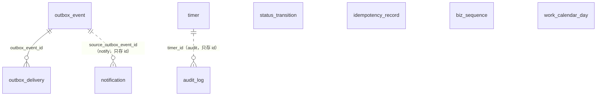

# 01 内核与流程基础（kernel、events、timers、flow、sla）

| 项 | 内容 |
| --- | --- |
| 模块 | `kernel`（幂等、业务单号）、`events`（出站事件与投递）、`timers`（定时器）、`flow`（状态历史）、`sla`（工作日历）；全部在 L0 |
| 表 | 7 张：`idempotency_record`、`biz_sequence`、`outbox_event`、`outbox_delivery`、`timer`、`status_transition`、`work_calendar_day` |
| 依据 | 草案 `docs/appendix/design/d3-flow.md` 第 3.3、7.5、19–22、25 节（下文写作 d3:行号）；`d7-platform.md` 第 3.1、7.3、7.6、9 节（d7:行号）；`d6-notify-docs-data.md` 第 5.1.2 节（d6:行号）；裁决 M14、M19、M21、M22、M31、M33、M34、M44、M45，第二轮 M46–M49、M52、M53、M60、M65、M71、M92，第三轮 M97、M101–M103、M110；`catalogue.json` 的 conventions 与本分组 7 张表的 notes；主文档 `01-architecture.md` 第 6.3、7 节（01:行号）、`03-key-designs.md` 第 3.1、9 节（03:行号）；画板 `admin/SysParams` |

## 1. 概览

这组表是所有业务模块共用的“一致性底座”，不属于任何一个业务对象：

- **幂等**：写接口的幂等行与业务写在同一个事务里（`idempotency_record`）。
- **业务单号**：按前缀与业务日取流水（`biz_sequence`）。
- **出站事件**：业务事务内写事件（`outbox_event`），worker 为每个订阅者展开一行投递（`outbox_delivery`），重投与死信都由库驱动。
- **定时器**：会改状态的时限与周期任务，一行一个到期时间（`timer`）。
- **状态历史**：`flow.transition()` 每次迁移写一行（`status_transition`），只供指标与进度时间轴。
- **工作日历**：一天一行（`work_calendar_day`），时限按它计算。

这些表在 L0，不引用上层的表：归属列、主体、聚合、操作人都只存 id，不建外键。本分组唯一的外键是 `outbox_delivery.outbox_event_id`。

`status_transition.subject_id`、`timer.subject_id`、`outbox_event.aggregate_id` 是多态引用，指向的表见第 3 节，图里不逐一画出。

## 2. 表定义

通用说明：

- `id` 为 UUID v7，由应用生成，不设数据库默认值。`seq` 是自增序号（`bigint`），只用于排序与扫描，不出接口。
- **时间列的默认值**。这 7 张表都是基础设施表，`created_at`、`updated_at` 带数据库默认值 `now()`（约定“时间”第 3 条允许）；worker 的中继、派发、扫描循环用数据库时间写租约与重试时间。业务时间（`occurred_at`、`fire_at`、`biz_date`）由注入的应用时钟写入，不设默认值。`updated_at` 不由触发器维护，每次 UPDATE 由写入方显式赋值。
- 出处里的“约定”指 `catalogue.json` 的 conventions；“补”表示草案没有、按约定或依赖方的要求补的列。
- 类型段、状态机名这类多态取值一律是最终表名（M19）。三个跨模块多态类型列（`outbox_event.aggregate_type`、`timer.subject_type`、`status_transition.machine`）只做格式校验（小写蛇形，`^[a-z][a-z0-9_]*$`），不逐值 CHECK（M52）：取值清单登记在 `packages/contract` 的登记表，应用启动时对照库里的表名单校验；第 3 节列出已知取值。新增取值只改登记表，不改库。
- 事件类型（`event_type`）、定时器类型（`kind`）、订阅者（`subscriber`）、幂等范围（`scope`）是代码里登记的常量，数量多且随功能增长，数据库只校验格式，不逐值 CHECK；取值的唯一来源是 `packages/contract`。
- 本分组 7 张表都在 L0，不对任何表建外键（唯一的例外是组内的 `outbox_delivery → outbox_event`），所以 M47 的归属复合外键不适用。带归属列的三张表（`outbox_event`、`timer`、`status_transition`）各有一条 `ck_<表>_tenant`：有门店必有主体，与 `audit_log` 相同。
- 下文说的“告警”都经 kernel 定义的告警端口 `alerts.raise({ rule, dimension?, severity, detail })`，“违规”都经检查项登记或 `invariants.report` 写入；两个端口由 ops 注册实现，在 ops 自己的独立短事务里写 `alert_event`、`invariant_violation`，失败不抛给调用方（M30；签名见 15 分组 5.2）。指纹由 ops 按 `rule`、`dimension` 拼，调用方不自拼。

### 2.1 `idempotency_record` 幂等记录

全仓统一的写接口幂等表。幂等行与业务写同事务：并发的同键请求阻塞在主键上，等第一个提交后读到同一份结果；业务失败随事务回滚，不留记录。只有事务外必须调外部服务的三段式用例（微信预下单、退款执行）用 `in_progress` 占用。

归属：全局。主键：复合自然键 `(scope, actor_key, key)`。不是只增表，过期行每小时物理删除（保留 24 小时）。`lock_rank = null`。

| 列 | 类型 | 空 | 默认 | 说明 | 出处 |
| --- | --- | --- | --- | --- | --- |
| `scope` | text | 否 | — | 路由的 `operationId`，如 `m.order.submit` | d7:418 |
| `actor_key` | text | 否 | — | `<操作人类型>:<操作人 id>`，如 `merchant:<uuid>`、`staff:<uuid>`。类型段只取 `merchant`、`staff`、`system`、`partner`；下载页请求写商家用户，不写 `portal:<会话 id>` | d7:419；catalogue notes（R15） |
| `key` | text | 否 | — | `Idempotency-Key` 请求头。1–128 个字符，字符集 `[A-Za-z0-9:_-]`；端上按“一次意图”生成（`<动作名>:<uuid>`，动作名不含点） | d7:400、405、420 |
| `request_hash` | text | 否 | — | `sha256(方法 + 路径参数 + 规范化后的请求体)`，十六进制小写 64 位；商家端另计入 `X-Store-Id`（同一个键在不同门店上下文下视为不同请求）。同键而哈希不同返回 `IDEMPOTENCY_KEY_REUSED` | d7:421、437；补：编码定为十六进制；A121 |
| `state` | text | 否 | — | `done` 已完成（单事务用例提交时即为此值）、`in_progress` 三段式用例占用中 | d7:422 |
| `locked_until` | timestamptz | 可 | — | 仅三段式：本次处理的占用到期时间（占用时写 `now + 30 秒`）。到期后重复请求可抢占续做 | d7:423、456-461 |
| `result` | jsonb | 可 | — | 用例函数的返回值（角色裁剪之前的 DTO）；重放时由路由层按观察者角色重新裁剪。结构见第 4 节 | d7:424 |
| `created_at` | timestamptz | 否 | `now()` | 落库时间 | d7:425 |
| `updated_at` | timestamptz | 否 | `now()` | 最近一次更新时间（写入 `result`、三段式改状态或续占） | 补：约定“时间” |
| `expires_at` | timestamptz | 否 | — | `created_at + 24 小时` | d7:425 |

**键与索引**

- 主键 `pk_idempotency_record (scope, actor_key, key)`。
- 外键：无。
- `ix_idempotency_record_expires_at (expires_at)`：周期任务 `ops.retention` 每小时删除过期行（d7:425、1586）。

**手写约束**

| 约束名 | 规则 |
| --- | --- |
| `ck_idempotency_record_state` | `state IN ('done','in_progress')` |
| `ck_idempotency_record_actor_key` | `actor_key` 形如 `(merchant\|staff\|system\|partner):<非空>` |
| `ck_idempotency_record_key` | `key` 匹配 `^[A-Za-z0-9:_-]{1,128}$` |
| `ck_idempotency_record_request_hash` | `request_hash` 匹配 `^[0-9a-f]{64}$` |
| `ck_idempotency_record_lock` | `state = 'in_progress'` 时 `locked_until` 非空 |
| `ck_idempotency_record_expires` | `expires_at > created_at` |

**状态机**（技术状态，不写 `status_transition`）

| 当前状态 | 事件 | 新状态 | 守卫 | 触发者 |
| --- | --- | --- | --- | --- |
| —（无行） | 单事务用例执行 | `done` | `INSERT … ON CONFLICT DO NOTHING` 插入成功；与业务写同事务提交 | `kernel.tx.run()` |
| —（无行） | 三段式第 ① 步 | `in_progress` | 同上；写 `locked_until = now + 30 秒`，连同业务“意图”提交 | 三段式用例 |
| `in_progress` | 三段式第 ③ 步写回结果 | `done` | — | 同一用例 |
| `in_progress` | 重复请求到达且 `locked_until` 已过 | `in_progress`（新的 `locked_until`） | 条件更新抢到占用，从第 ② 步续做 | 重复请求 |
| `done`、`in_progress` | 过期 | 行被删除 | `expires_at < now` | `ops.retention`（每小时） |

重复请求读到已提交的行时：`request_hash` 不同 → `IDEMPOTENCY_KEY_REUSED`；`done` → 直接返回 `result`；`in_progress` 且未过期 → `IDEMPOTENCY_IN_PROGRESS`（d7:436-461）。

**不变量**：没有需要每日校验的。防漏用检查在运行时做（标了 `required` 的路由没有经 `tx.run(ctx, …)` 即告警，d7:451）。

**相对草案的改动**

| 改动 | 依据 |
| --- | --- |
| d3:3193-3196 的同名表并入，定义以 d7:414-425 为准：`actor_id` → `actor_key`，`response_status`、`response_body` → `result`，加 `state`、`locked_until` | decisions #13；d7:2353 |
| d2 原稿的 `idempotency_key` 表不建 | d7:412 |
| `actor_key` 的类型段去掉 `portal`，下载页请求写 `merchant:<商家用户 id>` | R15；catalogue notes |
| 补 `updated_at` | 约定“时间”：可变表有 `updated_at` |
| `request_hash` 的编码定为十六进制小写 | 草案只写 `sha256(…)`；定死后才能写 CHECK |

### 2.2 `biz_sequence` 业务单号流水

对人展示的业务单号按“前缀 + 业务日”取流水。取号与业务写同事务，回滚时流水一并回滚，不产生空号。

归属：全局。主键：复合自然键 `(prefix, biz_date)`。不是只增表。`lock_rank = null`：不参与锁排序。取号的行锁持有到事务提交，同前缀同日的取号因此串行；死锁与锁超时由事务封装统一有限次重试（d3:946-966）。

| 列 | 类型 | 空 | 默认 | 说明 | 出处 |
| --- | --- | --- | --- | --- | --- |
| `prefix` | text | 否 | — | 单号前缀，2–4 个大写字母。已登记的前缀见下表 | d3:241；约定“业务单号” |
| `biz_date` | date | 否 | — | 业务日，按 Asia/Shanghai 取日 | d3:241 |
| `next_val` | integer | 否 | — | 下一个待发的流水号，从 1 起。取号语句：`INSERT (prefix, biz_date, next_val) VALUES (…, 2) ON CONFLICT (prefix, biz_date) DO UPDATE SET next_val = biz_sequence.next_val + 1, updated_at = now() RETURNING next_val - 1`，返回值即本次取到的号 | d3:241；d2:414 |
| `created_at` | timestamptz | 否 | `now()` | 落库时间（当日该前缀第一次取号） | 补：约定“时间” |
| `updated_at` | timestamptz | 否 | `now()` | 最近一次取号时间。由取号语句的 `DO UPDATE` 写数据库时间（基础设施表，允许） | 补：约定“时间” |

已登记的前缀（约定“业务单号”第 2 条）：

| 前缀 | 对象 | 单号所在列 | 流水位数 |
| --- | --- | --- | --- |
| `LYX` | 订购单 | `drama_order` 的单号列 | 8 位日期 + 5 位流水（d3:241） |
| `FK` | 付款单 | `billing_order.order_no` | 8 位日期 + 5 位流水，超出自动扩位（d2:198） |
| `GG` | 广告 | `ad` 的单号列 | 8 位日期 + 3 位流水，当日超过 999 扩到 4 位（d3:241） |
| `KF` | 客服工单 | `service_ticket` 的单号列 | 同 `GG` |
| `TK`、`TZ`、`YQ`、`ZH` | 退款与取消、积分调整、补偿延长、账号变更 | `approval_request.request_no`（领域表经一对一外键取，不重复存；`TK` 由审批单取号） | `TK` 同 `GG`（d2:288）；其余见 02、03、07 分组 |
| `KP`、`CY` | 开票申请、差异单 | `invoice_request`、`payment_exception` 的单号列 | 8 位日期 + 3 位流水，超出自动扩位（08 分组） |
| `DC` | 导出任务 | `export_job` 的单号列 | 见 14 分组 |

不经本表取号的三种编号：交付工单号 `JF` 由订购单号的数字部分加“-序号”派生（d3:241）；授权书编号 `SQ`（`license_letter.letter_no`）由订购单号派生（13 分组）；日志编号 `RZ` 由数据库序列生成（约定“业务单号”第 2 条）。位数、扩位与预发环境加 `T` 前缀（d2:198）是 `kernel` 里的格式规则，不落表。

**键与索引**：主键 `pk_biz_sequence (prefix, biz_date)`。外键：无。无其他索引。

**手写约束**

| 约束名 | 规则 |
| --- | --- |
| `ck_biz_sequence_prefix` | `prefix` 匹配 `^[A-Z]{2,4}$` |
| `ck_biz_sequence_next_val` | `next_val >= 1` |

**不变量**：单号唯一由各业务表上的 UNIQUE 保证，本表不另设校验。灾备约定：数据库按时间点恢复后，先把恢复点所在日及之后各日的 `FK`、`TK`、`KP`、`CY` 行的 `next_val` 各加 10,000，再恢复服务（d2:1222）。

**相对草案的改动**

| 改动 | 依据 |
| --- | --- |
| 草案只有行内定义（d3:241），补成字段表；归 `kernel` | 01:165；decisions 第 2 节 |
| `next_val` 的语义定为“下一个待发的流水号”，并给出取号语句 | d3:241 只写了“`next_val + 1 RETURNING`”，没有写首值与返回哪个值 |
| 补 `created_at`、`updated_at` | 约定“时间” |

### 2.3 `outbox_event` 出站事件

业务事务内写入的领域事件。`published_at` 的含义是“已为每个订阅者生成投递行”，不是“已入队”。负载只带 id 与必要快照，订阅者回库读当前状态。

归属：门店维度，但 `entity_id`、`store_id` 可空且不建外键（L0；平台级事件为空）。主键：`id uuid` + `seq`。不是只增表，但只允许受限更新：`published_at` 从空写一次，其余列不可改、行不可删（触发器）。V1.0 不清理事件行（M65）。`lock_rank = null`（中继用 `FOR UPDATE SKIP LOCKED`，业务事务只插入）。

| 列 | 类型 | 空 | 默认 | 说明 | 出处 |
| --- | --- | --- | --- | --- | --- |
| `id` | uuid | 否 | — | 主键。`notification.source_outbox_event_id` 等下游引用它 | d3:2609；R1 |
| `seq` | bigint | 否 | 自增 | 中继按它升序扫描未展开的事件 | 约定“主键”第 2 条；catalogue notes |
| `event_type` | text | 否 | — | 事件类型，小写点分，如 `order.started`、`store.qualification.approved`。取值登记在 `packages/contract` 的事件目录 | d3:2610、2706-2735 |
| `aggregate_type` | text | 可 | — | 聚合类型，取最终表名；只做格式校验，已知取值见 3.4。没有聚合行的系统级事件（如日历导入 `calendar.imported`）为空 | d3:2611；M19；M52；M65（可空） |
| `aggregate_id` | uuid | 可 | — | 聚合行的主键值，按 `aggregate_type` 多态，不建外键。目标表主键不叫 `id` 时取它的主键列（`billing_account` 取 `entity_id`，`production_record` 取 `file_id`）。与 `aggregate_type` 同有同无 | d3:2612；catalogue notes；M65 |
| `entity_id` | uuid | 可 | — | 所属主体。只存 id | d3:2613；约定“归属列”第 3 条 |
| `store_id` | uuid | 可 | — | 所属门店。只存 id | d3:2614 |
| `payload` | jsonb | 否 | — | 事件负载 `{ v: 1, … }`，`v` 是数字版本号，结构见第 4 节 | d3:2615 |
| `actor_type` | text | 否 | — | 操作人类型：`merchant` 商家用户、`staff` 员工、`system` 系统（定时器、回调、订阅者触发）、`partner` 服务商（V1.0 只声明不写入） | d3:2616；R15；M44 |
| `actor_id` | uuid | 可 | — | 操作人 id：商家用户或员工的 id；`system` 时为空。只存 id | d3:2616；约定“操作人列” |
| `client` | text | 可 | — | 客户端来源：`weapp` 小程序、`portal` 下载页、`admin` 后台；系统动作为空。`cli` 只在 `audit_log` 上允许，运维命令行以员工身份执行的动作本列为空 | R15；M44；M102 |
| `actor_role` | text | 可 | — | 商家角色快照：`owner` 老板、`clerk` 店员；操作人不是商家时为空。埋点派生取它 | d6:1881；约定“操作人列”第 4 条 |
| `client_platform` | text | 可 | — | 客户端平台，取自请求头 `X-Client-Platform`（`ios`、`android`、`harmony`、`windows`、`mac`、`devtools`）；后台、下载页与系统动作为空。不做 CHECK：取值随微信客户端增加，写不进事件会连带业务事务失败 | d6:1873、1882；d7:398 |
| `client_version` | text | 可 | — | 客户端版本，取自 `X-Client-Version` | d6:1873、1882；d7:398 |
| `request_id` | text | 可 | — | 请求追踪号（`X-Request-Id`，UUID 格式）；worker 处理该事件产生的任务日志带同一个值 | d7:399、1895；d6:1883 |
| `occurred_at` | timestamptz | 否 | — | 事件发生时间，取业务事务的应用时钟 | d3:2617；约定“时间” |
| `dedupe_key` | text | 可 | — | 去重键，全表唯一。同一事实只应发一次时使用。`events.emit()` 遇键冲突（`ON CONFLICT (dedupe_key) DO NOTHING` 未插入）即该事实已发过，跳过、不报错，业务事务照常提交。`tmr:{定时器去重键}` 只用于一次执行只发一个事件的定时器处理函数；一次可能发多个事件的（如 `order.start`、`po.expire`、`rf.poll`）不套 `tmr:`，否则第二条起撞键被当成已发而丢掉，恰好一次由业务状态守卫保证；事件自己定了键的照用自己的键；周期任务与订阅者发的事件不套 `tmr:`（x01 2.3） | d3:2618、2843；x01 2.3 |
| `published_at` | timestamptz | 可 | — | 中继为每个订阅者生成投递行的时间。只能从空写一次 | d3:2619 |
| `created_at` | timestamptz | 否 | `now()` | 落库时间 | 补：约定“时间” |

不设 `updated_at`：唯一可写的列是 `published_at`，它自己就是变更时间。

**键与索引**

- 主键 `pk_outbox_event (id)`。外键：无。
- 唯一：`uq_outbox_event_seq (seq)`；`uq_outbox_event_dedupe_key (dedupe_key)`（空值不参与唯一）。
- `ix_outbox_event_aggregate_type_aggregate_id (aggregate_type, aggregate_id)`：后台“流程运维”按对象查事件、排障（d3:3282）。补。
- `ix_outbox_event_unpublished (seq) WHERE published_at IS NULL`（手写）：中继扫描 `ORDER BY seq LIMIT 200 FOR UPDATE SKIP LOCKED`；“最老未展开事件的年龄”探针。

**手写约束**

| 约束名 | 规则 |
| --- | --- |
| `ck_outbox_event_event_type` | `event_type` 为小写点分，至少两段 |
| `ck_outbox_event_aggregate_type` | 格式校验：`aggregate_type` 匹配 `^[a-z][a-z0-9_]*$`（为空时放行）；取值清单在 `packages/contract`（M52） |
| `ck_outbox_event_aggregate_pair` | `aggregate_type` 与 `aggregate_id` 同有同无 |
| `ck_outbox_event_tenant` | `store_id` 非空时 `entity_id` 非空 |
| `ck_outbox_event_actor_type` | `actor_type IN ('merchant','staff','system','partner')` |
| `ck_outbox_event_client` | `client IN ('weapp','portal','admin')` |
| `ck_outbox_event_actor_role` | `actor_role IN ('owner','clerk')` |
| `ck_outbox_event_actor` | `actor_type = 'system'` 当且仅当 `actor_id` 为空；`system` 时 `client` 为空；`actor_role` 非空时 `actor_type = 'merchant'` |
| `ck_outbox_event_payload` | `payload` 是对象，含键 `v`，且 `v` 是数字 |
| `ix_outbox_event_unpublished` | 部分索引，见上 |
| `trg_outbox_event_write_once` | `BEFORE UPDATE OR DELETE`，`lyx_write_once('published_at')`：只允许把 `published_at` 从空写一次，其余列不可改，不可删 |
| `trg_outbox_event_no_truncate` | `BEFORE TRUNCATE`，`lyx_forbid_mutation()` |

数据库角色：应用角色 `lyx_app` 对本表只授 `INSERT`、`SELECT` 与 `UPDATE (published_at)`。

**状态**：没有状态列。`published_at IS NULL` 表示待展开；每个订阅者处理到哪一步看 `outbox_delivery`。

**不变量**（d3:3252 的 I8）：没有超过 5 分钟未展开的事件（`published_at IS NULL` 的最早 `occurred_at`）。每日校验项登记为 `events.I8`：module `events`，severity P2（非资金类），`modes: ['full']`、不设 `every`，`heal: none`（只告警，d3:3252）；每个超时事件一条违规，`subject_type = outbox_event`、`subject_id` 为事件 id，事件带 `entity_id` 时违规带 `entityId`（15 分组 2.4、5.2）；违规经 ops 的检查项框架或 kernel 端口 `invariants.report` 写入（M30）。实时探针另算，阈值：超过 1 分钟 P2，超过 5 分钟 P1（d3:3227）。

**相对草案的改动**

| 改动 | 依据 |
| --- | --- |
| `id bigint identity` → `id uuid` + `seq bigint`；中继的 `ORDER BY id`（d3:2648-2649）改为 `ORDER BY seq`；部分索引由 `(id)` 改为 `(seq)` | R1；decisions #2；catalogue notes |
| `aggregate_id` bigint → uuid | R1 |
| `aggregate_type`、`aggregate_id` 改为可空 | M65；没有聚合行的系统级事件（`calendar.imported`，d3:3054）无 id 可填；约定“主键”第 5 条不用 0 作哨兵 |
| `aggregate_type` 的取值定为最终表名，只做格式校验；已知取值 53 个，见 3.4 | M19；M52；decisions 第 8 节末段 |
| `payload.v` 要求是数字 | 订阅者按版本号分支；第 4 节 |
| V1.0 不清理事件行：触发器拦截删除 | M65（d3:2737 把事件行保留期留给数据设计） |
| `actor jsonb` 拆成 `actor_type`、`actor_id`、`client` 三列，并按通知与埋点的要求补 `actor_role`、`client_platform`、`client_version`、`request_id` 四列；`actor_type` 改为非空（系统动作写 `system`） | R15；M44；M65；d6:1873-1884；d7:1895（原文叫 `trace_id`，与状态历史、审计日志统一为 `request_id`） |
| 补“有门店必有主体”的 CHECK | 与 `audit_log` 一致（复核意见） |
| `occurred_at` 去掉默认值 `now()` | 约定“时间”：业务时间由应用时钟写入 |
| 补 `created_at`；补聚合索引 | 约定“时间”；d3:3282 |
| 补防改触发器 | 约定“主键”第 2 条：允许受限的更新；M14 的同类做法 |
| d7:2007 提到的 `publish_attempts`、`last_error` 两列不建 | d3 修订稿把失败次数与错误放在 `outbox_delivery`（d3:2626、2631） |

### 2.4 `outbox_delivery` 出站投递

事件 × 订阅者一行，是投递的真相：谁该处理、处理到哪、失败几次、是否进了死信。BullMQ 只负责把投递行送到处理器，重试由库驱动。

归属：全局（不带归属列，经 `outbox_event` 取）。主键：复合主键 `(outbox_event_id, subscriber)`。不是只增表。V1.0 不清理（同事件行，M65；不采用 d3:2737 的“已完成投递行保留 30 天后清理”）。`lock_rank = null`：业务事务从不锁它，只在消费事务开头加锁，派发用 `SKIP LOCKED`（d3:940、2694）。

| 列 | 类型 | 空 | 默认 | 说明 | 出处 |
| --- | --- | --- | --- | --- | --- |
| `outbox_event_id` | uuid | 否 | — | 所属出站事件 | d3:2623；M33 |
| `subscriber` | text | 否 | — | 订阅者注册名（名字登记在 `packages/contract` 的订阅者登记，处理器由各模块的 `register.ts` 登记），如 `support.onBizEvent`。字母开头，只含字母、数字、下划线、点；不含冒号与连字符（会进任务 `jobId`） | d3:2542、2624、2675、2698 |
| `status` | text | 否 | `pending` | `pending` 待派发、`leased` 已派发处理中、`done` 已消费、`retry` 失败待重试、`dead` 死信 | d3:2625 |
| `attempts` | smallint | 否 | 0 | 处理失败次数（含处理器失联）；入队失败不计。达到 10 进入 `dead` | d3:2626、2690-2691 |
| `dispatch_no` | integer | 否 | 0 | 派发序号。每次派发 + 1，是任务 `jobId`（`evt-{事件 id}-{订阅者}-{序号}`）的一段，也是消费时判断“是否已被新一次派发接管”的依据 | d3:2627、2664、2684；M34 |
| `next_attempt_at` | timestamptz | 否 | `now()` | 下次可派发时间；失败退避时后移（5 秒、15 秒、1 分、5 分、15 分、30 分，之后每小时） | d3:2628、2690 |
| `lease_until` | timestamptz | 可 | — | 租约到期时间（派发时写 `now + 2 分钟`）；过期后被重新派发 | d3:2629、2661 |
| `is_enqueued` | boolean | 否 | `false` | 本次派发是否已成功交给执行通道。租约过期且为真时记一次失败（处理器失联） | d3:2630、2660 |
| `last_error` | text | 可 | — | 最近一次失败的错误摘要 | d3:2631 |
| `consumed_at` | timestamptz | 可 | — | 消费成功时间 | d3:2632 |
| `created_at` | timestamptz | 否 | `now()` | 落库时间（中继展开的时间） | 补：约定“时间” |
| `updated_at` | timestamptz | 否 | `now()` | 最近一次更新时间 | 补：约定“时间” |

**键与索引**

- 主键 `pk_outbox_delivery (outbox_event_id, subscriber)`。
- 外键 `fk_outbox_delivery_outbox_event_id`：`outbox_event_id` → `outbox_event.id`，删除行为 Restrict。
- `ix_outbox_delivery_due (next_attempt_at) WHERE status IN ('pending','retry')`（手写）：派发扫描；“最老待处理投递”探针。
- `ix_outbox_delivery_lease (lease_until) WHERE status = 'leased'`（手写）：派发扫描找租约过期的行。
- `ix_outbox_delivery_dead (subscriber, outbox_event_id) WHERE status = 'dead'`（手写）：后台“流程运维”的死信列表；死信数探针。

**手写约束**

| 约束名 | 规则 |
| --- | --- |
| `ck_outbox_delivery_status` | `status IN ('pending','leased','done','retry','dead')` |
| `ck_outbox_delivery_subscriber` | `subscriber` 匹配 `^[A-Za-z][A-Za-z0-9_.]{0,63}$` |
| `ck_outbox_delivery_counters` | `attempts >= 0 AND dispatch_no >= 0` |
| `ck_outbox_delivery_lease` | `status = 'leased'` 时 `lease_until` 非空 |
| `ck_outbox_delivery_consumed` | `status = 'done'` 当且仅当 `consumed_at` 非空 |
| `ix_outbox_delivery_due`、`ix_outbox_delivery_lease`、`ix_outbox_delivery_dead` | 部分索引，见上 |

**状态机**（技术状态，不写 `status_transition`；用带原状态条件的 UPDATE）

| 当前状态 | 事件 | 新状态 | 守卫 | 触发者 |
| --- | --- | --- | --- | --- |
| —（无行） | 中继展开 | `pending` | `INSERT … ON CONFLICT DO NOTHING` | 中继循环（每秒） |
| `pending`、`retry` | 派发 | `leased` | `next_attempt_at <= now`；`dispatch_no + 1`，`is_enqueued = false`，`lease_until = now + 2 分钟` | 派发循环（每秒） |
| `leased` | 租约过期后重新派发 | `leased` | `lease_until < now`；原 `is_enqueued = true` 的 `attempts + 1` | 派发循环 |
| `leased` | 入队失败且不走进程内执行 | `pending` | `dispatch_no` 相符；不计失败次数，`lease_until` 置空 | 派发循环 |
| `leased` | 消费成功 | `done` | 行锁下 `dispatch_no` 相符；与订阅者的业务写同事务；写 `consumed_at` | `consume()` |
| `leased` | 消费抛错 | `retry` | `attempts + 1 < 10`；写 `last_error`、退避后的 `next_attempt_at` | `consume()` 的失败短事务 |
| `leased` | 消费抛错且次数耗尽 | `dead` | `attempts + 1 >= 10`；告警（规则 `outbox.exhausted`，维度 `{event_type}:{subscriber}`，P1；d7:1422、M103） | 同上 |
| `leased` | 订阅者不认识该事件类型 | `retry` | 不计失败次数，延后 5 分钟；持续 24 小时后按失败处理（d7:1446） | `consume()` |
| `dead` | 人工重投 | `retry` | 权限点 `flow.ops.manage`；`attempts` 清零；写审计 | 后台“流程运维” |

**不变量**（I8）：没有超过 15 分钟仍待处理且不在退避中的投递行。每日校验项与 2.3 同属 `events.I8`（module `events`，P2，`heal: none`）：每个超时投递行一条违规，`subject_type = outbox_delivery`，主键是复合键，写 `subject_key = {outbox_event_id}:{subscriber}`，所属事件带 `entity_id` 时违规带 `entityId`。探针阈值：最老待处理投递超过 5 分钟 P2、超过 15 分钟 P1（d3:3228）；死信数 ≥ 1 为 P1（M103：死信不再自动重试、要人处理，取 d7:2016；d3:3229 原写 P2）。探针阈值是部署配置，不落表。

**相对草案的改动**

| 改动 | 依据 |
| --- | --- |
| `event_id` → `outbox_event_id`（catalogue 的 pk 写的是缩写） | M33 |
| `dispatch_seq` → `dispatch_no` | M34：`seq` 只用于 identity 列 |
| `enqueued` → `is_enqueued` | 约定“命名规则”：布尔列前缀 |
| 补 `created_at`、`updated_at` | 约定“时间” |
| 死信索引由 `(status)` 改为 `(subscriber, outbox_event_id)` | 草案的索引列是常量，列表与计数用不上；按运维页的展示列建 |
| d7:1431-1440 的 `event_redelivery` 不建，d6:85、d7:1412 引用的 `event_consumption` 改读本表 | decisions #15；d3:176 |
| d7:2016 探针里的 `event_redelivery.state`（`retrying`、`exhausted`、`gave_up`）改读本表的 `status`（`retry`、`dead`）；人工处理说明不设列，写审计日志 | 同上；d3:2704 |
| d7 的周期任务 `events.redeliver` 不保留：重投由本表的租约与退避驱动 | M65 |
| d3:2737 的“已完成的投递行保留 30 天后清理”不做：V1.0 投递行与事件行一样不清理，外键保持 Restrict。量级：每个事件 1–4 行，百万行以内。以后要清理时，加 `(consumed_at) WHERE status = 'done'` 的部分索引，由 `ops.retention` 删除 | M65（事件行不清理，投递行是它的子行）；复核意见 |
| 订阅者名的 CHECK 允许大写字母 | d3:2542 的订阅者 `support.onBizEvent` 是驼峰；`jobId` 只怕冒号与连字符（d3:2675） |

### 2.5 `timer` 定时器

会改状态的时限，一行一个到期时间；周期任务的每一期也是一行。扫描认领后经 BullMQ 执行，Redis 不可用时关键类在 worker 进程内直接执行。纯提醒不登记（由 notify 按规则派生）；账务时钟不登记（由 billing 的到期列与推进函数驱动）。

归属：门店维度，但 `entity_id`、`store_id` 可空且不建外键（L0；周期任务行为空）。主键：`id uuid`。不是只增表。`lock_rank = null`：只有已持有该定时器主体业务行锁的事务才改它，扫描循环用 `SKIP LOCKED`（d3:939、2855-2857）。

| 列 | 类型 | 空 | 默认 | 说明 | 出处 |
| --- | --- | --- | --- | --- | --- |
| `id` | uuid | 否 | — | 主键。周期任务写审计时 `audit_log.timer_id` 指向它（M21） | d3:2762；R1 |
| `kind` | text | 否 | — | 规则编码，小写点分，对应代码里注册的处理器，如 `order.start`、`sla.breach`。已知取值见 3.3 | d3:2763 |
| `subject_type` | text | 可 | — | 主体类型，取最终表名；只做格式校验，已知取值见 3.3。周期任务行为空 | d3:2764；M19；M22；M45；M52 |
| `subject_id` | uuid | 可 | — | 主体行的主键值，按 `subject_type` 多态，不建外键。周期任务行为空 | d3:2765；M45 |
| `entity_id` | uuid | 可 | — | 所属主体。只存 id | d3:2766 |
| `store_id` | uuid | 可 | — | 所属门店。只存 id | d3:2766 |
| `fire_at` | timestamptz | 否 | — | 到期时间（业务真相） | d3:2767 |
| `retry_at` | timestamptz | 可 | — | 处理失败后的下次重试时间；不改 `fire_at` | d3:2768 |
| `dedupe_key` | text | 否 | — | 语义去重键，含目标日期、轮次、版本或用途，如 `usage.end:order_item:<id>:2027-06-30`、`service.first_response_due:service_ticket:<id>:r2`、`takedown.overdue:takedown_task:<id>:2027-06-30`；周期任务为 `{kind}:{本期的栅格时刻}`。键由登记方定，已知的键见 3.3。未取消的行里唯一（`fired`、`skipped`、`failed` 都占键），所以：① 同一目标在 `fired`、`skipped` 之后还要重新登记的，键里须带轮次；② 同一主体有两种同 kind 的定时器时，键里须带用途段（如审批单的决定时限与执行时限，`…:decision`、`…:execution`）；③ 目标日期变了换新键，旧键由调用方按 `keyPrefix` 取消。唯一的例外是声明了“跳过后可复活”的 kind（见下文状态机），V1.0 只有 `order.start`，键为 `order.start:drama_order:{订购单 id}`，不带轮次 | d3:583、2769、2789、2802、2894；03、11、12 分组 |
| `payload` | jsonb | 可 | — | 创建时的参数快照，结构按 `kind` 定义，见第 4 节 | d3:2770、3052 |
| `status` | text | 否 | `scheduled` | `scheduled` 待触发、`dispatched` 已认领执行中、`fired` 已执行、`skipped` 条件已不成立或已过期而跳过、`cancelled` 已取消、`failed` 重试耗尽 | d3:2771 |
| `dispatch_no` | integer | 否 | 0 | 认领序号。每次认领 + 1，是任务 `jobId`（`tmr-{id}-{序号}`）的一段，也是执行时判断“是否已被新一次认领接管”的依据 | d3:2772、2831、2839；M34 |
| `attempts` | smallint | 否 | 0 | 处理失败次数（处理器抛错或失联）；入队失败不计 | d3:2773 |
| `is_enqueued` | boolean | 否 | `false` | 本次认领是否已成功交给执行通道 | d3:2774 |
| `lease_until` | timestamptz | 可 | — | 租约到期时间（认领时写 `now + 5 分钟`；长任务模式按登记的租期续租） | d3:2775；d7:1608-1611 |
| `fired_at` | timestamptz | 可 | — | 处理完成时间（`fired` 或 `skipped`） | d3:2776、2844 |
| `last_error` | text | 可 | — | 最近一次失败的错误摘要 | d3:2777 |
| `result` | jsonb | 可 | — | 运行摘要（周期任务的处理条数、备份对象键与大小等），取代已删除的 `job_run`。结构见第 4 节 | d7:1613、1619、1667；decisions #23 |
| `created_at` | timestamptz | 否 | `now()` | 落库时间 | d3:2778 |
| `updated_at` | timestamptz | 否 | `now()` | 最近一次更新时间 | 补：约定“时间” |

**键与索引**

- 主键 `pk_timer (id)`。外键：无。
- `uq_timer_dedupe_key_live (dedupe_key) WHERE status <> 'cancelled'`（手写，部分唯一）：同一语义目标只有一行；已取消的不占键。周期任务每期只有一行也靠它。
- `ix_timer_due ((COALESCE(retry_at, fire_at))) WHERE status = 'scheduled'`（手写）：扫描认领；“定时器滞后”探针。
- `ix_timer_lease (lease_until) WHERE status = 'dispatched'`（手写）：扫描找租约过期的行。
- `ix_timer_subject (subject_type, subject_id) WHERE status IN ('scheduled','dispatched')`（手写）：`timers.cancel(tx, { subject, kinds?, keyPrefix? })`（d3:2789）先按主体走本索引，再按 `kind`、`dedupe_key` 前缀过滤，所以“按前缀取消”不需要另建前缀索引；不变量 I7 按主体找未完成的定时器。
- `ix_timer_failed (fire_at) WHERE status = 'failed'`（手写）：后台“失败的定时器”列表；失败数探针。
- `ix_timer_kind_fire_at (kind, fire_at)`：后台按类型查；周期任务漏跑探针与 90 天清理按类型扫描（d7:1971、2022）。补。

**手写约束**

| 约束名 | 规则 |
| --- | --- |
| `ck_timer_kind` | `kind` 为小写点分，至少两段 |
| `ck_timer_status` | `status IN ('scheduled','dispatched','fired','skipped','cancelled','failed')` |
| `ck_timer_subject_type` | 格式校验：`subject_type` 匹配 `^[a-z][a-z0-9_]*$`（为空时放行）；取值清单在 `packages/contract`（M52） |
| `ck_timer_subject_pair` | `subject_type` 与 `subject_id` 同有同无（周期任务行两列都为空） |
| `ck_timer_tenant` | `store_id` 非空时 `entity_id` 非空 |
| `ck_timer_counters` | `attempts >= 0 AND dispatch_no >= 0` |
| `ck_timer_lease` | `status = 'dispatched'` 时 `lease_until` 非空 |
| `ck_timer_fired` | `status IN ('fired','skipped')` 当且仅当 `fired_at` 非空 |
| `ck_timer_payload`、`ck_timer_result` | 非空时是 JSON 对象 |
| `uq_timer_dedupe_key_live`、`ix_timer_due`、`ix_timer_lease`、`ix_timer_subject`、`ix_timer_failed` | 部分索引与表达式索引，见上 |

**状态机**（技术状态，不写 `status_transition`）

| 当前状态 | 事件 | 新状态 | 守卫 | 触发者 |
| --- | --- | --- | --- | --- |
| —（无行，或同键只有 `cancelled`） | `timers.arm` | `scheduled` | 调用方已持有主体业务行锁 | 业务事务；周期任务由 `ensureRecurring` 与认领时登记下一期 |
| `scheduled` | `timers.arm`（同键） | `scheduled` | 更新 `fire_at` 与 `payload`。这就是“改期”，不另设接口（如未分享的邀请卡片复用时改 `fire_at`，02 分组） | 业务事务 |
| `dispatched` | `timers.arm`（同键） | 不变 | 正在执行，不动 | — |
| `fired` | `timers.arm`（同键） | 不变 | 同一语义目标已处理过，不重复创建 | — |
| `skipped` | `timers.arm`（同键），kind 未声明跳过后可复活 | 不变 | 同上；需要再登记的目标换新键（键里带轮次） | — |
| `skipped` | `timers.arm`（同键），kind 声明了跳过后可复活（`rearmAfterSkip`，V1.0 只有 `order.start`） | `scheduled` | 同 `failed` 的复活：`attempts = 0`、`retry_at = null`、`fired_at = null`、写入新的 `fire_at` 与 `payload` | 业务事务（如取消申请被驳回后重新登记开工）；补偿扫描 |
| `failed` | `timers.arm`（同键）或后台“重新排期” | `scheduled` | `attempts = 0`、`retry_at = null`；后台操作写审计 | 业务事务；后台“流程运维” |
| `scheduled` | 扫描认领 | `dispatched` | `COALESCE(retry_at, fire_at) <= now`；`dispatch_no + 1`，`is_enqueued = false`，写租约 | 扫描循环（每 20 秒） |
| `dispatched` | 租约过期后重新认领 | `dispatched` | `lease_until < now`；原 `is_enqueued = true` 的 `attempts + 1` | 扫描循环 |
| `dispatched` | 入队失败且不走进程内执行 | `scheduled` | `dispatch_no` 相符；不计失败次数，`lease_until` 置空 | 扫描循环 |
| `dispatched` | 处理器返回 | `fired` 或 `skipped` | `dispatch_no` 相符；与处理器的业务写同事务；写 `fired_at` | `runTimer()` |
| `dispatched` | 处理器抛错 | `scheduled` | `attempts + 1 < 6`：写 `retry_at`（退避 1、2、5、15、30 分钟）。关键类次数耗尽也回到 `scheduled`，每 30 分钟重试并升级告警 | `runTimer()` 的失败短事务 |
| `dispatched` | 处理器抛错且次数耗尽 | `failed` | 非关键类 `attempts + 1 >= 6`；告警 | 同上 |
| `scheduled`、`dispatched` | `timers.cancel` | `cancelled` | 调用方已持有主体业务行锁；跳过正在执行的这一条 | 业务事务 |
| `failed` | 标记为不再需要 | `cancelled` | 权限点 `flow.ops.manage`；原因必填，写审计 | 后台“流程运维” |

长任务模式（周期任务里要下载账单、跑备份的那些，d7:1604-1617）：认领确认后在事务外执行，按租期的三分之一续租；抛错时行保持 `dispatched`、把 `lease_until` 设为退避后的时间，由扫描循环重新认领；超过登记的最大次数置 `failed`。

`order.start` 为什么要“跳过后可复活”：它的键不含轮次（d3:583），到点时若有在途取消或资质不再通过，处理器返回 `skipped`；之后取消申请被驳回、或资质重新通过，业务要“重新登记开工”（d3:2969 N1；09 分组的取消申请关闭流程）。按草案“`skipped` 不重复创建”，这次登记会成为空操作，订购单停在待开工。所以 `order.start` 注册时声明 `rearmAfterSkip`。待开工补偿扫描 `order.pending_start_sweep`（d3:585）的条件相应改为：没有 `scheduled`、`dispatched` 的 `order.start` 定时器（无行、`skipped`、`failed` 都算），就经 `timers.arm` 补登记（`skipped`、`failed` 行复活）。开工处理器以“订购单待开工、无在途取消、资质已通过”为守卫，复活后重复执行没有副作用。

**不变量**

- I7（d3:3251，由各登记模块提供检查项）：每个未完成且有 `due_at` 的环节、广告、审批单、客服工单（以及 M22 的素材复核、对公收款确认、开票申请），要么 `due_at` 已过，要么存在对应的 `scheduled` 定时器；每个 `scheduled` 定时器的主体仍处于需要它的状态。登记为 `timers.I7`：module `timers`，severity P2，`modes: ['full']`，`heal: heal_only`（自愈：用登记方的同一个键补登记缺的定时器、取消多余的定时器；自愈成功即自动关闭，修不好的才留作未解决并告警；d3:3251；15 分组 2.4、2.5）。缺定时器的违规写该业务行（`subject_type` 为其表名，`subject_id` 为其 id），多余的定时器写 `subject_type = timer`、`subject_id` 为定时器 id；对象带主体的，违规带 `entityId`。各主体的检查项由登记该定时器的模块提供，已登记的：`delivery_ticket_stage`（10）、`service_ticket`（12）、`patrol_task` 的 `patrol.followup` 与 `takedown_task` 的 `takedown.overdue`（11）。审批单的两种 `sla.breach` 由 03 分组登记为 `approval.I3`，不在 `timers.I7` 下重复登记。
- 周期任务漏跑（d7:2022）：登记表里每一项最近一个已到的计划时刻，对应键的行在完成期限内变为 `fired`。这是 ops 的告警规则，不登记为不变量检查项。
- 探针（d3:3230-3231）：最早的到期未认领行滞后超过 2 分钟 P2、超过 10 分钟 P1；`failed` 行 ≥ 1 为 P2。
- 清理：已触发的周期任务行保留 90 天后物理删除（d7:1971）；业务定时器行不删。

**相对草案的改动**

| 改动 | 依据 |
| --- | --- |
| `id`、`subject_id` bigint → uuid | R1 |
| 周期任务行的 `subject_type`、`subject_id` 由 `system` / `0` 改为两列都为空 | M45；约定“主键”第 5 条 |
| `subject_type` 取值用最终表名：`order` → `drama_order`，`ticket_stage` → `delivery_ticket_stage`，`approval` → `approval_request` | M19；decisions 第 8.1 节 |
| 素材复核、对公收款确认、开票申请的 `sla.breach` 主体改为 `store_asset`、`transfer_proof`、`invoice_request` | M22（d3:2962-2963 原以审批单为主体） |
| 加 `result jsonb`；`job_run` 不建 | d7:1619、2352；decisions #23 |
| `dispatch_seq` → `dispatch_no`；`enqueued` → `is_enqueued` | M34；约定“命名规则” |
| 补 `updated_at`；补 `ix_timer_kind_fire_at` | 约定“时间”；d7:1971、2022 |
| 失败索引由 `(status)` 改为 `(fire_at)` | 草案的索引列是常量；列表按到期时间排 |
| 纯提醒不登记：d3:2919-2923 的 `sample.remind`、`ad.confirm_remind`、`launch.remind`、`launch.overdue`、`takedown.remind`，d3:2950 的 `drama.license_remind`，d3:2967 的 `followup.remind`，d4 的 `approval.remind` 都不建行 | R6；decisions #22 |
| 账务时钟不登记：d3:2933 的 `subscription.expire` 不建行 | 01:314 |
| `subject_type` 由逐值 CHECK 改为格式校验 | M52 |
| d3:2799 的“`fired`、`skipped` 不重复创建”加例外：声明 `rearmAfterSkip` 的 kind（`order.start`）遇到 `skipped` 行与 `failed` 一样复活；`order.start` 的键类型段改为 `drama_order`（d3:583 为 `order`）；补偿扫描条件①把 `skipped` 行视同没有定时器 | 复核意见：草案的固定键与“驳回后重新登记”（d3:2969）冲突；M19；M97 已确认 |
| `takedown.overdue`、`patrol.followup` 的主体定为 `takedown_task`、`patrol_task`；取消申请执行时限的 `sla.breach` 主体是 `approval_request` | M71；`patrol.followup` 按 11 分组的登记（d3:2949、2973 未写主体） |
| 周期任务 `events.redeliver` 不登记 | M65 |
| 补“有门店必有主体”的 CHECK | 与 `audit_log` 一致（复核意见） |

### 2.6 `status_transition` 状态变更历史

`flow.transition()` 每次迁移写一行，含不改状态的暂停、恢复、改派、改期、补发，客服工单的分配、转派、响应超时升级（`from_state = to_state`）。停留时长在写入那一刻按当时的工作日历算好并固化，日历事后修正不让历史指标漂移。

本表只供指标与进度时间轴。活动流（商家详情的操作日志、工作台实时动态、各单据详情的日志）统一读 `audit_log`（M31）。`flow.transition()` 在同一事务里按下面的规则写审计行，口径由 03 分组 2.10 的“迁移与审计行”定：

1. 每次迁移在 `audit_log` 里恰好一行。用例把审计内容作为 `transition()` 的参数传入时（带原因、前后值、通知结果，`stream` 由用例定），`transition()` 只写这一行，不另补；没有传入时，`transition()` 补写一条 `activity` 行。
2. 同一个用例里随审批单联动的领域行迁移（如审批通过时取消申请进入待执行），由用例声明并入审批单那一行，不另写。
3. 没有主体与门店的状态机（`machine = 'staff'`）不补写 `activity` 行；员工的新增、启用、禁用由用例传入 `ops` 审计。

本表只收 25 张业务状态机表（3.2）的迁移。不是状态机表的行（如 `delivery_ticket_stage`、`store_asset`、`transfer_proof`、`assignment_history`）即使有时限、会被重算，也不写本表，留痕只写 `audit_log`。

归属：门店维度，但 `entity_id`、`store_id` 可空且不建外键（L0；短剧、员工等全局对象为空）。主键：`id uuid` + `seq`。只增表：应用角色只有 `INSERT`、`SELECT`，另有触发器拦截 UPDATE、DELETE、TRUNCATE。`lock_rank = null`。

| 列 | 类型 | 空 | 默认 | 说明 | 出处 |
| --- | --- | --- | --- | --- | --- |
| `id` | uuid | 否 | — | 主键 | d3:2554；R1 |
| `seq` | bigint | 否 | 自增 | 同一对象的历史按它排序（同一事务里多次迁移的 `occurred_at` 相同） | 约定“主键”第 2 条 |
| `machine` | text | 否 | — | 状态机，取最终表名：`catalogue.json` 里 `state_machine = true` 的 25 张表，见 3.2。只做格式校验 | d3:2555-2556；M19；M52 |
| `subject_id` | uuid | 否 | — | 状态机对象的 id，按 `machine` 多态，不建外键 | d3:2557 |
| `state_field` | text | 否 | — | 被迁移的状态列名，如 `status`、`lifecycle`、`qualification_status`、`verification_status`；各 `machine` 的取值见 3.2。同一张表有两个状态列（`store`、`entity`）时靠它分成两条链 | M53；d9:462 |
| `entity_id` | uuid | 可 | — | 所属主体。只存 id；全局对象为空 | d3:2558；d8:642 |
| `store_id` | uuid | 可 | — | 所属门店。只存 id | d3:2559 |
| `from_state` | text | 可 | — | 迁移前状态；对象创建时为空。取值是该状态机的状态值，由各分组定义 | d3:2560 |
| `to_state` | text | 否 | — | 迁移后状态 | d3:2561 |
| `event` | text | 否 | — | 状态机事件名。人工纠偏固定为 `admin.force`，且只有人工纠偏用这个名字。分链靠 `state_field`，不靠事件名前缀 | d3:2562、1032；M53 |
| `actor_type` | text | 否 | — | 操作人类型：`merchant`、`staff`、`system`、`partner`（V1.0 只声明不写入） | d3:2563；R15；M44 |
| `actor_id` | uuid | 可 | — | 操作人 id；`system` 时为空。只存 id | d3:2563 |
| `client` | text | 可 | — | 客户端来源：`weapp`、`portal`、`admin`；系统动作为空。`cli` 只在 `audit_log` 上允许，运维命令行以员工身份执行的迁移本列为空 | R15；M44；M102 |
| `on_behalf_of_user_id` | uuid | 可 | — | 被代理的商家用户。V1.1“管理员经授权代为确认方案、样片、广告”时写授权人；V1.0 不写入（员工代录由 `actor_type = staff` 与事件名表达）。只存 id | d3:2563、3356 |
| `reason_code` | text | 可 | — | 原因编码（字典编码或状态机内的原因常量），不建外键 | d3:2564 |
| `note` | text | 可 | — | 说明。人工纠偏时必填，去掉首尾空白后不少于 10 个字 | d3:2565、1030 |
| `payload` | jsonb | 可 | — | 事件载荷摘要（版本号、轮次、数量、暂停原因等），结构见第 4 节 | d3:2566 |
| `is_forced` | boolean | 否 | `false` | 是否人工纠偏（`flow.adminTransition`） | d3:2567、1032 |
| `occurred_at` | timestamptz | 否 | — | 迁移发生时间，取业务事务的应用时钟 | d3:2568 |
| `biz_date` | date | 否 | — | 业务日 = `occurred_at` 按 Asia/Shanghai 取日；报表按它分组 | d3:2569 |
| `elapsed_seconds` | integer | 可 | — | 与同一链上一行之间的自然秒（切段口径同 `elapsed_work_min`）；所有状态机都写（不限于下一列的三类）；链的第一行为空 | d3:2570；A144 |
| `elapsed_work_min` | integer | 可 | — | 与同一链（`(machine, subject_id, state_field)` 按 `seq`）上一行之间的工作分钟数。中间夹着 `from_state = to_state` 的行也照常切段，所以它是这一段的时长，不是进入 `from_state` 以来的累计；按状态统计见下文“停留时长”。链的第一行（`from_state` 为空）为空。只有交付工单、审批单、客服工单才算；写入时按当时的日历算好 | d3:2571、2580；A144 |
| `request_id` | text | 可 | — | 请求或事件的追踪号 | d3:2572 |
| `created_at` | timestamptz | 否 | `now()` | 落库时间 | 补：约定“时间” |

**停留时长**（A144）

| 项 | 口径 |
| --- | --- |
| 单行的值 | `transition()` 写入时取同一链上一行（走 `ix_status_transition_machine_subject_id_state_field_seq`）的 `occurred_at` 起算，到本行 `occurred_at` 止。同一事务里连续迁移的行为 0 |
| from = to 的行 | 暂停、恢复、改派、日历重算、客服工单的 `assign`、`transfer`、`escalate` 等照常切段：它本身记上一段，下一行从它起算 |
| 按状态统计 | 把同一链上 `from_state` 为该状态的各行相加（含 from = to 的行），不能只取离开该状态的那一行。例：客服工单待受理期间有过 `assign`、`escalate`，待受理时长 = 这两行与 `reply` 行之和 |
| 暂停 | 暂停期间同样计入。要扣暂停的指标自己扣（交付环节用时扣 `delivery_ticket_stage.paused_minutes`，10 分组） |

**键与索引**

- 主键 `pk_status_transition (id)`。外键：无。
- 唯一：`uq_status_transition_seq (seq)`。
- `ix_status_transition_machine_subject_id_state_field_seq (machine, subject_id, state_field, seq)`：单个对象的进度时间轴（按前两列取全部链）；不变量 I12 逐条链核对相邻两行。
- `ix_status_transition_machine_state_field_to_state_occurred_at (machine, state_field, to_state, occurred_at)`：时效与漏斗指标按“进入某状态的时间段”取数；带 `state_field`，`store`、`entity` 两条链的同名状态（如 `rejected`）不混在一起。

**手写约束**

| 约束名 | 规则 |
| --- | --- |
| `ck_status_transition_machine` | 格式校验：`machine` 匹配 `^[a-z][a-z0-9_]*$`；取值清单在 `packages/contract`（M52） |
| `ck_status_transition_state_field` | 格式校验：`state_field` 匹配 `^[a-z][a-z0-9_]*$` |
| `ck_status_transition_tenant` | `store_id` 非空时 `entity_id` 非空 |
| `ck_status_transition_actor_type` | `actor_type IN ('merchant','staff','system','partner')` |
| `ck_status_transition_client` | `client IN ('weapp','portal','admin')` |
| `ck_status_transition_actor` | `actor_type = 'system'` 当且仅当 `actor_id` 为空；`system` 时 `client` 为空 |
| `ck_status_transition_biz_date` | `biz_date = (occurred_at AT TIME ZONE 'Asia/Shanghai')::date` |
| `ck_status_transition_elapsed` | `elapsed_seconds >= 0 AND elapsed_work_min >= 0` |
| `ck_status_transition_forced` | `event = 'admin.force'` 当且仅当 `is_forced` 为真；`is_forced` 为真时 `actor_type = 'staff'`、`note` 非空且 `char_length(btrim(note)) >= 10` |
| `ck_status_transition_payload` | 非空时是 JSON 对象 |
| `trg_status_transition_append_only` | `BEFORE UPDATE OR DELETE`，`lyx_forbid_mutation()` |
| `trg_status_transition_no_truncate` | `BEFORE TRUNCATE`，`lyx_forbid_mutation()` |

**状态机**：本表没有自己的状态。它记录 25 张业务状态机表的迁移；各状态机的迁移表在对应分组的文档里。不写本表的两类状态：账本内部状态（历史在 `subscription_event` 与 `point_ledger_entry`）、技术状态与处理进度（约定“状态”第 2 条）。

日历修正后的时限重算（d3:3054）：被重算的行属于状态机表（如 `approval_request`、`service_ticket`、`cancel_request`、`invoice_request`）时写一行 `from_state = to_state`，`state_field` 取该行的主状态列，事件名由 `sla` 登记（如 `sla.recalculated`）；不是状态机表的行只写 `audit_log`。

**不变量**（d3:3256 的 I12，每日校验）：同一条链相邻两行，前一行的 `to_state` = 后一行的 `from_state`；最后一行的 `to_state` = `machine` 表里该对象 `state_field` 列的当前值（人工纠偏的行同样满足）。链的口径是 `(machine, subject_id, state_field)` 按 `seq` 排序，不依赖事件命名。不成立说明有人绕过 `transition()` 改了状态。登记为 `flow.I12`：module `flow`，severity P2，`modes: ['full']`，`heal: none`（只告警，d3:3256），`subject_type` 写 `machine` 的值（即该对象的表名），`subject_id` 写对象 id，对象带主体的违规带 `entityId`。

**相对草案的改动**

| 改动 | 依据 |
| --- | --- |
| 表名定为 `status_transition`（d6:87 写作 `state_transition`） | 03:234；decisions #4 |
| `id bigint` → `id uuid` + `seq bigint`；`subject_id`、`entity_id`、`store_id` 改 uuid | R1；decisions #2 |
| `entity_id` 改为可空 | d8:642：短剧库是全局对象 |
| `machine` 取值用最终表名并扩到 25 个：`order` → `drama_order`，`ticket` → `delivery_ticket`，`plan` → `delivery_plan`，`approval` → `approval_request`；加入 d2、d4、d8、d6 的状态机 | M19；decisions #24、第 8.1 节 |
| `elapsed_seconds`、`elapsed_work_min` 改为与同一链上一行之间的一段（草案 d3:2570-2571 写的是“在 `from_state` 停留的”时长）；按状态统计停留时长时把 `from_state` 为该状态的各行相加 | A144 |
| `actor jsonb` 拆成 `actor_type`、`actor_id`、`client`；`onBehalfOf` 单独成列 `on_behalf_of_user_id` | R15；M44；约定“操作人列”：不用 jsonb 存操作人 |
| `forced` → `is_forced` | 约定“命名规则”：布尔列前缀 |
| 加 `state_field`；主索引由 `(machine, subject_id, occurred_at)` 改为 `(machine, subject_id, state_field, seq)`；指标索引加 `state_field` | M53；一次求值可在同一事务里连续迁移多步（d3:1003），`occurred_at` 相同，只有 `seq` 能定序 |
| d9:462 的“资质结论迁移事件名以 `qualification.` 开头、靠前缀分链”不再作为分链依据 | M53 |
| `machine` 由逐值 CHECK 改为格式校验 | M52 |
| 人工纠偏 CHECK 补上 `note` 为空的漏洞，并要求 `admin.force` 与 `is_forced` 一一对应 | d3:1030-1032：原因必填（≥ 10 字）、事件固定为 `admin.force`；复核意见 |
| 补“有门店必有主体”的 CHECK | 与 `audit_log` 一致（复核意见） |
| 明确本表只收状态机表；日历修正后，非状态机表的时限重算只写 `audit_log` | d3:3054 只写了“写一条状态历史”；M22、N6 后带工作日时限的行包括非状态机表 |
| 去掉 `(store_id, occurred_at DESC)` 索引 | M31：活动流改读 `audit_log`，本表不再按门店倒序取 |
| 补防改触发器 | 约定“只增表”（d3:2553 只写了权限） |
| 补 `created_at`；补 `biz_date`、人工纠偏、操作人一致性的 CHECK | 约定“时间”；d3:2569、1030-1032 |
| d3:2597 的“活动流读本表”作废；d3:914 的“员工操作或规则要求时才写审计”改为每次迁移在 `audit_log` 恰好一行：用例传入审计时只写它，没有传入时补写一条 `activity` 行；`staff` 状态机不补写；随审批单联动的领域行迁移并入审批单那一行 | M31；03 分组 2.10 |

### 2.7 `work_calendar_day` 工作日历

一天一行。每年先按“周一至周五工作、周末休息”铺满全年，再用导入的年度放假安排覆盖节假日与调休上班日。工作时间段（默认 09:00–18:00，不扣午休）是参数，不在本表。

归属：全局。主键：自然键 `day`。不是只增表（导入时覆盖）。`lock_rank = null`。

| 列 | 类型 | 空 | 默认 | 说明 | 出处 |
| --- | --- | --- | --- | --- | --- |
| `day` | date | 否 | — | 日期（Asia/Shanghai）。自然键 | d3:2992；catalogue pk |
| `is_workday` | boolean | 否 | `true` | 是否工作日。由 `kind` 决定，CHECK 保证一致；时限计算直接读这一列。默认值只为满足“布尔列带默认值”的约定，铺底与导入都显式写入 | d3:2993；约定“命名规则” |
| `kind` | text | 否 | — | `weekday` 平日（周一至周五，工作）、`weekend` 周末（休息）、`holiday` 放假（休息，可落在任何一天）、`adjusted_workday` 调休上班（周六或周日，工作） | d3:2994；画板 SysParams（放假 / 上班两类标记） |
| `note` | text | 可 | — | 节日或调休名称，如“国庆节”“国庆调休”。后台节假日表按连续日期合并展示 | d3:2995；画板 SysParams |
| `calendar_version` | integer | 否 | — | 最近一次改变本日 `kind` 的导入批次号。一次导入只有实际改变了至少一天的 `kind` 时才取新批次号（全表最大值 + 1），并只写到 `kind` 被改变的行与 `kind` 不同于兜底规则的新插入行；其余新插入的行写当前最大批次号（表为空时为 1）；内容相同的重复导入不升批次。时限快照 `sla_snapshot.calendarVersion` 记计算时全表的最大批次号（d3:3052；M60） | d3:2996；复核意见 |
| `created_at` | timestamptz | 否 | `now()` | 落库时间 | 补：约定“时间” |
| `updated_at` | timestamptz | 否 | `now()` | 最近一次实际改动本行的时间（`kind` 或 `note` 变化）；内容相同的重复导入不改 | 补：约定“时间” |

**键与索引**：主键 `pk_work_calendar_day (day)`。外键：无。无其他索引（按日期范围读取，走主键）。

**手写约束**

| 约束名 | 规则 |
| --- | --- |
| `ck_work_calendar_day_kind` | `kind IN ('weekday','weekend','holiday','adjusted_workday')` |
| `ck_work_calendar_day_kind_workday` | `is_workday = (kind IN ('weekday','adjusted_workday'))` |
| `ck_work_calendar_day_kind_dow` | `weekday` 只能落在周一至周五；`weekend`、`adjusted_workday` 只能落在周六、周日；`holiday` 不限 |
| `ck_work_calendar_day_calendar_version` | `calendar_version >= 1` |

**不变量**

- 覆盖检查（d3:2976 的 N8，每月 1 日；d7:2031 的告警 21）：未来 60 天每天都有行；12 月 1 日起下一年的放假安排未导入则告警。由周期任务 `calendar.coverage_check` 执行。
- 已铺满的年份内日期连续、无缺口。每日校验项登记为 `sla.N8`：module `sla`，severity P2，`modes: ['full']`，`heal: none`；本表是自然键，每个缺口日期一条违规，`subject_type = work_calendar_day`、`subject_key` 为缺失的日期（`YYYY-MM-DD`）；全局对象，不带 `entityId`。
- 计算用到的日期超出已有范围时，按“周一至周五工作”兜底并告警（d3:3055）。

导入是一个事务，按年导入、幂等（画板 SysParams 的“导入年度放假安排”）：先把该年没有行的日期按“周一至周五工作”铺底，再逐日比对导入内容，只改 `kind` 或 `note` 实际不同的行。至少一天的 `kind` 有变化（新插入的行与“周一至周五工作”的兜底规则比较）时，才取新批次号、写进这些行，并在提交后发 `calendar.imported`（无聚合，负载见第 4 节，带变化的日期清单）；没有 `kind` 变化的导入不发事件。订阅者找出“未完成、按工作日计、计算窗口覆盖变化日期”的行，用快照里的策略与新日历重算 `due_at` 并重设定时器（d3:3054；状态机表另写一行状态历史，见 2.6）。导入只允许超级管理员操作（03:242），写审计日志。

**相对草案的改动**

| 改动 | 依据 |
| --- | --- |
| 补 `created_at`、`updated_at` | 约定“时间” |
| 补三条一致性 CHECK（类型与是否工作日、类型与星期、批次号） | d3:2999 的铺底与覆盖规则；防止导入写错 |
| `day` 没有按“日期列以 `_date` 结尾”改名 | catalogue 的 pk 明定为 `day` |
| `note` 的含义定为“节日或调休名称” | 画板 SysParams 的节假日表每行有名称 |
| `calendar_version` 由“每次导入 + 1”改为“只在 `kind` 实际变化时取新批次号，只写到变化的行”；`calendar.imported` 的负载带变化的日期 | d3:3054 的订阅者要找“计算窗口覆盖被修改日期”的行，整年覆盖后看不出哪些天变了；复核意见；M97 已确认 |

## 3. 枚举汇总

### 3.1 枚举列

| 枚举（表.列） | 取值 | 含义 |
| --- | --- | --- |
| `idempotency_record.state` | `done`、`in_progress` | 已完成；三段式用例占用中 |
| `outbox_delivery.status` | `pending`、`leased`、`done`、`retry`、`dead` | 待派发；已派发处理中；已消费；失败待重试；死信 |
| `timer.status` | `scheduled`、`dispatched`、`fired`、`skipped`、`cancelled`、`failed` | 待触发；已认领执行中；已执行；跳过；已取消；重试耗尽 |
| `work_calendar_day.kind` | `weekday`、`weekend`、`holiday`、`adjusted_workday` | 平日；周末；放假；调休上班 |
| `outbox_event.actor_type`、`status_transition.actor_type` | `merchant`、`staff`、`system`、`partner` | 见 catalogue enums_shared 的 `actor_type` |
| `outbox_event.client`、`status_transition.client` | `weapp`、`portal`、`admin` | 见 catalogue enums_shared 的 `client`；不含 `audit_log` 独有的 `cli`（M102） |
| `outbox_event.actor_role` | `owner`、`clerk` | 见 catalogue enums_shared 的 `merchant_role` |

### 3.2 `status_transition.machine` 与 `state_field`（已知取值：25 个状态机，最终表名）

数据库只做格式校验（M52）；下表是 `packages/contract` 登记表的内容。`state_field` 是该表里经 `flow.transition()` 迁移的状态列名（M53），以各分组的表定义为准。

| 分组 | `machine` | `state_field` |
| --- | --- | --- |
| 02 身份与租户 | `merchant_user`、`entity_member`、`invitation` | `status` |
| 02 身份与租户 | `entity` | `lifecycle`（主体生命周期）、`verification_status`（认证结论） |
| 02 身份与租户 | `store` | `lifecycle`（门店生命周期）、`qualification_status`（资质结论，经 tenant 的函数由 profile 驱动，d9:462） |
| 03 员工与审批 | `staff`、`approval_request` | `status` |
| 05 短剧库 | `drama` | `status` |
| 08 付款 | `billing_order`、`refund_request`、`payment_exception`、`invoice_request` | `status`（`billing_order` 的 `transfer_state`、`fulfillment_status` 是子状态，不写本表） |
| 09 订购与广告 | `drama_order`、`cancel_request`、`ad` | `status`（`drama_order.sub_status` 是展示用子状态，不写本表） |
| 09 订购与广告 | `order_item` | `phase` |
| 10 交付 | `delivery_ticket` | `step` |
| 10 交付 | `delivery_plan`、`sample` | `status` |
| 11 发布 | `channel_account`、`patrol_task`、`takedown_task` | `status` |
| 11 发布 | `launch_task` | `review_status` |
| 12 客服 | `service_ticket` | `status` |
| 13 文书 | `license_letter` | `status` |

相对草案改掉的取值见 2.6 的改动表。清单与 `catalogue.json` 里 `state_machine = true` 的表保持一致，增减状态机或改状态列名时，登记表与各分组文档同改，库不用改。

事件名（`status_transition.event`）由各分组在自己的状态机里定义，登记在 `packages/shared` 的迁移表（`@liyoxi/shared/machines`），库只要求非空。已登记的补充：`store` 的 `qualification_status` 链除 d9 5.2 的八个 `qualification.*` 外，另有 `change` 轮次撤回 `qualification.change_withdraw`（from = to，04 分组 2.4）；`service_ticket` 的 from = to 事件 `assign`、`transfer`、`escalate`（12 分组 2.1，载荷见 12 分组 4.3）。

### 3.3 `timer.subject_type` 与 `kind`（已知取值）

数据库只做格式校验（M52）；`kind` 的处理器登记在 `packages/services/timers`，周期任务登记在 `apps/worker/src/recurring.ts`，以代码登记为准，下表是已知取值。主体类型共 17 个；`subject_id` 存主体表的主键值。

| `subject_type` | 已知的 `kind` | 出处 |
| --- | --- | --- |
| `drama_order` | `order.start`（关键类，跳过后可复活，键 `order.start:drama_order:{id}`）、`order.rejected_stale` | d3:583、2969、2972；2.5 |
| `order_item` | `usage.end`（关键类）、`usage.resync`（关键类）、`takedown.create`（关键类） | d3:2971、2968、2947 |
| `delivery_ticket_stage` | `sla.breach` | d3:2942 |
| `ad` | `sla.breach`（首版键 `sla.breach:ad:{id}:first:{resubmit_count}`，修改版键 `sla.breach:ad:{id}:rev:{revision_no}`）、`ad.returned_stale` | d3:1387-1388、2942、2980、3025；09 分组 |
| `approval_request` | `sla.breach` 两种用途，键带用途后缀：决定时限 `sla.breach:approval_request:{id}:decision`；有执行步四类（`order_cancel`、`ad_cancel`、`qualification_cancel`、`plan_refund`）的执行时限 `sla.breach:approval_request:{id}:execution`，审批通过时登记、领域行关闭时取消。两条都占在用唯一键，不带后缀会互相挡住 | d3:2941-2942；M71；03 分组（`approval.I3`）；09 分组 |
| `service_ticket` | `service.first_response_due`（键 `service.first_response_due:service_ticket:{id}:r{reopened_count}`）、`service.solution_due`（键 `service.solution_due:service_ticket:{id}`）、`service.auto_resolve`（关键类；键 `service.auto_resolve:service_ticket:{id}:{awaiting_confirm_at 的 Unix 毫秒数}`）。类型段用最终表名，不用缩写 `st` | d3:2938-2940、2802；12 分组 2.1；A96、A144 |
| `takedown_task` | `takedown.overdue`（`fire_at` = `due_date` 次日 09:00；键 `takedown.overdue:takedown_task:{id}:{due_date}`；应完成日改写时按前缀 `takedown.overdue:takedown_task:{id}:` 取消旧行再登记；商家确认、核查、作废时取消） | d3:2949；M71；11 分组 |
| `patrol_task` | `patrol.followup`（发现异常后 3 个自然日仍异常 → 交付经理待办；键 `patrol.followup:patrol_task:{patrolTaskId}`，一个任务只进入一次 `abnormal`，不带轮次；`admin.patrolTask.markAbnormal` 登记，`admin.patrolTask.recover` 恢复时取消，系统作废时同样取消） | d3:2973；11 分组；A144；x01 4.1 |
| `assignment_history` | `sla.breach`（转移后联系商家） | d3:2974；M14 |
| `store_asset`、`transfer_proof`、`invoice_request` | `sla.breach` | M22 |
| `invitation` | `invitation.expire`（`fire_at` = `invitation.expires_at`；键 `invitation.expire:invitation:{invitationId}`；未分享的卡片复用时同键 `timers.arm` 改 `fire_at`；接受、撤回时取消） | d4:618；02 分组第 5 节 |
| `drama` | `content.license_end`（键带止日：`content.license_end:drama:{dramaId}:{licenseEndDate}`，止日变更按前缀取消后重新登记） | d8:567；A96 |
| `billing_order` | `po.expire`（关键类）、`po.transfer_ttl` | d2:1176-1177 |
| `refund_txn` | `rf.poll` | d2:1178 |
| `drama_price_revision` | `pricing.drama_price_effective`（`fire_at` = `effective_at`；键 `pricing.drama_price_effective:drama_price_revision:{id}`）：定时生效的单剧调价，到点只发 `pricing.drama_price_changed`；生效前撤销时同事务取消 | d1:717；07 分组 5.5 |

不登记定时器的：纯提醒（R6；d3:2919-2923 的 `sample.remind`、`ad.confirm_remind`、`launch.remind` 等只发提醒、不改状态，由通知模块按规则派生，见 2.5 改动表）；账务时钟（`subscription.expire`，01:314；07 的月度发放、期末清零、预约周期生效由 `advance()` 驱动）；素材需求到期（06 分组默认由周期任务 `media.sweep` 按 `due_date` 扫描，若改用 d3 T33 的 `asset_request.due`，主体类型写 `store_asset_demand`，格式校验已放行，库不用改）。

周期任务行（`subject_type`、`subject_id` 为空，M45）的已知 `kind`：

| 归属 | `kind` | 出处 |
| --- | --- | --- |
| ops、kernel（15） | `invariant.full`、`invariant.quick`、`ops.retention`、`ops.cert_check`、`backup.pgdump`、`stg.pay.autorefund`（只在预发） | d7:1576-1588；15 分组 |
| order、publish、sla（09、11、本分组） | `order.pending_start_sweep`、`patrol.weekly_generate`、`calendar.coverage_check` | d3:2885-2890；d7:1585 |
| billing（07） | `billing.sweep.daily`（每日一次：对 `next_due_at` 已到的主体执行 `advance()`，即发放与清零的兜底；再累加每日快照 `billing_entity_daily`，然后跑估值。每分钟的 `advance()` 扫描是进程内循环，不建行） | d7:1578；d1:113、1375、1611；07 分组 5.5 |
| billing（08） | `bill.download`（d7:1579 写作 `recon.wechat.daily`，按 08 分组用 d2 的名字）、`tx.unapplied_scan`、`receipt.daily_digest` | d2:1179-1182；08 分组 |
| media（06） | `media.sweep` | d7:1584 |
| content（05） | `content.stat_refresh`、`content.archive_sweep` | d8:568-569 |
| notify、docs（13） | `notify.remind_scan`、`notify.sms_keepalive`、`notify.sms_balance`、`docs.sweep`、`evidence.consent_digest` | d6:147-148、150-151；13 分组 |
| analytics、reports、exports（14） | `analytics.partitions`、`analytics.dedup_purge`、`export.sweep`、`reports.finalize` | d6:149、152-154；14 分组（`reports.verify` 已并入不变量 `reports.N10`，每周一次，不单设定时器） |

不登记的：`events.redeliver`（M65）；`notify.reconcile`（d6 修订稿已删）；`report.daily`（d6 修订稿改为 `reports.finalize`；`reports.verify` 并入不变量 `reports.N10`）；`webhook.reprocess`、出站中继、定时器扫描、`notify.scan` 等节奏 ≤ 1 分钟的循环（worker 进程内循环，d7:1590）；`flow.reevaluate_sweep`（每 5 分钟，对条件已满足却停在原步骤的工单逐张 `reevaluate`）、`flow.reconcile_sweep`（每 5 分钟，止日对账每小时）也是进程内循环，不建定时器行（x01 2.2、4.3）；d2 的 `invariant.check`（由 `invariant.full` / `invariant.quick` 取代）；d9:726 的 `profile.invariants`、d5:2047 的 `media.invariants`（检查项登记在各模块的 `invariants.ts`，由 `invariant.full` / `invariant.quick` 调度，15 分组 2.4）。

### 3.4 `outbox_event.aggregate_type`（已知取值：53 个，最终表名）

数据库只做格式校验（M52）。25 张业务状态机表（同 3.2，`transition()` 每次迁移都发事件，d3:913），加上下面 28 张不走状态历史但会发事件的表：

| `aggregate_type` | 事件（示例） | 出处 |
| --- | --- | --- |
| `assignment_history` | `assignment.transferred`：一批改派（同一个 `batch_id`）只发一条，`aggregate_id` 取该批 `seq` 最小的一行的 `id`；负载带 `batchId`、按来源的数量、`toStaffId` 与原因 | d3:2733；03 分组 2.8 |
| `file_object` | `file.uploaded`、`file.stored`、`file.rejected`、`file.moderated` | d5:2139 |
| `production_record` | `media.production.checked`、`media.production.derived` | d5:2139 |
| `playable_asset` | `media.playable.ready`、`media.playable.failed` | d5:2139 |
| `zip_bundle` | `media.release.zip_ready` | d5:2139；M8 |
| `ocr_result` | `media.ocr.completed`（异步识别收尾，billing 订阅后写比对结论） | 06 分组 5.3；M8 |
| `store_asset` | `asset.processed`、`asset.review_needed`、`asset.reviewed`（负载带 `usability`）、`asset.adopted` | d5:2139；d6:248；06 分组 5.3 |
| `store_asset_demand` | `asset.demand_created`（发起素材需求） | d6:248；06 分组 5.3 |
| `subscription_term` | `billing.subscription.*` | d1:1720 |
| `billing_account` | `billing.points.*` | d1:1720 |
| `plan_revision` | `billing.plan_revision_scheduled` | d1:1720 |
| `billing_param` | `billing.param_change_scheduled`：按行发，变更集里每个生效时间晚于保存时刻的行各一条，`aggregate_id` 取该行 id | d1:1720；07 分组 5.5 |
| `drama_price_revision` | `pricing.drama_price_changed`（单剧调价生效；由热度等级变化引起的同名事件聚合取 `drama`） | d1:717、1720；07 分组 5.5 |
| `payment_txn` | `payment_txn.succeeded` | d2:1188 |
| `transfer_proof` | `transfer.proof_submitted`、`transfer.rejected` | d2:1188 |
| `refund_txn` | `refund_txn.created`（草案名 `refund_txn.submit`，按 x01 3.17 改名，A95） | d2:1188；x01 3.17 |
| `recon_day` | `recon.day_closed` | d2:1188 |
| `finance_config_revision` | `finance_config.proposed`、`finance_config.approved` | d2:1188 |
| `invoice_doc` | `invoice.issued`（开具电子发票并需发邮件） | 08 分组 |
| `delivery_release` | `package.delivered` | d3:2723 |
| `delivery_reissue` | `package.reissued` | d3:2723 |
| `publish_list` | `publish_list.updated` | d3:2723 |
| `manual_reminder_log` | 人工催办写入成功后的事件 | d6:739 |
| `notification_delivery` | `notify.mail_delivered`、`notify.mail_failed`（邮件投递到达终态） | d6:950；R14；13 分组 |
| `site_notice` | `site_notice.announced`、`site_notice.withdrawn` | d6:1714-1716 |
| `webhook_event` | `webhook.received`（收件箱模式落库时同事务发，以便立即处理） | d4:1832；15 分组 |
| `export_job` | `export.succeeded`、`export.failed`（导出完成或失败，通知申请人） | x01 3.14；14 分组 |
| `billing_month_close` | `billing.month_closed`（预留：该表上线时不建（M10），补建后才发；补建时主键用 uuid `id`） | x01 3.16；07 分组第 1 节；M10 |

事件名与聚合的对应由发事件的模块在 `packages/contract` 的事件目录里登记；一个事件影响多个对象时，聚合取触发它的那一行（如 `drama.masters_changed`、`drama.trailer_ready` 取 `drama`；`store.qualification.*`、`store.qualification_change.*`（含 04 分组补的 `store.qualification_change.withdrawn`）、`store.profile.changed` 取 `store`；`license_letter.revision_queued`、`license_letter.issued` 取 `license_letter`）。同一个事件名可能因触发来源不同而取不同的聚合（`pricing.drama_price_changed`：调价取 `drama_price_revision`，热度等级变化取 `drama`），订阅者按 `aggregate_type` 分支。

不发的：`billing.renewal_reminder_due`（续费提醒由通知模块派生，R6）、`billing.invariant_violated`（违规经 `invariant_violation` 由 ops 告警），07 分组确认不发。

`aggregate_id`、`subject_id` 存目标表的主键值。3.3、3.4 的目标表（聚合 53 张、定时器主体 17 张，去重后 54 张）主键都是单列 uuid，其中两张不叫 `id`：`billing_account` 的主键是 `entity_id`，`production_record` 的主键是 `file_id`，多态 id 取这两列。

不是表名的多态取值（M45 要求登记的例外）：本分组没有。周期任务行与系统级事件用“两列都为空”表达，不用 `system` 之类的占位值。

## 4. jsonb 快照结构

| 列 | 结构 | 对应的契约 schema |
| --- | --- | --- |
| `idempotency_record.result` | 用例函数的返回值，即该路由响应体在角色裁剪**之前**的 DTO。每个 `scope` 一种结构 | 该 `operationId` 的响应 schema（未裁剪版） |
| `outbox_event.payload` | `{ v: number, …}`。`v` 是该事件负载的版本号，必有且为数字（CHECK）；其余键按事件类型定义，只放 id 与必要快照（如取消执行的三个实际数量、提醒类的 `{ 对象 id, targetDate, node }`、人工纠偏的 `forced`）。订阅者回库读当前状态，不依赖负载里的状态值。本分组定义的事件：`calendar.imported` 为 `{ v: 1, calendarVersion: number, year: number, changedDays: string[] }`（`changedDays` 是 `kind` 变化的日期，`YYYY-MM-DD`，升序） | `EventPayload[event_type]`（事件目录，按 `event_type` 判别） |
| `timer.payload` | 对象，按 `kind` 定义。已知的键：时限类存登记时读到的时限快照，结构同下面的 `SlaSnapshot`（`policy`、`amount`、`unit`、`calendarVersion`、`computedAt`）；周期任务存 `scheduledFor`（本期的计划时刻） | `TimerPayload[kind]` |
| `timer.result` | 对象，运行摘要，按 `kind` 定义。已知的键：`processed`（处理条数）；备份任务的 `key`、`bytes`、`seconds`、`pgDumpVersion` | `TimerResult[kind]` |
| `status_transition.payload` | 对象，事件载荷摘要，按 `machine` + `state_field` + `event` 定义，各状态机的键由所在分组定义（如 12 分组 4.3 的 `service_ticket`）。已知的键：版本号、轮次、数量、暂停原因；日历修正重算时限的行带 `{ calendarVersion, dueAtBefore, dueAtAfter }` | `TransitionPayload[machine][event]` |

`idempotency_record.result` 可能含商家数据，随行在 24 小时后删除；不得放入密文、验证码这类不该留库的内容（由用例函数保证）。

**`SlaSnapshot`**（全仓共用的时限快照，`sla` 模块定义；d3:3019、3052；M60、M101）。各表的 `sla_snapshot` 列与时限类 `timer.payload` 都用这个结构；一行有多个时限时，由所在分组用带前缀的列名或分段结构（M60）。

| 键 | 类型 | 含义 |
| --- | --- | --- |
| `policy` | string | 时限策略编码：时限参数键去掉 `sla.` 前缀，如 `ticket.plan_confirm`、`review.qualification` |
| `amount` | number（整数） | 时限数值。`unit = same_day_cutoff` 时是截止时刻距当日 00:00 的分钟数（`ticket.delivering` 的 18:00 记 1080） |
| `unit` | string | `work_minutes` 工作分钟、`work_days` 工作日、`natural_hours` 自然小时、`natural_days` 自然日、`same_day_cutoff` 当日截止时刻 |
| `calendarVersion` | number（整数） | 计算时 `work_calendar_day.calendar_version` 的全表最大值（2.7） |
| `computedAt` | string（ISO 时间） | 计算时刻 |

时限计算函数、暂停恢复后的重算、日历重导入后的重算都按这个口径解释 `amount`，不另加键；参数值形态 `sla_policy`（14 分组）的 `{ amount, unit }` 用同一口径。M101 列了前四个键，`computedAt` 沿用 d3:3052，与各分组文档一致。

## 5. 与其他分组的关系

### 5.1 本分组引用的外部表

建外键的：无（L0 不引用上层）。

只存 id、不建外键的：

| 列 | 指向 | 说明 |
| --- | --- | --- |
| `outbox_event.entity_id`、`timer.entity_id`、`status_transition.entity_id` | `entity`（02） | 归属列，可空 |
| `outbox_event.store_id`、`timer.store_id`、`status_transition.store_id` | `store`（02） | 归属列，可空 |
| `outbox_event.actor_id`、`status_transition.actor_id` | `merchant_user`（02）或 `staff`（03） | 按 `actor_type` 区分 |
| `status_transition.on_behalf_of_user_id` | `merchant_user`（02） | V1.1 才写入 |
| `status_transition.subject_id` | 3.2 的 25 张表 | 按 `machine` 多态 |
| `timer.subject_id` | 3.3 的 17 张表 | 按 `subject_type` 多态 |
| `outbox_event.aggregate_id` | 3.4 的 53 张表 | 按 `aggregate_type` 多态；存目标表的主键值 |
| `idempotency_record.actor_key` 的 id 段 | `merchant_user` 或 `staff` | 文本键，不是 id 列 |

引用是否存在由不变量校验，不由数据库保证。

### 5.2 引用本分组的外部表

| 外部表.列 | 指向 | 方式 |
| --- | --- | --- |
| `notification.source_outbox_event_id`（13） | `outbox_event.id` | 只存 id，不建外键（catalogue 的 cross_module_fks；M33 改名） |
| `audit_log.timer_id`（03） | `timer.id` | 只存 id，不建外键（M21） |
| 各领域表的单号列（`*_no`） | `biz_sequence` | 取号，不是引用 |
| 各领域表的 `sla_snapshot.calendarVersion` | `work_calendar_day.calendar_version` | 快照里的批次号，不是引用 |

所有业务模块都经端口使用本分组：`kernel.tx.run()`（幂等）、`events.emit()`、`timers.arm / cancel`、`flow.transition()`、`sla` 的工作日函数。上层不直接写这些表。

kernel 另定义两个由 ops（15）注册实现的端口，本分组不建表：`alerts.raise({ rule, dimension?, severity, detail })` 写 `alert_event`，`invariants.report({ code, module, severity, subject?, entityId?, detail, healed? })` 写 `invariant_violation`。两者都在 ops 的独立短事务里写，失败只记日志、不抛给调用方（M30；15 分组 5.2）。检查项登记 `InvariantCheck` 带 `modes`、`every?`（`hour`、`week`）、`heal`（`none`、`heal_and_alert`、`heal_only`）；本分组四项的登记见 2.3、2.4、2.5、2.6、2.7 的“不变量”。

## 6. 待确认

| # | 问题 | 默认做法 | 若结论相反要改什么 |
| --- | --- | --- | --- |
| 1 | 年度放假安排的依据文号（画板 SysParams：“依据国办发明电〔2025〕7 号”）是否要留存 | 不落表，写进导入那条审计日志 | `work_calendar_day` 之外另需一张导入批次表，属于新增表，须主负责人裁决 |
| 2 | `on_behalf_of_user_id` 的写入规则（V1.1 管理员经授权代为确认） | V1.0 只留列不写入；V1.1 写授权人（老板）的商家用户 id | 若 V1.1 的代理关系不是“代某个商家用户”，改列名或改为记授权记录的 id |

已由裁决定案、从本节移出的：状态历史区分同表两个状态列（M53，见 2.6）；出站事件与投递行的保留期（M65，V1.0 都不清理，见 2.3、2.4）。

## 7. 修订记录

第二轮（2026-10-03），依据 rulings 第六、七节、其他分组的配合请求与两位复核员的意见：

| # | 改动 | 涉及 | 依据 |
| --- | --- | --- | --- |
| 1 | `status_transition` 加 `state_field text NOT NULL` 与格式 CHECK `ck_status_transition_state_field`；主索引改为 `ix_status_transition_machine_subject_id_state_field_seq (machine, subject_id, state_field, seq)`，指标索引改为 `ix_status_transition_machine_state_field_to_state_occurred_at (machine, state_field, to_state, occurred_at)`；`event` 说明、I12 改为按 `(machine, subject_id, state_field)` 分链，不再靠 `qualification.` 前缀；3.2 列出各 `machine` 的 `state_field` | 文档、Prisma、SQL | M53；复核 A、B；02、04 分组的请求 |
| 2 | `ck_outbox_event_aggregate_type`、`ck_timer_subject_type`、`ck_status_transition_machine` 由逐值 CHECK 改为格式 CHECK `^[a-z][a-z0-9_]*$`（约束名不变）；第 3 节改为“已知取值”，补登 `invoice_doc`、`notification_delivery`、`webhook_event`（聚合类型共 50 个）；写明主键不叫 `id` 的目标表取哪一列 | 文档、SQL | M52；复核 A、B；08、13、15 分组的请求 |
| 3 | `ck_status_transition_forced` 补 `note IS NOT NULL` 与 `btrim`，并要求 `admin.force` 与 `is_forced` 一一对应 | 文档、SQL | 复核 A、B；d3:1030-1032 |
| 4 | `ck_outbox_delivery_subscriber` 放宽为 `^[A-Za-z][A-Za-z0-9_.]{0,63}$` | 文档、SQL | 复核 A；d3:2542 |
| 5 | 定时器“跳过后可复活”：`order.start` 声明 `rearmAfterSkip`，同键 `skipped` 行与 `failed` 一样复活；写明 `order.start` 的键与补偿扫描条件 | 文档 | 复核 A；d3:583、585、2969；09 分组 |
| 6 | 工作日历：批次号只在 `kind` 实际变化时取新值、只写到变化的行；`calendar.imported` 负载定为 `{ v, calendarVersion, year, changedDays }` | 文档、Prisma 注释 | 复核 A；d3:3054 |
| 7 | 写明 `status_transition` 只收 25 张状态机表；日历修正后非状态机表的时限重算只写 `audit_log` | 文档 | 复核 A；d3:3054 |
| 8 | 3.3 重写：去掉 `events.redeliver`、`notify.reconcile`、`report.daily`、`recon.wechat.daily`（改用 08 的 `bill.download`）；补 05、08、13、14 分组登记的周期任务；`takedown.overdue` 出处改为 M71，并写明取消申请执行时限的主体；单剧调价定时器定名 `pricing.drama_price_effective`；写明素材需求到期不建定时器行 | 文档 | M65、M71；复核 A、B；05、06、07、13、14、15 分组的请求 |
| 9 | 第 6 节删去已裁决的两项；2.3、2.4 写明 V1.0 事件行与投递行都不清理，投递行不采用 d3:2737 的 30 天清理 | 文档 | M65、M92；复核 A、B |
| 10 | `notification.source_event_id` 全部改为 `notification.source_outbox_event_id` | 文档 | M33；13 分组的请求；复核 A、B |
| 11 | `biz_sequence`：`SQ` 移到“不经本表取号”；`KP`、`CY` 写明 3 位起自动扩位；取号语句补 `updated_at = now()` | 文档、Prisma 注释 | 08、13 分组；复核 B |
| 12 | `outbox_event`、`timer`、`status_transition` 各加 `ck_<表>_tenant`（有门店必有主体） | 文档、SQL | 复核 B；与 `audit_log` 一致 |
| 13 | `ck_outbox_event_payload` 要求 `v` 是数字 | 文档、SQL | 复核 B |
| 14 | 各表“不变量”补登记口径：`events.I8`、`timers.I7`、`flow.I12`、`sla.N8`（均为 P2），写明 `subject_type`、`subject_id` / `subject_key` 的取法 | 文档 | 15 分组的请求；复核 B；M30 |
| 15 | 核对 M46–M49：本分组没有注释掉的关系字段，手写 SQL 里没有外键；L0 不建外键，M47 不适用；7 张表的主键都已按 `pk_<表>` 命名；`seq` 用 `autoincrement()` | 文档通用说明 | M46–M49 |

第三轮（2026-10-03），依据 rulings 第八节（M93–M110）、其他分组在第二轮发来的请求（`review/xreq3-01-kernel-flow.md`）与各分组的列改名清单（M110）。表结构、列、约束都没有变化：Prisma 片段只改注释，手写 SQL 不变。

| # | 改动 | 涉及 | 依据 |
| --- | --- | --- | --- |
| 1 | `timer.dedupe_key` 的约定补三条：在用唯一键覆盖 `fired`、`skipped`、`failed`，触发后还要重登记的键带轮次；同一主体两种同 kind 定时器的键带用途段；目标日期变了换新键、旧键按 `keyPrefix` 取消。`ix_timer_subject` 写明 `timers.cancel(tx, { subject, kinds?, keyPrefix? })` 先按主体再按前缀过滤，不另建前缀索引；“同键 `timers.arm` 即改期” | 2.5、Prisma 注释 | 02、03、11 分组的请求；d3:2789、2802 |
| 2 | 3.3 补已知键：`invitation.expire:invitation:{invitationId}`（同键改期，接受、撤回时取消）；审批单 `sla.breach:approval_request:{id}:decision`、`…:execution`；广告 `sla.breach:ad:{id}:first:{resubmit_count}`、`sla.breach:ad:{id}:rev:{revision_no}`；`takedown.overdue:takedown_task:{id}:{due_date}`（应完成日改写时按前缀取消再登记）；`pricing.drama_price_effective:drama_price_revision:{id}`（撤销时取消）；客服工单三个键，`service.auto_resolve` 改按 `awaiting_confirm_at` 生成（原文引用的 `awaiting_since` 已改名），`service.first_response_due` 带 `r{reopened_count}` | 3.3 | 02、03、07、09、11、12 分组的请求；M110 |
| 3 | 周期任务：去掉 `profile.invariants`（另把 `media.invariants` 写进“不登记的”），检查项由 `invariant.full` / `invariant.quick` 调度；`billing.sweep.daily` 写明同时累加每日快照、跑估值 | 3.3 | 07、15 分组的请求 |
| 4 | 3.4 聚合类型增至 51 个：补 `ocr_result`（`media.ocr.completed`）；`store_asset` 补 `asset.reviewed`、`asset.adopted`；`store_asset_demand` 定名 `asset.demand_created`；`assignment.transferred` 每批一条、取该批 `seq` 最小的一行；`billing.param_change_scheduled` 按行发；热度等级引起的 `pricing.drama_price_changed` 取 `drama`；`store.qualification_change.*`（含 `.withdrawn`）取 `store`；`webhook_event` 写明 `webhook.received`；写明 07 不发 `billing.renewal_reminder_due`、`billing.invariant_violated`。2.3、5.1 的计数同改 | 3.4、2.3、5.1 | 03、04、06、07 分组的请求；15 分组 5.2 |
| 5 | 3.2 后补事件名登记：`qualification.change_withdraw`（`store`，`qualification_status`，from = to）；`service_ticket` 的 from = to 事件 `assign`、`transfer`、`escalate`，载荷见 12 分组 4.3；2.6 开头与第 4 节 `status_transition.payload` 同步 | 3.2、2.6、第 4 节 | 04、12 分组的请求 |
| 6 | 2.6 按 03 分组 2.10 写明 M31 的审计行规则：每次迁移恰好一行；用例传入审计时只写它，否则补 `activity` 行；`staff` 不补；随审批单联动的领域行并入审批单那一行 | 2.6 | 03 分组的请求；M31 |
| 7 | 第 4 节新增全仓共用的 `SlaSnapshot` 定义：`unit = same_day_cutoff` 时 `amount` 是截止时刻距当日 00:00 的分钟数（18:00 = 1080），计算、暂停恢复、日历重导入都按此解释；`calendarVersion` 为整数；保留 d3:3052 的 `computedAt`（与各分组一致） | 第 4 节、Prisma 注释 | M101；10、14 分组的请求 |
| 8 | 死信数探针改为 P1；死信告警写明规则 `outbox.exhausted`、维度 `{event_type}:{subscriber}` | 2.4 | M103；15 分组的请求；d7:1422、2016 |
| 9 | 四个检查项补 `modes`、`heal` 与 `entityId`：`events.I8`、`flow.I12`、`sla.N8` 为 `heal: none`，`timers.I7` 为 `heal_only`（自愈补登记、取消孤儿，自愈即关闭）；`timers.I7` 列出已登记检查项的主体（10、11、12）；通用说明与 5.2 写明告警端口 `alerts.raise({ rule, dimension?, severity, detail })` 与 `invariants.report` 的签名和独立短事务 | 2.3–2.7、通用说明、5.2 | 15 分组的请求；M30；d3:3251 |
| 10 | `outbox_event.client`、`status_transition.client` 注明不含 `cli`（只在 `audit_log` 上允许），运维命令行以员工身份执行的动作本列为空 | 2.3、2.6、3.1、Prisma 注释 | M102 |
| 11 | `rearmAfterSkip` 与日历批次号两处改动标注“M97 已确认” | 2.5、2.7 | M97 |
| 12 | 不采纳：09 分组请求在 3.3 的 `ad` 下补 `ad.confirm_remind`（T14）。它只在到点发提醒事件、不改状态，属于纯提醒，按 R6 与 decisions #22 不登记定时器行，由通知模块按规则派生（13 分组 `notify.remind_scan`）；09 分组第二轮之后的文档（第 5 节多态取值登记）也已写“确认提醒是纯提醒，不建定时器行” | — | R6（03:606）；decisions #22 |
| 13 | 核对脚本列出的 17 处“库里不存在的列”都是误报：16 处是定时器 kind 或出站事件名（如 `ad.confirm_remind`、`store.qualification.*`、`site_notice.announced`），1 处是第二轮修订记录里有意保留的旧名 `notification.source_event_id`。都不改 | — | `review/stale-01-kernel-flow.md` |

**接口阶段回写（2026-10-03）**：按接口契约阶段的裁决（[../api/working/api-rulings.md](../api/working/api-rulings.md) 的 A96、A121、A144）改了本文少量说明：`idempotency_record.request_hash` 商家端计入 `X-Store-Id`；`status_transition.elapsed_work_min`（与 `elapsed_seconds`）定为与同一链上一行之间的时长，补“停留时长”口径；3.3 的客服工单键类型段改为 `service_ticket`、补 `patrol.followup` 的键与登记、取消方；2.5 去重键示例改用最终表名。表结构未变，手写 SQL 只补注释。
第二批（2026-10-03）：按 x01 的请求（x01-events-jobs.md 2.2、2.3、3.14、3.16、3.17、4.3）与 A95：2.3 `outbox_event.dedupe_key` 写明 `events.emit()` 遇键冲突跳过、不报错，`tmr:{定时器去重键}` 只用于一次执行只发一个事件的定时器处理函数；3.3 把 `flow.reevaluate_sweep`、`flow.reconcile_sweep` 记为进程内循环、不建定时器行；3.4 已知聚合补 `export_job`、`billing_month_close`（预留），计数 51 改 53（2.3 设计说明、3.4 末段、5.1 同改；去重后的目标表 52 改 54），`refund_txn` 的事件名 `refund_txn.submit` 改为 `refund_txn.created`。表结构与约束未变。
