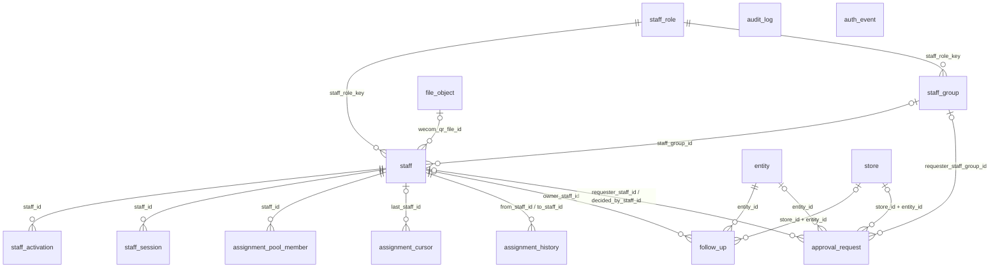

# 03 员工、运营跟进记录、权限、审计与统一审批单（staff、authz、audit、approval）

| 项 | 内容 |
| --- | --- |
| 模块 | `staff`（L1：员工、分组、角色、激活码、会话、分配池、改派记录、运营跟进记录）、`authz`（L0：权限点注册表在 `packages/contract`，没有自己的表）、`audit`（L0：审计日志、登录与安全事件）、`approval`（L1：统一审批单） |
| 表 | 12 张：`staff_role`、`staff_group`、`staff`、`staff_activation`、`staff_session`、`assignment_pool_member`、`assignment_cursor`、`assignment_history`、`follow_up`、`audit_log`、`auth_event`、`approval_request` |
| 依据 | 草案 `docs/appendix/design/d4-identity.md` 第 6–8 节（下文写作 d4:行号）；`d3-flow.md` 第 6.3、12.6、17、22、24 节（d3:行号）；`d1-ledger.md` 第 4.5 节（d1:行号）、`d2-payment.md` 第 3.4、3.9 节（d2:行号）、`d9-profile.md`（d9:行号）；裁决 M3、M12、M13、M14、M19、M21、M25、M27、M31、M33、M39、M44，第二轮另依据 M46–M48、M50–M54、M56、M57、M60、M63、M64、M71、M73、M79、M92，第三轮依据 M93、M97、M101、M102、M107、M110（见第 7 节）；`catalogue.json` 的 conventions 与本分组 12 张表的 notes；`decisions.md` 第 1 节 #5、#11、#21、#28，第 6、8 节；主文档 `03-key-designs.md` 第 3.1、4.2、4.3、9 节（03:行号）、`04-adr.md` ADR-019；PRD（PRD:行号）；调研 `proto-admin-a/b/e.md`、`prd-tech.md`；画板 `admin/SysStaff`、`admin/SysRoles`、`admin/SysLogs`、`admin/Renewals`、`admin/Overdue`、`admin/MerchantDetail` |

## 1. 概览

这组表回答四个问题：

- **谁在操作后台**：员工账号、角色、分组、激活码、会话（`staff*` 五张）。登录是手机号 + 密码 + TOTP；一人一角色；8 个角色固定。
- **事情落到谁名下**：轮询分配池与游标、改派记录（`assignment_*` 三张），以及运营跟进记录（`follow_up`）。四个池分属四个 L3 模块，表放在 L1，各业务模块都向下调用。
- **批没批**：一张单级的统一审批单（`approval_request`），只记录谁提交、谁决定、结论、原因、时限。内容与执行状态在各领域表里，与审批单一对一。
- **留了什么痕**：审计日志单表三条流（`audit_log`），与业务写同事务、只追加；登录与安全事件（`auth_event`）单独一张，保留 12 个月。

`audit_log`、`auth_event` 在 L0，所有引用列只存 id、不建外键，图里不画连线。`approval_request.subject_id`、`follow_up.subject_id`、`assignment_history.subject_id` 是多态引用，指向的表见第 5 节。

## 2. 表定义

通用说明：

- `id` 为 UUID v7，由应用生成，不设数据库默认值。`seq` 是自增序号（`bigint`），只用于排序与回放，不出接口。
- 时间列一律 `timestamptz`，由注入的应用时钟写入，不设默认值；唯一的例外是 `audit_log.created_at`（见 2.10）。`updated_at` 不由触发器维护，每次 UPDATE 由写入方显式赋值。
- 出处里的“约定”指 `catalogue.json` 的 conventions；“补”表示草案没有、按约定、规则或画板补的列。
- 外键的删除行为一律 `RESTRICT`：员工、主体、门店、审批单都不物理删除。删除草稿门店只做停用（`archive_reason = 'draft_deleted'`），所有引用 `store` 的外键统一 `RESTRICT`（M93）。
- 同时带 `entity_id`、`store_id` 的两张 L1 表（`follow_up`、`approval_request`）对门店建复合外键 `(store_id, entity_id) → store (id, entity_id)`，另保留 `entity_id → entity.id`（M47）；`store_id` 为空时不校验。
- 来源 IP 列用 `text`（M51）；值由 `resolveClientIp` 产出，格式在应用层保证。
- 状态机表（`staff`、`approval_request`）的状态列都是 `status`，写 `status_transition` 时 `state_field = 'status'`（M53）。
- 数据库角色与授权不写在 SQL 文件里，在各表的“手写约束”后说明。
- 不变量的登记（15 分组的 `InvariantCheck`）：本分组的检查项都是每日一次，登记 `modes: ['full']`，不写 `every`。自愈策略：`staff.I10`（自动改派）为 `heal_and_alert`，自愈后违规行仍要有人看原因、填结论，告警由 15 的探针规则“不变量校验失败”产生；其余都是 `none`。对象属于某个主体的（审批单、跟进记录、改派对象所在的门店、带 `entity_id` 的审计行），上报时带 `entityId`（写进 `detail.entityId`）；员工、角色、分组、分配池这类全局对象不带。

### 2.1 `staff_role` 后台角色

8 行固定角色，迁移时从代码注册表的默认值播种；后台只能改模块等级、权限点开关与数据范围，不能增删角色。模块等级与权限点放在一行的两个 jsonb 里：保存是带版本号的整体替换，前后对比就是两份 JSON 的差异（d4:1158）。

归属：全局。主键：自然键 `key`。不是只增表。`lock_rank = null`。

| 列 | 类型 | 空 | 默认 | 说明 | 出处 |
| --- | --- | --- | --- | --- | --- |
| `key` | text | 否 | — | 角色键：`super_admin` 超级管理员、`cs` 客服、`delivery_manager` 交付经理、`editor` 剪辑师、`publisher` 发布专员、`content_ops` 内容运营、`channel_ops` 渠道运营（V1.1 启用）、`finance` 财务 | d4:1149 |
| `name` | text | 否 | — | 角色名称 | d4:1150 |
| `description` | text | 否 | — | 职责描述（角色页左栏展示） | d4:1150；画板 admin/SysRoles |
| `module_levels` | jsonb | 否 | — | 13 个模块的等级，取值 `n` 无权限、`v` 查看、`o` 本人任务、`e` 编辑；`o` 只允许出现在 `delivery`、`publish`。结构见第 4 节 | d4:1151 |
| `actions` | jsonb | 否 | — | 敏感操作权限点开关，键是权限点、值是 `{on, leadOnly}`。结构见第 4 节 | d4:1152 |
| `data_scope` | text | 否 | — | 数据范围：`own` 本人负责、`group` 本组、`all` 全部 | d4:1153 |
| `is_locked` | boolean | 否 | `false` | 是否锁定。超级管理员为 `true`，不可编辑 | d4:1154 |
| `available_from` | text | 否 | — | 起始版本：`v1.0`、`v1.1`（渠道运营为 `v1.1`，是否展示由功能开关控制） | d4:1155 |
| `lock_version` | integer | 否 | `0` | 乐观锁版本号。保存 = 带版本号的整体替换 | d4:1156；约定“乐观锁” |
| `updated_by_staff_id` | uuid | 可 | — | 最近保存人；迁移播种时为空 | d4:1156；约定“操作人列” |
| `created_at` | timestamptz | 否 | — | 创建时间 | 补：约定“时间” |
| `updated_at` | timestamptz | 否 | — | 更新时间 | d4:1156 |

**键与索引**

- 主键：`pk_staff_role (key)`。
- 外键：`updated_by_staff_id` → `staff.id`（`fk_staff_role_updated_by_staff_id`）。

**手写约束**

| 约束名 | 规则 |
| --- | --- |
| `ck_staff_role_key` | `key` 在 8 个角色键之内 |
| `ck_staff_role_data_scope` | `data_scope IN ('own','group','all')` |
| `ck_staff_role_available_from` | `available_from IN ('v1.0','v1.1')` |
| `ck_staff_role_json_shape` | `module_levels`、`actions` 都是 JSON 对象 |
| `ck_staff_role_super_admin_locked` | `key = 'super_admin'` 的行 `is_locked` 必为 `true` |

**不变量**（每日校验，P2）：`staff.I7` `module_levels` 的 `o` 只出现在 `delivery`、`publish`；`actions` 的键都在权限点注册表内（d4:2003 的 I19，读写两侧 Zod 校验加契约测试，每日巡检复核）。`staff.I8` 表里恰有 8 行。违规对象用 `subject_key = key`（自然键）。

**相对草案的改动**

| 改动 | 依据 |
| --- | --- |
| `locked` → `is_locked` | 约定“命名规则”：布尔列用 `is_` 前缀 |
| `version` → `lock_version`；`updated_by` → `updated_by_staff_id` 并建外键 | 约定“乐观锁”“操作人列” |
| 补 `created_at` | 约定“时间” |
| 补 5 条 CHECK | 约定“枚举”；d4:1154、2003 |

### 2.2 `staff_group` 员工分组

“本组”数据范围的组织实体。迁移时为每个角色各建一个默认组（如“交付组”），新员工默认进所属角色的默认组；将来按城市拆成两个交付组时不改模型（d4:943）。

归属：全局。主键：`id`（uuid）。不是只增表。`lock_rank = null`。

| 列 | 类型 | 空 | 默认 | 说明 | 出处 |
| --- | --- | --- | --- | --- | --- |
| `id` | uuid | 否 | — | 主键 | d4:943 |
| `name` | text | 否 | — | 组名 | d4:943 |
| `staff_role_key` | text | 否 | — | 所属角色（`staff_role.key`） | d4:943；M57 |
| `is_default` | boolean | 否 | `false` | 是否该角色的默认组 | 补：d4:943“新员工默认进所属角色的默认组”，要能定位到这一行 |
| `created_at` | timestamptz | 否 | — | 创建时间 | d4:943 |
| `updated_at` | timestamptz | 否 | — | 更新时间 | 补：约定“时间” |

**键与索引**

- 主键：`pk_staff_group (id)`。
- 外键：`staff_role_key` → `staff_role.key`（`fk_staff_group_staff_role_key`）。
- 唯一约束：`uq_staff_group_staff_role_key_name (staff_role_key, name)`，同一角色下组名不重复；同时覆盖“按角色列出分组”的查询。

**手写约束**

| 约束名 | 规则 |
| --- | --- |
| `uq_staff_group_default_role` | 部分唯一索引 `(staff_role_key) WHERE is_default`：每个角色至多一个默认组 |

**不变量**（每日校验，severity 均为 P2）：`staff.I5` 每个角色恰有一个默认组；`staff.I6` 每个有成员的组至少有一名启用的主管，否则该组的待分配池只有超级管理员可见（d4:1346）。

**相对草案的改动**

| 改动 | 依据 |
| --- | --- |
| 草案只有行内定义（`id`、`name`、`role_key`、`created_at`），补 `is_default`、`updated_at` 与两个唯一约束 | d4:943；约定“时间” |
| `role_key` → `staff_role_key` | M57：指向自然键表的外键列用“被引用表全名 + 主键列名” |

### 2.3 `staff` 员工账号

后台员工的登录账号。登录名即手机号；口令用 scrypt；第二因子是 TOTP。登录失败按“已登录过的设备”与“陌生来源”分两个桶计数与锁定，锁定状态存 PostgreSQL，Redis 清空不会解除（d4:941、1022-1032）。

归属：全局。主键：`id`（uuid）。不是只增表。业务状态机（`status`）。`lock_rank = 20`：分配类操作在事务开头对目标员工行 `FOR SHARE`，禁用与移交 `FOR NO KEY UPDATE`，多行按 id 升序。不用 `FOR UPDATE`：七十多个外键指向 `staff.id`，别的事务插入带 `*_by_staff_id` 的行时，外键检查要对员工行加 `FOR KEY SHARE`，`FOR UPDATE` 会挡住它并可能与业务行锁形成死锁；`FOR NO KEY UPDATE` 仍与分配方的 `FOR SHARE` 互斥。禁用事务的 UPDATE 不改唯一键列（`wecom_userid` 解绑时保留，见下），本身也只取 `FOR NO KEY UPDATE` 级别的行锁。

| 列 | 类型 | 空 | 默认 | 说明 | 出处 |
| --- | --- | --- | --- | --- | --- |
| `id` | uuid | 否 | — | 主键 | d4:921 |
| `staff_no` | integer | 否 | 序列，从 1001 起 | 工号，唯一 | d4:922；画板 admin/SysStaff |
| `name` | text | 否 | — | 姓名（≤10 字，契约层校验） | d4:923；proto-admin-e:249 |
| `phone_enc` | text | 否 | — | 手机号密文（AES-256-GCM） | d4:924 |
| `phone_bidx` | bytea | 否 | — | 手机号盲索引（HMAC-SHA256，32 字节），唯一 | d4:924 |
| `phone_mask` | text | 否 | — | 手机号脱敏串（前 3 后 4，如 `138****6021`） | 补：约定“敏感字段三件套” |
| `phone_last4` | text | 否 | — | 手机号后四位，供列表按后四位检索 | d4:924 |
| `staff_role_key` | text | 否 | — | 角色（`staff_role.key`）；一人一角色 | d4:925；M57 |
| `is_lead` | boolean | 否 | `false` | 是否本岗位主管 | d4:926 |
| `staff_group_id` | uuid | 可 | — | 所属分组 | d4:927 |
| `status` | text | 否 | — | `pending` 待启用（账号已建、尚未开放登录）、`active` 启用、`disabled` 已禁用 | d4:928 |
| `password_hash` | text | 可 | — | `scrypt$N$r$p$salt$hash`；空 = 尚未激活或已被重置 | d4:929 |
| `password_changed_at` | timestamptz | 可 | — | 最近一次设置口令的时间；从未设置时为空 | d4:930 |
| `totp_secret_enc` | text | 可 | — | TOTP 密钥密文，用独立的 MFA 密钥加密 | d4:931 |
| `totp_enrolled_at` | timestamptz | 可 | — | TOTP 绑定完成时间；非空表示已绑定 | d4:931 |
| `totp_pending_secret_enc` | text | 可 | — | 绑定中的 TOTP 密钥密文。`enroll` 时写入，`confirm` 通过后转入 `totp_secret_enc` 并清空 | 补：d4:1054“生成密钥（加密暂存）”没有写暂存位置；catalogue notes 要求在本表定列 |
| `totp_pending_at` | timestamptz | 可 | — | 绑定中密钥的生成时间；清理任务按它清空超时未确认的密钥 | 补：同上 |
| `totp_last_step` | integer | 可 | — | 最近一次通过校验的时间步；新校验必须严格大于它 | d4:932 |
| `recovery_codes` | jsonb | 否 | `'[]'` | 一次性恢复码的 sha256 列表（最多 10 个），用掉即移除。结构见第 4 节 | d4:933 |
| `wecom_userid` | text | 可 | — | 企业微信成员 `userid`，唯一。解绑（含禁用时置 `unbound`）后保留：企业微信回调（外部联系人删除、离职继承）按它对到员工，`wecom_contact` 不另存员工的 `userid`。同一 `userid` 要绑到另一名员工时，服务层在同一事务里先清空旧员工的值 | d4:934、1072；02 分组的请求 |
| `wecom_bind_status` | text | 否 | `'none'` | `none` 未绑定、`invited` 已邀请、`bound` 已绑定、`unbound` 已解绑 | d4:934 |
| `wecom_bound_at` | timestamptz | 可 | — | 绑定时间 | d4:934 |
| `wecom_qr_file_id` | uuid | 可 | — | 企业微信“联系我”二维码图片：接口生成后落库，或企业微信不可用时人工上传 | 补：PRD:636（服务经理展示企业微信二维码）；d3:447；01:418（降级为人工上传）；M58；同层调用 `staff → media` 见 M64 |
| `display_name` | text | 可 | — | 对商家展示的称呼（如“小林”）；空时展示 `name` | 补：PRD:636“展示姓名”；画板 merchant/Service（商家端称呼“小林”，后台员工名“林晓”） |
| `service_phone` | text | 可 | — | 对商家展示的服务电话（工作电话或座机，允许带分机号）；空时商家端不显示“拨打电话”。不是登录手机号：登录手机号是敏感字段，不对商家展示 | 补：PRD:636“展示……电话”；画板 merchant/Service 的“拨打电话”；proto-merchant-b:187 |
| `fail_untrusted` | integer | 否 | `0` | 陌生来源桶的连续失败次数 | d4:935 |
| `locked_until_untrusted` | timestamptz | 可 | — | 陌生来源桶的锁定截止时间 | d4:935 |
| `fail_trusted` | integer | 否 | `0` | 可信设备桶的连续失败次数 | d4:936 |
| `locked_until_trusted` | timestamptz | 可 | — | 可信设备桶的锁定截止时间 | d4:936 |
| `last_login_at` | timestamptz | 可 | — | 最近登录时间；空 = 从未登录 | d4:937 |
| `last_login_ip` | text | 可 | — | 最近登录来源 IP（原值，展示时脱敏） | d4:937 |
| `disabled_at` | timestamptz | 可 | — | 禁用时间；重新启用时清空 | d4:938 |
| `disabled_reason` | text | 可 | — | 禁用原因：`resigned` 离职、`reassigned` 调岗、`long_leave` 长期休假、`other` 其他 | d4:938；画板 admin/SysStaff |
| `disabled_by_staff_id` | uuid | 可 | — | 执行禁用的员工 | d4:938 |
| `handover_to_staff_id` | uuid | 可 | — | 禁用时在办事项的接收人；没有在办事项时为空 | d4:938 |
| `created_by_staff_id` | uuid | 可 | — | 创建人；命令行引导创建第一位超级管理员时为空 | d4:939、1040 |
| `created_at` | timestamptz | 否 | — | 创建时间 | d4:939 |
| `updated_at` | timestamptz | 否 | — | 更新时间 | d4:939 |
| `lock_version` | integer | 否 | `0` | 乐观锁版本号 | d4:939；约定“乐观锁” |

**键与索引**

- 主键：`pk_staff (id)`。
- 外键：`staff_role_key` → `staff_role.key`（`fk_staff_staff_role_key`）；`staff_group_id` → `staff_group.id`（`fk_staff_staff_group_id`）；`wecom_qr_file_id` → `file_object.id`（`fk_staff_wecom_qr_file_id`，同层 media）；`disabled_by_staff_id`、`handover_to_staff_id`、`created_by_staff_id` → `staff.id`（`fk_staff_disabled_by_staff_id`、`fk_staff_handover_to_staff_id`、`fk_staff_created_by_staff_id`）。
- 唯一约束：`uq_staff_staff_no (staff_no)`；`uq_staff_phone_bidx (phone_bidx)`，登录按盲索引取员工，并发创建同手机号的员工只成功一个；`uq_staff_wecom_userid (wecom_userid)`，空值不参与。
- 普通索引：`ix_staff_staff_role_key_status (staff_role_key, status)`：禁用弹窗找同角色的启用员工、“至少一名启用的超级管理员”计数、角色页的成员名单；`ix_staff_staff_group_id (staff_group_id)`：取“本组成员 id 列表”算数据范围；`ix_staff_phone_last4 (phone_last4)`：列表按手机号后四位检索。

**手写约束**

| 约束名 | 规则 |
| --- | --- |
| `staff_staff_no_seq` | `ALTER SEQUENCE … RESTART WITH 1001`：工号从 1001 起 |
| `ck_staff_staff_no` | `staff_no >= 1001` |
| `ck_staff_status` | `status IN ('pending','active','disabled')` |
| `ck_staff_phone_bidx_len` | `phone_bidx` 恰为 32 字节 |
| `ck_staff_phone_last4` | `phone_last4` 是 4 位数字 |
| `ck_staff_wecom_bind_status` | `wecom_bind_status IN ('none','invited','bound','unbound')` |
| `ck_staff_wecom_bound` | `bound` 时 `wecom_userid`、`wecom_bound_at` 都非空；`none` 时 `wecom_userid` 为空；`invited`、`unbound` 可保留原 `userid` |
| `ck_staff_totp_enrolled` | `totp_secret_enc` 与 `totp_enrolled_at` 同有同无 |
| `ck_staff_totp_pending` | `totp_pending_secret_enc` 与 `totp_pending_at` 同有同无 |
| `ck_staff_recovery_codes` | `recovery_codes` 是 JSON 数组 |
| `ck_staff_fail_counts` | 两个失败计数都不为负 |
| `ck_staff_disabled_reason` | `disabled_reason` 为空或在四个取值之内 |
| `ck_staff_disabled_fields` | `status = 'disabled'` ⇔ `disabled_at` 非空 ⇔ `disabled_reason` 非空；非禁用状态下 `disabled_by_staff_id`、`handover_to_staff_id` 为空 |
| `ck_staff_not_self` | 接收人与禁用操作人都不能是本人 |

**状态机**（`staff.status`；经 `flow.transition()`，`machine = 'staff'`、`state_field = 'status'`，每次写 `status_transition`。员工没有主体与门店，迁移不补写 `activity` 行；新增、启用、禁用由用例写一条 `ops` 审计（类别 `staff_authz`），经 `transition()` 的审计参数传入，见 2.10 的“迁移与审计行”）

| 当前状态 | 事件 | 新状态 | 守卫 | 触发者 |
| --- | --- | --- | --- | --- |
| — | 命令行引导（`staff.bootstrap`） | `active`（待激活） | 库里没有启用的超级管理员 | 系统（CLI `staff:bootstrap`） |
| — | 新增（立即启用，`staff.create`） | `active`（待激活） | `sys.staff.manage`；手机号未占用 | 超级管理员 |
| — | 新增（暂不启用，`staff.create`） | `pending` | 同上 | 超级管理员 |
| `pending` | 启用（`staff.enable`） | `active`（待激活） | `sys.staff.manage` | 超级管理员 |
| `active` | 禁用（`staff.disable`） | `disabled` | 不是本人；在办事项已指定同角色的启用员工接收；不是最后一位启用的超级管理员 | 超级管理员 |
| `disabled` | 启用（`staff.enable`） | `active`（待激活） | `sys.staff.manage` | 超级管理员 |

“待激活”不是状态值，是 `status = 'active'` 且 `password_hash` 为空。桶锁定不改 `status`，只写 `locked_until_*` 与 `auth_event`。禁用事务同时写 `disabled_*`、把企业微信状态置 `unbound`（保留 `wecom_userid`）、吊销全部会话、移出分配池、写改派记录与审计（d4:1072、1096-1107）；重新启用时清空 `disabled_*`、清空口令并下发新的激活码，TOTP 保留，两个失败桶清零（d4:1130）。

**不变量**（每日校验；编码按 15 分组的登记规则，severity 均为 P2）

- `staff.I1` 已禁用员工没有未吊销的会话、没有在办事项、不在任何分配池里（d4:1995 的 I11；d3:3151 的 I13）。在办事项按各来源的在办条件统计，跟进记录只算 `next_follow_at` 非空且 `done_at` 为空的行（2.9）。
- `staff.I2` 至少有 1 名启用的超级管理员（d4:1998 的 I14）。
- `staff.I3` 员工的 `staff_group_id` 非空时，该组的 `staff_role_key` 等于员工的 `staff_role_key`（只作不变量，不做复合外键；改角色时由服务层同时换组）。
- `staff.I4` `handover_to_staff_id` 指向的员工与本人同角色（d4:1102）。

**相对草案的改动**

| 改动 | 依据 |
| --- | --- |
| 补 `phone_mask`；`phone_last4` 由 `char(4)` 改 `text` 加 CHECK | 约定“敏感字段三件套” |
| `group_id` → `staff_group_id` | M33 |
| `role_key` → `staff_role_key` | M57 |
| `totp_last_step` 由 `bigint` 改 `integer` | 时间步是 Unix 秒 ÷ 30，当前约 5.9×10⁷，`integer` 可用到公元 4000 年以后；`bigint` 的例外只有 M15 列出的三类 |
| 补 `totp_pending_secret_enc`、`totp_pending_at` | catalogue notes；d4:1054 |
| 补 `wecom_qr_file_id` | PRD:636；d3:447；01:418；M64 |
| 补 `display_name`、`service_phone` | PRD:636 要求展示姓名与电话；唯一的手机号是登录手机号（敏感字段），不能给商家看 |
| `last_login_ip` 由 `inet` 改 `text` | M51 |
| `disabled_by` → `disabled_by_staff_id`，`created_by` → `created_by_staff_id`，都建外键；`version` → `lock_version` | 约定“操作人列”“乐观锁” |
| `disabled_reason` 定为四个枚举值并加 CHECK；补“禁用字段与状态一致”的 CHECK，约定重新启用时清空 `disabled_*` | d4:938 只给了中文选项；历史在 `audit_log` 与 `status_transition` |
| `wecom_bind_status` 的 CHECK：`bound` 必有 `userid`；解绑后保留 `userid` | d4:1072 只要求禁用时置 `unbound`；02 分组的企业微信回调按本列对到员工 |

### 2.4 `staff_activation` 员工激活码与重置码

一次性的 8 位数字字母码，只存哈希，24 小时有效，错 5 次作废。用于首次激活、重置密码、重置第二因子后的重新激活、重新启用。短信未配置时由超级管理员在界面上看到一次并线下转交（d4:1044）。

归属：全局。主键：`id`（uuid）。不是只增表；已用或过期超过 30 天的行由每日清理任务物理删除（d4:1646）。`lock_rank = null`。

| 列 | 类型 | 空 | 默认 | 说明 | 出处 |
| --- | --- | --- | --- | --- | --- |
| `id` | uuid | 否 | — | 主键；激活码短信在事务提交后经 `notify.sendDirect` 直发，直发幂等键 `staff_act:{id}`（不经出站事件，接口裁决 A95） | d4:949、1942 |
| `staff_id` | uuid | 否 | — | 所属员工 | d4:950 |
| `purpose` | text | 否 | — | `activate` 激活、`reset_password` 重置密码 | d4:951 |
| `code_hash` | bytea | 否 | — | 激活码的 sha256（32 字节）；库里没有明文 | d4:952 |
| `delivery` | text | 否 | — | 下发方式：`sms` 短信、`manual` 由超级管理员线下转交 | d4:954 |
| `expires_at` | timestamptz | 否 | — | 过期时间（创建 + 24 小时） | d4:953 |
| `attempts` | integer | 否 | `0` | 校验失败次数；满 5 次作废 | d4:953 |
| `used_at` | timestamptz | 可 | — | 使用时间（设置密码成功时写入） | d4:953、1050 |
| `revoked_at` | timestamptz | 可 | — | 作废时间：重新生成激活码、错满 5 次、员工被禁用时写入 | 补：d4:1044“旧码作废”要与过期、已用区分，并支撑“同一员工只有一个有效码” |
| `created_by_staff_id` | uuid | 可 | — | 生成人；命令行引导时为空 | d4:955；约定“操作人列” |
| `created_at` | timestamptz | 否 | — | 创建时间 | d4:955 |
| `updated_at` | timestamptz | 否 | — | 更新时间 | 补：约定“时间” |

**键与索引**

- 主键：`pk_staff_activation (id)`。
- 外键：`staff_id` → `staff.id`（`fk_staff_activation_staff_id`）；`created_by_staff_id` → `staff.id`（`fk_staff_activation_created_by_staff_id`）。
- 普通索引：`ix_staff_activation_staff_id (staff_id)`：激活时按员工取码；`ix_staff_activation_expires_at (expires_at)`：每日清理。

**手写约束**

| 约束名 | 规则 |
| --- | --- |
| `ck_staff_activation_purpose` | `purpose IN ('activate','reset_password')` |
| `ck_staff_activation_delivery` | `delivery IN ('sms','manual')` |
| `ck_staff_activation_code_hash_len` | `code_hash` 恰为 32 字节 |
| `ck_staff_activation_attempts` | `attempts` 在 0–5 之间 |
| `ck_staff_activation_used_or_revoked` | `used_at`、`revoked_at` 不同时非空 |
| `ck_staff_activation_expires` | `expires_at > created_at` |
| `uq_staff_activation_live` | 部分唯一索引 `(staff_id) WHERE used_at IS NULL AND revoked_at IS NULL`：同一员工至多一个未用且未作废的码；生成新码前先把旧码写 `revoked_at` |

**相对草案的改动**

| 改动 | 依据 |
| --- | --- |
| 补 `revoked_at`、`updated_at` 与部分唯一索引 | d4:1044；约定“时间” |
| `created_by` → `created_by_staff_id` | 约定“操作人列” |

### 2.5 `staff_session` 员工会话

Cookie 会话（`__Host-lyx_admin`），一次登录一行。空闲 60 分钟滑动、绝对 12 小时。吊销某员工全部会话是一条 UPDATE，与触发它的业务写在同一事务（d4:1082）。

归属：全局。主键：`id`（uuid）。不是只增表；过期或吊销超过 30 天的行由每日清理任务物理删除（d4:1646）。`lock_rank = null`。

| 列 | 类型 | 空 | 默认 | 说明 | 出处 |
| --- | --- | --- | --- | --- | --- |
| `id` | uuid | 否 | — | 主键 | d4:961 |
| `staff_id` | uuid | 否 | — | 所属员工 | d4:962 |
| `token_hash` | bytea | 否 | — | 会话令牌的 sha256（32 字节），唯一；Cookie 里是 32 字节随机数 | d4:963 |
| `auth_method` | text | 否 | — | 登录方式：`password+totp`、`password+recovery`；审计日志的“登录方式”取自这里 | d4:964 |
| `ip` | text | 否 | — | 登录来源 IP（原值） | d4:965 |
| `user_agent` | text | 可 | — | 浏览器 UA，服务端截断到 512 字符 | d4:965 |
| `created_at` | timestamptz | 否 | — | 登录时间 | d4:966 |
| `last_seen_at` | timestamptz | 否 | — | 最近活跃时间；距上次更新超过 60 秒才写 | d4:966、1079 |
| `idle_expires_at` | timestamptz | 否 | — | 空闲过期时间（滑动 60 分钟） | d4:967 |
| `absolute_expires_at` | timestamptz | 否 | — | 绝对过期时间（创建 + 12 小时） | d4:967 |
| `stepup_at` | timestamptz | 否 | — | 最近一次验证第二因子的时间；登录成功时即写为登录时刻 | d4:968 |
| `revoked_at` | timestamptz | 可 | — | 吊销时间 | d4:969 |
| `revoke_reason` | text | 可 | — | `logout` 退出、`disabled` 员工被禁用、`password_reset` 重置密码、`mfa_reset` 重置第二因子、`phone_changed` 修改手机号、`admin` 被强制下线 | d4:969 |
| `updated_at` | timestamptz | 否 | — | 更新时间 | 补：约定“时间” |

**键与索引**

- 主键：`pk_staff_session (id)`。
- 外键：`staff_id` → `staff.id`（`fk_staff_session_staff_id`）。
- 唯一约束：`uq_staff_session_token_hash (token_hash)`：每请求按令牌哈希取会话。
- 普通索引：`ix_staff_session_absolute_expires_at (absolute_expires_at)`：每日清理。

**手写约束**

| 约束名 | 规则 |
| --- | --- |
| `ck_staff_session_auth_method` | `auth_method IN ('password+totp','password+recovery')` |
| `ck_staff_session_token_hash_len` | `token_hash` 恰为 32 字节 |
| `ck_staff_session_revoke_reason` | `revoke_reason` 为空或在六个取值之内 |
| `ck_staff_session_revoked` | `revoked_at` 与 `revoke_reason` 同有同无 |
| `ck_staff_session_expiry` | 两个过期时间都晚于 `created_at`；`stepup_at >= created_at` |
| `ix_staff_session_staff_id_active` | 部分索引 `(staff_id) WHERE revoked_at IS NULL`：吊销某员工的全部会话 |

**不变量**：已禁用员工没有未吊销的会话（并入 2.3 的 `staff.I1`）。

**相对草案的改动**

| 改动 | 依据 |
| --- | --- |
| `ip` 由 `inet` 改 `text` | M51 |
| 补 `updated_at` 与 5 条 CHECK | 约定“时间”“枚举” |

### 2.6 `assignment_pool_member` 分配池成员

四个轮询池的成员：交付经理（按城市）、剪辑师、发布专员、客服。客服池的 `on_duty` 是“当班 / 接单中”开关，由客服本人或主管切换（d3:2536）。员工被禁用时从所有池移除。

归属：全局。主键：复合 `(pool, staff_id, city_code)`。不是只增表。`lock_rank = null`（只在已持有游标行锁的 `pickNext` 里读，增删在已持有员工行锁的事务里做）。

| 列 | 类型 | 空 | 默认 | 说明 | 出处 |
| --- | --- | --- | --- | --- | --- |
| `pool` | text | 否 | — | 池：`delivery_manager` 交付经理、`editor` 剪辑师、`publisher` 发布专员、`cs` 客服 | d3:636 |
| `staff_id` | uuid | 否 | — | 池内员工 | d3:637 |
| `city_code` | text | 否 | `''` | 城市编码（行政区划字典 `region` 的市级编码，不建外键）。只有交付经理池按城市；空串 = 不限城市 | d3:638 |
| `on_duty` | boolean | 否 | `true` | 当班开关。只有客服池可以为 `false`，其他池恒为 `true` | d3:639；03:329 |
| `created_at` | timestamptz | 否 | — | 创建时间 | 补：约定“时间” |
| `updated_at` | timestamptz | 否 | — | 更新时间 | 补：约定“时间” |

**键与索引**

- 主键：`pk_assignment_pool_member (pool, staff_id, city_code)`；`pickNext` 按 `pool` 前缀取候选并按 `staff_id` 升序。
- 外键：`staff_id` → `staff.id`（`fk_assignment_pool_member_staff_id`）。
- 普通索引：`ix_assignment_pool_member_staff_id (staff_id)`：禁用员工时从全部池移除；员工页展示所在的池。

**手写约束**

| 约束名 | 规则 |
| --- | --- |
| `ck_assignment_pool_member_pool` | `pool` 在四个取值之内 |
| `ck_assignment_pool_member_city` | 非交付经理池的 `city_code` 必为空串 |
| `ck_assignment_pool_member_on_duty` | 非客服池的 `on_duty` 必为 `true` |

**不变量**（每日校验，P2）：`staff.I9` 池内员工都是启用状态，且角色与池对应（`delivery_manager`、`editor`、`publisher`、`cs` 四个池名就是角色键）。

**相对草案的改动**

| 改动 | 依据 |
| --- | --- |
| 归属由 d3 的“流程基础”改为 staff（L1） | decisions #21 |
| `staff_id` 由 `bigint` 改 `uuid` 并建外键；补 `created_at`、`updated_at` 与三条 CHECK | 约定“主键”“时间”“枚举” |
| `on_duty` 保留原名，不加 `is_` 前缀 | catalogue notes 与 03:329 点名用 `on_duty`；登记为布尔命名的例外 |
| `city_code` 保留空串哨兵 | 它是主键列，不能为空；约定“主键”第 5 条针对的是 uuid 列用 0 作哨兵 |

### 2.7 `assignment_cursor` 轮询游标

每个池 × 范围一行，记上一次分配到的员工。`pickNext` 先锁游标行，再取第一个 `staff_id` 大于 `last_staff_id` 的候选，没有则回到第一个（d3:646-653）。

归属：全局。主键：复合 `(pool, scope_key)`。不是只增表。`lock_rank = 10`：全局加锁顺序里最先，只在 `pickNext` 里 `FOR UPDATE`，必须在锁任何业务行之前调用。

| 列 | 类型 | 空 | 默认 | 说明 | 出处 |
| --- | --- | --- | --- | --- | --- |
| `pool` | text | 否 | — | 池，取值同 `assignment_pool_member.pool` | d3:642 |
| `scope_key` | text | 否 | — | 范围键：交付经理池是城市编码，其余池固定为 `all` | d3:642；d3:600 |
| `last_staff_id` | uuid | 可 | — | 上一次分配到的员工；行刚建、还没分配过时为空 | d3:643 |
| `created_at` | timestamptz | 否 | — | 创建时间 | 补：约定“时间” |
| `updated_at` | timestamptz | 否 | — | 更新时间 | 补：约定“时间” |

**键与索引**

- 主键：`pk_assignment_cursor (pool, scope_key)`。
- 外键：`last_staff_id` → `staff.id`（`fk_assignment_cursor_last_staff_id`）。

**手写约束**

| 约束名 | 规则 |
| --- | --- |
| `ck_assignment_cursor_pool` | `pool` 在四个取值之内 |
| `ck_assignment_cursor_scope_key` | `scope_key` 不为空串；非交付经理池必为 `all` |

**相对草案的改动**

| 改动 | 依据 |
| --- | --- |
| `pool`、`scope_key` 定为 `text`（草案没写类型）；`last_staff_id` 由 `bigint` 改 `uuid`、可空并建外键 | catalogue notes；约定“主键” |
| 补 `created_at`、`updated_at` 与两条 CHECK | 约定“时间”“枚举” |

### 2.8 `assignment_history` 改派记录

员工禁用、只移交不禁用、转移交付经理、不变量自动改派时，逐对象写一行，同一次操作共用 `batch_id`。门店的交付经理变更后，新交付经理要在 1 个工作日内联系商家（PRD:776；d3:2974 的 N6）：门店交付经理变更的行（`source = 'store_manager'` 且 `subject_type = 'store'`）一律带联系截止时间，不论是转移、禁用移交还是不变量自动改派——三种情况商家看到的都是换了交付经理（M107）。联系后补“已联系”标记；联系前同一门店又被改派时，旧行的联系义务作废。

归属：全局。主键：`id`（uuid）加 `seq`。`append_only = false`（M14）：允许受限更新，由触发器限制到联系相关的五列与 `updated_at`，不可删。`lock_rank = null`。

| 列 | 类型 | 空 | 默认 | 说明 | 出处 |
| --- | --- | --- | --- | --- | --- |
| `id` | uuid | 否 | — | 主键 | d3:3144 |
| `seq` | bigint | 否 | 自增 | 排序与回放用序号，唯一 | 约定“主键” |
| `batch_id` | uuid | 否 | — | 批次号：一次禁用、移交或转移共用一个 | d3:3144 |
| `source` | text | 否 | — | 在办来源（各业务模块注册的来源键）：`store_manager` 门店交付经理、`ticket_editor` 工单剪辑师、`ticket_publisher` 工单发布专员、`ad_editor` 广告剪辑师、`service_ticket_owner` 客服工单负责人（`service_ticket.owner_staff_id`，12 分组）、`follow_up_owner` 跟进提醒对象 | d3:3144；d3:3113-3120；d4:1237 |
| `subject_type` | text | 否 | — | 被改派对象的类型（最终表名）：`store`、`drama_order`、`delivery_ticket`、`ad`、`service_ticket`、`follow_up` | d3:3144；M19 |
| `subject_id` | uuid | 否 | — | 被改派对象的 id；多态，不建外键 | d3:3144 |
| `from_staff_id` | uuid | 否 | — | 原负责人 | d3:3145 |
| `to_staff_id` | uuid | 否 | — | 新负责人 | d3:3145 |
| `reason_code` | text | 否 | — | 原因：`resigned` 离职、`reassigned` 调岗、`long_leave` 长期休假（禁用与移交沿用员工禁用原因）；`workload` 工作量调整、`merchant_request` 商家要求更换、`staff_change` 人员调岗或离职（转移交付经理的原因）；`invariant_fix` 不变量自动改派；`other` 其他 | d3:3145；画板 admin/SysStaff、admin/MerchantDetail；d3:3151 |
| `note` | text | 可 | — | 交接说明（≤200 字，契约层校验） | d3:3145；proto-admin-b:94 |
| `actor_type` | text | 否 | — | 操作人类型：`staff`、`system`（不变量自动改派） | d3:3145、3151；M44 |
| `actor_id` | uuid | 可 | — | 操作人 id；`system` 时为空；多态，不建外键 | 同上 |
| `client` | text | 可 | — | 客户端来源：员工操作必为 `admin`；系统动作为空 | M44 |
| `contact_due_at` | timestamptz | 可 | — | 新交付经理联系商家的截止时间；`source = 'store_manager'` 且 `subject_type = 'store'` 的行必有，其余行为空 | 补：M14；d3:2974；PRD:776 |
| `sla_snapshot` | jsonb | 可 | — | 联系时限的参数快照（`sla.manager.first_contact`，默认 1 个工作日）。结构见第 4 节 | 补：d3:3036、3052；M60 |
| `contacted_at` | timestamptz | 可 | — | “已联系”标记时间 | 补：M14；d3:2974 |
| `contacted_by_staff_id` | uuid | 可 | — | 标记“已联系”的员工 | 补：M14；约定“操作人列” |
| `contact_voided_at` | timestamptz | 可 | — | 联系义务作废时间：联系前同一门店又产生了一行门店交付经理变更（再次转移，或本行的接收人被禁用而移交），由写新行的事务同时写入。与 `contacted_at` 互斥；作废原因看同一门店下一行的 `reason_code` | 补：d3:2974 的 N6“标记后取消”之外的关闭途径；d3:3157 转移可重复发生 |
| `created_at` | timestamptz | 否 | — | 创建时间 | d3:3145 |
| `updated_at` | timestamptz | 否 | — | 更新时间 | 补：约定“时间” |

**键与索引**

- 主键：`pk_assignment_history (id)`。
- 外键：`from_staff_id`、`to_staff_id`、`contacted_by_staff_id` → `staff.id`（`fk_assignment_history_from_staff_id`、`fk_assignment_history_to_staff_id`、`fk_assignment_history_contacted_by_staff_id`）。
- 唯一约束：`uq_assignment_history_seq (seq)`。
- 普通索引：`ix_assignment_history_subject (subject_type, subject_id)`：对象的改派历史（商家详情的交付经理变更记录）；`ix_assignment_history_batch_id (batch_id)`：按批次汇总数量与通知接收人；`ix_assignment_history_from_staff_id (from_staff_id)`：取某员工最近一次移交批次的接收人（I13 自动改派）；`ix_assignment_history_to_staff_id (to_staff_id)`：接收人名下接手的事项。

**手写约束**

| 约束名 | 规则 |
| --- | --- |
| `ck_assignment_history_source` | `source` 在六个取值之内 |
| `ck_assignment_history_subject_type` | `subject_type` 在六个取值之内 |
| `ck_assignment_history_source_subject` | 来源与对象类型配对：`store_manager` → `store`、`drama_order`、`delivery_ticket`、`service_ticket`；`ticket_editor`、`ticket_publisher` → `delivery_ticket`；`ad_editor` → `ad`；`service_ticket_owner` → `service_ticket`；`follow_up_owner` → `follow_up` |
| `ck_assignment_history_reason_code` | `reason_code` 在八个取值之内 |
| `ck_assignment_history_from_to` | `from_staff_id <> to_staff_id` |
| `ck_assignment_history_actor_type` | `actor_type IN ('staff','system')` |
| `ck_assignment_history_actor` | `system` ⇔ `actor_id` 为空 ⇔ `client` 为空 |
| `ck_assignment_history_client` | `client` 为空或为 `admin`（员工只在后台操作） |
| `ck_assignment_history_contact` | `contact_due_at` 与 `sla_snapshot` 同有同无；有截止时间 ⇔ 门店交付经理变更的行；没有截止时间的行不能有“已联系”或“作废”；`contacted_at` 与 `contacted_by_staff_id` 同有同无；`contacted_at` 与 `contact_voided_at` 不同时非空 |
| `ix_assignment_history_contact_pending` | 部分索引 `(to_staff_id, contact_due_at) WHERE contact_due_at IS NOT NULL AND contacted_at IS NULL AND contact_voided_at IS NULL`：新交付经理的“待联系商家”待办 |
| `trg_assignment_history_guard` | 行级 `BEFORE UPDATE OR DELETE`，函数 `lyx_03_assignment_history_guard()`：不可删；只允许改 `contact_due_at`、`sla_snapshot`、`contacted_at`、`contacted_by_staff_id`、`contact_voided_at`、`updated_at`；`contacted_at` 或 `contact_voided_at` 一旦写入，联系相关的五列冻结；截止时间可以重算（日历修正），不能事后补上或抹掉。授权（在授权迁移里，不在本分组 SQL）：应用角色 `lyx_app` 对本表只有 `INSERT`、`SELECT`，另对这里放行的六列授列级 `UPDATE`，不多给（W0-06a） |
| `trg_assignment_history_no_truncate` | 语句级 `BEFORE TRUNCATE`，函数 `lyx_forbid_mutation()` |

联系时限的超时提醒是 `timer` 里 `kind = 'sla.breach'`、`subject_type = 'assignment_history'` 的一行。标记“已联系”或写 `contact_voided_at` 时，同一事务取消它（d3:2974）。门店再次改派的事务按“先作废旧行并取消旧定时器、再写新行并登记新定时器”的顺序做；作废与改派都由 staff 模块的 `reassign` 完成，业务模块不直接写本表。

日历修正后的重算（01 分组 2.6、2.7）：staff 订阅 `calendar.imported`，对未联系、未作废、按工作日计且计算窗口覆盖变化日期的行，用 `sla_snapshot` 里的策略与新日历重算 `contact_due_at`、更新快照并重设定时器。本表不是状态机表，重算只写一条 `audit_log`（`target_type = 'assignment_history'`，`before`、`after` 记新旧截止时间），不写 `status_transition`。

出站事件：一批改派（同一个 `batch_id`）只发一条 `assignment.transferred`，`aggregate_type = 'assignment_history'`，`aggregate_id` 取该批 `seq` 最小的一行的 `id`；载荷带 `batchId`、按来源的数量、`toStaffId` 与原因（回复 01 分组的请求）。消费方按 `batchId` 查明细，用 `ix_assignment_history_batch_id`。

**不变量**（每日校验，P2）：`staff.I10` 已禁用员工名下没有在办事项；发现时自动改派给该员工最近一次移交批次的接收人，写一行 `reason_code = 'invariant_fix'`、`actor_type = 'system'` 的记录；登记为 `heal_and_alert`，违规行留待人工填结论，告警由 15 的规则“不变量校验失败”产生（d3:3151 的 I13）。`staff.I11` 同一门店至多一行“待联系”（`contact_due_at` 非空、未联系、未作废），且它是该门店最新的一行门店交付经理变更。

**相对草案的改动**

| 改动 | 依据 |
| --- | --- |
| 归属由 d3 的“流程基础”改为 staff（L1） | decisions #21 |
| 主键改为 uuid 加 `seq`；`subject_id`、员工列由 `bigint` 改 `uuid` | 约定“主键” |
| `operated_by` → `actor_type`、`actor_id`、`client` 三列 | M44：操作人可能是员工或系统（d3:3151 的自动改派） |
| 补 `contact_due_at`、`sla_snapshot`、`contacted_at`、`contacted_by_staff_id`、`contact_voided_at`、`updated_at` | M14；M60（快照列统一叫 `sla_snapshot`）；d3:2974、3052、3157；约定“时间” |
| `source`、`subject_type`、`reason_code` 定出取值并加 CHECK | 草案没列取值；M19；decisions 第 8.1 节末段 |
| 补防改触发器 | M14：受限更新 |

### 2.9 `follow_up` 运营跟进记录

运营对商家的跟进记录与跟进待办：续费跟进（“套餐到期”页）、逾期未上线跟进（“逾期跟踪”页）、巡检异常与逾期未下架的跟进、补发后确认商家已替换（系统生成的待办）。续费跟进的行带续费意向；后台“套餐到期”页的续费意向由读侧取每个订阅周期最新一条跟进组装，billing 不引用本表（M3）。

**在办（待办）的判定**：`next_follow_at IS NOT NULL AND done_at IS NULL`。没有下次跟进时间的人工记录是纯记录，写入即不在办（续费跟进弹窗没有下次跟进，商家详情的下次跟进可不填）；草案的在办条件是“`next_follow_at` 在未来”（d3:3119），本稿把已过期未处理的也算在办，到期后仍要有人跟。关闭途径：负责人标记完成（写 `done_at`、可选 `done_note`）；同一对象写入下一条跟进时，服务层在同一事务里关闭该对象此前在办的行（`done_at` = 新行的记录时间）；系统待办的来源事项消失时（如补发的订单项已终止），由来源模块调用 staff 的接口关闭。系统生成的行都是待办，写入时必带 `next_follow_at`（提醒时间）。

归属：主体维度（`entity_id` 必填，`store_id` 可空：续费跟进按主体归属）。主键：`id`（uuid）。不是只增表（负责人会改派、下次跟进时间会改期、事项会标记完成，三者可能并发，用 `lock_version`）。`lock_rank = null`。

| 列 | 类型 | 空 | 默认 | 说明 | 出处 |
| --- | --- | --- | --- | --- | --- |
| `id` | uuid | 否 | — | 主键 | d3:1822 |
| `subject_type` | text | 否 | — | 跟进对象类型（最终表名）：`order_item` 逾期未上线、`subscription_term` 续费、`store` 门店（售前与日常，V1.1 启用入口）、`patrol_task` 巡检异常、`takedown_task` 逾期未下架、`delivery_reissue` 补发后确认 | d3:1822；M19；decisions 第 8.1 节 |
| `subject_id` | uuid | 否 | — | 跟进对象 id；多态，不建外键 | d3:1822；M3 |
| `entity_id` | uuid | 否 | — | 所属主体 | d3:1823；M3 |
| `store_id` | uuid | 可 | — | 所属门店；续费跟进为空 | d3:1823；M3；prd-tech:48 |
| `channel` | text | 可 | — | 沟通方式：`wecom` 企业微信、`phone` 电话、`visit` 上门拜访、`system` 系统生成；空 = 未注明（“逾期跟踪”的记录弹窗只有沟通内容与下次跟进，没有方式）。系统生成的行必为 `system`，人工记录不能是 `system` | d3:1823；画板 admin/Renewals、admin/MerchantDetail、admin/Overdue；proto-admin-a:433、597 |
| `content` | text | 否 | — | 沟通内容；系统生成的行写待办主题（如“补发后确认商家已替换”）。≤200 字，契约层校验 | d3:1823、1680 |
| `intent` | text | 可 | — | 续费意向：`confirmed` 已确认续费、`considering` 考虑中、`declined` 暂不续费。只有 `subject_type = 'subscription_term'` 的行可填 | d3:1824；proto-admin-b:290 |
| `next_follow_at` | timestamptz | 可 | — | 下次跟进时间；到期当日 09:00 提醒负责人。非空且 `done_at` 为空即在办。系统生成的行必填 | d3:1824、2967、3119 |
| `owner_staff_id` | uuid | 可 | — | 负责跟进的员工，即提醒对象。人工记录时等于记录人；系统生成时取门店的交付经理（门店没有交付经理时为空）。员工禁用时只改派在办的行 | 补：d3:3119“提醒对象改为接收人”；d3:1680 |
| `done_at` | timestamptz | 可 | — | 跟进事项完成时间；非空后不再提醒、不计入待办 | 补：d3:1680、3089 的跟进待办要有关闭标记；画板 admin/MerchantDetail 的“已完成” |
| `done_note` | text | 可 | — | 完成说明（如“09-28 确认续费意向”） | 补：画板 admin/MerchantDetail |
| `actor_type` | text | 否 | — | 记录人类型：`staff`、`system` | d3:1824；catalogue notes；M44 |
| `actor_id` | uuid | 可 | — | 记录人 id；`system` 时为空；多态，不建外键 | 同上 |
| `client` | text | 可 | — | 客户端来源：员工记录必为 `admin`；系统动作为空 | M44 |
| `lock_version` | integer | 否 | `0` | 乐观锁版本号：改期、标记完成时校验；禁用移交按行改派时同样递增 | 补：约定“乐观锁”（多人会改的行） |
| `created_at` | timestamptz | 否 | — | 记录时间 | d3:1824 |
| `updated_at` | timestamptz | 否 | — | 更新时间 | 补：约定“时间” |

**键与索引**

- 主键：`pk_follow_up (id)`。
- 外键：`entity_id` → `entity.id`（`fk_follow_up_entity_id`）；`(store_id, entity_id)` → `store (id, entity_id)`（`fk_follow_up_store_entity`，M47；`store_id` 为空时不校验）；`owner_staff_id` → `staff.id`（`fk_follow_up_owner_staff_id`）。
- 普通索引：`ix_follow_up_subject_created_at (subject_type, subject_id, created_at)`：对象的跟进时间线；“套餐到期”页取每个订阅周期最新一条的续费意向；`ix_follow_up_entity_id_created_at (entity_id, created_at)`：主体下的全部跟进；`ix_follow_up_store_id_created_at (store_id, created_at)`：商家详情的“跟进记录”页签。

**手写约束**

| 约束名 | 规则 |
| --- | --- |
| `ck_follow_up_subject_type` | `subject_type` 在六个取值之内 |
| `ck_follow_up_channel` | `channel` 为空或在 `wecom`、`phone`、`visit`、`system` 之内 |
| `ck_follow_up_intent` | `intent` 为空，或取值在三个之内且 `subject_type = 'subscription_term'` |
| `ck_follow_up_actor_type` | `actor_type IN ('staff','system')` |
| `ck_follow_up_actor` | `system` ⇔ `actor_id` 为空 ⇔ `client` 为空 ⇔ `channel = 'system'` |
| `ck_follow_up_client` | `client` 为空或为 `admin` |
| `ck_follow_up_system_todo` | `system` 的行 `next_follow_at` 非空（系统生成的都是待办） |
| `ck_follow_up_done` | 有 `done_note` 时必有 `done_at` |
| `ck_follow_up_subject_store` | `subject_type = 'store'` 时 `subject_id = store_id` |
| `ix_follow_up_next_follow_at` | 部分索引 `(next_follow_at) WHERE next_follow_at IS NOT NULL AND done_at IS NULL`：到期提醒取数 |
| `ix_follow_up_owner_open` | 部分索引 `(owner_staff_id, next_follow_at) WHERE owner_staff_id IS NOT NULL AND next_follow_at IS NOT NULL AND done_at IS NULL`：我的跟进待办；禁用员工时统计与改派在办的跟进 |

跟进到期提醒是纯提醒，不登记 `timer` 行，由通知中心每日按 `ix_follow_up_next_follow_at` 取数（01 分组 2.5 的改动表；R6）。

**不变量**（每日校验，P2）：`staff.I12` `subject_id` 指向的行存在，且其主体、门店与本行的 `entity_id`、`store_id` 一致；`staff.I13` 在办跟进（`next_follow_at` 非空、`done_at` 为空）的 `owner_staff_id` 不是已禁用员工。

**相对草案的改动**

| 改动 | 依据 |
| --- | --- |
| 由 publish（L3）下沉到 staff（L1）；`entity_id` 必填、`store_id` 可空，都建外键（门店为复合外键，M47）；主体多态不建外键 | M3 |
| `subject_type` 的 `subscription` → `subscription_term`，`package_reissue` → `delivery_reissue` | M19；decisions 第 8.1 节 |
| `created_by` → `actor_type`、`actor_id`、`client` | catalogue notes；M44 |
| `channel` 改为可空 | 画板 admin/Overdue 的记录弹窗没有方式这一项 |
| `intent` 定出三个取值；“待跟进”“已续费”是读侧派生的展示值，不落库 | proto-admin-b:290、298 |
| 补 `owner_staff_id`、`done_at`、`done_note`、`lock_version`、`updated_at` | d3:3119、1680、3089；画板 admin/MerchantDetail；约定“乐观锁”“时间” |
| 在办条件由“`next_follow_at` 在未来”改为“`next_follow_at` 非空且未完成” | d3:3119；已过期未处理的仍要有人跟，纯记录不算在办 |
| `next_follow_at` 的部分索引加上 `done_at IS NULL` | 完成后不再提醒 |

### 2.10 `audit_log` 审计日志

单表三条流，只追加，与业务写同事务（`audit.record` 只接受事务句柄）。活动流（商家详情的操作日志、工作台实时动态、各单据详情的日志）统一读它；每次状态迁移在本表恰好留一行（M31，规则见下文“迁移与审计行”）。敏感文件读地址的签发、样片文件的访问写 `access` 流（M27）。V1.0 不分区，在线保留不少于 36 个月；`audit_log.created_at` 用数据库时钟（插入触发器），是约定“时间”第 3 条的既定例外（d4:1575）。

归属：门店维度，但 `entity_id`、`store_id` 都可空（平台级操作为空；主体级事件 `store_id` 为空）。L0，所有引用列只存 id、不建外键。主键：`id`（uuid）加 `seq`。只增表。`lock_rank = null`。

| 列 | 类型 | 空 | 默认 | 说明 | 出处 |
| --- | --- | --- | --- | --- | --- |
| `id` | uuid | 否 | — | 主键 | 约定“主键”（d4:1521 原为 bigint identity） |
| `seq` | bigint | 否 | 自增 | 排序与回放用序号，唯一 | 约定“主键” |
| `created_at` | timestamptz | 否 | `now()` | 写入时间。由插入触发器写 `clock_timestamp()`，应用传什么都被覆盖 | d4:1522、1555 |
| `log_no` | text | 否 | `''` | 日志编号，唯一：`RZ` + yyyyMMdd（Asia/Shanghai）+ 序号（不足 5 位补零）。由同一个插入触发器生成；不保证从 1 起、不保证连续 | d4:1523、1556-1557、1578 |
| `stream` | text | 否 | — | `ops` 关键操作（系统 › 操作日志）、`activity` 商家、店员、系统与员工对门店的日常动作（活动流）、`access` 查看字段明文与签发敏感文件读地址 | d4:1524、1582-1586；decisions #18 |
| `category` | text | 否 | — | 类别编码，代码登记，不写 CHECK。取值见第 3 节 | d4:1525 |
| `action` | text | 否 | — | 机器可读的动作，`<领域>.<对象>.<动作>`，如 `finance.refund.execute` | d4:1526、1680 |
| `summary` | text | 否 | — | 写入时渲染好的中文标题（截到 200 字），之后不再变化 | d4:1527、1609 |
| `actor_type` | text | 否 | — | 操作人类型：`merchant`、`staff`、`system`、`partner`（V1.0 只声明） | d4:1528；R15 |
| `actor_id` | uuid | 可 | — | 操作人 id；`system` 时为空 | d4:1529 |
| `client` | text | 可 | — | 客户端来源：`weapp`、`portal`、`admin`、`cli`（运维命令行以员工身份执行，只在本表允许）；系统动作为空 | R15；M44；M102 |
| `actor_name` | text | 否 | — | 操作人名称快照：员工姓名、“商家”“店员”、“系统”（截到 32 字） | d4:1530 |
| `actor_role` | text | 否 | — | 操作人角色快照：“交付主管”“财务”“老板”“自动任务”等 | d4:1531 |
| `on_behalf_of_entity_id` | uuid | 可 | — | 代操作时的被代理主体（员工代改档案；V1.1 服务商代操作同列） | d4:1532 |
| `target_type` | text | 可 | — | 对象类型，取最终表名，只写格式 CHECK（M52）；已知取值见 3.3 | d4:1533；M19；M52 |
| `target_id` | uuid | 可 | — | 对象 id（uuid 主键的表）。调用方传入的 id 不是 uuid 时，`audit.record` 把它写进 `target_key` | d4:1534；约定“主键”第 5 条 |
| `target_key` | text | 可 | — | 对象的自然键或非 uuid 标识：`staff_role`、`dict_type`、`feature_flag`、参数键等不用 uuid 主键的对象 | 补：`target_id` 改 uuid 后，自然键对象要有落点 |
| `target_label` | text | 可 | — | 对象标签快照，如“星河洗车 · TZ20260930002”（截到 120 字） | d4:1535 |
| `entity_id` | uuid | 可 | — | 所属主体 | d4:1536 |
| `store_id` | uuid | 可 | — | 所属门店；主体级事件为空，在该主体每家门店的活动流里都出现 | d4:1537、1677 |
| `reason_code` | text | 可 | — | 原因编码 | d4:1538 |
| `reason_text` | text | 可 | — | 原因说明（截到 500 字） | d4:1539 |
| `before` | jsonb | 可 | — | 变更前：仅变更字段，敏感字段脱敏后写入。结构见第 4 节 | d4:1540 |
| `after` | jsonb | 可 | — | 变更后，同上 | d4:1541 |
| `meta` | jsonb | 可 | — | 扩展键值：审批状态、规则、通知结果、影响范围等。结构见第 4 节 | d4:1542 |
| `request_id` | text | 可 | — | 请求追踪号 | d4:1543 |
| `session_id` | uuid | 可 | — | 会话 id（`user_session`、`staff_session`、`portal_session` 之一，由 `actor_type` 与 `client` 判断） | d4:1544 |
| `auth_method` | text | 可 | — | 登录方式：`password+totp`、`password+recovery`（员工）、`weapp`（小程序会话）、`portal`（下载页会话）、`system`（系统任务）。不写 CHECK | d4:1545 |
| `ip` | text | 可 | — | 来源 IP 原值，展示时脱敏；系统任务为空 | d4:1546 |
| `user_agent` | text | 可 | — | UA（截到 512 字符） | d4:1547 |
| `job_name` | text | 可 | — | 系统任务或命令行的命令名，如 `cli.staff.bootstrap`、`cli.alerts.ack` | d4:1548；15 分组 |
| `timer_id` | uuid | 可 | — | 周期任务的定时器行（`timer.id`） | M21（d4:1549 原为 `job_run_id`） |

**键与索引**

- 主键：`pk_audit_log (id)`。没有外键。
- 唯一约束：`uq_audit_log_seq (seq)`；`uq_audit_log_log_no (log_no)`：详情接口按编号取。
- 普通索引：`ix_audit_log_stream_created_at (stream, created_at DESC)`：操作日志列表默认按时间倒序、不带类别；`ix_audit_log_stream_category_created_at (stream, category, created_at DESC)`：按类别筛选；`ix_audit_log_actor_created_at (actor_type, actor_id, created_at DESC)`：按操作人筛选（含“系统”）；`ix_audit_log_target (target_type, target_id)`：各单据详情的日志。

列表按 `(created_at DESC, seq DESC)` 游标分页（d4:1650 原写 `id`，改用 `seq`）。

**手写约束**

| 约束名 | 规则 |
| --- | --- |
| `audit_no_seq` | 序列，`MINVALUE 1 MAXVALUE 9999999 CYCLE`：7 位循环，日内不可能绕回 |
| `trg_audit_log_bi` | 行级 `BEFORE INSERT`，函数 `lyx_03_audit_log_before_insert()`：取一次 `clock_timestamp()`，同时写 `created_at` 与 `log_no`，零点前后编号日期与时间不会不同日 |
| `trg_audit_log_append_only` | 行级 `BEFORE UPDATE OR DELETE`，函数 `lyx_forbid_mutation()` |
| `trg_audit_log_no_truncate` | 语句级 `BEFORE TRUNCATE`，函数 `lyx_forbid_mutation()` |
| `ck_audit_log_stream` | `stream IN ('ops','activity','access')` |
| `ck_audit_log_actor_type` | `actor_type` 在四个取值之内 |
| `ck_audit_log_client` | `client` 为空或在 `weapp`、`portal`、`admin`、`cli` 之内（M102） |
| `ck_audit_log_target_type` | `target_type` 为空或是小写蛇形（`^[a-z][a-z0-9_]*$`，M52） |
| `ix_audit_log_store_created_at` | 部分索引 `(store_id, created_at DESC) WHERE store_id IS NOT NULL`：门店活动流的门店级行 |
| `ix_audit_log_entity_created_at` | 部分索引 `(entity_id, created_at DESC) WHERE entity_id IS NOT NULL AND store_id IS NULL`：门店活动流的主体级行 |
| `ix_audit_log_target_key` | 部分索引 `(target_type, target_key) WHERE target_key IS NOT NULL`：自然键对象的日志 |

CHECK 只加在由类型化代码写入的列上：`stream`、`actor_type`、`client` 是代码枚举，`target_type` 取自契约登记的表名清单（启动时对照表名单校验，M52）。列间关系不写 CHECK，文本列一律不设长度约束：审计写失败会让业务事务回滚，`record` 的契约是“永不因内容格式失败”（d4:1574、1609）。列间关系由 `audit.record` 规范化后写入，性质测试覆盖（d4 §11.1），每日校验复核：

| 规范化规则 | 说明 |
| --- | --- |
| 操作人 | `actor_type`、`actor_id` 取自类型化的 `Actor`；`system` 时 `actor_id`、`client` 一律写空（即使请求带了客户端，如商家提交时触发的系统自动审批）；`merchant`、`staff` 的 `client` 取自会话（员工为 `admin`） |
| 命令行 | 运维命令行以员工身份执行（`--staff` 指定的启用员工，如认领告警、处理违规、重置死信）：`actor_type = 'staff'`、`actor_id` 为该员工、`client = 'cli'`、`job_name = 'cli.<命令>'`；没有会话，`session_id`、`auth_method` 为空。命令行引导第一位超级管理员（`cli.staff.bootstrap`）时还没有员工，按 `system` 写（M102；15 分组） |
| 对象 | `target.type` 必须是登记的表名；`target.id` 是 uuid 时写 `target_id`，否则写 `target_key`（业务单号、参数键等），两列只填一个 |
| 归属 | `record` 的参数类型要求“给 `storeId` 必给 `entityId`”；L0 不查门店表，不做补全 |
| 会话 | `session_id` 属于哪张会话表由 `actor_type` 与 `client` 判断（商家 + `weapp` → `user_session`，商家 + `portal` → `portal_session`，员工 + `admin` → `staff_session`；员工 + `cli` 没有会话） |

授权（在迁移的授权脚本里，不在本分组 SQL）：应用角色 `lyx_app` 对本表只有 `INSERT`、`SELECT`，对 `audit_no_seq` 有 `USAGE`；表属主是迁移角色 `lyx_migrator`（d4:1634）。

门店活动流（d4:1668-1674）由两条各自走索引的有序查询合并：门店级行 `WHERE store_id = :storeId AND stream IN ('ops','activity')`（`ix_audit_log_store_created_at`），主体级行 `WHERE entity_id = :entityId AND store_id IS NULL AND stream IN ('ops','activity')`（`ix_audit_log_entity_created_at`）；各取一页后按 `(created_at, seq)` 倒序归并。不写成一个 `OR` 条件。

**迁移与审计行**（M31 的落地规则；`flow.transition()` 由 01 分组实现，本节定口径）

1. 每次状态迁移在本表恰好一行。用例需要 `ops` 审计（带原因、前后值、通知结果）时，把审计内容作为 `transition()` 的参数传入，`transition()` 只写这一行（`stream` 由用例定），不再补写 `activity` 行；用例没有传时，`transition()` 补写一条 `activity` 行。
2. 审批单（`approval_request`）的提交、通过、驳回、撤回都经 `transition()` 并传入审计内容：`category = 'approval'` 的写 `ops`，`category = 'review'` 的写 `activity`（商家提交与员工审核都是门店的日常动作）。`target_type = 'approval_request'`、`target_id` 为审批单 id。所以商家详情的“操作日志”里每次迁移只出现一次。
3. 同一个用例里随审批单联动的领域行迁移（如审批通过时取消申请进入待执行），由用例声明并入审批单那一行，不另写。
4. 没有主体与门店的状态机（`machine = 'staff'`）不补写 `activity` 行；员工的新增、启用、禁用由用例传入 `ops` 审计（类别 `staff_authz`）。
5. 日历修正后的时限重算（01 分组 2.6）：被重算的行属于状态机表（如 `approval_request`）时，经 `transition()` 写一行 `from_state = to_state` 的状态历史，审计行按第 1 条；不是状态机表的行（如 `assignment_history`）只写一条审计行，不写 `status_transition`。

**不变量**（每日校验；编码按 15 分组的登记规则，P2）

- `audit.I1` 敏感操作与审计配对：已决的审批单都能找到 `target_type = 'approval_request'` 的“发起”和“通过 / 驳回 / 撤回”两行；执行类业务单据能找到执行审计（d4:1975、1999 的 I15）。
- `audit.I2` `log_no` 的日期部分等于 `created_at` 按 Asia/Shanghai 取的日期（d4:2068）。
- `audit.I3` 规范化复核：`system` 行的 `actor_id`、`client` 为空，非 `system` 行都有 `actor_id` 与 `client`；`client = 'cli'` 的行 `actor_type = 'staff'`、`job_name` 以 `cli.` 开头、`session_id` 为空，命令行写的员工行按这一条复核，不要求有会话；`target_id`、`target_key` 不同时非空，有其一时 `target_type` 非空；有 `store_id` 时有 `entity_id`。违规说明 `audit.record` 有缺陷，修代码，不改历史行。
- 行写入后不变（d4:2000 的 I16，由权限与触发器保证，不用巡检）。

**相对草案的改动**

| 改动 | 依据 |
| --- | --- |
| 表名 `audit_logs` → `audit_log`；归属由 kernel 改为 audit | decisions 第 2.1、2.4 节 |
| 主键由 `bigint identity` 改为 uuid 加 `seq` | 约定“主键”；decisions #2 |
| `actor_type` 去掉 `portal`，补 `client` | R15；M44 |
| `client` 比其他表多一个取值 `cli`：运维命令行以员工身份执行的操作 | M102；15 分组 |
| `target_id` 由 `text` 改 `uuid`，补 `target_key` | 约定“主键”第 5 条、“命名规则”（不用 text 存其他表的 id） |
| `job_run_id` → `timer_id`（uuid） | M21 |
| `ip` 由 `inet` 改 `text` | M51 |
| 并入 `file_access_log`：敏感文件读地址的签发写 `access` 流 | decisions #18；M27 |
| `category`、`auth_method` 由中文改为编码 | 约定“枚举”：取值来自 `packages/contract`；展示名在前端渲染 |
| 触发器函数名 `audit_log_before_insert` → `lyx_03_audit_log_before_insert` | 写作规范第 4 节 |
| `created_at` 保留“数据库时钟覆盖”的做法，列带默认值 `now()` | d4:1575；约定“时间”第 3 条的例外 |
| 补 `ix_audit_log_stream_created_at`、`ix_audit_log_target_key`；主体级行的部分索引排除门店级行 | 列表默认不带类别；门店活动流的第二条查询 |
| 补 `stream`、`actor_type`、`client` 的枚举 CHECK 与 `target_type` 的格式 CHECK；列间关系不写 CHECK，由 `record` 规范化 | 约定“枚举”；M52；d4:1609 |

### 2.11 `auth_event` 登录与安全事件

三个身份空间（商家、员工、下载页）共用的登录与安全事件。失败登录不属于任何业务事务，量可能被攻击放大，所以不进 `audit_log`，在独立事务里写（d4:1590、2122）。保留 12 个月。

归属：全局。L0，`subject_id` 多态、不建外键。主键：`id`（uuid）加 `seq`。只增表：触发器只拦 UPDATE；DELETE 只经清理函数（M14）。`lock_rank = null`。

| 列 | 类型 | 空 | 默认 | 说明 | 出处 |
| --- | --- | --- | --- | --- | --- |
| `id` | uuid | 否 | — | 主键 | 约定“主键”（d4:1590 原为 bigint identity） |
| `seq` | bigint | 否 | 自增 | 排序与回放用序号，唯一 | 约定“主键” |
| `created_at` | timestamptz | 否 | — | 事件时间 | d4:1590 |
| `space` | text | 否 | — | 身份空间：`merchant`、`staff`、`portal` | d4:1590 |
| `subject_id` | uuid | 可 | — | 账号 id，按 `space` 多态：`merchant`、`portal` → `merchant_user.id`（下载页取授权该会话的商家用户），`staff` → `staff.id`。下载页的会话 id 写在 `detail.sessionId`：会话行 30 天后、票据 7 天后物理删除（M63），本表要保留 12 个月，不能指向它们。账号不存在或未识别（如白名单外被拒、票据无效）时为空 | d4:1590、1645；M63 |
| `event` | text | 否 | — | 事件，取值见第 3 节 | d4:1590 |
| `method` | text | 可 | — | 认证方式，按 `space` 不同，取值见第 3 节。不写 CHECK | d4:1590、298 |
| `ip` | text | 可 | — | 来源 IP（原值） | d4:1590 |
| `user_agent` | text | 可 | — | UA（截到 512 字符） | d4:1590 |
| `detail` | jsonb | 可 | — | 事件明细。结构见第 4 节 | d4:1590 |

**键与索引**

- 主键：`pk_auth_event (id)`。没有外键。
- 唯一约束：`uq_auth_event_seq (seq)`。
- 普通索引：`ix_auth_event_space_subject_created_at (space, subject_id, created_at)`：某账号的登录历史；“同一账号的陌生来源桶一天内被锁 ≥3 次”的告警（d4:1031）；`ix_auth_event_event_created_at (event, created_at)`：手机号组件用量的月度对账（d4:1974）、白名单外被拒的周清单；`ix_auth_event_created_at (created_at)`：清理函数按时间删除。

**手写约束**

| 约束名 | 规则 |
| --- | --- |
| `ck_auth_event_space` | `space IN ('merchant','staff','portal')` |
| `ck_auth_event_event` | `event` 在 9 个取值之内 |
| `trg_auth_event_no_update` | 行级 `BEFORE UPDATE`，函数 `lyx_forbid_update()` |
| `trg_auth_event_no_truncate` | 语句级 `BEFORE TRUNCATE`，函数 `lyx_forbid_mutation()` |
| `lyx_03_purge_auth_event(p_before timestamptz)` | `SECURITY DEFINER` 清理函数：`p_before` 晚于 `now() - 12 个月` 时报错；否则删除 `created_at < p_before` 的行并返回行数。worker 每日调用 |

授权：`lyx_app` 对本表只有 `INSERT`、`SELECT`，没有 `UPDATE`、`DELETE`；对清理函数有 `EXECUTE`。拿到应用账号的人删不掉近 12 个月的记录（d4:1645）。

告警（d4:1031）：员工的 `untrusted` 桶被锁时写 `locked` 事件，再按 `ix_auth_event_space_subject_created_at` 数该员工当天 `detail.bucket = 'untrusted'` 的 `locked` 次数，达到 3 次即经 kernel 的告警端口报出：`alerts.raise({ rule, dimension, severity, detail })`，`dimension` 为员工 id，规则键在 `packages/contract` 登记，指纹由 ops 拼，调用方不自拼。端口在 ops 的独立短事务里写，失败不抛给登录流程（M30；15 分组 5.2）。

**相对草案的改动**

| 改动 | 依据 |
| --- | --- |
| 草案只有行内定义；主键由 `bigint identity` 改为 uuid 加 `seq` | 约定“主键” |
| `ip` 由 `inet` 改 `text` | M51 |
| `portal` 空间的 `subject_id` 由会话 id 改为商家用户 id，会话 id 进 `detail.sessionId` | M63：会话与票据会被物理删除，安全事件要能追到账号 |
| `purge_auth_event` → `lyx_03_purge_auth_event` | 写作规范第 4 节 |
| 触发器只拦 UPDATE，另加 TRUNCATE 拦截 | M14；清空整表等同于绕过 12 个月保留期 |
| `event` 按草案列出的 9 个值写 CHECK | 约定“枚举”；草案清单以省略号结尾，identity 定稿后若有新增，按“先声明、下一版再写入”改 CHECK |

### 2.12 `approval_request` 统一审批单

单级审批单，只记录“批没批”：谁提交、谁决定、结论、原因、时限与决定时的留痕。内容与执行状态在一对一的领域表里（R3、ADR-019）。范围：员工发起的审批全部进入；商家提交的审核只有资质审核、账号核验、链接核验进入；开票申请、对公收款确认、素材复核不进（M22）。

归属：门店维度，但 `entity_id`、`store_id` 都可空，按 `kind` 约束（M13、M39）。主键：`id`（uuid）。不是只增表；提交时确定的列创建后不可改（触发器）。业务状态机（`status`）。`lock_rank = 30`：审批、撤回与领域执行事务的入口，`FOR NO KEY UPDATE`（领域表插入行时对本表做外键检查要取 `FOR KEY SHARE`，`FOR UPDATE` 会挡住它；本表的迁移不改唯一键列）。

| 列 | 类型 | 空 | 默认 | 说明 | 出处 |
| --- | --- | --- | --- | --- | --- |
| `id` | uuid | 否 | — | 主键 | d3:2249 |
| `request_no` | text | 可 | — | 业务单号，唯一：`TK`（四类取消与退款）、`TZ`（积分调整）、`YQ`（补偿延长）、`ZH`（账号变更）+ yyyyMMdd + 3 位流水。其余类型为空。领域表不重复存单号 | d3:2250；d4:1463；约定“业务单号” |
| `kind` | text | 否 | — | 审批类型，12 个取值，见第 3 节 | d3:2251；enums_shared `approval_kind` |
| `category` | text | 否 | — | 大类：`review` 商家提交的审核（资质审核、账号核验、链接核验）、`approval` 员工发起的审批（其余 9 类） | d3:2252、2421 |
| `subject_type` | text | 否 | — | 对象类型（最终表名），按 `kind` 固定，见第 3 节 | d3:2253；M19 |
| `subject_id` | uuid | 否 | — | 对象 id；多态，不建外键 | d3:2254 |
| `entity_id` | uuid | 可 | — | 所属主体；哪些类型必填见第 3 节 | d3:2255；M13 |
| `store_id` | uuid | 可 | — | 所属门店；哪些类型必填见第 3 节 | d3:2256；M13 |
| `delivery_ticket_id` | uuid | 可 | — | 所属交付工单，不可变，只作数据范围键（链接核验的处理人读取时取该工单的发布专员）。`launch_link` 必填。不建外键：L1 不引用 L3 | d3:2257；M17 |
| `round_no` | integer | 否 | `1` | 同一对象第几次提交；驳回后再次提交是新的一行。审核类与领域轮次行的 `round_no` 相同（`qualification_submission`、`channel_account_submission`、`launch_submission`） | d3:2258、2321；d9:202；M34 |
| `status` | text | 否 | — | `pending` 待审、`approved` 已通过、`rejected` 已驳回、`withdrawn` 已撤回 | d4:1465；enums_shared `approval_status` |
| `summary_snapshot` | jsonb | 否 | — | 展示摘要快照：队列与工作台列表用的标题、键值、数额与领域行引用；不含领域内容与敏感明文。由该 `kind` 注册的处理器在 `approval.submit` 里生成（调用方不传），之后不可变。审核期间会变的角标（比对异常、终局驳回）不进快照，读队列时从领域表派生。结构见第 4 节 | d3:2260-2261、2292；M79；d9:231、485、527 |
| `checklist_code` | text | 可 | — | 审核所用清单模板的编码（`checklist_template.code`，如 `launch.verify`、`account.verify`）。按值引用，不建外键 | d3:2263；M56 |
| `checklist_version_no` | integer | 可 | — | 清单模板版本号（`checklist_template.version_no`） | d3:2264；M56 |
| `checklist_result` | jsonb | 可 | — | 清单结论。结构见第 4 节 | d3:2262（原名 `result`） |
| `reason_codes` | text[] | 否 | `'{}'` | 驳回原因编码（字典 `reject_reason` 的编码，按 `kind` 取适用场景；不建外键）。审核类由员工驳回时至少 1 项 | d3:2265、2316；d9:523 |
| `decision_note` | text | 可 | — | 决定说明或撤回说明；驳回必填。比对异常时强制通过的理由也写这里 | d3:2266、2380 |
| `submit_actor_type` | text | 否 | — | 提交人类型：`merchant`、`staff`、`system`、`partner`（V1.0 只声明） | d3:2267；M44 |
| `submit_actor_id` | uuid | 可 | — | 提交人 id（`merchant_user.id` 或 `staff.id`）；`system` 时为空；多态，不建外键 | d3:2267 |
| `submit_client` | text | 可 | — | 提交的客户端来源：员工为 `admin`，商家为 `weapp` 或 `portal`；系统动作为空 | M44 |
| `requester_staff_id` | uuid | 可 | — | 发起员工。员工发起时等于提交人；系统代某员工生成时（终局驳回后的取消申请、差异单转入的退款）填该员工 | d3:2268；d4:1396 |
| `requester_staff_group_id` | uuid | 可 | — | 发起员工当时所在的组（快照）。补偿延长这类“仅限发起人所在组的主管审批”的类型用它判断 | d4:1396、1409-1416；M33 |
| `submitted_at` | timestamptz | 否 | — | 提交时间 | d3:2269 |
| `due_at` | timestamptz | 可 | — | 决定时限；到期由 `sla.breach` 定时器生成超时待办。执行时限不在本表，在领域行（见“相对草案的改动”） | d3:2270 |
| `sla_snapshot` | jsonb | 可 | — | 时限参数快照。结构见第 4 节 | d3:2272、3052 |
| `decided_by_staff_id` | uuid | 可 | — | 审批人：通过或驳回的员工。撤回与系统自动决定时为空 | d3:2273；d4:1396 |
| `is_decided_by_system` | boolean | 否 | `false` | 是否由系统自动决定（免审批开关、同信用代码自动驳回、对象失效自动撤回） | d3:2274 |
| `decided_at` | timestamptz | 可 | — | 进入终态的时间（通过、驳回、撤回） | d3:2275 |
| `confirm_checks` | text[] | 否 | `'{}'` | 决定时勾选的核对项 | d3:2276 |
| `dedupe_key` | text | 可 | — | 在途去重键 `kind:对象`。没有执行步的 8 类必填（取法见 3.2）；有执行步的 4 类必为空，由领域表的 `closed_at` 表达在途唯一 | d3:2283；M12 |
| `idempotency_key` | text | 可 | — | 幂等键，员工发起时由客户端带入 | d3:2284 |
| `lock_version` | integer | 否 | `0` | 乐观锁版本号；决定时校验。只升锁版本（A143）：待审期间领域内容被员工改动、使审批人看到的比对结论失效时，领域用例在同一事务里先锁本行（30）再锁领域行，给本列加 1；不迁移，不写状态历史。基于旧结论的通过因锁版本不符返回 `VERSION_CONFLICT`；驳回不校验锁版本，不受影响（A143 的“决定”按此只指通过：驳回本来就不带锁版本，A21、本文 806 行、a03 3.27）。已登记：`qualification` 修正识别字段（a03 3.24；04 分组 2.4） | d3:2285；A143 |
| `created_at` | timestamptz | 否 | — | 创建时间 | 补：约定“时间” |
| `updated_at` | timestamptz | 否 | — | 更新时间 | 补：约定“时间” |

**键与索引**

- 主键：`pk_approval_request (id)`。
- 外键：`entity_id` → `entity.id`（`fk_approval_request_entity_id`）；`(store_id, entity_id)` → `store (id, entity_id)`（`fk_approval_request_store_entity`，M47；`store_id` 为空时不校验）；`requester_staff_id`、`decided_by_staff_id` → `staff.id`（`fk_approval_request_requester_staff_id`、`fk_approval_request_decided_by_staff_id`）；`requester_staff_group_id` → `staff_group.id`（`fk_approval_request_requester_staff_group_id`）。
- 唯一约束：`uq_approval_request_request_no (request_no)`，空值不参与。
- 普通索引：`ix_approval_request_kind_status_due_at (kind, status, due_at)`：各队列页的待审列表与超时数；`ix_approval_request_delivery_ticket_id_status (delivery_ticket_id, status)`：按工单取核验单（处理人随工单改派）；`ix_approval_request_store_id_kind (store_id, kind)`：商家详情的审核记录；`ix_approval_request_entity_id_kind (entity_id, kind)`：主体下的退款、调整、延长申请；`ix_approval_request_subject_kind (subject_type, subject_id, kind)`：对象的历次轮次；`ix_approval_request_requester_staff_id_status (requester_staff_id, status)`：“我发起的”；发起人被禁用后找出其在途申请供代为撤回。

**手写约束**

| 约束名 | 规则 |
| --- | --- |
| `reason_codes`、`confirm_checks` 的 NOT NULL | `ALTER COLUMN … SET NOT NULL`。Prisma 的标量数组列建表时不带 NOT NULL，由 SQL 文件补 |
| `ck_approval_request_kind` | `kind` 在 12 个取值之内 |
| `ck_approval_request_category` | `category IN ('review','approval')`；`review` ⇔ `kind` 是资质审核、账号核验、链接核验 |
| `ck_approval_request_status` | `status IN ('pending','approved','rejected','withdrawn')` |
| `ck_approval_request_round_no` | `round_no >= 1` |
| `ck_approval_request_subject_type` | 对象类型按 `kind` 固定（第 3 节的对照表） |
| `ck_approval_request_tenant` | 归属列按 `kind` 必填（第 3 节的对照表）；有 `store_id` 时必有 `entity_id` |
| `ck_approval_request_subject_tenant` | 对象是门店时 `subject_id = store_id`；对象是主体或计费账户时 `subject_id = entity_id` |
| `ck_approval_request_request_no` | 有单号 ⇔ `kind` 是四类取消与退款、积分调整、补偿延长、账号变更 |
| `ck_approval_request_submit_actor_type` | `submit_actor_type` 在四个取值之内 |
| `ck_approval_request_submit_client` | `submit_client` 为空或在 `weapp`、`portal`、`admin` 之内 |
| `ck_approval_request_submitter` | `system` ⇔ `submit_actor_id` 为空；`system` 时 `submit_client` 为空；提交人是员工时 `submit_client = 'admin'` 且 `submit_actor_id = requester_staff_id`；提交人是商家时 `submit_client` 为 `weapp` 或 `portal`；`category = 'approval'` 时 `requester_staff_id` 必填；有 `requester_staff_group_id` 时必有 `requester_staff_id` |
| `ck_approval_request_decider_not_requester` | 发起人 ≠ 审批人：`decided_by_staff_id`、`requester_staff_id` 都非空时不相等 |
| `ck_approval_request_decision` | `pending` ⇔ `decided_at` 为空；`pending` 时不是系统决定；只有通过、驳回有审批人；通过、驳回时“有审批人”与“系统决定”恰有其一；驳回必有 `decision_note`；`decided_at >= submitted_at` |
| `ck_approval_request_reject_reasons` | 审核类（`category = 'review'`）由员工驳回时 `reason_codes` 至少 1 项；系统驳回（如同信用代码自动驳回）不要求 |
| `ck_approval_request_checklist` | `checklist_code` 与 `checklist_version_no` 同有同无；有清单结论时必有清单编码 |
| `ck_approval_request_sla` | `due_at` 与 `sla_snapshot` 同有同无 |
| `ck_approval_request_summary_snapshot` | `summary_snapshot` 是 JSON 对象且有 `title` |
| `ck_approval_request_dedupe_key` | `dedupe_key` 为空 ⇔ `kind` 是有执行步的四类 |
| `ck_approval_request_delivery_ticket` | `kind = 'launch_link'` 时 `delivery_ticket_id` 非空 |
| `uq_approval_request_dedupe_key_pending` | 部分唯一索引 `(dedupe_key) WHERE status = 'pending' AND dedupe_key IS NOT NULL` |
| `uq_approval_request_requester_idempotency_key` | 部分唯一索引 `(requester_staff_id, idempotency_key) WHERE idempotency_key IS NOT NULL` |
| `trg_approval_request_immutable` | 行级 `BEFORE UPDATE`，函数 `lyx_forbid_column_change(…)`（M50）：`request_no`、`kind`、`category`、`subject_type`、`subject_id`、`entity_id`、`store_id`、`delivery_ticket_id`、`round_no`、`summary_snapshot`、`submit_actor_type`、`submit_actor_id`、`submit_client`、`requester_staff_id`、`requester_staff_group_id`、`submitted_at`、`dedupe_key`、`idempotency_key`、`created_at` 创建后不可改。`request_no` 是账本幂等键的一段（07 分组）。迁移要写的列（`status`、`decided_*`、`decision_note`、`reason_codes`、`checklist_*`、`confirm_checks`、`due_at`、`sla_snapshot`、`lock_version`、`updated_at`）不在其中 |

商家提交的审核没有 `requester_staff_id`，幂等由 `idempotency_record`（01 分组）保证，不走上面第二个索引。

**状态机**（`approval_request.status`；经 `flow.transition()`，`machine = 'approval_request'`、`state_field = 'status'`，每次写 `status_transition`；每次迁移由用例传入一条审计，`transition()` 不另补 `activity` 行，见 2.10 的“迁移与审计行”）

| 当前状态 | 事件 | 新状态 | 守卫 | 触发者 |
| --- | --- | --- | --- | --- |
| — | `submit` | `pending` | 提交权限；处理器生成摘要并按 `kind` 的 schema 校验；同对象无在途（去重索引，或领域表的 `closed_at` 索引）；`kind.validate` | 商家用户、员工、系统 |
| `pending` | `approve` | `approved` | 决定权限点且对象在数据范围内；审批人 ≠ 发起人；二次确认回显；标了 step-up 的类型须再验证；清单版本有效；`kind.revalidate`；`lock_version` 一致 | 员工；免审批时为系统 |
| `pending` | `reject` | `rejected` | 权限同上（不要求 step-up：接口约定用路由级元数据 `x-step-up: skip` 按 operationId 登记各驳回接口，A127）；说明必填；审核类由员工驳回时原因至少 1 项（字典 `reject_reason` 对应场景的编码），其余类型原因可选（字典另有积分调整、对公复核、取消与退款驳回 `cancel_refund` 三类场景，后者为接口阶段补，A156） | 员工；系统（如同信用代码的另一张已通过） |
| `pending` | `withdraw` | `withdrawn` | 提交人本人；或发起人已不是启用状态时由有审批权的人代为撤回；或对象失效 | 商家用户、员工、系统 |
| 终态（`approved`、`rejected`、`withdrawn`） | 任何 | 不变 | 返回 `409 APPROVAL_NOT_PENDING` | — |

没有执行步的类型在 `approve` 的同一事务里生效（处理器 `kind.onApproved`）。有执行步的四类（`order_cancel`、`ad_cancel`、`qualification_cancel`、`plan_refund`）在提交时即建领域行（`cancel_request`、`refund_request`），领域行的 `status` 按 M54 走 `pending_approval` → `pending_execution` → `executing`（只有现金退款）→ `done`，或以 `not_executed` 关闭（`close_reason` 为 `rejected`、`withdrawn`、`voided`）；审批单停在 `approved`。审批通过后、执行前作废，只记领域行 `not_executed` + `voided`，审批单保持 `approved`（M54，回复 09 分组的确认请求）。执行时限（`exec_due_at` 与 `sla_snapshot`）由审批通过的事务写在领域行上，执行时限的 `sla.breach` 定时器主体是本审批单（M71）。

撤销已通过的核验（链接核验，账号核验同理）：原审批单保持 `approved` 不动，原领域行停在 `revoked`；为重开的领域行（`round_no + 1`）另建一张新审批单（M73）。

**处理器约定**：每个 `kind` 由归属模块向 approval 登记一组处理器，都在审批单迁移的同一事务里调用：`validate`（提交前校验）与摘要生成（`approval.submit`）、`revalidate`（决定前）、`onApproved`（通过）、`onRejected`（驳回）、`onWithdrawn`（撤回）。领域行的关闭（`not_executed` + `close_reason`）与随审批结束要清掉的数据都在 `onRejected`、`onWithdrawn` 里做，如 `account_change` 由 identity 的处理器把 `account_change_request.new_phone_enc` 置空（02 分组）。

撤回的来源（`withdraw` 的三种触发者）：

| 来源 | 写法 | 已登记的场景 |
| --- | --- | --- |
| 提交人本人 | 员工或商家用户在待审时撤回 | 各类型 |
| 发起人已不是启用状态 | 有审批权的员工代为撤回（`ix_approval_request_requester_staff_id_status` 取在途单） | `category = 'approval'` 的类型 |
| 对象失效 | 归属模块在自己的事务里调 `approval.withdraw`，操作人为 `system`，`is_decided_by_system = true` | `launch_link`：上线任务作废（`launch.void`），以及已上线任务的补充核验轮在使用期结束或平台原因终止时收尾（`launch.settle`）（11 分组）；`account_change`：商家用户注销时，以该账号为对象的在审申请由系统代为撤回（02 分组） |

日历修正后，`pending` 且有 `due_at` 的行按 `sla_snapshot` 重算决定时限并重设定时器；本表是状态机表，另经 `transition()` 写一行 `from_state = to_state` 的状态历史（`state_field = 'status'`，01 分组 2.6），审计行按 2.10 的“迁移与审计行”第 5 条。

**不变量**（每日校验；编码按 15 分组的登记规则，P2）

- `approval.I1` 有领域表的类型，每张审批单恰有一行领域行指向它（`approval_request_id` 唯一外键在领域表上）；领域行不指向别的 `kind`；有执行步的四类，领域行状态与审批单对应（审批单 `pending` ⇔ 领域行 `pending_approval`；`rejected`、`withdrawn` ⇒ 领域行 `not_executed`；`approved` ⇒ 领域行 `pending_execution`、`executing`、`done`，或 `not_executed` + `voided`）。
- `approval.I2` 审批人 ≠ 发起人（CHECK 已保证，d4:1996 的 I12）；同一对象至多一张在途的同类申请（去重索引与领域表索引，I13）。
- `approval.I3` 定时器（`timer.subject_type = 'approval_request'`）有两种用途：决定时限——`pending` 且 `due_at` 非空的行恰有一条未触发、未取消的决定时限定时器；执行时限——有执行步的四类，领域行处于 `pending_execution`、还没有执行过（没建过退款交易）且执行时限未过时，恰有一条未触发、未取消的执行时限定时器；执行时（进入 `executing` 或直接 `done`）、作废时、退款回调晚到直接 `done` 时同事务取消。已到点触发的、执行失败回到 `pending_execution` 的（不重新计时，08-billing-payment.md 2.4“退款交易到达失败终态”一行）、`executing` 及之后的行都没有执行时限定时器（与 08-billing-payment.md 2.4 `refund_request` 状态机的“执行”行一致：建退款交易时取消执行时限的定时器；x01 4.1 按 08）。其余行没有未触发、未取消的定时器。两种定时器的 `dedupe_key` 须带用途后缀区分（如 `…:decision`、`…:execution`），否则会被 `timer` 的在用唯一键挡住。
- `approval.I4` `reason_codes` 里的编码都存在于字典 `reject_reason`；`checklist_code`、`checklist_version_no` 指向存在的清单模板版本。
- `approval.I5` 超过 `approval.escalate_workdays` 仍 `pending` 的行进入“待审批超期”清单（d4:1978）。

**相对草案的改动**

| 改动 | 依据 |
| --- | --- |
| 表名 `approval_requests` → `approval_request`；`no`、`type`（d4）定为 `request_no`、`kind` | decisions #4、#5；catalogue notes |
| `status` 收窄为四态，去掉 `executing`、`done` | R3；decisions #5 |
| 删 `exec_due_at`、`executed_by`、`executed_at`、`exec_confirm_checks`、`execution_ref`、`execution_error` | 执行状态在领域表（catalogue notes）。执行时限的承接方：`cancel_request` 的 `exec_due_at`、`sla_snapshot`（09 分组，已有；快照列按 M60 统一叫 `sla_snapshot`）；`refund_request` 需 08 分组补同样两列（审批通过时写入，第三轮请求中）；定时器主体仍是审批单（M71） |
| 删 `related_service_ticket_id` | L1 不引用 L3；关联只存在 `service_ticket_ref`（decisions #28） |
| `ticket_id` → `delivery_ticket_id`；`launch_link` 必填 | M17；处理人数据范围的唯一依据 |
| `payload`、`precheck` 合并为 `summary_snapshot`（无默认值，处理器生成，必有 `title`）；`result` 收窄并改名 `checklist_result` | M79；catalogue notes：两列不再承载领域内容，只留展示摘要；比对结论在 `qualification_doc`、`channel_account_submission`、`launch_submission`；约定“命名规则”（快照列以 `_snapshot` 结尾） |
| `round_no` 由 `smallint` 改 `integer` | 与 `qualification_submission.round_no`（d9:202）同型，04 分组的请求 |
| `checklist_version` → `checklist_version_no` | M56 |
| `entity_id` 改为可空；按 `kind` 写 CHECK；门店外键改为 `(store_id, entity_id)` 复合外键 | M13、M39、M47 |
| `submitted_by`（jsonb）→ `submit_actor_type`、`submit_actor_id`、`submit_client` | 约定“操作人列”；M44；列名与 02、04 分组的 `<动作>_actor_type` 写法一致 |
| `decided_by` → `decided_by_staff_id`；`decided_by_system` → `is_decided_by_system` | 约定“操作人列”“命名规则” |
| 补 `requester_staff_group_id` | d4:1396、1409-1416：`assertDecision` 要用发起时的组快照，d3 的表里没有；列名按 M33 用被引用表全名 |
| 去重索引只覆盖 `status = 'pending'`；`dedupe_key` 按类型必填或必空 | M12（d3:2287 原含 `approved`、`executing`） |
| `kind` 去掉 `store_asset`、`invoice`、`bank_receipt`；加 `finance_config_change`、`account_change`、`transfer_confirm` | M22、M25；enums_shared `approval_kind` |
| 主键与引用列由 `bigint` 改 `uuid`；补 `created_at`、`updated_at` | 约定“主键”“时间” |
| 补 `subject_type`、`request_no`、提交人、决定字段、驳回原因、清单、时限的 CHECK | M39；d3:2286、2316；d4:1471；d9:523 |
| 补“创建后不可改”的触发器 | d3:2257、2260“不可变”；07 分组：`request_no` 是账本幂等键的一段；M50 |

## 3. 枚举汇总

### 3.1 本分组的枚举列

| 枚举（表.列） | 取值 | 含义 |
| --- | --- | --- |
| `staff_role.key` | `super_admin`、`cs`、`delivery_manager`、`editor`、`publisher`、`content_ops`、`channel_ops`、`finance` | 超级管理员、客服、交付经理、剪辑师、发布专员、内容运营、渠道运营（V1.1）、财务 |
| `staff_role.data_scope` | `own`、`group`、`all` | 本人负责、本组、全部 |
| `staff_role.available_from` | `v1.0`、`v1.1` | 起始版本 |
| `staff.status` | `pending`、`active`、`disabled` | 待启用、启用、已禁用 |
| `staff.wecom_bind_status` | `none`、`invited`、`bound`、`unbound` | 未绑定、已邀请、已绑定、已解绑 |
| `staff.disabled_reason` | `resigned`、`reassigned`、`long_leave`、`other` | 离职、调岗、长期休假、其他 |
| `staff_activation.purpose` | `activate`、`reset_password` | 激活、重置密码 |
| `staff_activation.delivery` | `sms`、`manual` | 短信、线下转交 |
| `staff_session.auth_method` | `password+totp`、`password+recovery` | 密码 + 动态码、密码 + 恢复码 |
| `staff_session.revoke_reason` | `logout`、`disabled`、`password_reset`、`mfa_reset`、`phone_changed`、`admin` | 退出、员工被禁用、重置密码、重置第二因子、修改手机号、被强制下线 |
| `assignment_pool_member.pool`、`assignment_cursor.pool` | `delivery_manager`、`editor`、`publisher`、`cs` | 交付经理、剪辑师、发布专员、客服 |
| `assignment_history.source` | `store_manager`、`ticket_editor`、`ticket_publisher`、`ad_editor`、`service_ticket_owner`、`follow_up_owner` | 在办来源，由各业务模块注册 |
| `assignment_history.subject_type` | `store`、`drama_order`、`delivery_ticket`、`ad`、`service_ticket`、`follow_up` | 被改派对象（最终表名） |
| `assignment_history.reason_code` | `resigned`、`reassigned`、`long_leave`、`workload`、`merchant_request`、`staff_change`、`invariant_fix`、`other` | 离职、调岗、长期休假、工作量调整、商家要求更换、人员调岗或离职、不变量自动改派、其他 |
| `assignment_history.actor_type`、`follow_up.actor_type` | `staff`、`system` | 操作人类型的子集（见 catalogue enums_shared `actor_type`） |
| `follow_up.subject_type` | `order_item`、`subscription_term`、`store`、`patrol_task`、`takedown_task`、`delivery_reissue` | 跟进对象（最终表名） |
| `follow_up.channel` | `wecom`、`phone`、`visit`、`system`（可空） | 企业微信、电话、上门拜访、系统生成；空 = 未注明 |
| `follow_up.intent` | `confirmed`、`considering`、`declined` | 已确认续费、考虑中、暂不续费 |
| `audit_log.stream` | `ops`、`activity`、`access` | 关键操作、活动流、访问留痕 |
| `auth_event.space` | `merchant`、`staff`、`portal` | 身份空间 |
| `auth_event.event` | `login_success`、`login_fail`、`locked`、`step_up`、`identity_rebound`、`identity_removed`、`reverify_required`、`logout`、`offnet_denied` | 登录成功、登录失败、桶被锁定、再验证、微信身份换绑、微信身份移除、需人工复核、退出、白名单外被拒 |
| `approval_request.category` | `review`、`approval` | 商家提交的审核、员工发起的审批 |

跨分组共用的枚举（见 catalogue enums_shared）：`actor_type`（`audit_log.actor_type`、`approval_request.submit_actor_type`）、`client`（各表的 `client`、`submit_client`；只有 `audit_log.client` 另多一个 `cli`，M102）、`approval_status`（`approval_request.status`）、`approval_kind`（`approval_request.kind`）。

### 3.2 `approval_request` 按 `kind` 的对照表（M39）

| `kind` | 含义 | `category` | `subject_type` | `entity_id` | `store_id` | 单号 | 执行步 | 领域表（一对一） |
| --- | --- | --- | --- | --- | --- | --- | --- | --- |
| `qualification` | 资质审核 | review | `store` | 必填 | 必填 | — | 无 | `qualification_submission` |
| `channel_account` | 账号核验 | review | `channel_account` | 必填 | 必填 | — | 无 | `channel_account_submission` |
| `launch_link` | 链接核验 | review | `launch_submission` | 必填 | 必填 | — | 无 | `launch_submission` |
| `order_cancel` | 订购取消 | approval | `drama_order` | 必填 | 必填 | TK | 有 | `cancel_request` |
| `ad_cancel` | 广告取消 | approval | `ad` | 必填 | 必填 | TK | 有 | `cancel_request` |
| `qualification_cancel` | 资质相关取消 | approval | `store` | 必填 | 必填 | TK | 有 | `cancel_request` |
| `plan_refund` | 套餐退款（现金） | approval | `billing_order`；孤儿收款为 `payment_txn` | 必填；孤儿收款可空 | 可空 | TK | 有 | `refund_request` |
| `points_adjust` | 积分调整 | approval | `billing_account` | 必填 | 可空 | TZ | 无 | `point_adjustment_request` |
| `subscription_extend` | 补偿延长 | approval | `subscription_term` | 必填 | 可空 | YQ | 无 | `term_extension_request` |
| `finance_config_change` | 受控财务配置变更 | approval | `finance_config_revision` | 必为空 | 必为空 | — | 无 | `finance_config_revision` |
| `account_change` | 换绑手机号、老板更换、老板复核 | approval | `merchant_user`；老板更换为 `entity` | 对象是主体时必填，否则可空 | 必为空 | ZH | 无 | `account_change_request` |
| `transfer_confirm` | 对公大额二人复核（默认不启用） | approval | `transfer_proof` | 必填 | 可空 | — | 无 | `transfer_proof`（`review_approval_request_id`） |

说明：

- “可空”的 `store_id` 在从门店上下文发起时填写（如在商家详情里发起积分调整），供数据范围与门店活动流使用。
- `billing_account` 的主键就是 `entity_id`，所以积分调整的 `subject_id = entity_id`。
- 有执行步的四类不填 `dedupe_key`（CHECK 保证），在途唯一由 `cancel_request`、`refund_request` 上 `WHERE closed_at IS NULL` 的部分唯一索引表达（M12）。
- 其余 8 类必填 `dedupe_key`（CHECK 保证），由归属模块在登记处理器时给出取法，格式 `kind:对象`。各处理器的约定：

| `kind` | `dedupe_key` | `round_no` | `delivery_ticket_id` | 依据 |
| --- | --- | --- | --- | --- |
| `qualification` | `qualification:{storeId}`（领域表在途唯一之外的第二道） | 取 `qualification_submission.round_no` | 空 | d9:226、485；04 分组 |
| `channel_account` | `channel_account:{channelAccountId}` | 取 `channel_account_submission.round_no` | 空 | 11 分组 |
| `launch_link` | `launch_link:{launchTaskId}`（上线任务 id） | 取 `launch_submission.round_no` | 必填：上线任务所属工单 | 11 分组；d3:2257 |
| `points_adjust` | `points_adjust:{entityId}` | 1 | 空 | d1:572；07 分组 |
| `subscription_extend` | `subscription_extend:{entityId}` | 1 | 空 | d1:573；07 分组 |
| `finance_config_change` | `finance_config_change:{configKey}` | 1 | 空 | 08 分组 |
| `account_change` | `account_change:phone_rebind:{merchantUserId}`、`account_change:owner_reverify:{merchantUserId}`、`account_change:owner_transfer:{entityId}` | 1 | 空 | 02 分组（替代 d4:1475 的两条部分唯一索引） |
| `transfer_confirm` | `transfer_confirm:{transferProofId}` | 1 | 空 | M25；本稿定 |

- 撤销已通过的核验时，原审批单保持 `approved`，为重开的领域行另建新审批单（`round_no + 1`，M73）；新单的 `dedupe_key` 与原单相同，去重索引只覆盖 `pending`，不冲突。
- 本分组的多态类型列（`approval_request.subject_type`、`follow_up.subject_type`、`assignment_history.subject_type`、`audit_log.target_type`）取值都是最终表名，没有需要按 M45 登记的例外。前三列取值少、由本模块写入，逐值 CHECK；`audit_log.target_type` 是跨模块的多态列，只写格式 CHECK（M52）。

### 3.3 不逐值 CHECK 的登记值

这些列的取值由代码登记（`packages/contract`），数量随功能增长，或写入失败的代价高于脏值，数据库不逐值约束（`audit_log.target_type` 只有格式 CHECK）。

| 列 | 已知取值 | 说明 |
| --- | --- | --- |
| `audit_log.category` | `refund` 退款、`points_adjust` 积分调整、`term_adjust` 套餐有效期调整、`price_adjust` 积分价调整、`points_expire` 积分清零、`points_grant` 积分发放、`profile_edit` 档案修改、`staff_authz` 员工与权限、`param` 参数修改、`dict` 字典修改、`plan_config` 套餐与积分包调整、`export` 导出、`member` 成员、`account_security` 账号安全、`manager_assign` 交付经理分配与转移、`pii_reveal` 查看字段明文、`file_access` 敏感文件读地址签发；接口阶段补登（A107）：`system_ops` 系统运维（告警、违规、定时器、死信、回调、文件恢复与彻底删除、清除放行、媒体重试）、`report` 报表、`merchant_quota` 主体额度覆盖、`merchant_lifecycle` 后台关闭主体、`referral_code` 渠道码登记、`ops_config` 运营配置、`agreement` 协议版本、`notify_config` 消息模板与场景；（A155）：`payment` 付款单与转账凭证、`invoice` 开票与发票邮件重发、`recon` 对账差异、`finance_config` 受控财务配置与收款账户、`docs` 授权书更正与作废重出、`delivery` 交付活动流、`service_ticket` 工单内容编辑与分配、`approval` 审批决定、`review` 审核决定、`flow` 流程人工纠偏。共 35 个 | 前八项是“系统 › 操作日志”的类型筛选（画板 admin/SysLogs）；其余取自 d4:1616-1628、1586 与 decisions #18。编码为本稿所定；各业务模块的活动流类别（订购、广告、交付、发布、素材等）随模块登记。补登的 18 个取自接口裁决 A107、A155，展示名与所属菜单模块以 a01-system.md 第 4 节 `auditCategory`、a02-workbench-report.md 2.7 对照表为准；`audit_log.category` 不写 CHECK（代码登记），不改 constraints |
| `audit_log.action` | `<领域>.<对象>.<动作>` | 每个敏感权限点有对应的审计动作，契约测试核对（d4:1616） |
| `audit_log.target_type` | 用 `target_id`：本分组 `staff`、`staff_group`、`approval_request`、`follow_up`、`assignment_history`；02 分组各表（`entity`、`store`、`merchant_user`、`entity_member`、`invitation` 等）；05 `drama`（许可、版权、剧集的保存也记在剧目上，d8:270）；06 `file_object`（`access` 流）；08 分组 12 张表；09 `drama_order`、`cancel_request`、`ad`、`order_item`（状态机表，迁移时补活动流的那一行以它们为对象）；10 分组各表，含 `sample`（样片访问，M27）；11 分组 7 张表；12 `service_ticket`；13 `license_letter`；14 `dict_item`、`site_config_revision`、`home_banner`、`site_notice`、`checklist_template`、`export_job`、`report_month_close`；15 `webhook_event`、`alert_event`、`invariant_violation`、`invariant_run`。用 `target_key`：`staff_role`（角色键）、`dict_type`（类型键）、`feature_flag`（开关键）、参数键（`target_type` 为 `param_value` 或 `billing_param`） | M19；M52：格式 CHECK，完整清单在 `packages/contract` 的登记表，启动时对照表名单校验；05、10、14、15 分组登记的取值已并入 |
| `audit_log.auth_method` | `password+totp`、`password+recovery`、`weapp`、`portal`、`system` | d4:1545 的中文写法改为编码 |
| `auth_event.method` | `merchant`：`phone`（手机号组件）、`silent`（静默登录）；`staff`：`password`（第一步）、`password+totp`、`password+recovery`、`totp`（再验证）；`portal`：`ticket` | d4:298、964、1974 出现了 `phone`、`password+totp`、`password+recovery`；其余为本稿补全 |
| `approval_request.reason_codes` | 字典 `reject_reason` 的编码（R01–R10 等；d6:1462） | 字典编码不是枚举，由不变量校验引用存在（约定“枚举”第 3 条） |
| `approval_request.checklist_code` | `launch.verify`、`account.verify` 等 | `checklist_template.code`（14 分组） |
| `assignment_pool_member.city_code`、`assignment_cursor.scope_key` | 行政区划字典 `region` 的市级编码（d6:1459）；`''`、`all` | 字典编码 |

## 4. jsonb 快照结构

| 列 | 结构 | 契约 schema |
| --- | --- | --- |
| `staff_role.module_levels` | 对象，键是模块、值是 `n` / `v` / `o` / `e`。13 个模块：工作台、短剧库管理、套餐与积分、商家管理、订单管理、交付管理、发布管理、客服工单、财务管理、数据报表、内容运营、系统设置、渠道管理（PRD:270-284）。键名以权限注册表为准；d4 里出现过 `merchant`、`order`、`delivery`、`publish`、`finance`、`report`。缺失的键取代码默认值，注册表里没有的键被丢弃 | `RoleModuleLevels` |
| `staff_role.actions` | 对象，键是权限点（`PermissionKey`），值是 `{ on: boolean, leadOnly?: boolean }` | `RoleActions` |
| `staff.recovery_codes` | 字符串数组，每项是一个恢复码的 sha256（十六进制小写 64 位），最多 10 项；用掉即移除 | `RecoveryCodeHashes` |
| `assignment_history.sla_snapshot`、`approval_request.sla_snapshot` | `{ policy: string, amount: integer, unit: 'work_minutes'｜'work_days'｜'natural_hours'｜'natural_days'｜'same_day_cutoff', calendarVersion: integer, computedAt: string }`。`policy` 是时限参数键去掉 `sla.` 前缀的部分，如 `review.qualification`、`manager.first_contact`；`unit = same_day_cutoff` 时 `amount` 是截止时刻距当日零点的分钟数（18:00 = 1080），与参数值 `sla_policy` 相同；`calendarVersion` 记计算时 `work_calendar_day` 全表最大的 `calendar_version`（整数；批次号只在日历类型实际变化时升，01 分组 2.7）；`computedAt` 是 ISO 时间（d3:3019、3052；M101；M97） | `SlaSnapshot`（全仓共用，与 01 分组同一 schema） |
| `approval_request.summary_snapshot` | `{ title: string, lines?: [{ label: string, value: string }], amountFen?: number, points?: number, domain?: { type: string, id: string } }`。由该 `kind` 的处理器在提交时生成，之后不变。`title` 是队列行标题（必有，CHECK）；`lines` 是已脱敏的展示键值；`amountFen`、`points` 只作展示与排序，真相在领域表；`domain` 是一对一领域行的最终表名与 id。审核期间或决定时才确定的角标（比对异常、终局驳回）不进快照，队列按 `domain` 从领域表派生（`qualification_submission.check_summary`、`final_rejected_at` 等）。不放证照号、银行账号、凭证图片等明文（d3:2292） | `ApprovalSummary`（按 `kind` 的判别联合） |
| `approval_request.checklist_result` | 数组 `[{ key: string, result: 'pass'｜'fail'｜'na', note?: string }]`，`key` 对应清单模板条目；`fail` 必有 `note`，`na` 只允许出现在模板标了 `allowNa` 的条目上（d3:1486、1499） | `ChecklistResult`（与 10 分组的质检记录共用） |
| `audit_log.before`、`audit_log.after` | 对象，只含发生变化的字段，键是字段名、值是脱敏后的值；不含口令、令牌、动态码密钥。序列化后超过 16KB 时改存 `{ keys: string[], length: number, sha256: string }`（d4:1609、1613） | `AuditDiff` |
| `audit_log.meta` | 对象，扩展键值。已知的键：`approvalStatus`、`requestNo`、`rule`、`notify`（通知结果）、`impact`（影响范围，如移交数量）、`batchId`、`onBehalfOfStaffId`（代某员工执行的导出）、`fileCategory` 与 `urlTtlSec`（`access` 流的文件读地址，d5:112）、`rowCount` 与 `fileSha256`（导出完成）。超过 16KB 的处理同上 | `AuditMeta` |
| `auth_event.detail` | 对象。已知的键：`bucket`（`trusted` / `untrusted`）、`lockedUntil`、`reason`（失败原因的内部分类，不回给客户端）、`sessionId`（三类会话的 id；下载页事件必带，因为 `subject_id` 是商家用户）、`identityId`、`requestId` | `AuthEventDetail` |

## 5. 与其他分组的关系

### 5.1 本分组引用的外部表

建外键：

| 外部表（分组） | 本分组的列 | 说明 |
| --- | --- | --- |
| `entity`（02） | `follow_up.entity_id`、`approval_request.entity_id` | 同层（L1） |
| `store`（02） | `follow_up (store_id, entity_id)`、`approval_request (store_id, entity_id)` → `store (id, entity_id)` | 同层（L1）；复合外键（M47），依赖 `store` 上的 `uq_store_id_entity_id` |
| `file_object`（06） | `staff.wecom_qr_file_id` | 同层（L1，`staff → media` 见 M64）；文件分类 `wecom_qr`（`asset` 桶、平台级）；文件引用另需在 `file_ref` 登记（`ref_type = 'staff'`，角色 `wecom_qr`），业务事务里调 `files.link()` |

只存 id、不建外键：

| 本分组的列 | 指向 | 原因 |
| --- | --- | --- |
| `approval_request.subject_id` | `store`、`channel_account`、`launch_submission`、`billing_order`、`payment_txn`、`drama_order`、`ad`、`billing_account`、`subscription_term`、`merchant_user`、`entity`、`finance_config_revision`、`transfer_proof` | 按 `kind` 多态；多数在更高层 |
| `approval_request.delivery_ticket_id` | `delivery_ticket`（10） | L1 不引用 L3 |
| `approval_request.submit_actor_id` | `merchant_user`（02）、`staff` | 操作人多态 |
| `approval_request.checklist_code` + `checklist_version_no` | `checklist_template`（14）的 `(code, version_no)` | 按值引用（M56） |
| `approval_request.reason_codes` | `dict_item`（14）的编码 | 字典编码 |
| `follow_up.subject_id` | `order_item`（09）、`subscription_term`（07）、`store`（02）、`patrol_task`、`takedown_task`（11）、`delivery_reissue`（10） | 多态；多数在更高层（M3） |
| `assignment_history.subject_id` | `store`（02）、`drama_order`、`ad`（09）、`delivery_ticket`（10）、`service_ticket`（12）、`follow_up` | 多态 |
| `assignment_history.actor_id`、`follow_up.actor_id` | `staff` | 操作人多态（M44） |
| `assignment_pool_member.city_code`、`assignment_cursor.scope_key` | `dict_item`（14）的行政区划编码 | 字典编码 |
| `audit_log` 的 `actor_id`、`entity_id`、`store_id`、`on_behalf_of_entity_id`、`target_id`、`session_id`、`timer_id` | 任意表；`timer`（01） | L0 的表只存 id |
| `auth_event.subject_id` | `merchant_user`（02）、`staff` | L0；多态；下载页会话 id 只在 `detail.sessionId` |

### 5.2 引用本分组的外部表

| 外部表（分组） | 列 | 指向 |
| --- | --- | --- |
| `store`（02） | `delivery_manager_id` | `staff.id` |
| `wecom_contact`（02） | `staff_id` | `staff.id` |
| `referral_code`（02） | `owner_staff_id` | `staff.id` |
| `account_change_request`（02） | `approval_request_id`（唯一） | `approval_request.id` |
| `qualification_submission`（04） | `approval_request_id`（唯一，可空） | `approval_request.id` |
| `point_adjustment_request`、`term_extension_request`（07） | `approval_request_id`（唯一） | `approval_request.id` |
| `refund_request`、`finance_config_revision`（08） | `approval_request_id`（唯一） | `approval_request.id` |
| `transfer_proof`（08） | `review_approval_request_id`（可空） | `approval_request.id` |
| `cancel_request`（09） | `approval_request_id`（唯一） | `approval_request.id` |
| `launch_submission`、`channel_account_submission`（11） | `approval_request_id`（唯一） | `approval_request.id` |
| L1 及以上各表（05、06 等） | `<动作>_by_staff_id`、`delivery_manager_id`、`editor_id`、`publisher_id` 等员工列 | `staff.id` |
| `status_transition`（01） | `machine = 'staff'`、`'approval_request'` 时的 `subject_id`（`state_field = 'status'`） | 只存 id |
| `timer`（01） | `subject_type = 'approval_request'` 时的 `subject_id`：决定时限与有执行步四类的执行时限两种 `sla.breach`（M71，`dedupe_key` 带用途后缀）；`subject_type = 'assignment_history'`：转移后联系商家（N6） | 只存 id |
| `outbox_event`（01） | `aggregate_type = 'staff'`、`'approval_request'`、`'assignment_history'` 时的 `aggregate_id`；`assignment.transferred` 每批一条，取该批 `seq` 最小的一行（2.8） | 只存 id |
| `service_ticket_ref`（12）、`delivery_ticket_pause`（10）、`ledger_operation`（07） | `ref_type = 'approval_request'` 时的 `ref_id` | 只存 id |

领域表经一对一外键取单号（`approval_request.request_no`），不重复存（约定“业务单号”）。

## 6. 待确认

本轮没有需要业务、法务或主负责人决定且影响表结构的问题（M92）。初稿第 6 节的 11 条已处理：#1、#2 由 M79 裁决，#5 由 M51 裁决，#8 由 M64 裁决；#3、#4、#6、#7 是“已按默认处理”而裁决未提及，视为接受，结论已写进 2.11、2.10、2.3、2.9；#9、#10、#11 不影响表结构，删除（第二因子按 d4:984 用 TOTP；审计日志在线保留不少于 36 个月；资质审核权限点默认授予客服，只影响 `staff_role.actions` 的播种值）。

## 7. 修订记录

### 7.1 第二轮（2026-10-03）

按裁决落实：

| # | 改动 | 依据 |
| --- | --- | --- |
| 1 | `staff`、`staff_group` 的 `role_key` → `staff_role_key`；外键、唯一约束、索引随之改名（`fk_staff_staff_role_key`、`fk_staff_group_staff_role_key`、`uq_staff_group_staff_role_key_name`、`ix_staff_staff_role_key_status`），`uq_staff_group_default_role` 的列同步 | M57 |
| 2 | `approval_request` 的 `checklist_version` → `checklist_version_no`，按值引用 `checklist_template (code, version_no)` | M56；14 分组的请求 |
| 3 | `assignment_history` 的 `contact_sla_snapshot` → `sla_snapshot` | M60 |
| 4 | `approval_request` 的 `requester_group_id` → `requester_staff_group_id`（外键 `fk_approval_request_requester_staff_group_id`），与 `staff.staff_group_id` 同一规则 | M33；复核意见 B |
| 5 | `follow_up`、`approval_request` 的门店外键改为复合外键 `(store_id, entity_id) → store (id, entity_id)`（`fk_follow_up_store_entity`、`fk_approval_request_store_entity`），保留主体单列外键 | M47 |
| 6 | `audit_log.target_type` 加格式 CHECK `ck_audit_log_target_type`，3.3 列出已知取值 | M52；05、10、14、15 分组的请求 |
| 7 | 两个状态机注明 `state_field = 'status'` | M53 |
| 8 | 有执行步四类的领域行状态按 M54 改写；审批通过后作废只记领域行 `not_executed` + `voided`，审批单保持 `approved` | M54；09 分组的请求 |
| 9 | 审批单不变量改为区分决定时限与执行时限两种定时器；两种定时器的 `dedupe_key` 带用途后缀 | M71；复核意见 A、B |
| 10 | 撤销已通过的核验：原审批单不动，为重开的领域行另建新审批单 | M73；11 分组的请求 |
| 11 | 通用说明补草稿门店可删与 `RESTRICT` 的关系；`auth_event` 的下载页事件改记商家用户 id | M63 |
| 12 | `approval_request` 加 `trg_approval_request_immutable`（公共函数 `lyx_forbid_column_change`） | M50；07 分组的请求；复核意见 B |
| 13 | 第 6 节按 M92 清理；出处里的 IP 列类型改引 M51，二维码文件改引 M58、M64 | M51、M58、M64、M79、M92 |
| 14 | 核对 M46、M48、M49：片段里没有注释掉的关系字段，SQL 里没有外键；主键约束名都是 `pk_<表>`；标量数组列 `reason_codes`、`confirm_checks` 有 `SET NOT NULL` | M46、M48、M49 |

落实其他分组的请求：

| # | 改动 | 来源 |
| --- | --- | --- |
| 15 | 2.8 写明 `assignment.transferred` 每批一条、`aggregate_id` 取该批 `seq` 最小的一行；`audit_log.timer_id`、`request_id` 的类型已与 01 一致 | 01 分组 |
| 16 | 2.10 写明 M31 的落地规则“迁移与审计行”：每次迁移恰好一行审计，用例传入审计时 `transition()` 不另补；`staff` 状态机不补 `activity` 行 | 01 分组；复核意见 A |
| 17 | `staff.wecom_userid` 保留唯一约束，且解绑后保留值（企业微信回调按它对到员工） | 02 分组；复核意见 A、B |
| 18 | `approval_request.round_no` 由 `smallint` 改 `integer` | 04 分组 |
| 19 | 3.2 补齐各 `kind` 的 `dedupe_key`、`round_no`、`delivery_ticket_id` 取法（含 `launch_link`、`channel_account`、`transfer_confirm`） | 02、04、07、08、11 分组；复核意见 B |
| 20 | 5.1 写明二维码文件的分类 `wecom_qr` 与 `files.link()` | 06 分组 |
| 21 | 2.8 注明 `service_ticket_owner` 对应 `service_ticket.owner_staff_id` | 12 分组 |
| 22 | 各表不变量按 `<命名空间>.<编号>` 编码（`staff.I1`–`I13`、`audit.I1`–`I3`、`approval.I1`–`I5`），severity 均为 P2 | 15 分组 |
| 23 | 05、08、10 分组与 04 分组要求手写的反向字段：校验工具已自动补（M46），本片段不加 | 04、05、08、10 分组 |

落实复核意见：

| # | 改动 | 来源 |
| --- | --- | --- |
| 24 | `follow_up` 的在办改为 `next_follow_at` 非空且 `done_at` 为空；系统生成的行必带 `next_follow_at`（`ck_follow_up_system_todo`）；`ix_follow_up_owner_open` 与不变量同步；写明三种关闭途径 | 复核意见 A |
| 25 | `follow_up.channel` 改为可空（逾期跟踪的记录弹窗没有方式）；`ck_follow_up_actor` 改为 `system` ⇔ `channel = 'system'` | 复核意见 A |
| 26 | `follow_up` 加 `lock_version` | 复核意见 B |
| 27 | `assignment_history` 加 `contact_voided_at`：联系前同一门店再次改派时作废旧行并取消定时器；CHECK、部分索引、防改触发器同步；门店交付经理变更的行一律带联系时限（含禁用移交与自动改派） | 复核意见 A、B |
| 28 | `assignment_history`、`follow_up` 的 `client`：员工操作必为 `admin`，`system` ⇔ `client` 为空；`approval_request` 的提交人：员工必为 `admin`，商家必为 `weapp` 或 `portal` | 复核意见 B |
| 29 | `audit_log` 去掉 `ck_audit_log_actor`、`ck_audit_log_target`、`ck_audit_log_tenant`，改由 `audit.record` 规范化（规则表）并加每日校验 `audit.I3` | 复核意见 A；d4:1609 |
| 30 | `ix_audit_log_entity_created_at` 只收主体级行（`store_id IS NULL`）；门店活动流写成两条有序查询归并 | 复核意见 B |
| 31 | `staff` 加 `display_name`、`service_phone`（PRD 要求对商家展示姓名与电话） | 复核意见 A；PRD:636 |
| 32 | `approval_request.summary_snapshot` 去掉默认值与 `flags`，由处理器在提交时生成、必有 `title`（`ck_approval_request_summary_snapshot`），角标从领域表派生 | 复核意见 A |
| 33 | 审核类驳回至少 1 个原因（`ck_approval_request_reject_reasons`）；状态机守卫同步 | 复核意见 A；d3:2316 |
| 34 | `dedupe_key` 按类型必填或必空（`ck_approval_request_dedupe_key`）；`launch_link` 必带 `delivery_ticket_id`（`ck_approval_request_delivery_ticket`） | 复核意见 B |
| 35 | 员工行与审批单的入口锁由 `FOR UPDATE` 改为 `FOR NO KEY UPDATE` | 复核意见 B |
| 36 | “相对草案的改动”注明执行时限由领域行承接，`refund_request` 待 08 分组补列 | 复核意见 A |

### 7.2 第三轮（2026-10-03）

范围按 M109：只处理第二轮其他分组发来的请求与 M93–M110，不做全面复核。没有新增、删除或改名的列；唯一的结构改动是 `ck_audit_log_client` 增加取值 `cli`。

| # | 改动 | 位置 | 依据 |
| --- | --- | --- | --- |
| 1 | `audit_log.client` 增加 `cli`（运维命令行以员工身份执行）：`ck_audit_log_client` 同步改，其他表的 `client` 不变；规范化规则补“命令行”一行（`actor_type = 'staff'`、`client = 'cli'`、`job_name = 'cli.<命令>'`、没有会话）；`audit.I3` 写明命令行的员工行怎样复核 | 2.10、3.1、SQL、Prisma 注释 | M102；15 分组的请求 |
| 2 | 通用说明改为门店不物理删除，删草稿门店只做停用，引用 `store` 的外键统一 `RESTRICT`；删去第二轮“草稿门店可删”的说法 | 第 2 节通用说明 | M93 |
| 3 | 日历修正后的重算：`assignment_history` 不是状态机表，重算 `contact_due_at` 只写 `audit_log`；`approval_request` 是状态机表，另写一行 `from_state = to_state` 的状态历史。2.10 的“迁移与审计行”补第 5 条 | 2.8、2.10、2.12 | 01 分组的请求；01 文档 2.6 |
| 4 | `SlaSnapshot`：`amount`、`calendarVersion` 写明是整数；`same_day_cutoff` 时 `amount` 是截止时刻距零点的分钟数（18:00 = 1080）；`calendarVersion` 记计算时 `work_calendar_day` 全表最大的批次号，批次号只在日历类型实际变化时升 | 第 4 节 | M101、M97；01、14 分组的请求 |
| 5 | 审批单补“处理器约定”（`onRejected`、`onWithdrawn` 与 `onApproved` 同在迁移事务里调用）与撤回来源表：`account_change` 被驳回或撤回时由 identity 的处理器清空 `new_phone_enc`，商家用户注销时系统代撤以该账号为对象的在审申请；`launch_link` 除 `launch.void` 外，`launch.settle` 同样撤回在途核验单 | 2.12 | 02、11 分组的请求 |
| 6 | 不变量登记补 15 分组新增的两个字段：全部 `modes: ['full']`、不写 `every`；`staff.I10` 为 `heal_and_alert`，其余 `none`；对象属于主体的上报带 `entityId`。`staff.I10` 的“告警”改为由 15 的探针规则产生 | 第 2 节通用说明、2.8 | 15 分组的请求 |
| 7 | `untrusted` 桶一天内被锁 ≥3 次的告警（d4:1031）写明经告警端口 `alerts.raise({ rule, dimension, severity, detail })` 报出，`dimension` 为员工 id，调用方不自拼指纹 | 2.11 | 15 分组的请求；M30 |
| 8 | 引用其他分组的列按对方第二轮的列名：`cancel_request` 的执行时限快照列是 `sla_snapshot`（原写 `exec_sla_snapshot`）；其余引用核对无误 | 2.12 相对草案的改动 | M110；09 分组改名清单 |
| 9 | 第二轮修订记录里的四处旧列名改写为“表的 旧列 → 新列”的写法，避免被当成现行引用（脚本扫出的 5 处都是这类，不是遗漏的旧名） | 7.1 第 1–4 条 | stale 扫描 |
| 10 | 2.8 的“交付经理变更一律带联系时限”改引 M107 | 2.8 | M107 |

**接口阶段回写（2026-10-03）**：按接口契约阶段的裁决（[../api/working/api-rulings.md](../api/working/api-rulings.md) 的 A95、A96、A105、A127、A143）改了本文少量说明；表结构未变。A127：2.12 驳回一行写明靠 `x-step-up: skip` 免再验证；A143：2.12 `lock_version` 列说明登记“只升锁版本”（资质审核修正识别字段）。 第二批（接口第三轮之后）：第 3 节 `audit_log.category` 补 A107 的 8 个与 A155 的 10 个类别（共 35 个；不写 CHECK，constraints 不变）；2.12 `approval.I3` 的执行时限定时器改为只在领域行 `pending_execution`、未执行过且时限未过时存在，执行时取消，执行失败回到待执行的不重新计时（与 08 2.4 一致，x01 4.1）。 2.12 驳回一行的原因字典场景补 `cancel_refund`（A156）。
