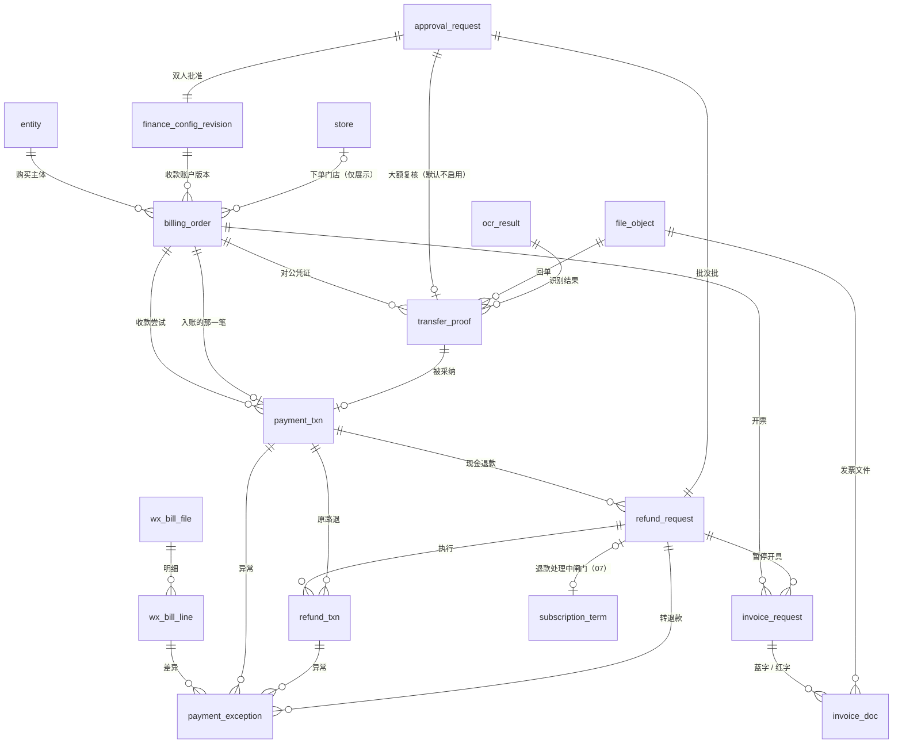
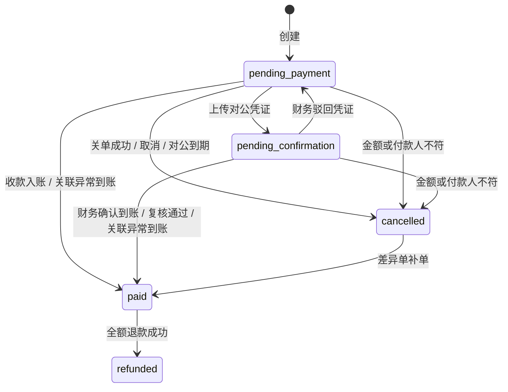
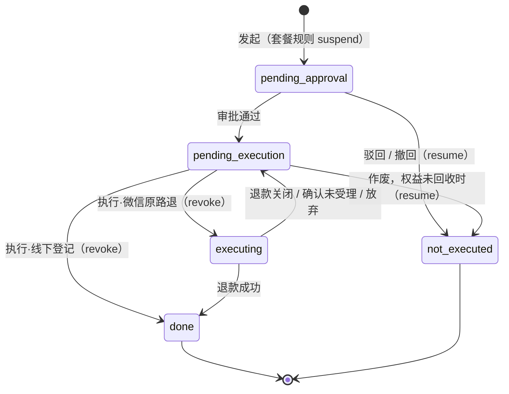
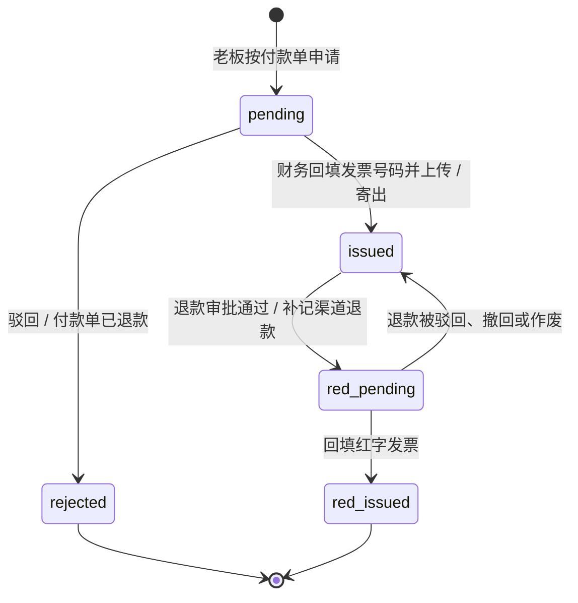

# 付款单、收款交易、退款、对账、发票

| 项 | 内容 |
| --- | --- |
| 模块 | `billing`（L2 资金）里的付款部分。价目、订阅、积分账本在分组 07 |
| 表 | 12 张：`billing_order`、`payment_txn`、`transfer_proof`、`refund_request`、`refund_txn`、`payment_exception`、`wx_bill_file`、`wx_bill_line`、`recon_day`、`invoice_request`、`invoice_doc`、`finance_config_revision` |
| 依据 | 草案 `docs/appendix/design/d2-payment.md` 第 3–11 节（下文写作 d2:行号），套餐退款闸门与履约按 `d1-ledger.md` 第 4.4、6.10 节；`docs/03-key-designs.md` 第 1、2.7 节与第 9 节裁决（R 编号）；rulings 的 M12、M13、M15、M22–M25、M33、M34、第四节第 3、4 项，第二轮的 M44、M46–M48、M53–M55、M60、M66–M68、M92，以及第三轮的 M93、M98–M101；`catalogue.json` 的 conventions 与各表 notes；`decisions.md` 第 1、6、7 节 |
| 配套文件 | Prisma 片段 `08-billing-payment.prisma`；手写约束 `08-billing-payment.sql`。三处的表、列、类型、可空性一致 |

## 1. 概览

这组表回答四个问题：商家为哪次购买该付多少钱（付款单）；渠道上实际收到、退出了哪些钱（收款交易、退款交易）；两者对不上时怎么办（差异单、账单文件与明细、每日对账汇总）；钱的凭据怎么留（对公凭证、开票申请与票据、受控财务配置）。

主线是“先记资金事实，再入账”：渠道成功的收款无条件记进 `payment_txn`，再在同一事务里入账到 `billing_order` 并调用账本的 `fulfill()`。入不了账或履约受阻时开一张 `payment_exception`，付款单同时离开“未完成”集合。退款分两层：`refund_request` 挂统一审批单，`refund_txn` 记渠道事实。

付款只发生在开通、续费、升级、加购四种场景（03:18）。订购与广告只扣积分，它们的取消退回在 order 模块的 `cancel_request`，不在本分组。

`recon_day` 是按账单日 × 渠道的汇总行，不与其他表建外键，图中未画。`subscription_term` 在分组 07，由它的 `refund_request_id` 指向本分组。

通用约定（逐表不再重复）：

- 主键 `id uuid`，UUID v7，应用生成，库里不设默认值（R1）；主键约束名 `pk_<表>`（M48）。
- 时刻列 `timestamptz`，库内存 UTC；业务时间由注入的时钟写入，列上不设 `now()` 默认值。“哪一天”用 `date`，按 Asia/Shanghai 取日。
- 金额列以 `_fen` 结尾，`integer`（分）；只有 `recon_day` 的 7 个汇总列是 `bigint`，出接口转字符串（M15）。
- 枚举列 `text` + CHECK，取值的唯一来源是 `packages/contract` 的 Zod enum。字典编码（驳回原因、退款申请原因、快递公司、付款行；类型键见第 3 节）不是枚举，不写 CHECK、不建外键。
- 本分组在 L2，对 `entity`、`store`、`merchant_user`、`staff`、`approval_request`、`file_object`、`ocr_result`（都在 L1）建外键，一律 `ON DELETE RESTRICT`：资金与票据是证据类数据，不删。外键全部由 Prisma 片段生成，手写 SQL 里没有外键（M46）。`billing_order` 指向门店的外键是复合外键 `(store_id, entity_id) → store(id, entity_id)`（M47）。
- 不变量在每日校验里登记为 `payment.I1` … `payment.I13`（`module = billing`），文中写全称；各表“不变量”里没有编号的检查项，登记时在同一命名空间下从 `payment.I14` 续编（15 分组的请求）。检查项都是每日项：`modes: ['full']`，不写 `every`；`heal = none`（资金类不自愈）；违规对象属于某个主体的（带 `entity_id` 的行），上报时传 `entityId`，孤儿行不传。文中的“告警”一律经告警端口 `alerts.raise({ rule, dimension?, severity, detail })`，指纹由 ops 拼，本分组不自拼（M30；15 分组）。
- 写 `status_transition` 的四张表（`billing_order`、`refund_request`、`payment_exception`、`invoice_request`）都只迁移 `status` 一列：`machine` = 表名，`state_field = 'status'`（M53）。子状态列（`billing_order.transfer_state`、`fulfillment_status`）的变化只写 `audit_log`。
- 时限列（`transfer_proof.due_at`、`invoice_request.due_at`、`refund_request.exec_due_at`）在工作日历修正后由 sla 重算：状态机表 `invoice_request`、`refund_request` 另写一行 `from_state = to_state` 的状态历史（`state_field = status`，负载带 `calendarVersion`、`dueAtBefore`、`dueAtAfter`）；`transfer_proof` 不是状态机表，只写 `audit_log`（01 文档 2.6）。
- 本分组没有只增表（catalogue 的 `append_only` 都为 false），但行都不物理删除：建议数据库应用角色对这 12 张表只有 INSERT、SELECT、UPDATE 权限。`finance_config_revision` 另有防改触发器。
- jsonb 可空列的“空”一律指 SQL NULL（Prisma 写 `Prisma.DbNull`），不写 JSON `null`；CHECK 按 SQL NULL 判断。

## 2. 表定义

### 2.1 `billing_order` 付款单

付款单（`FK…`）：开通、续费、升级、加购四类购买的业务单据。严格 5 态；保存内容快照、应付、实收、已退金额与履约结果。渠道过程态在 `payment_txn`，不进本表。

归属：主体维度（`entity_id`）。`store_id` 只作展示，不算归属列，但按 M47 与 `entity_id` 一起对 `store` 建复合外键。主键：`id`（uuid）。只增：否。锁顺序（lock_rank）：290。

| 列 | 类型 | 空 | 默认 | 说明 | 出处 |
| --- | --- | --- | --- | --- | --- |
| `id` | uuid | 否 | — | 主键，UUID v7，应用生成 | R1 |
| `order_no` | text | 否 | — | 付款单号：`FK` + yyyymmdd + 5 位日流水，超过 5 位自动扩位；预发环境加前缀 `T`。由 `biz_sequence` 在事务内取号 | d2:198 |
| `entity_id` | uuid | 否 | — | 购买主体 → `entity.id` | d2:199 |
| `store_id` | uuid | 可 | — | 创建时的当前门店；与 `entity_id` 一起 → `store(id, entity_id)`（复合外键，保证门店属于购买主体）。只用于列表展示，不参与鉴权 | d2:200；M47 |
| `type` | text | 否 | — | 付款类型，由服务端按报价判定，前端不传。取值：`plan_new` 开通；`plan_renew` 续费（含降级续费）；`plan_upgrade` 升级补差；`topup` 加购积分 | d2:201 |
| `status` | text | 否 | — | 付款单状态（PRD 5.3，严格 5 种）。取值：`pending_payment` 待支付；`pending_confirmation` 待确认收款；`paid` 已支付；`cancelled` 已取消；`refunded` 已退款 | d2:202 |
| `channel` | text | 否 | — | 收款渠道。取值：`wechat_jsapi` 微信支付 JSAPI；`bank_transfer` 对公转账 | d2:203 |
| `source` | text | 否 | — | 下单来源；灾备重建的付款单按原下单来源记 `weapp`。取值：`weapp` 商家在小程序下单；`admin` 后台线下签约代建（退路 B） | d2:204；enums_shared `client` |
| `content_snapshot` | jsonb | 否 | — | 内容快照 `BillingOrderContent`（套餐、升级、加购三种形态）。履约只认快照，不回查现价 | d2:205；d1:519-536 |
| `formula_code` | text | 可 | — | 计算式模板码（如“¥6,000 × 3 个月”），展示用；灾备重建的付款单为空 | d2:206 |
| `formula_args` | jsonb | 可 | — | 计算式参数，展示用 | d2:206 |
| `quote_hash` | text | 否 | — | 快照内容哈希；用于“同内容未完成付款单复用” | d2:207 |
| `amount_fen` | integer | 否 | — | 应付金额（分），大于 0；V1.0 不改价，等于报价金额 | d2:208 |
| `paid_amount_fen` | integer | 否 | `0` | 实收金额（分）：入账时写入渠道实收，不是应付 | d2:209、636 |
| `refunded_amount_fen` | integer | 否 | `0` | 已退金额（分）。不设上限：超额退款是要记录的资金事实，由不变量与 `refund_over` 差异单发现 | d2:210 |
| `expires_at` | timestamptz | 否 | — | 待支付截止时间。微信：创建 + `billing.payment.order_timeout_minutes`；对公：创建 + `billing.payment.transfer_valid_days`；升级单另受快照 `validUntil` 约束 | d2:211；M24 |
| `transfer_state` | text | 可 | — | 对公转账子状态；只在对公付款单未完成期间有值，进入已支付、已取消、已退款时清空。取值：`awaiting_proof` 待上传凭证；`proof_submitted` 凭证已提交，待财务确认；`proof_rejected` 凭证被驳回，待重新上传；`confirm_review` 大额复核中（仅启用二人复核时） | d2:212 |
| `bank_account_finance_config_revision_id` | uuid | 可 | — | 仅对公：创建时展示给商家的收款账户版本（`config_key = bank_account` 的行）→ `finance_config_revision.id`。角色 `bank_account` + 被引用表全名 | d2:213；M33 |
| `paid_at` | timestamptz | 可 | — | 收款时间：微信 `success_time`，对公为财务确认到账时间 | d2:214 |
| `paid_payment_txn_id` | uuid | 可 | — | 入账的那笔收款交易 → `payment_txn.id`；一笔交易至多入账一张付款单 | d2:215 |
| `applied_at` | timestamptz | 可 | — | 入账事务的时间 | d2:215 |
| `fulfillment_status` | text | 否 | `'none'` | 履约状态；“已支付 / 已退款 ⇔ 非 none”由不变量校验。取值：`none` 未履约；`done` 履约完成；`blocked` 履约受阻 | d2:216；decisions #32 |
| `fulfilled_at` | timestamptz | 可 | — | 履约完成的时刻：`fulfill()` 所在事务的账本时钟（含重试履约）。不一定是周期的生效时刻：生效期间续费、重复付款多排的预约周期在本期结束次日 00:00 生效，生效时刻取 `fulfillment_result.effectiveAt` | d2:217；d1:511、945 |
| `fulfillment_note` | text | 可 | — | 履约说明，如“重复付款，多排一个周期”“升级前提已变” | d2:217 |
| `fulfillment_result` | jsonb | 可 | — | `billing.fulfill()` 的返回快照 | d2:217；d1:561-563 |
| `cancelled_at` | timestamptz | 可 | — | 取消时间；补单后保留作痕迹 | d2:218 |
| `cancel_reason` | text | 可 | — | 取消原因。取值：`timeout` 微信超时关单；`user` 老板取消；`staff` 员工取消；`transfer_ttl` 对公到期未传凭证；`amount_mismatch` 实收与应付不符；`payer_mismatch` 付款人或回传数据不符 | d2:218 |
| `refunded_at` | timestamptz | 可 | — | 全额退款成功时间 | d2:219 |
| `has_open_exception` | boolean | 否 | `false` | 冗余：存在未决差异单（列表打标“对账差异待处理”） | d2:220 |
| `client_platform` | text | 可 | — | 下单端平台，排查虚拟支付与策略命中用；后台代建为空。取值：`ios` iOS；`android` Android；`harmony` 鸿蒙；`windows` Windows；`mac` macOS；`devtools` 开发者工具；`unknown` 未知 | d2:222、1293 |
| `client_version` | text | 可 | — | 下单端小程序版本号 | d2:222 |
| `contract_no` | text | 可 | — | 线下合同号；`source = admin` 必填 | d2:223 |
| `placed_by_user_id` | uuid | 可 | — | 下单的商家用户（老板）→ `merchant_user.id`；与 `created_by_staff_id` 二选一 | d2:224 |
| `created_by_staff_id` | uuid | 可 | — | 代建付款单的员工 → `staff.id`（线下签约代建；灾备重建时为处理差异的财务） | d2:224；03:91 |
| `proxy_actor_type` | text | 可 | — | V1.1 代操作人类型；V1.0 恒为空。取值：`merchant` 商家用户（V1.1 的管理员）；`partner` 服务商 | 01:176；decisions #33 |
| `proxy_actor_id` | uuid | 可 | — | V1.1 代操作人 id；多态，不建外键；V1.0 恒为空 | 01:176；decisions #33 |
| `proxy_client` | text | 可 | — | V1.1 代操作人所用的客户端；V1.0 恒为空。取值：`weapp` 小程序；`portal` 电脑端下载页；`admin` 运营管理后台 | M44 |
| `rebuilt_from` | text | 可 | — | 灾备重建时记录原 `out_trade_no` | d2:225 |
| `lock_version` | integer | 否 | `0` | 乐观锁；后台操作带 `expectedVersion` | d2:226；约定“乐观锁” |
| `created_at` | timestamptz | 否 | — | 创建时间 | d2:190 |
| `updated_at` | timestamptz | 否 | — | 更新时间 | d2:190 |

**键与索引**

- 主键：`id`（`pk_billing_order`）。
- 外键：`entity_id` → `entity.id`（RESTRICT）；复合外键 `fk_billing_order_store_entity`：(`store_id`, `entity_id`) → `store`(`id`, `entity_id`)（RESTRICT；`store_id` 为空时不校验）；`bank_account_finance_config_revision_id` → `finance_config_revision.id`（RESTRICT）；`paid_payment_txn_id` → `payment_txn.id`（RESTRICT）；`placed_by_user_id` → `merchant_user.id`（RESTRICT）；`created_by_staff_id` → `staff.id`（RESTRICT）。
- 唯一约束：`uq_billing_order_order_no`（`order_no`）；`uq_billing_order_paid_payment_txn_id`（`paid_payment_txn_id`）。部分唯一索引、表达式唯一索引见“手写约束”。
- 普通索引：
  - `ix_billing_order_entity_created`（`entity_id`, `created_at DESC`）：商家端与后台按主体列付款单；创建时查同主体未完成单。
  - `ix_billing_order_status_channel_created`（`status`, `channel`, `created_at`）：后台列表按状态、支付方式筛选与计数。
  - `ix_billing_order_store_id`（`store_id`）：按门店筛选付款单；复合外键 `fk_billing_order_store_entity` 在门店侧删改时的引用检查。
- 部分索引见“手写约束”。

**手写约束**

| 约束名 | 种类 | 规则 |
| --- | --- | --- |
| `ck_billing_order_type` | CHECK | `type` 的取值限于：`plan_new`、`plan_renew`、`plan_upgrade`、`topup` |
| `ck_billing_order_status` | CHECK | `status` 的取值限于：`pending_payment`、`pending_confirmation`、`paid`、`cancelled`、`refunded` |
| `ck_billing_order_channel` | CHECK | `channel` 的取值限于：`wechat_jsapi`、`bank_transfer` |
| `ck_billing_order_source` | CHECK | `source` 的取值限于：`weapp`、`admin` |
| `ck_billing_order_transfer_state` | CHECK | `transfer_state` 的取值限于：`awaiting_proof`、`proof_submitted`、`proof_rejected`、`confirm_review` |
| `ck_billing_order_fulfillment_status` | CHECK | `fulfillment_status` 的取值限于：`none`、`done`、`blocked` |
| `ck_billing_order_cancel_reason` | CHECK | `cancel_reason` 的取值限于：`timeout`、`user`、`staff`、`transfer_ttl`、`amount_mismatch`、`payer_mismatch` |
| `ck_billing_order_client_platform` | CHECK | `client_platform` 的取值限于：`ios`、`android`、`harmony`、`windows`、`mac`、`devtools`、`unknown` |
| `ck_billing_order_proxy_actor_type` | CHECK | `proxy_actor_type` 的取值限于：`merchant`、`partner` |
| `ck_billing_order_proxy_client` | CHECK | `proxy_client` 的取值限于：`weapp`、`portal`、`admin` |
| `ck_billing_order_amount_fen` | CHECK | 应付金额大于 0 |
| `ck_billing_order_paid_amount_fen` | CHECK | 实收金额不为负 |
| `ck_billing_order_refunded_amount_fen` | CHECK | 已退金额不为负；不设上限 |
| `ck_billing_order_content_kind` | CHECK | 快照是 JSON 对象且必有 `kind` 键；`type` 与 `kind` 对应：开通、续费 ↔ plan，升级 ↔ upgrade，加购 ↔ topup |
| `ck_billing_order_channel_fields` | CHECK | 微信付款单没有对公子状态、收款账户版本，也不会进入待确认收款；对公付款单必有收款账户版本 |
| `ck_billing_order_transfer_state_by_status` | CHECK | 对公付款单的子状态与状态的搭配：待支付 ↔ 待传或被驳回；待确认收款 ↔ 已提交或复核中（两者子状态都不得为空）；终态为空 |
| `ck_billing_order_creator` | CHECK | 下单人二选一：商家用户或员工 |
| `ck_billing_order_admin_source` | CHECK | 后台代建：必有员工、合同号，且渠道为对公转账 |
| `ck_billing_order_proxy_actor` | CHECK | 代操作人三列（类型、id、客户端）同空同非空（M44） |
| `ck_billing_order_paid_facts` | CHECK | 已支付 / 已退款 ⇔ 入账四列齐全（收款时间、入账交易、入账时间、实收大于 0）；其余状态四列为空或 0 |
| `ck_billing_order_cancelled` | CHECK | 取消时间与原因同空同非空；已取消必有取消时间 |
| `ck_billing_order_refunded` | CHECK | 已退款：必有退款时间，且已退不小于实收 |
| `ck_billing_order_fulfillment` | CHECK | 履约完成 ⇔ 有履约时刻；履约状态非 none 的付款单必为已支付或已退款 |
| `uq_billing_order_open_plan` | 部分唯一索引 | `(entity_id) WHERE status IN ('pending_payment','pending_confirmation') AND type IN ('plan_new','plan_renew','plan_upgrade')`：同一主体同一时刻只允许一张未完成的套餐类付款单 |
| `ix_billing_order_pending_expires` | 部分索引 | `(expires_at) WHERE status = 'pending_payment'`：超时扫描与到期兜底（`po.expire`、`po.transfer_ttl` 的对账） |
| `ix_billing_order_blocked` | 部分索引 | `(paid_at) WHERE fulfillment_status = 'blocked'`：履约受阻队列与“72 小时未处理”的不变量（`payment.I4`） |

**状态机**

写 `status_transition`，`machine = billing_order`，`state_field = status`。迁移只经 `flow.transition()`，底层是带原状态条件的 UPDATE（d2:1150）。`transfer_state`、`fulfillment_status` 是子状态：只改子状态、`status` 不变的动作不写状态历史，只写 `audit_log`。

| 当前状态 | 事件 | 新状态 | 守卫 | 触发者 |
| --- | --- | --- | --- | --- |
| — | 创建（微信） | `pending_payment` | 仅老板；主体已认证或审核中；购买策略允许该渠道与金额；报价金额与入参一致；无其他未完成套餐类付款单；加购须套餐生效中；主体没有处于退款处理中的周期（报价函数返回 `PLAN_REFUND_IN_PROGRESS`，d1:864、1129） | 商家 |
| — | 创建（对公）或后台线下代建 | `pending_payment`（`awaiting_proof`） | 同上；代建须合同号且 `controls.admin_create_order` 开启 | 商家 / 员工 |
| `pending_payment` | 收款入账 `applyPayment` | `paid` | 交易已成功；渠道实收 = 应付；付款人、回传数据与本库一致 | 系统（回调、查单、对账、内联与任务进程） |
| `pending_payment` / `pending_confirmation` | 收到金额或付款人不符的款 | `cancelled` | 系统动作；`cancel_reason` 取 `amount_mismatch` / `payer_mismatch`；该笔保留为未入账收款并开差异单 | 系统 |
| `pending_payment`（微信） | 超时或老板取消 | `cancelled` | 名下尝试都已 `closed`（以关单结果为准，不是到点即取消） | 系统 / 商家 |
| `pending_payment`（`awaiting_proof` / `proof_rejected`） | 上传凭证 | `pending_confirmation`（`proof_submitted`） | 文件已确认存在、类型合规；未过期；该单没有待确认的凭证 | 商家 / 员工代传 |
| `pending_confirmation`（`proof_submitted`） | 重新上传凭证（财务尚未处理） | 不变 | 旧凭证 `pending` → `superseded`，新凭证 `pending`；按新凭证重算 `due_at`、重设 `sla.breach` 定时器；状态与子状态都不变，只写审计 | 商家 / 员工代传 |
| `pending_confirmation`（`confirm_review`） | 重新上传凭证 | — | 拒绝：复核期间不允许替换凭证，须先由复核人退回 | — |
| `pending_confirmation`（`proof_submitted`） | 财务驳回凭证 | `pending_payment`（`proof_rejected`） | 原因 + 说明；`expires_at` 顺延一个对公有效期（升级单不延长）（M68） | 财务 |
| `pending_confirmation`（`proof_submitted`） | 财务确认到账（不需复核） | `paid` | 权限 + 再次验证身份；回显付款单号与到账金额；到账金额 = 应付；银行流水号规范化后唯一；确认人不是开单员工 | 财务 |
| `pending_confirmation`（`proof_submitted`） | 财务确认到账（金额 ≥ 复核阈值，启用二人复核时） | `pending_confirmation`（`confirm_review`） | 同上；建 `transfer_confirm` 审批单（`dedupe_key = transfer_confirm:{凭证 id}`），只暂存确认内容 | 财务 |
| `pending_confirmation`（`confirm_review`） | 复核通过 / 退回 | `paid` /（`proof_submitted`） | 审批人不是发起人（审批单保证） | 财务（第二人） |
| `pending_payment` / `pending_confirmation`（对公，不在 `confirm_review`） | 差异单 `bank_unmatched` 的“关联到付款单并确认”（`link_order`） | `paid` | 同主体、金额相等；孤儿收款关联到本单后 `applyPayment`；本单 `pending` 的凭证同事务置 `accepted`（结论人 = 处理差异的财务，交易的 `transfer_proof_id` 指向它），取消其 `sla.breach` 定时器 | 财务 |
| `pending_payment`（`awaiting_proof` / `proof_rejected`） | 到期或老板取消 | `cancelled` | 没有待确认的凭证；凭证待财务确认期间不可取消、不自动关闭 | 系统 / 商家 |
| `cancelled` | 差异单“补单” | `paid` | 唯一入口；存在该单未入账的成功收款；实时查单仍为成功且金额相等；回显 + 再次验证身份 + 说明 | 财务 |
| `paid` | 入账收款的退款成功且累计退款 ≥ 实付 | `refunded` | 由 `refund_txn` 成功驱动；只算入账收款（`paid_payment_txn_id`）上的退款，未入账收款的退回不动本单 | 系统 |

商家创建付款单的事务里先由 `biz_sequence` 取得 `order_no`，再随 `ref { type: 'billing_order', id, no }` 调 `agreements.assertConsents`（场景 `plan_purchase` / `topup`），同意记录的 `biz_no` 即本单号（13 分组；`ck_agreement_consent_biz_no` 要求 `FK` 前缀）。后台线下代建的付款单凭合同号，不调。

履约子状态（只写 `audit_log`）：

| 当前 | 事件 | 新值 | 说明 |
| --- | --- | --- | --- |
| `none` | 入账事务里调用 `fulfill()` | `done` 或 `blocked` | 先置 `paid`，再写 `fulfillment_status`、`fulfillment_result`；`done` 时写 `fulfilled_at`。受阻的付款单仍是已支付（R11），同事务开 `fulfillment_blocked` 差异单 |
| `blocked` | 差异单“重试履约”（`retried`，M66） | `done` | 再次调用 `fulfill()`（幂等键 `fulfill:billing_order:{id}`）返回 `done`：写 `fulfilled_at`、覆盖 `fulfillment_result`、`fulfillment_note` 记“重试履约”；同事务差异单 → `resolved`（`retried`），刷新 `has_open_exception`。仍返回 `blocked` 时付款单与差异单都不变，只覆盖 `fulfillment_result` 并写审计 |
| `blocked` | 差异单转退款，退款成功 | 不变 | 付款单 → `refunded`，`fulfillment_status` 保持 `blocked` 作痕迹 |

**不变量**（每日校验）

- `payment.I1`：`paid` / `refunded` ⇔ 恰有一条 `applied_at` 非空的成功收款，且 `paid_amount_fen` = 该交易 `channel_amount_fen` = `amount_fen`；此时 `fulfillment_status` ∈ {`done`, `blocked`}。
- `payment.I2`：待支付、待确认、已取消 ⇒ 无已入账交易，`fulfillment_status = none`；待支付、待确认的付款单名下没有成功的收款。
- `payment.I3`：`refunded_amount_fen` = 已入账收款的 `refunded_fen`；`status = refunded` ⇔ `refunded_amount_fen ≥ paid_amount_fen > 0`。
- `payment.I4`：`fulfillment_status = blocked` 的付款单有未决的 `fulfillment_blocked` 差异单，或已退款；受阻超过 72 小时未处理计入违规（03:52）。
- `payment.I12`：对公付款单的 `bank_account_finance_config_revision_id` 指向 `config_key = bank_account` 的行，且是创建时刻生效的版本。
- `payment.I13`：履约完成的付款单在账本侧恰有对应的周期或批次（由分组 07 的不变量校验，结果并入同一份报告）。
- `has_open_exception` 为真 ⇔ 存在指向本单、状态为 `open` 或 `resolving` 的差异单。

**相对草案的改动**

1. 主键由“随全局约定”定为 `uuid`（R1）。
2. `agreement_versions jsonb`（d2:221）删除：同意证据只在 `agreement_consent`，由它的 `biz_type = billing_order`、`biz_id` 指回付款单，`biz_no` 存付款单号快照（R13；decisions #9；13 分组）。
3. `version` 改名 `lock_version`（约定“乐观锁”；decisions #27）。
4. `source` 的取值 `miniapp` 改为 `weapp`，与全仓的客户端来源取值一致（enums_shared `client`）。
5. `fulfillment_status` 的取值 `exception` 改为 `blocked`（decisions #32；R11“履约受阻”）。受阻后允许“重试履约”，`blocked` → `done`（d1:510；M66）；d2:780 只允许退款的写法不采用。
6. `paid_txn_id` 改名 `paid_payment_txn_id`（M33：角色名 + 被引用表全名），并加唯一约束。`bank_account_revision_id` 改名 `bank_account_finance_config_revision_id`（M33：角色 + 被引用表全名，与本分组其他按角色命名的外键列一致）。
7. 新增 `proxy_actor_type`、`proxy_actor_id`、`proxy_client`：V1.1 服务商模块的“代操作人”留痕列，V1.0 恒为空（01:176；decisions #33；M44 要求三列齐全）。d2:60 现稿未留。
8. 状态迁移补写状态历史（decisions #24）；d2:190 只有带原状态条件的 UPDATE。
9. 财务驳回凭证后回到 `pending_payment`（`proof_rejected`），按 03:41 与 M68；d2:455-456 保持“待确认收款”的写法不采用。`transfer_state` 与 `status` 的搭配写成 CHECK；进入终态时清空 `transfer_state`（草案未写）。
10. 补“待确认收款时重新上传凭证”（状态不变，旧凭证 `superseded`）与“差异单关联异常到账”两条迁移：d2:454-456 的付款单状态机没有，而凭证表（d2:278）与差异单处理矩阵（d2:1110）用到。复核期间不允许重传。
11. `expires_at` 的时限参数改从参数服务取：`billing.payment.order_timeout_minutes`、`billing.payment.transfer_valid_days`（M24）；d2:170、1415-1416 写在计费参数里。
12. d1:507、519 把快照列叫 `item_snapshot`、类型列叫 `kind`（取值 `subscribe` 等）；本表是 d2 定义的，沿用 d2 的 `content_snapshot`、`type`，快照结构以 07 文档第 4.8 节为准。d1:511 要求的 `effective_at` 不单独建列：周期生效时刻在 `fulfillment_result.effectiveAt`（生效期间续费的预约周期不是履约时刻），`fulfilled_at` 只记履约事务的时刻。
13. `store_id` 的外键按 M47 改为复合外键 `(store_id, entity_id) → store(id, entity_id)`，`ON DELETE RESTRICT`（初稿为单列 `ON DELETE SET NULL`）。门店（含草稿门店）不物理删除，删除草稿门店只做停用（`archive_reason = draft_deleted`），引用 `store` 的外键统一 RESTRICT（M93）。
14. 补 CHECK：下单人二选一、后台代建三要件、入账四列与状态一致、快照 `kind` 与 `type` 对应（快照缺 `kind` 键或不是 JSON 对象时拒绝）、对公子状态不得为空、退款与取消的时间列。d2:216 说明“已支付 ⇔ 履约非 none”不能做行级 CHECK，本稿只写了单向的那一半。

### 2.2 `payment_txn` 收款交易

渠道侧一次收款尝试，成功的即“收款流水”。保存渠道实收金额、付款人、回传数据、对账状态。对公到账与孤儿到账也落在本表。银行流水号与付款行在本表，不在凭证表。

归属：主体维度（`entity_id`）；孤儿到账（没有对应付款单）时为空。主键：`id`（uuid）。只增：否。锁顺序（lock_rank）：300。

| 列 | 类型 | 空 | 默认 | 说明 | 出处 |
| --- | --- | --- | --- | --- | --- |
| `id` | uuid | 否 | — | 主键，UUID v7，应用生成 | R1 |
| `entity_id` | uuid | 可 | — | 所属主体 → `entity.id`；创建时从付款单复制，孤儿到账为空，关联到付款单时补写 | 补：约定“归属列”、M13、catalogue notes |
| `billing_order_id` | uuid | 可 | — | 付款单 → `billing_order.id`；仅“账单或银行有、平台无对应付款单”的孤儿交易为空 | d2:238 |
| `channel` | text | 否 | — | 收款渠道，同付款单。取值：`wechat_jsapi` 微信支付 JSAPI；`bank_transfer` 对公转账 | d2:239 |
| `attempt_no` | smallint | 否 | — | 同一付款单的第几次尝试，从 1 起。出现第 2 次的唯一场景：付款人 openid 变了。孤儿交易：微信取商户单号里的尝试段，对公登记为 1 | d2:240；M34 |
| `out_trade_no` | text | 否 | — | 商户单号：`{order_no}-{attempt_no 两位}-{6 位随机 [0-9A-Z]}`。随机段使单号不随流水回退而重复；对公渠道同样生成，作内部引用。孤儿交易没有付款单号：微信取账单或查单返回的商户单号；对公“登记异常到账”取 `{CY 差异单号}-01-{6 位随机}`，关联到付款单后不改 | d2:241、1111 |
| `amount_fen` | integer | 否 | — | 下单时的应付金额（分），大于 0；孤儿交易取渠道实收 | d2:242 |
| `channel_amount_fen` | integer | 可 | — | 渠道实收金额（分）：微信回调、查单、账单返回的 `amount.total`；对公为财务确认的到账金额。成功前为空 | d2:243 |
| `payer_openid` | text | 可 | — | 微信：预下单时取当前会话的 openid，即 JSAPI 的 `payer.openid` | d2:244 |
| `channel_payer_ref` | text | 可 | — | 渠道返回的付款人：微信回调里的 `payer.openid`；对公为付款户名 | d2:245 |
| `attach` | text | 可 | — | 下单时写给微信的附加数据（不超过 128 字节）：`v1.{entityId}.{orderId}.{typeCode}.{refId}.{months}` | d2:246、552 |
| `channel_attach` | text | 可 | — | 回调或查单返回的附加数据；应与 `attach` 相同，用于入账校验与灾备重建 | d2:246 |
| `status` | text | 否 | — | 渠道事实，不写状态历史。取值：`created` 已建（预下单在途或失败）；`prepaid` 已拿到 prepay_id，等用户付款；`succeeded` 收款成功；`closed` 已关闭 | d2:247 |
| `applied_at` | timestamptz | 可 | — | 入账到付款单的时间。未入账收款 = 已成功、未入账、未全额退回 | d2:248、249 |
| `refunded_fen` | integer | 否 | `0` | 该笔收款已成功退回的金额（分）；不设上限 | d2:249 |
| `prepay_id` | text | 可 | — | 微信预支付交易会话标识，有效 2 小时 | d2:250 |
| `prepay_expires_at` | timestamptz | 可 | — | `prepay_id` 失效时间 | d2:250 |
| `channel_txn_no` | text | 可 | — | 微信 `transaction_id`；对公为规范化后的银行流水号（去空白、全角转半角、去连字符、转大写） | d2:251 |
| `bank_serial_raw` | text | 可 | — | 对公：财务录入的原始流水号 | d2:252 |
| `payer_bank` | text | 可 | — | 对公：付款行（字典 `bank` 的编码，不建外键）；仅在流水号冲突时填写 | d2:252；14 分组 |
| `channel_success_at` | timestamptz | 可 | — | 微信 `success_time`；对公为财务确认到账时间 | d2:253 |
| `trade_state_raw` | text | 可 | — | 渠道原始交易状态 | d2:254 |
| `bank_type` | text | 可 | — | 微信返回的付款银行类型 | d2:254 |
| `fee_fen` | integer | 可 | — | 手续费（分），对账时由交易账单回填 | d2:255 |
| `transfer_proof_id` | uuid | 可 | — | 对公：被采纳的凭证 → `transfer_proof.id` | d2:256；M33 |
| `confirmed_by_staff_id` | uuid | 可 | — | 对公：确认到账的财务（登记异常到账时为登记人）→ `staff.id` | d2:256 |
| `reviewed_by_staff_id` | uuid | 可 | — | 对公：复核人 → `staff.id`；仅启用二人复核时有值，取复核审批单的审批人 | d2:256；M25 |
| `recon_state` | text | 否 | `'pending'` | 行级对账状态；对公收款确认即对平。取值：`pending` 待对账（账单未到）；`matched` 已对平；`diff` 有差异（关联着未决差异单）；`resolved` 差异已处理 | d2:257、1088-1095 |
| `recon_bill_date` | date | 可 | — | 对平所依据的账单日 | d2:258 |
| `last_queried_at` | timestamptz | 可 | — | 最近一次主动查单时间（节流） | d2:259 |
| `query_count` | integer | 否 | `0` | 主动查单次数 | d2:259 |
| `created_at` | timestamptz | 否 | — | 创建时间 | d2:190 |
| `updated_at` | timestamptz | 否 | — | 更新时间 | d2:190 |

**键与索引**

- 主键：`id`（`pk_payment_txn`）。
- 外键：`entity_id` → `entity.id`（RESTRICT）；`billing_order_id` → `billing_order.id`（RESTRICT）；`transfer_proof_id` → `transfer_proof.id`（RESTRICT）；`confirmed_by_staff_id` → `staff.id`（RESTRICT）；`reviewed_by_staff_id` → `staff.id`（RESTRICT）。
- 唯一约束：`uq_payment_txn_out_trade_no`（`out_trade_no`）；`uq_payment_txn_transfer_proof_id`（`transfer_proof_id`）。部分唯一索引、表达式唯一索引见“手写约束”。
- 普通索引：
  - `ix_payment_txn_billing_order_attempt`（`billing_order_id`, `attempt_no`）：取一张付款单名下的全部尝试。
  - `ix_payment_txn_status_success`（`status`, `channel_success_at`）：收款流水列表与汇总；按成功时间做反向对账。
  - `ix_payment_txn_recon_success`（`recon_state`, `channel_success_at`）：按对账状态筛选收款流水。
  - `ix_payment_txn_entity_success`（`entity_id`, `channel_success_at`）：按主体查收款。
- 部分索引见“手写约束”。

**手写约束**

| 约束名 | 种类 | 规则 |
| --- | --- | --- |
| `ck_payment_txn_channel` | CHECK | `channel` 的取值限于：`wechat_jsapi`、`bank_transfer` |
| `ck_payment_txn_status` | CHECK | `status` 的取值限于：`created`、`prepaid`、`succeeded`、`closed` |
| `ck_payment_txn_recon_state` | CHECK | `recon_state` 的取值限于：`pending`、`matched`、`diff`、`resolved` |
| `ck_payment_txn_attempt_no` | CHECK | 尝试序号从 1 起 |
| `ck_payment_txn_amount_fen` | CHECK | 应付金额大于 0 |
| `ck_payment_txn_channel_amount_fen` | CHECK | 渠道实收大于 0（空值不校验） |
| `ck_payment_txn_refunded_fen` | CHECK | 已退金额不为负；不设上限 |
| `ck_payment_txn_query_count` | CHECK | 查单次数不为负 |
| `ck_payment_txn_succeeded_facts` | CHECK | 收款成功必有渠道实收、渠道流水号、成功时间 |
| `ck_payment_txn_applied` | CHECK | 只有成功且有付款单的交易才能入账 |
| `ck_payment_txn_entity` | CHECK | 有付款单的交易必有主体；只有孤儿到账可以没有主体 |
| `ck_payment_txn_wechat_fields` | CHECK | 微信专有列只在微信渠道有值 |
| `ck_payment_txn_bank_fields` | CHECK | 对公专有列只在对公渠道有值 |
| `ck_payment_txn_bank_confirmed` | CHECK | 对公交易在财务确认时才建行：必为成功，且有原始流水号与确认人 |
| `ck_payment_txn_reviewer` | CHECK | 复核人不得是确认人 |
| `uq_payment_txn_channel_txn_no` | 部分唯一索引 | `(channel, channel_txn_no, COALESCE(payer_bank, '')) WHERE channel_txn_no IS NOT NULL`：同一微信交易号、同一银行流水号（加付款行）只能入库一次 |
| `uq_payment_txn_open_attempt` | 部分唯一索引 | `(billing_order_id) WHERE status IN ('created','prepaid')`：一张付款单至多一个进行中的尝试 |
| `uq_payment_txn_applied` | 部分唯一索引 | `(billing_order_id) WHERE applied_at IS NOT NULL`：一张付款单至多入账一笔（V1.0 不支持分笔付款） |
| `ix_payment_txn_payer_success` | 部分索引 | `(payer_openid, channel_success_at) WHERE status = 'succeeded'`：付款人当日累计已付（判断微信渠道是否可用） |
| `ix_payment_txn_unapplied` | 部分索引 | `(channel_success_at) WHERE status = 'succeeded' AND applied_at IS NULL`：未入账收款扫描（`tx.unapplied_scan`）与“成功未入账超过 10 分钟”告警 |

**状态列（不写状态历史）**

`status` 记录渠道事实，不写 `status_transition`；用带原状态条件的 UPDATE。

| 当前状态 | 事件 | 新状态 | 说明 |
| --- | --- | --- | --- |
| — | 首次预下单（事务 A） | `created` | 同一付款单至多一个进行中的尝试 |
| `created` | 微信下单成功（事务 B，带守卫） | `prepaid` | 付款单已不是待支付则回滚并关单 |
| `created` / `prepaid` / `closed` | 渠道成功 `recordChannelSuccess` | `succeeded` | `closed` 也允许：迟到的成功。不做业务判断 |
| `created` / `prepaid` | 关单成功、查单为已关闭、换付款人 | `closed` | |
| — | 财务确认对公到账、登记异常到账、对账补建 | `succeeded` | 直接以成功建行。登记异常到账与“账单有、平台无”建的是孤儿交易（没有付款单，单号规则见 `out_trade_no`） |

入账是另一件事：`applied_at` 从空写为入账时间，至多一次。`recon_state`：`pending` → `matched`；有未决差异单时为 `diff`，处理后为 `resolved`。

**不变量**（每日校验）

- `payment.I1`、`payment.I2`：见 `billing_order`。每条未入账收款（成功已超过 10 分钟、未入账、未全额退回）都有一张未决差异单。
- `payment.I3`：`refunded_fen` = 指向它的成功退款交易金额之和；`refunded_fen > channel_amount_fen` ⇒ 存在 `refund_over` 差异单。
- `payment.I9`：`channel_txn_no` 全局唯一（唯一索引保证；校验任务复核成功行的空值比例）。
- 已入账的交易：`entity_id`、`billing_order_id` 与付款单一致，且 `billing_order.paid_payment_txn_id` 指回本行。

**相对草案的改动**

1. 补 `entity_id`（草案没有归属列，d2:238）；孤儿到账时为空（M13；catalogue notes）。
2. `attempt_seq` 改名 `attempt_no`（M34：`seq` 只指 identity 列）。不加 `(billing_order_id, attempt_no)` 唯一约束：对账补建的交易可能关联到单号被复用的付款单（d2:1063、1613 的时间线），序号会重复。
3. `proof_id` 改名 `transfer_proof_id`（M33），并加唯一约束：一张凭证至多被一笔交易采纳。
4. 银行流水号（`channel_txn_no`、`bank_serial_raw`）与付款行（`payer_bank`）放在本表，不放凭证表（rulings 第四节第 4 项；03:26 待回写）。
5. “流水号冲突放行”标记（d2:743、1182、1507）不建列：同一 `channel_txn_no` 出现在多行（付款行不同）即为放行，导出与每日清单按此派生。
6. 补 CHECK：成功必有三项渠道事实；入账的前提；微信、对公专有列的适用渠道；对公交易确认时才建行；复核人不是确认人。
7. 草案的三条普通索引里 `(payer_openid, channel_success_at) WHERE status = succeeded` 是部分索引，放手写 SQL；另补“未入账收款”的部分索引。
8. 孤儿交易（没有付款单）的 `out_trade_no`、`attempt_no` 取值草案没有定义（d2:1111 只写“登记”）：微信取渠道返回的商户单号，对公登记取 `{CY 差异单号}-01-{6 位随机}`、`attempt_no = 1`。

### 2.3 `transfer_proof` 对公转账凭证

商家或员工上传的对公转账回单：文件、识别结果引用、系统比对结论、财务审核结论。启用二人复核时暂存第一名财务的确认内容。它是“对公收款确认”这条处理队列的待办对象，不进审批单。

归属：主体维度（`entity_id`）。主键：`id`（uuid）。只增：否。锁顺序（lock_rank）：310。

| 列 | 类型 | 空 | 默认 | 说明 | 出处 |
| --- | --- | --- | --- | --- | --- |
| `id` | uuid | 否 | — | 主键，UUID v7，应用生成 | R1 |
| `entity_id` | uuid | 否 | — | 所属主体 → `entity.id`；创建时从付款单复制，不可变 | 补：约定“归属列” |
| `billing_order_id` | uuid | 否 | — | 付款单 → `billing_order.id`；一张付款单可多次上传 | d2:273 |
| `upload_no` | integer | 否 | — | 同一付款单的第几次上传，从 1 起 | d2:273；M34 |
| `file_id` | uuid | 否 | — | 回单文件 → `file_object.id`（分类 `pay_receipt`，私有桶；图片不超过 5MB 或 PDF） | d2:274；d5:263 |
| `uploaded_by_user_id` | uuid | 可 | — | 上传的商家用户 → `merchant_user.id`；与 `uploaded_by_staff_id` 二选一 | d2:275 |
| `uploaded_by_staff_id` | uuid | 可 | — | 后台代传的员工 → `staff.id` | d2:275 |
| `uploaded_at` | timestamptz | 否 | — | 上传时间；也是升级报价有效期判断用的“付款人行为时刻” | d2:275；d1:511 |
| `ocr_result_id` | uuid | 可 | — | 识别结果 → `ocr_result.id`；OCR 未配置时为空。异步识别时 `ocr_result` 先以 `pending` 建行。识别值只存在 `ocr_result` | d5:115、943；06 分组请求 |
| `check_result` | jsonb | 可 | — | 系统比对四项的结论（户名、金额、附言含付款单号、转账时间晚于创建）；只含结论，不含识别原值。仅提示，不阻断。异步识别完成后由 billing 订阅 `media.ocr.completed` 写入（media 不写本表） | d2:277；d5:115；06 分组 |
| `review_status` | text | 否 | — | 财务审核结论；处理进度，不写状态历史。取值：`pending` 待财务确认；`accepted` 已采纳（确认到账）；`rejected` 已驳回；`superseded` 被新凭证替换 | d2:278 |
| `first_confirm` | jsonb | 可 | — | 仅二人复核：第一名财务确认的内容（流水号、付款行、到账金额）；确认人与时间在复核审批单上。复核退回时清空 | d2:279；M25 |
| `review_approval_request_id` | uuid | 可 | — | 仅二人复核：复核审批单 → `approval_request.id`（`kind = transfer_confirm`）；保存最近一次 | M25 |
| `reviewed_by_staff_id` | uuid | 可 | — | 作出采纳或驳回结论的财务 → `staff.id` | d2:280 |
| `reviewed_at` | timestamptz | 可 | — | 作出结论的时间 | d2:280 |
| `reject_reason_code` | text | 可 | — | 驳回原因（字典 `reject_reason` 的编码，场景 `transfer`，5 项：未到账、金额不符、户名与购买主体不一致、凭证无法识别、其他） | d2:280；14 分组 |
| `reject_note` | text | 可 | — | 驳回说明，不超过 200 字 | d2:280 |
| `due_at` | timestamptz | 可 | — | 财务应处理的截止时间（上传后 1 个工作日）；`sla.breach` 定时器以本行为主体 | M22；d2:742；d3:2962 |
| `sla_snapshot` | jsonb | 可 | — | 计算 `due_at` 时的时限参数快照 `SlaSnapshot`（`policy = review.transfer_proof`） | M22；M60；d3:3052 |
| `lock_version` | integer | 否 | `0` | 乐观锁；两名财务同时处理时后者得到 409 | d2:190、1152 |
| `created_at` | timestamptz | 否 | — | 创建时间 | d2:190 |
| `updated_at` | timestamptz | 否 | — | 更新时间 | d2:190 |

**键与索引**

- 主键：`id`（`pk_transfer_proof`）。
- 外键：`entity_id` → `entity.id`（RESTRICT）；`billing_order_id` → `billing_order.id`（RESTRICT）；`file_id` → `file_object.id`（RESTRICT）；`uploaded_by_user_id` → `merchant_user.id`（RESTRICT）；`uploaded_by_staff_id` → `staff.id`（RESTRICT）；`ocr_result_id` → `ocr_result.id`（RESTRICT）；`review_approval_request_id` → `approval_request.id`（RESTRICT）；`reviewed_by_staff_id` → `staff.id`（RESTRICT）。
- 唯一约束：`uq_transfer_proof_review_approval_request_id`（`review_approval_request_id`）；`uq_transfer_proof_billing_order_upload_no`（`billing_order_id`, `upload_no`）。部分唯一索引、表达式唯一索引见“手写约束”。
- 普通索引：
  - `ix_transfer_proof_review_status_uploaded`（`review_status`, `uploaded_at`）：对公收款确认队列（待确认、今日已处理）。
  - `ix_transfer_proof_entity_id`（`entity_id`）：按主体鉴权与查询。
- 部分索引见“手写约束”。

**手写约束**

| 约束名 | 种类 | 规则 |
| --- | --- | --- |
| `ck_transfer_proof_review_status` | CHECK | `review_status` 的取值限于：`pending`、`accepted`、`rejected`、`superseded` |
| `ck_transfer_proof_upload_no` | CHECK | 上传序号从 1 起 |
| `ck_transfer_proof_uploader` | CHECK | 上传人二选一：商家用户或员工 |
| `ck_transfer_proof_reviewed` | CHECK | 待确认的凭证没有结论人；已采纳、已驳回的必有结论人与时间 |
| `ck_transfer_proof_rejected` | CHECK | 驳回必填原因与说明 |
| `ck_transfer_proof_reject_note` | CHECK | 驳回说明不超过 200 字 |
| `ck_transfer_proof_first_confirm` | CHECK | 暂存的第一人确认内容必有对应的复核审批单 |
| `ck_transfer_proof_sla` | CHECK | 截止时间与时限快照同空同非空 |
| `uq_transfer_proof_pending` | 部分唯一索引 | `(billing_order_id) WHERE review_status = 'pending'`：一张付款单同一时刻至多一张待确认的凭证 |
| `ix_transfer_proof_pending_due` | 部分索引 | `(due_at) WHERE review_status = 'pending'`：超时预警与工作台待办的派生查询 |

**状态列（不写状态历史）**

`review_status` 是处理队列的结论，不写 `status_transition`，不进审批单（M22）；用带原状态条件的 UPDATE，后台操作带 `expectedVersion`。

| 当前状态 | 事件 | 新状态 | 守卫 | 触发者 |
| --- | --- | --- | --- | --- |
| — | 上传凭证 | `pending` | 付款单为对公且未过期；该单没有其他待确认凭证；算出 `due_at` 并登记 `sla.breach`。配置了 OCR 时经 media 发起识别，`ocr_result` 先以 `pending` 建行并由 `ocr_result_id` 指向，`check_result.ocrStatus = pending` | 商家 / 员工代传 |
| `pending` | 回单识别完成（订阅 `media.ocr.completed`） | `pending` | 按识别结果重算四项比对，写 `check_result`；状态不变 | 系统 |
| `pending` | 财务确认到账 | `accepted` | 见付款单状态机；同事务建 `payment_txn` 并入账 | 财务 |
| `pending` | 财务确认到账（需复核） | `pending` | 写 `first_confirm`、`review_approval_request_id`；付款单进入 `confirm_review` | 财务 |
| `pending` | 复核通过 | `accepted` | 审批单通过的同一事务；交易的确认人取发起人，复核人取审批人 | 财务（第二人） |
| `pending` | 复核退回 | `pending` | 清空 `first_confirm`；说明必填 | 财务（第二人） |
| `pending` | 财务驳回 | `rejected` | 原因 + 说明 | 财务 |
| `pending` | 被新凭证替换 | `superseded` | 付款单为 `pending_confirmation`（`proof_submitted`）、财务尚未处理时重新上传；复核中（`first_confirm` 非空）不允许 | 商家 / 员工代传 |
| `pending` | 差异单 `bank_unmatched` 关联到本付款单并确认 | `accepted` | 见付款单状态机；结论人为处理差异的财务，被关联的交易 `transfer_proof_id` 指向本行 | 财务 |

离开 `pending` 时取消 `sla.breach` 定时器；重新上传时新行重算 `due_at` 并登记新的定时器。“审核时效”指标取 `uploaded_at` 到 `reviewed_at`。工作日历修正后重算 `due_at`（连同 `sla_snapshot`）：本表不是状态机表，只写 `audit_log`，不写状态历史（01 文档 2.6）。

**不变量**（每日校验）

- 付款单处于 `pending_confirmation` ⇔ 恰有一张 `pending` 的凭证。
- `accepted` 的凭证 ⇔ 恰有一条 `payment_txn.transfer_proof_id` 指向它，且该交易已成功。
- `first_confirm` 非空 ⇒ 付款单 `transfer_state = confirm_review`，且复核审批单为待审。
- `pending` 且 `due_at` 未过的凭证有对应的 `sla.breach` 定时器（主体类型 `transfer_proof`）。

**相对草案的改动**

1. 补 `entity_id`（约定“归属列”：接口按 id 读写的子表带归属列）。
2. `seq` 改名 `upload_no`（M34）。
3. `ocr_result jsonb` 改为 `ocr_result_id` 外键；`check_result` 只存比对结论，不存识别出的原值（d5:115、943）。
4. 补 `due_at`、`sla_snapshot`（M22）：`sla.breach` 定时器的主体是本表，不是审批单（d3:2962 的 T32 原写审批单）。快照结构与全仓 `SlaSnapshot` 相同（M60）。
5. 补 `review_approval_request_id`（M25）：启用对公大额二人复核时指向 `kind = transfer_confirm` 的审批单。`first_confirm` 里不再存第一确认人与时间（d2:279 的 `staffId`、`at`），它们是审批单的发起人与提交时间（约定“操作人列”：不用 jsonb 存操作人）。
6. `reviewed_by` 改名 `reviewed_by_staff_id`（约定“操作人列”）。
7. 补 `lock_version`（d2:190：带人工并发写的表有乐观锁）。
8. 银行流水号与付款行不在本表（rulings 第四节第 4 项）。
9. d2:278 的 `superseded` 补上进入条件：付款单处于 `proof_submitted` 时重新上传；`bank_unmatched` 关联到付款单时，该单待确认的凭证置 `accepted`（d2:1110 未写凭证的去向）。
10. 回单识别是异步的：上传时 `ocr_result` 先以 `pending` 建行，识别结论由 billing 订阅 `media.ocr.completed` 后写入 `check_result`（06 分组；M8：media 不写 L2）。

### 2.4 `refund_request` 现金退款申请

现金退款的领域单据：规则核算快照与执行状态。与审批单一对一（`kind = plan_refund`，单号 `TK…` 存在审批单上）。提交时即建行。订购与广告取消退回积分不在本表，在 order 模块的 `cancel_request`；两表的执行状态取值相同（M54）。

归属：主体维度（`entity_id`）；孤儿收款退款时为空。主键：`id`（uuid）。只增：否。锁顺序（lock_rank）：70（领域申请单，紧跟审批单之后）。

| 列 | 类型 | 空 | 默认 | 说明 | 出处 |
| --- | --- | --- | --- | --- | --- |
| `id` | uuid | 否 | — | 主键，UUID v7，应用生成 | R1 |
| `approval_request_id` | uuid | 否 | — | 审批单 → `approval_request.id`，一对一；单号 `TK…` 取 `approval_request.request_no` | d2:289；R3 |
| `source` | text | 否 | — | 申请来源。取值：`customer_service` 客服在付款单详情发起；`exception` 差异单或履约受阻转入 | d2:291 |
| `entity_id` | uuid | 可 | — | 所属主体 → `entity.id`；孤儿收款退款时为空 | d2:292；M13 |
| `billing_order_id` | uuid | 可 | — | 被退收款所属的付款单 → `billing_order.id`；孤儿收款为空。规则为 `unapplied_receipt` 时它可能是一张已支付的单（重复付款），被退的不是它的入账交易 | d2:293、1105 |
| `payment_txn_id` | uuid | 否 | — | 被退的那一笔收款交易 → `payment_txn.id`。除 `unapplied_receipt` 外都等于付款单的 `paid_payment_txn_id` | d2:294 |
| `base_amount_fen` | integer | 否 | — | 基数（分）：该笔收款的实收，或未入账收款的未退余额 | d2:297 |
| `deduct_amount_fen` | integer | 否 | `0` | 扣除（分）；V1.0 只做全额退款，恒为 0 | d2:297 |
| `amount_fen` | integer | 否 | — | 申请退款金额（分）= 基数 − 扣除，大于 0；由服务端核算 | d2:297 |
| `breakdown_snapshot` | jsonb | 否 | — | 规则核算快照 `CashRefundBreakdown`（发起时调用一次并保存；含窗口截止时刻与被退周期的起止） | d2:298；d1:1072、1130 |
| `rule_code` | text | 否 | — | 适用规则。套餐三条与 `subscription_term.refund_rule` 取值相同，发起时原样传给 `suspendTermForRefund`。取值：`window` 套餐：开通或续费 7 天内且未使用积分；`qualification_failed` 套餐：资质终审不通过，免窗口；`override` 套餐：规则外退款（免窗口，仅超级管理员）；`fulfillment_blocked` 履约受阻，全额退；`unapplied_receipt` 未入账收款退回 | d2:299；M67 |
| `rule_text` | text | 否 | — | 规则文案快照，如“开通 7 天内且未使用积分（含冻结），全额退款” | d2:299 |
| `recheck_log` | jsonb | 可 | — | 审批、执行时的复核结果，各存一份，供排查 | d2:301 |
| `is_override` | boolean | 否 | `false` | 规则外退款（`rule_code = override`，仅超级管理员可发起） | d2:302；M67 |
| `reason_code` | text | 可 | — | 申请原因（字典 `refund_reason` 的编码）；客服发起必填，差异转入为空（原因即差异单本身） | d2:303；14 分组 |
| `note` | text | 可 | — | 申请说明 | d2:303 |
| `status` | text | 否 | — | 执行状态（与 `cancel_request.status` 同一组取值）；审批结论另读审批单。取值：`pending_approval` 已提交、待审批；`pending_execution` 已批准、待执行；`executing` 执行中（微信原路退在途）；`done` 已退款；`not_executed` 未执行即关闭（驳回、撤回、作废） | d2:304；M54 |
| `exec_route` | text | 可 | — | 退款路由，执行时确定。取值：`wechat_original` 微信原路退；`offline` 线下退款登记 | d2:305 |
| `exec_due_at` | timestamptz | 可 | — | 执行时限：审批通过时写入（参数 `sla.review.refund_execute`，默认 1 个工作日）；审批中、驳回、撤回为空。执行时限的 `sla.breach` 定时器主体是一对一的审批单（M71）。与 09 分组 `cancel_request.exec_due_at` 同名同义 | d3:2271；M71；03 分组请求 |
| `sla_snapshot` | jsonb | 可 | — | 执行时限的参数快照 `SlaSnapshot`（`policy = review.refund_execute`）；与 `exec_due_at` 同有同无 | d3:3052；M60；03 分组请求 |
| `entitlement_revoked_at` | timestamptz | 可 | — | 套餐权益已回收（`revokeTerm` 成功）的时刻；非空后申请单不可作废 | d2:306；d1:1114 |
| `executed_by_staff_id` | uuid | 可 | — | 最近一次执行的财务 → `staff.id` | d2:309 |
| `executed_at` | timestamptz | 可 | — | 最近一次执行的时间 | d2:309 |
| `done_at` | timestamptz | 可 | — | 退款完成时间 | d2:309 |
| `voided_by_staff_id` | uuid | 可 | — | 审批通过后作废的财务 → `staff.id`；仅 `close_reason = voided` 时有值 | d2:310；M54 |
| `exec_error` | jsonb | 可 | — | 最近一次执行失败的原因，供“待执行、执行中”队列展示 | d2:311 |
| `closed_at` | timestamptz | 可 | — | 申请结束时间：进入 `done` 或 `not_executed` 时写入。为空即在途 | M12；M54 |
| `close_reason` | text | 可 | — | 未执行即关闭的原因；仅 `not_executed` 时非空。取值：`rejected` 审批驳回；`withdrawn` 申请人在审批前撤回；`voided` 审批通过后、执行前作废 | M54 |
| `close_note` | text | 可 | — | 作废说明，仅 `close_reason = voided` 时必填。驳回与撤回的说明在审批单的 `decision_note` | d2:310；M54 |
| `lock_version` | integer | 否 | `0` | 乐观锁 | d2:312；约定“乐观锁” |
| `created_at` | timestamptz | 否 | — | 创建时间，即申请时刻；套餐退款的窗口按这一时刻判断 | d2:190；d1:1130 |
| `updated_at` | timestamptz | 否 | — | 更新时间 | d2:190 |

**键与索引**

- 主键：`id`（`pk_refund_request`）。
- 外键：`approval_request_id` → `approval_request.id`（RESTRICT）；`entity_id` → `entity.id`（RESTRICT）；`billing_order_id` → `billing_order.id`（RESTRICT）；`payment_txn_id` → `payment_txn.id`（RESTRICT）；`executed_by_staff_id` → `staff.id`（RESTRICT）；`voided_by_staff_id` → `staff.id`（RESTRICT）。
- 唯一约束：`uq_refund_request_approval_request_id`（`approval_request_id`）。部分唯一索引、表达式唯一索引见“手写约束”。
- 普通索引：
  - `ix_refund_request_status_created`（`status`, `created_at`）：退款管理的待审批、待执行、执行中、已处理队列。
  - `ix_refund_request_status_exec_due_at`（`status`, `exec_due_at`）：待执行队列按执行时限排序、超时标记。
  - `ix_refund_request_billing_order_id`（`billing_order_id`）：付款单详情取退款申请。
  - `ix_refund_request_payment_txn_id`（`payment_txn_id`）：按收款交易取历次申请。
  - `ix_refund_request_entity_created`（`entity_id`, `created_at`）：按主体查退款。
- 部分索引见“手写约束”。

**手写约束**

| 约束名 | 种类 | 规则 |
| --- | --- | --- |
| `ck_refund_request_source` | CHECK | `source` 的取值限于：`customer_service`、`exception` |
| `ck_refund_request_rule_code` | CHECK | `rule_code` 的取值限于：`window`、`qualification_failed`、`override`、`fulfillment_blocked`、`unapplied_receipt` |
| `ck_refund_request_status` | CHECK | `status` 的取值限于：`pending_approval`、`pending_execution`、`executing`、`done`、`not_executed` |
| `ck_refund_request_exec_route` | CHECK | `exec_route` 的取值限于：`wechat_original`、`offline` |
| `ck_refund_request_close_reason` | CHECK | `close_reason` 的取值限于：`rejected`、`withdrawn`、`voided` |
| `ck_refund_request_amount` | CHECK | 退款金额 = 基数 − 扣除，且大于 0；扣除不为负 |
| `ck_refund_request_rule_source` | CHECK | 差异转入的申请只用履约受阻、未入账收款两条规则；客服发起的只用套餐三条规则 |
| `ck_refund_request_override` | CHECK | 规则外标记与 `override` 规则一一对应 |
| `ck_refund_request_reason` | CHECK | 客服发起必有申请原因；差异转入不填 |
| `ck_refund_request_subject` | CHECK | 只有未入账收款退回可以没有付款单；只有没有付款单的申请可以没有主体 |
| `ck_refund_request_closed` | CHECK | 已退款、未执行即关闭 ⇔ 有结束时间；关闭原因只在 `not_executed` 时非空（M54） |
| `ck_refund_request_voided` | CHECK | 作废 ⇔ 有作废人与作废说明；驳回、撤回不填这两列 |
| `ck_refund_request_executed` | CHECK | 执行中、已退款必有路由、执行人、执行时间 |
| `ck_refund_request_executing_route` | CHECK | 只有微信原路退有“执行中” |
| `ck_refund_request_done` | CHECK | 已退款 ⇔ 有完成时间 |
| `ck_refund_request_revoked` | CHECK | 只有套餐规则会回收权益；权益已回收的申请不可作废，也不会停在待审批 |
| `ck_refund_request_sla` | CHECK | 执行时限与时限快照同空同非空；审批中、驳回、撤回没有执行时限，审批通过之后（待执行、执行中、已退款、作废）必有（与 09 的 `ck_cancel_request_sla` 同义） |
| `uq_refund_request_open_payment_txn` | 部分唯一索引 | `(payment_txn_id) WHERE closed_at IS NULL`：同一笔收款只允许一张在途退款申请（M12） |
| `ix_refund_request_open_billing_order` | 部分索引 | `(billing_order_id) WHERE closed_at IS NULL AND rule_code <> 'unapplied_receipt'`：开具发票、执行退款时现查“该付款单的入账收款有无在途退款申请”；未入账收款的退回不影响发票 |

**状态机**

写 `status_transition`，`machine = refund_request`，`state_field = status`。取值与分组 09 的 `cancel_request` 相同（M54）；审批结论在审批单上（R3），本表的 `pending_approval`、`not_executed` + `close_reason` 与审批单一一对应（`payment.I11`）。

**套餐退款的闸门**（M66；d1:513、1088-1125）：套餐三条规则（`window`、`qualification_failed`、`override`）在三个时点调用分组 07 的函数，与本表的迁移在同一事务里：发起时 `suspendTermForRefund(termId, 本行 id, rule_code)`（周期的 `refund_request_id` 指向本行，主体不可再新增冻结与购买）；未执行即关闭时 `resumeTermFromRefund(termId, 本行 id)`；执行时 `revokeTerm(termId, 本行 id)`。幂等键按 07 的约定：`refund_suspend:{TK 单号}`、`refund_resume:{TK 单号}`、`revoke:subscription_term:{termId}`。`termId` 取 `breakdown_snapshot.termId`。差异转入的两条规则（`fulfillment_blocked`、`unapplied_receipt`）不涉及周期，不调用这三个函数。升级过的周期不能按 `window`、`qualification_failed` 退：07 的 `suspendTermForRefund` 对这两条规则守卫“周期没有 `upgraded` 事件”，一张申请仍只对一笔收款；需要退的走规则外退款，`override` 不受这条守卫（M98）。同一周期的升级补差款是另外的收款，规则外退款时如何随之退回，M98 未写，已报主负责人。 已升级周期的例外（M111）：来源付款单的 `override` 申请执行时作废整个周期；之后各笔升级补差款的 `override` 申请不再调用闸门函数（`breakdown_snapshot` 不带 `termId`），只退现金。

**与发票的联动只看入账收款**：规则不是 `unapplied_receipt` 的申请退的是付款单的入账交易（`payment_txn_id = billing_order.paid_payment_txn_id`），才会暂停开票、触发红冲、受发票守卫约束；`unapplied_receipt`（如 `duplicate_receipt` 的重复款）不动付款单，也不动它的发票（d2:851）。

| 当前状态 | 事件 | 新状态 | 守卫 | 副作用（同事务） | 触发者 |
| --- | --- | --- | --- | --- | --- |
| — | 发起（同事务建审批单） | `pending_approval` | 权限；该笔收款无在途申请（部分唯一索引）；数额由服务端核算；属于 V1.0 支持的组合且规则核算通过：套餐规则调用 `previewPlanRefund(termId)`，窗口按此刻（即 `created_at`）判断，只判断这一次（d1:1130；M99）；`window`、`qualification_failed` 还要求周期没有升级过（M98）；差异转入：对应的未入账收款或履约受阻仍存在 | 套餐规则：`suspendTermForRefund`，不通过则整体回滚；入账收款的退款：该付款单 `pending` 的开票申请置 `held_by_refund_request_id`；差异转入：差异单 → `resolving` | 客服 / 处理差异的财务 |
| `pending_approval` | 审批通过（审批事务内回调） | `pending_execution` | 复核会变坏的事实：套餐规则重新调用 `previewPlanRefund` 只看“未使用”（窗口不再复核）、可退余额仍足够、差异转入的收款仍未入账；结果写 `recheck_log.approve` | 写 `exec_due_at`、`sla_snapshot`，登记执行时限的 `sla.breach` 定时器（主体为审批单，M71）；入账收款的退款：该付款单 `issued` 的开票申请 → `red_pending` | 财务 |
| `pending_approval` | 审批驳回 | `not_executed`（`rejected`） | 驳回说明在审批单 | 套餐规则：`resumeTermFromRefund`；清除开票申请的暂停标记；差异单回到 `open`；写 `closed_at` | 财务 |
| `pending_approval` | 申请人撤回 | `not_executed`（`withdrawn`） | 申请人本人；申请人已停用或对象已失效时，由 `finance.refund.approve` 持有人代撤（接口裁决 A15） | 同驳回 | 申请人 |
| `pending_execution` | 执行（微信原路） | `executing` | 权限 + 再次验证身份；入账收款的退款现算发票守卫（最新开票申请为 `issued` / `red_pending` 时拒绝，`RED_INVOICE_REQUIRED`）；金额 ≤ 实收 − 已退 − 在途；名下没有未到终态的退款交易 | 套餐规则：`revokeTerm`（重新执行时按幂等键直接返回），首次成功写 `entitlement_revoked_at`；`revokeTerm` 拒绝则整体回滚，申请单留在待执行、由财务作废。建 `refund_txn(created)`，写 `executed_*`；取消执行时限的定时器 | 财务 |
| `pending_execution` | 执行（线下登记） | `done` | 同上 | 同上；建 `refund_txn(offline, succeeded)`；其余同“退款交易成功” | 财务 |
| `pending_execution` | 退款回调晚到（申请已回到待执行时收到渠道“退款成功”） | `done` | 回调验签通过；对应退款交易存在 | 照常记成功：累加已退金额，同“退款交易成功”（接口裁决 A102） | 系统（回调） |
| `pending_execution` | 作废 | `not_executed`（`voided`） | `entitlement_revoked_at` 为空；名下没有成功或未到终态的退款交易；说明必填 | 套餐规则：`resumeTermFromRefund`；同驳回的恢复动作；`red_pending` 的开票申请恢复为 `issued`（已回填红票的保持 `red_issued`）；写 `voided_by_staff_id`、`close_note`、`closed_at`；取消执行时限的定时器；审批单保持 `approved` | 财务 |
| `executing` | 退款交易成功 | `done` | — | 收款交易累加 `refunded_fen`。入账收款：付款单累加已退，累计 ≥ 实付则 → `refunded`，`pending` 的开票申请自动驳回（`reject_kind = order_refunded`）。未入账收款：不动付款单。差异单 → `resolved`。写 `done_at`、`closed_at` | 系统（回调、查询） |
| `executing` | 退款交易到达失败终态（`closed` / `not_accepted` / `abandoned`） | `pending_execution` | — | 写 `exec_error`；权益可能已回收，不可作废；执行时限不重新计时（失败由 `exec_error` 与退款告警跟进） | 系统 |

`closed_at` 在进入 `done` 或 `not_executed` 时写入。工作日历修正后重算 `exec_due_at`（连同 `sla_snapshot`）时写一行 `from_state = to_state` 的状态历史（01 文档 2.6）。

**不变量**（每日校验）

- `payment.I5`：`done` ⇔ 其成功退款交易金额之和 = `amount_fen`；`executing` ⇒ 恰有一条未到终态的退款交易；其他状态 ⇒ 没有未到终态的退款交易。
- `payment.I10`：套餐退款申请 `done` ⇒ 对应订阅周期为已退款或已取消，其批次可用为 0（挂着 `entitlement_unrecovered` 差异单的除外）。
- `payment.I11`：每行恰对应一张审批单（`kind = plan_refund`），且相容：审批单 `pending` ⇔ `pending_approval`；`rejected` / `withdrawn` ⇔ `not_executed` 且 `close_reason` 同名；`approved` ⇔ `pending_execution`、`executing`、`done`，或 `not_executed` 且 `close_reason = voided`。
- 闸门一致：套餐规则、`closed_at` 为空且 `entitlement_revoked_at` 为空 ⇔ 对应周期的 `subscription_term.refund_request_id` 指向本行（07 的 `billing.I17` 另对处理中超过 7 天的周期出提醒）。
- `entity_id`、`billing_order_id` 与 `payment_txn` 上的一致；规则不是 `unapplied_receipt` 时 `payment_txn_id = billing_order.paid_payment_txn_id`。
- `pending_execution` 且 `exec_due_at` 未过的申请有对应的执行时限 `sla.breach` 定时器（主体类型 `approval_request`）。

**相对草案的改动**

1. 只保留现金退款。`kind = points`（订购与广告取消退回积分）连同 `subject_type`、`subject_id`、`unit` 拆到 order 模块的 `cancel_request`（decisions #6；rulings 第五节）。`kind`、`unit` 两列因此删除，`exec_route` 去掉 `points_ledger`。
2. `request_no` 删除：`TK…` 单号只存 `approval_request.request_no`（约定“业务单号”）。
3. `store_id` 删除（catalogue notes）。`service_ticket_id` 删除：与客服工单的关联只在 `service_ticket_ref`（decisions #28）。
4. `status` 按 M54 统一：`pending` → `pending_approval`，`approved` → `pending_execution`，`rejected`、`withdrawn`、`cancelled`（作废）并为 `not_executed`，原因记在新增的 `close_reason`（`rejected` / `withdrawn` / `voided`）；“审批通过后作废”记为 `not_executed` + `voided`，审批单保持 `approved`。
5. `applicant_staff_id`、`applied_at`、`approved_by`、`approved_at` 删除：发起人、提交时间、审批人、审批时间都在审批单上（d2:307-308 的冗余按 R3 去掉）。申请时刻即本表的 `created_at`。
6. 新增 `closed_at`；在途唯一改为 `uq_refund_request_open_payment_txn … WHERE closed_at IS NULL`（M12），取代 d2:314 按 `status` 列举的两条部分唯一索引。
7. `cancelled_by` 改名 `voided_by_staff_id`，`cancel_note` 改名 `close_note`（M54），`cancelled_at` 并入 `closed_at`。`executed_by` 改名 `executed_by_staff_id`；`version` 改名 `lock_version`。
8. `entity_id` 可空（M13：孤儿收款退款）。
9. `base_amount`、`deduct_amount`、`amount` 改名 `base_amount_fen`、`deduct_amount_fen`、`amount_fen`（约定“金额与积分”）。
10. `breakdown` 改名 `breakdown_snapshot`（约定“命名规则”：快照列以 `_snapshot` 结尾）；只留现金一侧的结构，另存 d1 返回的窗口截止时刻与被退周期的起止（d1:1130；原型 admin/Refunds）。
11. `rule_code` 按 M67 改用 d1 的取值，与 `subscription_term.refund_rule` 相同：`plan_7d` → `window`，`window_waived` → `override`；`fulfillment_exception` 改为 `fulfillment_blocked`（decisions #32）。
12. `window_ref_at` 删除：按 d1（M66 采纳 d1 的闸门），窗口在发起时由 `previewPlanRefund` / `suspendTermForRefund` 按当时时刻判断，审批、执行不再复核窗口；d2:953 “关联客服工单取工单创建时刻”的默认做法不采用（07 的函数不接受外部时刻；M99）。
13. 套餐规则补上与分组 07 闸门函数的三个调用点（d1:513、1088-1125；M66）；d2 第 7.2 节写的是“申请时不冻结任何积分”，没有闸门。
14. `reason_code` 改为可空：客服发起必填，差异转入不填（原因即差异单）；d2:303 未区分来源。
15. 资质终审不通过的判定函数由 `merchant.isQualificationDead` 改名 `profile.isQualificationDead`（d9:651），不影响列。
16. 补 `exec_due_at`、`sla_snapshot`：d3:2271 审批单上的执行时限改由领域行承接（审批通过时写入），与 09 的 `cancel_request` 同名同义；快照列按 M60 叫 `sla_snapshot`；定时器主体仍是审批单（M71；03 分组请求）。
17. 升级过的周期按 d2 不可按 `window`、`qualification_failed` 退，需要退的走 `override`（M98）；d1 第 6.10 节“一张申请、多笔退款交易”的写法不采用，表结构不变。

### 2.5 `refund_txn` 退款交易

渠道侧一次退款的资金事实：微信原路退、线下退款登记、事后补记的渠道退款。成功的退款无论此前状态如何都落库。

归属：主体维度（`entity_id`）；孤儿收款退款时为空。主键：`id`（uuid）。只增：否。锁顺序（lock_rank）：320。

| 列 | 类型 | 空 | 默认 | 说明 | 出处 |
| --- | --- | --- | --- | --- | --- |
| `id` | uuid | 否 | — | 主键，UUID v7，应用生成 | R1 |
| `entity_id` | uuid | 可 | — | 所属主体 → `entity.id`；创建时从收款交易复制，孤儿收款退款为空 | 补：约定“归属列”；M13 |
| `refund_request_id` | uuid | 可 | — | 退款申请 → `refund_request.id`；“补记渠道退款”与差异单“线下退回”时为空 | d2:320、1111 |
| `billing_order_id` | uuid | 可 | — | 付款单 → `billing_order.id`；孤儿收款为空 | d2:321 |
| `payment_txn_id` | uuid | 否 | — | 原收款交易 → `payment_txn.id`（原路退需要它的 `out_trade_no`） | d2:321 |
| `channel` | text | 否 | — | 退款渠道。取值：`wechat_jsapi` 微信原路退；`offline` 线下退款 | d2:322 |
| `origin` | text | 否 | — | 发起方。取值：`system` 本系统发起；`external` 在微信商户平台直接发起、事后补记 | d2:323 |
| `out_refund_no` | text | 否 | — | 商户退款单号：`{TK 单号}-{序号两位}-{6 位随机}`，微信原路退与线下退款登记同一格式；重试同一次退款必须沿用。补记渠道退款取账单里的商户退款单号；差异单“线下退回”没有退款申请，取 `{CY 差异单号}-{序号两位}-{6 位随机}` | d2:324、1111 |
| `amount_fen` | integer | 否 | — | 退款金额（分），大于 0 | d2:325 |
| `status` | text | 否 | — | 渠道事实，不写状态历史。取值：`created` 已建（是否被微信受理未知，或被明确拒绝待重试）；`processing` 微信已受理；`succeeded` 退款成功；`closed` 微信关闭（失败终态）；`abnormal` 微信侧异常（非终态）；`not_accepted` 经查询确认微信侧不存在该退款单（失败终态）；`abandoned` 异常退款经确认无法继续后人工放弃（失败终态） | d2:326 |
| `channel_refund_no` | text | 可 | — | 微信 `refund_id`；线下为规范化后的退款银行流水号 | d2:327 |
| `submit_count` | integer | 否 | `0` | 向微信提交的次数 | d2:328 |
| `last_submit_at` | timestamptz | 可 | — | 最近一次提交时间 | d2:328 |
| `is_retry_halted` | boolean | 否 | `false` | 是否已停止自动重试 | d2:328；约定“命名规则” |
| `success_at` | timestamptz | 可 | — | 退款成功时间：微信入账时间；线下为登记时间 | d2:329 |
| `user_received_account` | text | 可 | — | 微信返回的退款入账账户描述 | d2:329 |
| `fail_code` | text | 可 | — | 失败码，如余额不足、频率限制、超期 | d2:330 |
| `fail_message` | text | 可 | — | 失败说明 | d2:330 |
| `is_late_success` | boolean | 否 | `false` | 从失败终态被渠道事实改成成功（必开差异单） | d2:331；约定“命名规则” |
| `transfer_date` | date | 可 | — | 线下：转账日期，不晚于登记当天 | d2:332、923 |
| `payee_name` | text | 可 | — | 线下：收款户名；对公付款的须等于购买主体名称 | d2:332、923 |
| `payee_bank` | text | 可 | — | 线下：收款开户行 | d2:332 |
| `payee_account_enc` | text | 可 | — | 线下：收款账号密文（AES-256-GCM） | d2:332；约定“敏感字段三件套” |
| `payee_account_mask` | text | 可 | — | 线下：收款账号脱敏串（后 4 位） | 补：约定“敏感字段三件套” |
| `receipt_file_id` | uuid | 可 | — | 线下：退款回单文件 → `file_object.id`（分类 `pay_receipt`；主体未知的孤儿收款退款按平台级登记，`scope_type = platform`） | d2:332；06 分组请求 |
| `registered_by_staff_id` | uuid | 可 | — | 线下：登记人 → `staff.id` | d2:332 |
| `note` | text | 可 | — | 线下：登记说明；改走线下时必填 | d2:921、923 |
| `fee_refund_fen` | integer | 可 | — | 退还的手续费（分），对账时由账单回填 | d2:333 |
| `recon_state` | text | 否 | `'pending'` | 行级对账状态；线下退款登记即对平。取值：`pending` 待对账；`matched` 已对平；`diff` 有差异；`resolved` 差异已处理 | d2:333 |
| `recon_bill_date` | date | 可 | — | 对平所依据的账单日 | d2:333 |
| `last_queried_at` | timestamptz | 可 | — | 最近一次查询退款的时间 | d2:333 |
| `created_at` | timestamptz | 否 | — | 创建时间 | d2:190 |
| `updated_at` | timestamptz | 否 | — | 更新时间 | d2:190 |

**键与索引**

- 主键：`id`（`pk_refund_txn`）。
- 外键：`entity_id` → `entity.id`（RESTRICT）；`refund_request_id` → `refund_request.id`（RESTRICT）；`billing_order_id` → `billing_order.id`（RESTRICT）；`payment_txn_id` → `payment_txn.id`（RESTRICT）；`receipt_file_id` → `file_object.id`（RESTRICT）；`registered_by_staff_id` → `staff.id`（RESTRICT）。
- 唯一约束：`uq_refund_txn_out_refund_no`（`out_refund_no`）。部分唯一索引、表达式唯一索引见“手写约束”。
- 普通索引：
  - `ix_refund_txn_refund_request_id`（`refund_request_id`）：取一张申请名下的历次退款交易。
  - `ix_refund_txn_payment_txn_id`（`payment_txn_id`）：核对收款交易的已退合计（不变量 `payment.I3`）。
  - `ix_refund_txn_billing_order_id`（`billing_order_id`）：付款单详情取退款记录。
  - `ix_refund_txn_status_success`（`status`, `success_at`）：退款明细列表与“本月退款”汇总；成功满 3 天无账单行的反向检查。
  - `ix_refund_txn_recon_success`（`recon_state`, `success_at`）：按对账状态筛选。
  - `ix_refund_txn_entity_id`（`entity_id`）：按主体查退款。
- 部分索引见“手写约束”。

**手写约束**

| 约束名 | 种类 | 规则 |
| --- | --- | --- |
| `ck_refund_txn_channel` | CHECK | `channel` 的取值限于：`wechat_jsapi`、`offline` |
| `ck_refund_txn_origin` | CHECK | `origin` 的取值限于：`system`、`external` |
| `ck_refund_txn_status` | CHECK | `status` 的取值限于：`created`、`processing`、`succeeded`、`closed`、`abnormal`、`not_accepted`、`abandoned` |
| `ck_refund_txn_recon_state` | CHECK | `recon_state` 的取值限于：`pending`、`matched`、`diff`、`resolved` |
| `ck_refund_txn_amount_fen` | CHECK | 退款金额大于 0 |
| `ck_refund_txn_submit_count` | CHECK | 提交次数不为负 |
| `ck_refund_txn_succeeded` | CHECK | 退款成功必有成功时间 |
| `ck_refund_txn_late_success` | CHECK | 迟到成功标记只出现在成功的行上 |
| `ck_refund_txn_entity` | CHECK | 有付款单的退款必有主体 |
| `ck_refund_txn_request` | CHECK | 本系统发起的微信退款必有退款申请 |
| `ck_refund_txn_external` | CHECK | 补记的只能是已成功的微信退款 |
| `ck_refund_txn_offline` | CHECK | 线下退款登记即成功，转账日期、流水号、收款户名、开户行、账号、回单、登记人齐全；微信退款这些列为空 |
| `uq_refund_txn_open` | 部分唯一索引 | `(refund_request_id) WHERE status IN ('created','processing','abnormal')`：一张申请同一时刻至多一条未到终态的退款交易（`abnormal` 算进行中） |
| `uq_refund_txn_channel_refund_no` | 部分唯一索引 | `(channel, channel_refund_no) WHERE channel_refund_no IS NOT NULL`：同一微信退款单号、同一线下退款流水号只能入库一次 |
| `ix_refund_txn_open_submit` | 部分索引 | `(last_submit_at) WHERE status IN ('created','processing','abnormal')`：退款轮询兜底与“处理中超过 3 天”“有失败码超过 1 小时”告警 |

**状态列（不写状态历史）**

`status` 记录渠道事实，不写 `status_transition`。

| 当前状态 | 事件 | 新状态 | 说明 |
| --- | --- | --- | --- |
| — | 执行退款（微信原路） | `created` | 先落意图并提交，再调微信 |
| — | 线下退款登记、补记渠道退款、差异单“线下退回” | `succeeded` | 直接以成功建行。三者的 `out_refund_no` 规则见列说明 |
| `created` | 微信受理 | `processing` | |
| `created` | 调用超时、网络错误、明确的业务错误 | `created` | 记 `fail_code`；以同一 `out_refund_no` 重试 |
| `created` | 财务“确认未受理” | `not_accepted` | 已停止自动重试；距最近一次提交 ≥ 10 分钟；查询返回退款单不存在 |
| `processing` | 微信返回关闭 | `closed` | 失败终态 |
| `processing` | 微信返回异常 | `abnormal` | 非终态；只能在微信商户平台处理，不允许改走线下 |
| `abnormal` | 运维命令放弃（两人确认） | `abandoned` | 失败终态 |
| 任意 | 回调、查询、账单得到成功 | `succeeded` | 成功的退款永远落库；此前已是失败终态的记 `is_late_success` |

**不变量**（每日校验）

- `payment.I3`：见 `payment_txn`。成功退款累计超过实收时必有 `refund_over` 差异单。
- `payment.I5`：见 `refund_request`。
- `payment.I9`：`channel_refund_no` 全局唯一（唯一索引保证）。
- `is_late_success` 为真的行有对应的差异单。
- `entity_id`、`billing_order_id` 与原收款交易上的一致。

**相对草案的改动**

1. 补 `entity_id`；孤儿收款退款时为空（M13；catalogue notes）。
2. `billing_order_id` 可空：孤儿收款没有付款单（d2:321 写“必填”的是原收款交易）。
3. `payee_account (enc)` 拆成 `payee_account_enc`、`payee_account_mask`（约定“敏感字段三件套”；不需要等值查找，不建盲索引）。
4. `registered_by` 改名 `registered_by_staff_id`。
5. `retry_halted`、`late_success` 改名 `is_retry_halted`、`is_late_success`（约定“命名规则”：布尔列前缀）。
6. 补 `note`：线下登记的说明（d2:921、923 的提交字段里有，3.5 的列表里漏了）。
7. `refund_request_id` 为空的情形除“补记渠道退款”（d2:320）外，还有差异单的“线下退回”（d2:1111，`bank_unmatched` 的处理不走审批）。CHECK 按此写。
8. 线下登记的各列按渠道写成一条 CHECK（线下齐全、微信为空）。回单文件按必填处理，见第 6 节。
9. 差异单“线下退回”没有 `TK` 单号，`out_refund_no` 取 `{CY 差异单号}-{序号两位}-{6 位随机}`（草案没有定义）；孤儿收款的退款回单按平台级文件登记（06 分组）。

### 2.6 `payment_exception` 差异单

差异单（`CY…`）：实时发现的异常与 T+1 对账差异共用一种单据、一个处理入口。14 种类型，每种有固定的可选处理。

归属：主体维度（`entity_id`）；对公到账无对应付款单、账单有而平台无等情形为空。主键：`id`（uuid）。只增：否。锁顺序（lock_rank）：340。

| 列 | 类型 | 空 | 默认 | 说明 | 出处 |
| --- | --- | --- | --- | --- | --- |
| `id` | uuid | 否 | — | 主键，UUID v7，应用生成 | R1 |
| `exception_no` | text | 否 | — | 差异单号：`CY` + yyyymmdd + 3 位起、自动扩位 | d2:341 |
| `entity_id` | uuid | 可 | — | 所属主体 → `entity.id`；创建时从付款单或收款交易复制，没有时为空 | 补：约定“归属列”、M13 |
| `kind` | text | 否 | — | 差异类型（收款侧 9 种、退款侧 5 种）。取值：`paid_after_cancel` 已取消后收到款；`amount_mismatch` 实收与应付不符；`payer_mismatch` 付款人或回传数据与付款单不符；`duplicate_receipt` 已支付的付款单又收到一笔；`fulfillment_blocked` 已支付但履约受阻；`bill_only` 账单有、平台无；`platform_only` 平台有、账单无；`status_mismatch` 本库成功而渠道查询非成功等矛盾；`bank_unmatched` 对公到账无对应付款单（人工登记）；`refund_bill_only` 退款：账单有、平台无；`refund_platform_only` 退款：平台有、账单无；`refund_amount_mismatch` 退款金额不符；`refund_over` 累计成功退款超过实收；`entitlement_unrecovered` 钱已退出、权益未能收回 | d2:342 |
| `detected_by` | text | 否 | — | 发现途径。取值：`callback` 回调；`query` 主动查单或查询退款；`apply` 入账函数；`reconciliation` T+1 对账；`manual` 人工登记 | d2:343 |
| `bill_date` | date | 否 | — | 对账发现时为账单日；实时发现时为发生日（Asia/Shanghai） | d2:344 |
| `billing_order_id` | uuid | 可 | — | 相关付款单 → `billing_order.id` | d2:345 |
| `payment_txn_id` | uuid | 可 | — | 相关收款交易 → `payment_txn.id` | d2:345 |
| `refund_txn_id` | uuid | 可 | — | 相关退款交易 → `refund_txn.id` | d2:345 |
| `wx_bill_line_id` | uuid | 可 | — | 相关账单行 → `wx_bill_line.id` | d2:345 |
| `amount_fen` | integer | 否 | — | 差异金额（分） | d2:346 |
| `bill_fact` | jsonb | 可 | — | 账单侧（或渠道侧）事实 | d2:346 |
| `platform_fact` | jsonb | 可 | — | 平台侧事实 | d2:346 |
| `cause_text` | text | 可 | — | 系统判断的原因，如“支付回调晚于取消” | d2:346 |
| `status` | text | 否 | — | 处理状态；未决 = `open` 或 `resolving`。取值：`open` 待处理；`resolving` 已转退款申请，等待完成；`resolved` 已处理；`auto_healed` 系统自动关闭：查单或对账补记后入账成功，或由入账函数重新归类到新差异单（只留痕，不占待办）；`ignored` 无需处理 | d2:347 |
| `resolution` | text | 否 | `'none'` | 处理方式。取值：`restore` 补单；`refund` 原路或线下退款（走审批）；`retried` 重试履约（仅履约受阻）；`rebuild_order` 重建付款单并入账；`link_order` 关联到付款单并确认；`offline_return` 线下退回；`record_channel_refund` 补记渠道退款；`corrected` 数据更正；`written_off` 核销；`none` 尚未处理或无需处理 | d2:348 |
| `resolution_note` | text | 可 | — | 处理说明，人工处理必填（含“转退款”时），不超过 200 字 | d2:349、1099 |
| `resolved_by_staff_id` | uuid | 可 | — | 处理人 → `staff.id`：作出处理的财务；“转退款”时即写入，退款完成后沿用。系统自动关闭（`auto_healed`）为空 | d2:349 |
| `resolved_at` | timestamptz | 可 | — | 处理完成时间 | d2:349 |
| `refund_request_id` | uuid | 可 | — | “转退款”生成的退款申请 → `refund_request.id`；申请被驳回、撤回、作废后与处理方式、处理人、说明一起清空，回到 `open` | d2:349、1104 |
| `dedupe_key` | text | 否 | — | 去重键，如 `paid_after_cancel:FK…-01-7QK2M9`、`bill_only:2026-09-29:4200…`；重跑对账、重复入账都不会重复开单。回调（`callback`）与入账函数（`apply`）实时开单的键：收款侧 `{kind}:{out_trade_no}`（`status_mismatch`、`amount_mismatch`、`payer_mismatch`、`paid_after_cancel`、`duplicate_receipt`、`fulfillment_blocked`，取到账那笔的商户单号）；退款侧 `refund_over:{out_refund_no}`、`status_mismatch:refund:{out_refund_no}`（迟到成功且未超额；带 `refund:` 段免与收款侧同名键相撞）、`refund_amount_mismatch:{out_refund_no}`。查单（`m.paymentOrder.sync`、`po.expire`、`rf.poll`）发现同类事实用同一套键；对账（`bill.download`）的键按 a07 与 x01（如 `bill_only:{账单日}:{微信单号}`）。迟到成功（未超额）记哪种 `kind` 待财务确认，暂记 `status_mismatch`，不加新取值 | d2:350；h01-hooks.md 2.6 |
| `lock_version` | integer | 否 | `0` | 乐观锁 | d2:190；约定“乐观锁” |
| `created_at` | timestamptz | 否 | — | 创建时间 | d2:190 |
| `updated_at` | timestamptz | 否 | — | 更新时间 | d2:190 |

**键与索引**

- 主键：`id`（`pk_payment_exception`）。
- 外键：`entity_id` → `entity.id`（RESTRICT）；`billing_order_id` → `billing_order.id`（RESTRICT）；`payment_txn_id` → `payment_txn.id`（RESTRICT）；`refund_txn_id` → `refund_txn.id`（RESTRICT）；`wx_bill_line_id` → `wx_bill_line.id`（RESTRICT）；`resolved_by_staff_id` → `staff.id`（RESTRICT）；`refund_request_id` → `refund_request.id`（RESTRICT）。
- 唯一约束：`uq_payment_exception_exception_no`（`exception_no`）；`uq_payment_exception_dedupe_key`（`dedupe_key`）。
- 普通索引：
  - `ix_payment_exception_status_kind`（`status`, `kind`）：差异队列与未决计数。
  - `ix_payment_exception_bill_date_status`（`bill_date`, `status`）：对账页按日汇总差异；判断某日差异是否全部处理。
  - `ix_payment_exception_billing_order_id`（`billing_order_id`）：维护付款单的 `has_open_exception`。
  - `ix_payment_exception_payment_txn_id`（`payment_txn_id`）：判断未入账收款是否已有未决差异单。
  - `ix_payment_exception_refund_txn_id`（`refund_txn_id`）：按退款交易取差异单。
  - `ix_payment_exception_wx_bill_line_id`（`wx_bill_line_id`）：不变量 `payment.I7`：账单行是否关联差异单。
  - `ix_payment_exception_refund_request_id`（`refund_request_id`）：退款申请完成或终止时回写差异单。
  - `ix_payment_exception_entity_id`（`entity_id`）：按主体查差异。

**手写约束**

| 约束名 | 种类 | 规则 |
| --- | --- | --- |
| `ck_payment_exception_kind` | CHECK | `kind` 的取值限于：`paid_after_cancel`、`amount_mismatch`、`payer_mismatch`、`duplicate_receipt`、`fulfillment_blocked`、`bill_only`、`platform_only`、`status_mismatch`、`bank_unmatched`、`refund_bill_only`、`refund_platform_only`、`refund_amount_mismatch`、`refund_over`、`entitlement_unrecovered` |
| `ck_payment_exception_detected_by` | CHECK | `detected_by` 的取值限于：`callback`、`query`、`apply`、`reconciliation`、`manual` |
| `ck_payment_exception_status` | CHECK | `status` 的取值限于：`open`、`resolving`、`resolved`、`auto_healed`、`ignored` |
| `ck_payment_exception_resolution` | CHECK | `resolution` 的取值限于：`restore`、`refund`、`retried`、`rebuild_order`、`link_order`、`offline_return`、`record_channel_refund`、`corrected`、`written_off`、`none` |
| `ck_payment_exception_amount_fen` | CHECK | 差异金额不为负 |
| `ck_payment_exception_resolution_note` | CHECK | 处理说明不超过 200 字 |
| `ck_payment_exception_open` | CHECK | 待处理的差异单没有处理方式、说明、处理人与退款申请（转退款回到待处理时一并清空） |
| `ck_payment_exception_resolving` | CHECK | 处理中只出现在“转退款”：必有退款申请、说明与处理人（转退款的财务），尚无完成时间 |
| `ck_payment_exception_resolved` | CHECK | 已处理必有处理方式、说明、处理人、完成时间 |
| `ck_payment_exception_refund_link` | CHECK | 挂着退款申请的差异单处理方式必为退款 |

**状态机**

写 `status_transition`，`machine = payment_exception`，`state_field = status`。所有人工处理都要求权限 `finance.recon.resolve`（d4 注册表的名字；`reconcile.resolve` 已作废）、再次验证身份、回显差异单号与金额、处理说明（d2:1099）。

| 当前状态 | 事件 | 新状态 | 守卫与写入 | 触发者 |
| --- | --- | --- | --- | --- |
| — | 开单 | `open` | `dedupe_key` 唯一：重跑对账、重复入账不会重复开单 | 系统 / 财务（登记异常到账） |
| — | 对账自愈留痕 | `auto_healed` | 回调丢失后由查单或对账补记并入账成功 | 系统 |
| `open` | 转退款 | `resolving` | 生成退款申请（申请人 = 处理差异的财务），之后走审批与执行；同时写 `resolution = refund`、`resolution_note`、`resolved_by_staff_id`（转退款的财务） | 财务 |
| `resolving` | 退款申请完成（`done`） | `resolved` | 退款交易成功；写 `resolved_at`，处理人、说明沿用转退款时的值 | 系统 |
| `resolving` | 退款申请未执行即关闭（驳回、撤回、作废） | `open` | 同事务清空 `resolution`、`resolution_note`、`resolved_by_staff_id`、`refund_request_id`，重新进入待办；原值留在 `audit_log` | 系统 |
| `open` | 重试履约（仅 `fulfillment_blocked`） | `resolved`（`retried`） | `fulfill()` 返回 `done`，付款单的履约子状态同事务改为 `done`（见 `billing_order`）；仍受阻时差异单保持 `open` | 财务 |
| `open` | 补单、重建付款单、关联到付款单并确认、线下退回、补记渠道退款、数据更正、核销 | `resolved` | 按类型只允许固定的几种处理（下表）；核销仅超级管理员 | 财务 |
| `open` | `bill_only`（已关联到现有付款单）由入账函数重新归类 | `auto_healed` | 入账成功，或已按付款单当前状态另开了对应类型的新差异单（d2:1107）；不需要处理人 | 系统 |
| `open` | 后续账单出现该行 | `auto_healed` | 仅 `platform_only` | 系统 |

每种类型的可选处理（d2:1101-1118；M66）：

| 类型 | 可选处理 |
| --- | --- |
| `paid_after_cancel` | `restore` 补单；`refund` 退款 |
| `amount_mismatch`、`payer_mismatch`、`duplicate_receipt` | `refund`（规则 `unapplied_receipt`，不动付款单及其发票） |
| `fulfillment_blocked` | `retried` 重试履约；`refund`（全额，规则 `fulfillment_blocked`；退款成功后付款单为已退款） |
| `bill_only` | 已关联到现有付款单：由入账函数重新归类，本单 `auto_healed`；没有付款单：`rebuild_order` 或 `refund` |
| `bank_unmatched` | `link_order` 关联到付款单并确认；`offline_return` 线下退回 |
| `platform_only`、`status_mismatch`、`refund_platform_only`、`refund_amount_mismatch` | `corrected` 数据更正 |
| `refund_bill_only` | `record_channel_refund` 补记渠道退款。付款单是套餐类时同事务调用 07 的 `revokeTermForExternalRefund(tx, { termId, paymentExceptionId })` 回收权益（M100：没有退款申请，不经闸门；规则按 `override`；账本操作 `ref_type = payment_exception`）；周期正在退款处理中（挂着某张申请的闸门）或守卫不通过时不回收，另开 `entitlement_unrecovered`（d2:1114） |
| `refund_over` | 追回后 `corrected`；`written_off` 核销 |
| `entitlement_unrecovered` | 扣回或追回后 `corrected`；`written_off` 核销 |

**不变量**（每日校验）

- `payment.I2`：每条未入账收款（成功已超过 10 分钟）都有一张未决（`open` 或 `resolving`）差异单。
- `payment.I4`：履约受阻的付款单有未决的 `fulfillment_blocked` 差异单，或已退款。
- `payment.I7`：已解析账单日的每一条非外部账单行，要么已匹配，要么关联一张差异单。
- `resolving` ⇒ 所指的退款申请在途（`closed_at` 为空）；退款申请终止后差异单不会停在 `resolving`。
- 未决差异单超过 1 个工作日未处理升级告警；`refund_over`、`entitlement_unrecovered` 立即升级。

**相对草案的改动**

1. 补 `entity_id`，可空（catalogue notes）。
2. `kind` 的 `fulfillment_exception` 改为 `fulfillment_blocked`（decisions #32）。14 种类型不变。
3. `resolution` 增加 `retried`：履约受阻允许重试履约（d1:510；M66）；d2:780、1106 只允许退款。
4. `resolved_by` 改名 `resolved_by_staff_id`。
5. 补 `lock_version`：人工处理带 `expectedVersion`（d2:1152）。
6. `resolution` 定为非空、默认 `none`。
7. 状态迁移补写状态历史（decisions #24）。
8. “转退款”时即写处理人与说明，退款完成由系统迁到 `resolved` 时沿用；回到 `open` 时清空处理方式、说明、处理人与退款申请引用（草案只写“回到 open”）；历次转退款的痕迹在 `audit_log` 与退款申请上。
9. `bill_only` 已关联付款单时“由入账函数重新归类、本单 resolved”（d2:1107）改记 `auto_healed`：这是系统动作，没有处理人。
10. `ignored` 的进入条件草案没有写：保留取值，V1.0 的处理矩阵不产生它。

### 2.7 `wx_bill_file` 微信交易账单文件

按商户号、账单日记录交易账单的下载与解析状态，以及原文件的归档位置。整个对账任务按账单日幂等。

归属：全局（不带归属列）。主键：`id`（uuid）。只增：否。锁顺序（lock_rank）：不参与排序。

| 列 | 类型 | 空 | 默认 | 说明 | 出处 |
| --- | --- | --- | --- | --- | --- |
| `id` | uuid | 否 | — | 主键，UUID v7，应用生成 | R1 |
| `mchid` | text | 否 | — | 微信支付商户号 | d2:354 |
| `bill_date` | date | 否 | — | 账单日（Asia/Shanghai） | d2:354 |
| `bill_type` | text | 否 | — | 账单类型。取值：`trade_all` 交易账单（全部交易，`bill_type=ALL`） | d2:354 |
| `status` | text | 否 | — | 下载与解析进度；技术状态，不写状态历史。取值：`pending` 待下载；`downloaded` 已下载并归档；`parsed` 已解析入库；`empty` 当日无账单；`failed` 下载或解析失败，待重试 | d2:354 |
| `file_id` | uuid | 可 | — | 归档的账单原文件 → `file_object.id`；永久保留（接口只能拉近 3 个月） | d2:354、1053；d5:107 |
| `sha1` | text | 可 | — | 微信返回的文件摘要值 | d2:354 |
| `is_hash_verified` | boolean | 否 | `false` | 下载内容的摘要是否校验通过 | d2:354；约定“命名规则” |
| `line_count` | integer | 可 | — | 解析出的明细行数 | d2:354 |
| `summary` | jsonb | 可 | — | 文件尾部汇总行（解析后与明细核对） | d2:354、1047 |
| `attempt_count` | integer | 否 | `0` | 下载尝试次数 | d2:354 |
| `last_error` | text | 可 | — | 最近一次失败原因 | d2:354 |
| `downloaded_at` | timestamptz | 可 | — | 下载完成时间 | d2:354 |
| `created_at` | timestamptz | 否 | — | 创建时间 | d2:190 |
| `updated_at` | timestamptz | 否 | — | 更新时间 | d2:190 |

**键与索引**

- 主键：`id`（`pk_wx_bill_file`）。
- 外键：`file_id` → `file_object.id`（RESTRICT）。
- 唯一约束：`uq_wx_bill_file_mchid_bill_date_bill_type`（`mchid`, `bill_date`, `bill_type`）。
- 普通索引：
  - `ix_wx_bill_file_status_bill_date`（`status`, `bill_date`）：补扫近 90 天内未完成的账单日。

**手写约束**

| 约束名 | 种类 | 规则 |
| --- | --- | --- |
| `ck_wx_bill_file_bill_type` | CHECK | `bill_type` 的取值限于：`trade_all` |
| `ck_wx_bill_file_status` | CHECK | `status` 的取值限于：`pending`、`downloaded`、`parsed`、`empty`、`failed` |
| `ck_wx_bill_file_downloaded` | CHECK | 已下载、已解析必有归档文件与下载时间 |
| `ck_wx_bill_file_counts` | CHECK | 次数与行数不为负 |

**状态列（不写状态历史）**

`status` 是技术状态，不写 `status_transition`。

| 当前状态 | 事件 | 新状态 |
| --- | --- | --- |
| — | 周期任务 `bill.download` 每日 10:30 触发（并补扫近 90 天内未完成的账单日） | `pending` |
| `pending` / `failed` | 下载成功、摘要校验通过、原文件归档 | `downloaded` |
| `pending` / `failed` | 微信返回账单不存在，且平台当日没有成功收款或退款 | `empty` |
| `pending` / `failed` | 下载失败、摘要不符、账单不存在但平台当日有交易 | `failed`（30 分钟后重试；14:00 仍失败告警） |
| `downloaded` | 逐行解析入库并核对尾部汇总行 | `parsed` |
| `downloaded` | 解析失败 | `failed` |

**不变量**（每日校验）

- `parsed` 的文件：`line_count` = 名下 `wx_bill_line` 的行数，且与 `summary` 的总笔数一致。
- 最近 90 天内每个已过 D+1 14:00 的账单日都有一行，状态为 `parsed` 或 `empty`（否则告警）。

**相对草案的改动**

1. 草案只有行内写法（d2:354），本稿按它补全列类型与可空性。
2. `storage_key` 改为 `file_id` 外键：业务表只存 `file_id`，不存对象键（约定“命名规则”；d5:107 的 `files.putSystemFile()`）。文件分类为 `pay_bill`（secure 桶、平台级、系统写入、不释放；06 分组已登记）。
3. `hash_verified` 改名 `is_hash_verified`。
4. 补 `created_at`、`updated_at`（约定“时间”）。

### 2.8 `wx_bill_line` 微信交易账单明细行

交易账单的每一行（收款行、退款行），保存账单原始字段与匹配结果。金额由“元”字符串定点解析成分。

归属：全局（不带归属列）。主键：`id`（uuid）。只增：否。锁顺序（lock_rank）：不参与排序。

| 列 | 类型 | 空 | 默认 | 说明 | 出处 |
| --- | --- | --- | --- | --- | --- |
| `id` | uuid | 否 | — | 主键，UUID v7，应用生成 | R1 |
| `wx_bill_file_id` | uuid | 否 | — | 账单文件 → `wx_bill_file.id` | d2:356；M33 |
| `line_no` | integer | 否 | — | 文件内行号，从 1 起 | d2:356 |
| `bill_date` | date | 否 | — | 账单日，从文件复制 | d2:356 |
| `line_kind` | text | 否 | — | 行类型。取值：`payment` 收款行；`refund` 退款行 | d2:356 |
| `traded_at` | timestamptz | 否 | — | 交易时间：账单列“交易时间”（北京时间）转存 UTC | d2:356；约定“命名规则”（时刻以 _at 结尾） |
| `appid` | text | 否 | — | 公众账号 ID | d2:356 |
| `mchid` | text | 否 | — | 商户号 | d2:356 |
| `transaction_id` | text | 否 | — | 微信订单号 | d2:356 |
| `out_trade_no` | text | 否 | — | 商户订单号 | d2:356 |
| `trade_state` | text | 否 | — | 交易状态原值（`SUCCESS`、`REFUND` 等） | d2:356 |
| `order_amount_fen` | integer | 否 | — | 订单金额（分） | d2:356 |
| `settle_amount_fen` | integer | 否 | — | 应结订单金额（分） | d2:356 |
| `refund_id` | text | 可 | — | 微信退款单号；退款行才有 | d2:356 |
| `out_refund_no` | text | 可 | — | 商户退款单号；退款行才有 | d2:356 |
| `refund_amount_fen` | integer | 可 | — | 退款金额（分）；退款行才有 | d2:356 |
| `refund_state` | text | 可 | — | 退款状态原值；退款行才有 | d2:356 |
| `attach` | text | 可 | — | 商户数据包；账单含该列时才填（待核），重建付款单以查单返回的为准 | d2:356 |
| `fee_fen` | integer | 否 | — | 手续费（分）；退款行为退还的手续费，可为负 | d2:356 |
| `rate_text` | text | 可 | — | 费率原文 | d2:356 |
| `is_foreign` | boolean | 否 | `false` | 非我方交易（共用商户号的其他系统）：appid、mchid 非我方，或商户订单号不符合我方格式；不计入差异 | d2:356、1060 |
| `match_state` | text | 否 | — | 匹配结果。取值：`matched` 已匹配且一致；`matched_pending` 退款行处理中：只核对了单号与金额，不改本库状态；`diff` 有差异（关联差异单）；`unmatched` 尚未匹配或找不到对应交易；`foreign` 非我方交易，跳过 | d2:356 |
| `matched_payment_txn_id` | uuid | 可 | — | 匹配到的收款交易 → `payment_txn.id` | d2:356；M33 |
| `matched_refund_txn_id` | uuid | 可 | — | 匹配到的退款交易 → `refund_txn.id` | d2:356 |
| `created_at` | timestamptz | 否 | — | 创建时间 | d2:190 |
| `updated_at` | timestamptz | 否 | — | 更新时间（重跑对账会改匹配结果） | d2:190 |

**键与索引**

- 主键：`id`（`pk_wx_bill_line`）。
- 外键：`wx_bill_file_id` → `wx_bill_file.id`（RESTRICT）；`matched_payment_txn_id` → `payment_txn.id`（RESTRICT）；`matched_refund_txn_id` → `refund_txn.id`（RESTRICT）。
- 唯一约束：`uq_wx_bill_line_file_line_no`（`wx_bill_file_id`, `line_no`）。
- 普通索引：
  - `ix_wx_bill_line_out_trade_no`（`out_trade_no`）：收款行按商户订单号连接收款交易。
  - `ix_wx_bill_line_out_refund_no`（`out_refund_no`）：退款行按商户退款单号连接退款交易；反向检查“成功满 3 天无账单行”。
  - `ix_wx_bill_line_bill_date_match`（`bill_date`, `match_state`）：按账单日汇总与不变量 `payment.I7`。
  - `ix_wx_bill_line_matched_payment_txn_id`（`matched_payment_txn_id`）：反向检查：收款交易是否被账单行匹配。
  - `ix_wx_bill_line_matched_refund_txn_id`（`matched_refund_txn_id`）：反向检查：退款交易是否被账单行匹配。

**手写约束**

| 约束名 | 种类 | 规则 |
| --- | --- | --- |
| `ck_wx_bill_line_line_kind` | CHECK | `line_kind` 的取值限于：`payment`、`refund` |
| `ck_wx_bill_line_match_state` | CHECK | `match_state` 的取值限于：`matched`、`matched_pending`、`diff`、`unmatched`、`foreign` |
| `ck_wx_bill_line_line_no` | CHECK | 行号从 1 起 |
| `ck_wx_bill_line_foreign` | CHECK | 非我方标记与匹配结果 `foreign` 一一对应 |
| `ck_wx_bill_line_refund` | CHECK | 退款行必有商户退款单号与退款金额 |
| `ck_wx_bill_line_matched` | CHECK | 已匹配的行必指向一笔收款或退款交易 |

**状态列（不写状态历史）**

`match_state` 是匹配结果，不写 `status_transition`；重跑对账会重写。

| 取值 | 何时写入 |
| --- | --- |
| `unmatched` | 解析入库时的初值；匹配后仍找不到对应交易的行（同时开 `bill_only` 或 `refund_bill_only`） |
| `foreign` | appid、mchid 非我方，或商户订单号不符合我方格式；不参与匹配 |
| `matched` | 收款行与收款交易的金额一致；退款行状态为成功且本库已成功 |
| `matched_pending` | 退款行状态不是成功：只核对单号与金额，不改本库状态 |
| `diff` | 金额不等等情形，关联着差异单 |

**不变量**（每日校验）

- `payment.I7`：已解析账单日的每一条非外部行，`match_state` ∈ {`matched`, `matched_pending`}，或关联一张差异单。
- 同一文件内 `line_no` 连续；行的 `bill_date` 与文件一致。

**相对草案的改动**

1. 草案只有行内写法（d2:356），本稿按它补全列类型与可空性。
2. `bill_file_id` 改名 `wx_bill_file_id`；`matched_txn_id` 改名 `matched_payment_txn_id`（M33）。
3. 补 `created_at`、`updated_at`。
4. 不以退款单号做唯一键：同一笔退款可能在受理日与成功日的账单各出现一行（待核，d2:1084）。
5. `attach` 列是否有值取决于账单是否含“商户数据包”列（待核）；不依赖它。
6. `fee_fen` 不写非负 CHECK：退款行的手续费是退还额，可为负。
7. 交易时间列名定为 `traded_at`（约定“命名规则”：时刻以 `_at` 结尾；初稿为 `trade_time`）。

### 2.9 `recon_day` 每日对账汇总

按账单日 × 渠道记录平台侧与账单侧的收款、退款笔数金额，差异数与对账状态。四态与后台“对账”页一致。

归属：全局（不带归属列）。主键：`id`（uuid）。只增：否。锁顺序（lock_rank）：不参与排序。

| 列 | 类型 | 空 | 默认 | 说明 | 出处 |
| --- | --- | --- | --- | --- | --- |
| `id` | uuid | 否 | — | 主键，UUID v7，应用生成 | R1 |
| `bill_date` | date | 否 | — | 账单日（Asia/Shanghai） | d2:358 |
| `channel` | text | 否 | — | 收款渠道。取值：`wechat_jsapi` 微信支付 JSAPI；`bank_transfer` 对公转账 | d2:358 |
| `platform_pay_count` | integer | 否 | `0` | 平台侧收款笔数 | d2:358 |
| `platform_pay_fen` | bigint | 否 | `0` | 平台侧收款金额（分） | d2:358；M15 |
| `bill_pay_count` | integer | 否 | `0` | 账单侧收款笔数 | d2:358 |
| `bill_pay_fen` | bigint | 否 | `0` | 账单侧收款金额（分） | d2:358；M15 |
| `platform_refund_count` | integer | 否 | `0` | 平台侧退款笔数（按成功日） | d2:358 |
| `platform_refund_fen` | bigint | 否 | `0` | 平台侧退款金额（分） | d2:358；M15 |
| `bill_refund_count` | integer | 否 | `0` | 账单侧退款笔数（按受理日） | d2:358 |
| `bill_refund_fen` | bigint | 否 | `0` | 账单侧退款金额（分） | d2:358；M15 |
| `bank_count` | integer | 否 | `0` | 当日确认的对公到账笔数（仅展示） | d2:358 |
| `bank_fen` | bigint | 否 | `0` | 当日确认的对公到账金额（分，仅展示） | d2:358；M15 |
| `fee_fen` | bigint | 否 | `0` | 当日手续费合计（分）；含退款退还的手续费，可为负 | d2:358；M15 |
| `diff_count` | integer | 否 | `0` | 当日发生的差异笔数：`bill_date` 为该日的差异单数，含已处理的，不含 `auto_healed`、`ignored`。已处理后不清零（`fixed` 行仍显示差异数与处理结果） | d2:358；原型 admin/Reconcile |
| `diff_fen` | bigint | 否 | `0` | 当日发生的差异金额合计（分），口径同 `diff_count` | d2:358；M15 |
| `status` | text | 否 | — | 对账状态；技术状态，不写状态历史。取值：`wait` 待对账（账单未到）；`ok` 已对平；`diff` 有差异；`fixed` 已处理差异 | d2:358 |
| `run_count` | integer | 否 | `0` | 对账运行次数（含“重新对账”） | d2:358 |
| `last_run_at` | timestamptz | 可 | — | 最近一次运行时间 | d2:358 |
| `created_at` | timestamptz | 否 | — | 创建时间 | d2:190 |
| `updated_at` | timestamptz | 否 | — | 更新时间 | d2:190 |

**键与索引**

- 主键：`id`（`pk_recon_day`）。
- 外键：无。
- 唯一约束：`uq_recon_day_bill_date_channel`（`bill_date`, `channel`）。
- 普通索引：无。

**手写约束**

| 约束名 | 种类 | 规则 |
| --- | --- | --- |
| `ck_recon_day_channel` | CHECK | `channel` 的取值限于：`wechat_jsapi`、`bank_transfer` |
| `ck_recon_day_status` | CHECK | `status` 的取值限于：`wait`、`ok`、`diff`、`fixed` |
| `ck_recon_day_counts` | CHECK | 各笔数与运行次数不为负 |
| `ck_recon_day_amounts` | CHECK | 收款、退款、对公、差异金额不为负（手续费合计可为负，不校验） |

**状态列（不写状态历史）**

`status` 是技术状态，不写 `status_transition`。

| 取值 | 含义与进入条件 |
| --- | --- |
| `wait` | 账单未到（当天的行；次日 10 点后才有账单） |
| `ok` | 当日收款两侧笔数金额相等，且无未决差异单 |
| `diff` | 两侧不等或有未决差异单 |
| `fixed` | 当日差异全部处理后，由 `diff` 进入；`diff_count`、`diff_fen` 保留当日发生的差异数与金额 |

“重新对账”按账单日幂等重跑匹配，`run_count` 加一。

**不变量**（每日校验）

- `payment.I8`：`status = ok` ⇒ 当日收款两侧笔数金额相等且无未决差异单。
- `status = diff` ⇔ 当日两侧不等或存在 `bill_date` 为该日的未决差异单（`open`、`resolving`）；`status = fixed` ⇒ 当日没有未决差异单且 `diff_count > 0`。
- `diff_count` = `bill_date` 为该日、状态为 `open`、`resolving`、`resolved` 的差异单数（含已处理，不含 `auto_healed`、`ignored`）；`diff_fen` 同口径求和。

**相对草案的改动**

1. 草案只有行内写法（d2:358），本稿按它补全。
2. 7 个 `*_fen` 汇总列用 `bigint`（M15；rulings 第四节第 3 项）：跨主体的日汇总，只在对账服务内以 BigInt 处理，出接口转字符串。
3. 各计数与金额列非空、默认 0；补 `created_at`、`updated_at`。
4. 退款两侧的笔数金额只作展示：账单按受理日、平台按成功日，不参与 `ok` 的判定（d2:1080）。
5. `diff_count`、`diff_fen` 定为“当日发生的差异（含已处理）”：原型对账页“已处理差异”的行仍显示差异数与处理结果（原型 admin/Reconcile），处理后不清零。

### 2.10 `invoice_request` 开票申请

开票申请（`KP…`）：商家按付款单全额申请开票，抬头与税号从认证主体快照。承载待开票、已开具、已驳回、待红冲、已红冲五个状态。它是处理队列，不进审批单。

归属：主体维度（`entity_id`）。主键：`id`（uuid）。只增：否。锁顺序（lock_rank）：330。

| 列 | 类型 | 空 | 默认 | 说明 | 出处 |
| --- | --- | --- | --- | --- | --- |
| `id` | uuid | 否 | — | 主键，UUID v7，应用生成 | R1 |
| `request_no` | text | 否 | — | 申请单号：`KP` + yyyymmdd + 3 位起、自动扩位 | d2:366 |
| `billing_order_id` | uuid | 否 | — | 付款单 → `billing_order.id` | d2:367 |
| `entity_id` | uuid | 否 | — | 所属主体 → `entity.id` | d2:367 |
| `amount_fen` | integer | 否 | — | 开票金额（分）；V1.0 恒等于付款单实付全额 | d2:368 |
| `invoice_type` | text | 否 | — | 发票类型。取值：`normal` 普通发票；`special` 增值税专用发票 | d2:369 |
| `medium` | text | 否 | — | 介质；普通发票仅电子。取值：`electronic` 电子；`paper` 纸质 | d2:370 |
| `title` | text | 否 | — | 抬头：申请时从认证主体快照，接口不接受客户端传入 | d2:371 |
| `tax_no_enc` | text | 否 | — | 税号密文（AES-256-GCM）；申请时从认证主体快照 | d2:371；约定“敏感字段三件套” |
| `tax_no_mask` | text | 否 | — | 税号脱敏串，如 `91510107MA6C****7K` | 补：约定“敏感字段三件套”；原型 admin/Invoices |
| `addr_tel_enc` | text | 可 | — | 地址与电话密文；专票必填 | d2:372 |
| `addr_tel_mask` | text | 可 | — | 地址与电话脱敏串 | 补：约定“敏感字段三件套” |
| `bank_account_enc` | text | 可 | — | 开户行及账号密文；专票必填 | d2:372 |
| `bank_account_mask` | text | 可 | — | 开户行及账号脱敏串，如“中国银行成都武侯支行 ****5208” | 补：约定“敏感字段三件套” |
| `recv_email_enc` | text | 可 | — | 接收邮箱密文；电子发票必填 | d2:373 |
| `recv_email_mask` | text | 可 | — | 接收邮箱脱敏串，如 `yunjian****@163.com` | 补：约定“敏感字段三件套” |
| `mail_to_enc` | text | 可 | — | 纸质发票收件信息密文（明文为 JSON：收件人、电话、地址）；纸质必填，可编辑，默认带出联系人与门店地址 | d2:374 |
| `mail_to_mask` | text | 可 | — | 收件信息脱敏串，如“李女士 · 139****2046 · 成都市武侯区****” | 补：约定“敏感字段三件套” |
| `item_name` | text | 否 | — | 开票项目快照，取参数 `invoice.item_name.{type}` | d2:375 |
| `status` | text | 否 | — | 开票申请状态。取值：`pending` 待开票；`issued` 已开具（纸质展示为“已寄出”）；`rejected` 已驳回；`red_pending` 待红冲；`red_issued` 已红冲 | d2:376 |
| `held_by_refund_request_id` | uuid | 可 | — | 该付款单的入账收款有在途退款申请时置上 → `refund_request.id`（规则为 `unapplied_receipt` 的不算）；只作队列展示（“退款处理中，暂停开具”），开具守卫另行现算 | d2:377 |
| `reject_kind` | text | 可 | — | 驳回方式；只在 `rejected` 时有值。系统自动驳回不用字典编码（M55）。取值：`manual` 财务驳回（带字典原因）；`order_refunded` 付款单已退款，系统自动驳回 | 补：d2:851、1369；M55 |
| `reject_reason_code` | text | 可 | — | 财务驳回原因（字典 `reject_reason` 的编码，场景 `invoice`，3 项：开票信息有误、重复申请、其他；“付款单已退款”改由 `reject_kind = order_refunded` 表达）；仅 `reject_kind = manual` 时有值 | d2:378；14 分组 |
| `reject_note` | text | 可 | — | 驳回说明，不超过 200 字 | d2:378 |
| `rejected_by_staff_id` | uuid | 可 | — | 驳回人 → `staff.id`；仅 `reject_kind = manual` 时有值 | d2:378 |
| `rejected_at` | timestamptz | 可 | — | 驳回时间 | d2:378 |
| `applied_by_user_id` | uuid | 否 | — | 申请人（老板）→ `merchant_user.id` | d2:379 |
| `applied_at` | timestamptz | 否 | — | 申请时间 | d2:379 |
| `provider` | text | 否 | `'manual'` | 开票方式；V1.0 固定人工开具后回填。取值：`manual` 人工在税务平台开具后回填 | d2:379 |
| `due_at` | timestamptz | 可 | — | 财务应处理的截止时间；`sla.breach` 定时器以本行为主体。未配置时限时为空 | M22 |
| `sla_snapshot` | jsonb | 可 | — | 计算 `due_at` 时的时限参数快照 `SlaSnapshot`（`policy = review.invoice_request`） | M22；M60；d3:3052 |
| `lock_version` | integer | 否 | `0` | 乐观锁 | d2:380；约定“乐观锁” |
| `created_at` | timestamptz | 否 | — | 创建时间 | d2:190 |
| `updated_at` | timestamptz | 否 | — | 更新时间 | d2:190 |

**键与索引**

- 主键：`id`（`pk_invoice_request`）。
- 外键：`billing_order_id` → `billing_order.id`（RESTRICT）；`entity_id` → `entity.id`（RESTRICT）；`held_by_refund_request_id` → `refund_request.id`（RESTRICT）；`rejected_by_staff_id` → `staff.id`（RESTRICT）；`applied_by_user_id` → `merchant_user.id`（RESTRICT）。
- 唯一约束：`uq_invoice_request_request_no`（`request_no`）。部分唯一索引、表达式唯一索引见“手写约束”。
- 普通索引：
  - `ix_invoice_request_status_applied`（`status`, `applied_at`）：发票管理的待开票、待红冲、已处理队列。
  - `ix_invoice_request_entity_applied`（`entity_id`, `applied_at DESC`）：商家端开票记录。
  - `ix_invoice_request_billing_order_id`（`billing_order_id`）：付款单详情的发票状态；退款执行时取最新开票申请。
  - `ix_invoice_request_held_by_refund_request_id`（`held_by_refund_request_id`）：退款申请终止时清除暂停标记。
- 部分索引见“手写约束”。

**手写约束**

| 约束名 | 种类 | 规则 |
| --- | --- | --- |
| `ck_invoice_request_invoice_type` | CHECK | `invoice_type` 的取值限于：`normal`、`special` |
| `ck_invoice_request_medium` | CHECK | `medium` 的取值限于：`electronic`、`paper` |
| `ck_invoice_request_status` | CHECK | `status` 的取值限于：`pending`、`issued`、`rejected`、`red_pending`、`red_issued` |
| `ck_invoice_request_reject_kind` | CHECK | `reject_kind` 的取值限于：`manual`、`order_refunded` |
| `ck_invoice_request_provider` | CHECK | `provider` 的取值限于：`manual` |
| `ck_invoice_request_amount_fen` | CHECK | 开票金额大于 0 |
| `ck_invoice_request_type_medium` | CHECK | 普通发票仅电子 |
| `ck_invoice_request_special_fields` | CHECK | 专票必填地址电话与开户行账号 |
| `ck_invoice_request_recipient` | CHECK | 电子必填接收邮箱；纸质必填收件信息 |
| `ck_invoice_request_enc_mask` | CHECK | 密文列与脱敏列同空同非空 |
| `ck_invoice_request_rejected` | CHECK | 已驳回 ⇔ 有驳回时间与驳回方式；财务驳回 ⇔ 有字典原因与驳回人；系统自动驳回两列都为空 |
| `ck_invoice_request_reject_note` | CHECK | 驳回说明不超过 200 字 |
| `ck_invoice_request_sla` | CHECK | 截止时间与时限快照同空同非空 |
| `uq_invoice_request_active` | 部分唯一索引 | `(billing_order_id) WHERE status IN ('pending','issued','red_pending')`：一张付款单同一时刻至多一张有效开票申请 |
| `ix_invoice_request_pending_due` | 部分索引 | `(due_at) WHERE status = 'pending'`：超时预警与工作台待办的派生查询 |

**状态机**

写 `status_transition`，`machine = invoice_request`，`state_field = status`。不进审批单（M22）。开具、发起退款、执行退款三个事务都先锁付款单行，严格串行。下文“在途退款申请”只算退付款单入账收款的申请（`rule_code` 不是 `unapplied_receipt`，即 `payment_txn_id = billing_order.paid_payment_txn_id`）：重复付款等未入账收款的退回不影响发票。

| 当前状态 | 事件 | 新状态 | 守卫 | 触发者 |
| --- | --- | --- | --- | --- |
| — | 老板申请 | `pending` | 付款单已支付且履约完成；已退金额为 0；无在途退款申请（`ix_refund_request_open_billing_order`）；无有效开票申请；主体认证已通过；专票、电子、纸质各自的必填项齐全；配置了申请时限时未超期。算出 `due_at` 并登记 `sla.breach` | 商家（老板） |
| `pending` | 财务开具（电子） | `issued` | 先锁付款单行再现查：仍为已支付、已退为 0、无在途退款申请；发票号码按介质校验且未被使用；文件已上传 | 财务 |
| `pending` | 财务开具并寄出（纸质） | `issued` | 同上，另填快递公司与运单号 | 财务 |
| `pending` | 财务驳回 | `rejected` | `reject_kind = manual`；原因（字典）+ 说明；商家可重新申请（新申请单） | 财务 |
| `pending` | 付款单退款成功 | `rejected` | 系统动作：`reject_kind = order_refunded`，不填字典原因与驳回人（M55） | 系统 |
| `issued` | 入账收款的退款申请审批通过；或“补记渠道退款”使付款单全额退款 | `red_pending` | — | 系统 |
| `red_pending` | 财务回填红字发票 | `red_issued` | 红字发票号码 + 文件 | 财务 |
| `red_pending` | 该退款申请未执行即关闭（驳回、撤回、作废） | `issued` | 红票尚未回填 | 系统 |

发起入账收款的退款时，该付款单 `pending` 的开票申请置上 `held_by_refund_request_id`；退款申请结束时清除。它只影响队列展示，不是守卫。

工作日历修正后重算 `pending` 申请的 `due_at`（连同 `sla_snapshot`）时写一行 `from_state = to_state` 的状态历史（01 文档 2.6）。

**不变量**（每日校验）

- `payment.I6`：付款单 `refunded` ⇒ 其开票申请不处于 `issued`；开票申请 `issued` ⇒ 恰有一张蓝字票据，金额 = 付款单实付。
- `red_issued` ⇒ 恰有一张红字票据，金额 = 蓝字金额的相反数。
- `amount_fen` = 付款单 `paid_amount_fen`（V1.0 全额、一对一）。
- `held_by_refund_request_id` 非空 ⇒ 所指的退款申请在途，且规则不是 `unapplied_receipt`。
- `pending` 且 `due_at` 未过的申请有对应的 `sla.breach` 定时器（主体类型 `invoice_request`）。

**相对草案的改动**

1. 不镜像进审批单（M22；decisions #8）；d3:2355 的 `kind = invoice` 不采用。
2. 补 `due_at`、`sla_snapshot`（M22）。
3. 敏感列按三件套拆开：`tax_no`、`addr_tel`、`bank_account`、`recv_email`、`mail_to` 各为 `_enc` + `_mask`（d2:371-374 只标了 enc）。都不需要等值查找，不建盲索引。`mail_to` 由 jsonb 改为密文 text（明文是 JSON）。
4. `rejected_by` 改名 `rejected_by_staff_id`；`version` 改名 `lock_version`。
5. 状态迁移补写状态历史（decisions #24）。
6. 补 CHECK：专票、电子、纸质的必填项；密文与脱敏列成对；驳回时间与状态一致。
7. 补 `reject_kind`（`manual` / `order_refunded`）：系统自动驳回“付款单已退款”（d2:851、1369）由状态机写入，按 M55 不放进可维护字典；`reject_reason_code`、`rejected_by_staff_id` 只在财务驳回时有值。
8. 开票与退款的联动只看付款单的入账收款（d2:851“原收款未入账：不动付款单”）：未入账收款的退回不暂停开票、不触发红冲。

### 2.11 `invoice_doc` 票据

一张开票申请下的蓝字或红字发票：号码、文件、快递、邮件状态。邮件只经通知中心发送，`email_state` 由通知结果事件回写。

归属：主体维度（`entity_id`）。主键：`id`（uuid）。只增：否。锁顺序（lock_rank）：不参与排序（只在持有开票申请行锁的事务里修改）。

| 列 | 类型 | 空 | 默认 | 说明 | 出处 |
| --- | --- | --- | --- | --- | --- |
| `id` | uuid | 否 | — | 主键，UUID v7，应用生成 | R1 |
| `entity_id` | uuid | 否 | — | 所属主体 → `entity.id`；创建时从开票申请复制，不可变 | 补：约定“归属列” |
| `invoice_request_id` | uuid | 否 | — | 开票申请 → `invoice_request.id` | d2:384 |
| `doc_kind` | text | 否 | — | 票据种类。取值：`blue` 蓝字发票；`red` 红字发票 | d2:384 |
| `invoice_no` | text | 否 | — | 发票号码：电子为 20 位数字；纸质接受 20 位数字或 8 位号码（配发票代码）。校验规则取参数 `invoice.no_rules` | d2:384 |
| `invoice_code` | text | 可 | — | 发票代码（10 或 12 位）；数电发票没有 | d2:384 |
| `amount_fen` | integer | 否 | — | 票面金额（分）；红字为负 | d2:384 |
| `file_id` | uuid | 可 | — | 发票文件 → `file_object.id`（分类 `invoice`）；纸质发票可为空 | d2:384；d5:266 |
| `file_format` | text | 可 | — | 文件格式。取值：`pdf` PDF；`ofd` OFD；`xml` XML | d2:384 |
| `issued_at` | timestamptz | 否 | — | 开具（回填）时间 | d2:384 |
| `issued_by_staff_id` | uuid | 否 | — | 开具人 → `staff.id` | d2:384 |
| `express_company` | text | 可 | — | 快递公司（字典 `express_company` 的编码；d2 的参数 `invoice.express_companies` 即此字典，不登记为参数）；纸质才有 | d2:384；14 分组 |
| `tracking_no` | text | 可 | — | 运单号；纸质才有 | d2:384 |
| `shipped_at` | timestamptz | 可 | — | 寄出时间 | d2:384 |
| `email_state` | text | 否 | `'none'` | 邮件发送状态，由通知结果事件回写。取值：`none` 不发邮件（纸质或未填邮箱）；`queued` 已交通知中心；`sent` 已送达；`failed` 发送失败，可在后台重发；`skipped` 未配置邮件驱动，跳过 | d2:384；R14；d6:950 |
| `email_sent_at` | timestamptz | 可 | — | 邮件送达时间 | d2:384 |
| `original_invoice_doc_id` | uuid | 可 | — | 红字发票指向被冲的蓝字发票 → `invoice_doc.id` | d2:384；M33 |
| `red_reason` | text | 可 | — | 红冲原因 | d2:384 |
| `provider_ref` | text | 可 | — | 开票服务商侧的引用；V1.0 为空（为自动开票预留） | d2:384、1401 |
| `created_at` | timestamptz | 否 | — | 创建时间 | d2:190 |
| `updated_at` | timestamptz | 否 | — | 更新时间 | d2:190 |

**键与索引**

- 主键：`id`（`pk_invoice_doc`）。
- 外键：`entity_id` → `entity.id`（RESTRICT）；`invoice_request_id` → `invoice_request.id`（RESTRICT）；`file_id` → `file_object.id`（RESTRICT）；`issued_by_staff_id` → `staff.id`（RESTRICT）；`original_invoice_doc_id` → `invoice_doc.id`（RESTRICT）。
- 唯一约束：`uq_invoice_doc_original_invoice_doc_id`（`original_invoice_doc_id`）；`uq_invoice_doc_request_kind`（`invoice_request_id`, `doc_kind`）。部分唯一索引、表达式唯一索引见“手写约束”。
- 普通索引：
  - `ix_invoice_doc_entity_issued`（`entity_id`, `issued_at`）：按主体查票据。
  - `ix_invoice_doc_issued_at`（`issued_at`）：发票台账导出与“本月已开票”汇总。

**手写约束**

| 约束名 | 种类 | 规则 |
| --- | --- | --- |
| `ck_invoice_doc_doc_kind` | CHECK | `doc_kind` 的取值限于：`blue`、`red` |
| `ck_invoice_doc_file_format` | CHECK | `file_format` 的取值限于：`pdf`、`ofd`、`xml` |
| `ck_invoice_doc_email_state` | CHECK | `email_state` 的取值限于：`none`、`queued`、`sent`、`failed`、`skipped` |
| `ck_invoice_doc_amount` | CHECK | 蓝字金额为正，红字金额为负 |
| `ck_invoice_doc_red` | CHECK | 红字必指向被冲的蓝字发票，蓝字不指向；不得指向自己 |
| `ck_invoice_doc_file` | CHECK | 文件与格式同空同非空 |
| `ck_invoice_doc_express` | CHECK | 快递公司与运单号同空同非空 |
| `ck_invoice_doc_email_sent` | CHECK | 邮件已送达必有送达时间 |
| `uq_invoice_doc_code_no` | 表达式唯一索引 | `(COALESCE(invoice_code, ''), invoice_no)`：发票代码 + 号码全局唯一（数电发票没有代码，按空串参与） |

**状态列（不写状态历史）**

没有状态列。`email_state` 是投递进度，不写 `status_transition`：

| 当前 | 事件 | 新值 |
| --- | --- | --- |
| `none` | 开具电子发票且申请单填了邮箱：发出站事件 `invoice.issued` | `queued` |
| `none` | 未配置邮件驱动 | `skipped` |
| `queued` | 通知中心的结果事件 `notify.mail_delivered` | `sent`（写 `email_sent_at`） |
| `queued` | 通知中心的结果事件 `notify.mail_failed` | `failed` |
| `failed` | 财务“重新发送”（调用 `notify.resend`，业务对象类型传 `invoice_doc`） | `queued` |

本模块不直接调邮件驱动（R14）。

**不变量**（每日校验）

- `payment.I6`：见 `invoice_request`。每张开票申请至多一张蓝字、一张红字（唯一约束保证）。
- 红字票据的 `original_invoice_doc_id` 指向同一开票申请下的蓝字票据。
- `entity_id` 与开票申请上的一致。

**相对草案的改动**

1. 草案只有行内写法（d2:384），本稿按它补全。
2. 补 `entity_id`（约定“归属列”）。
3. `issued_by` 改名 `issued_by_staff_id`；`original_doc_id` 改名 `original_invoice_doc_id`（M33）。
4. 邮件只经通知中心发送，`email_state` 由通知结果事件回写（R14；decisions #36）；d2:1399 由支付模块直接发邮件的写法作废。重发时业务对象类型传最终表名 `invoice_doc`（d6:953 写作 `invoice`；M19）。
5. 补唯一约束 `(invoice_request_id, doc_kind)` 与 `original_invoice_doc_id` 唯一：一张申请一蓝一红，一张蓝字至多被冲一次（d2:1199 的 I6、d2:1371）。
6. `UNIQUE (COALESCE(invoice_code, ''), invoice_no)` 是表达式唯一索引，放手写 SQL。

### 2.12 `finance_config_revision` 受控财务配置版本

受控财务配置的版本表：对公收款账户、购买入口策略规则表、内控开关组。每次变更一行，与审批单一对一（`kind = finance_config_change`，提议人不得是批准人，由审批单保证）。按生效时间取当前值，不需要任何任务去切换。

归属：全局（不带归属列）。主键：`id`（uuid）。只增：否（内容不可改；只允许在批准时写一次 `effective_at`，由触发器限制）。锁顺序（lock_rank）：不参与排序（只在持有其审批单行锁的事务里修改）。

| 列 | 类型 | 空 | 默认 | 说明 | 出处 |
| --- | --- | --- | --- | --- | --- |
| `id` | uuid | 否 | — | 主键，UUID v7，应用生成 | R1 |
| `config_key` | text | 否 | — | 配置键。取值：`bank_account` 对公收款户名、开户行、账号（展示给所有商家）；`purchase_policy` 购买入口策略规则表；`controls` 内控开关组（代建付款单、微信限额、二人复核阈值、发货信息上报） | d2:392 |
| `payload` | jsonb | 否 | — | 配置内容，按键用 Zod 校验；`bank_account` 的账号在这里只放脱敏值 | d2:393 |
| `account_no_enc` | text | 可 | — | 仅 `bank_account`：对公收款账号密文（AES-256-GCM） | d2:393；约定“敏感字段三件套” |
| `account_no_mask` | text | 可 | — | 仅 `bank_account`：对公收款账号脱敏串 | 补：约定“敏感字段三件套” |
| `change_note` | text | 否 | — | 变更说明，必填 | d2:395 |
| `approval_request_id` | uuid | 否 | — | 审批单 → `approval_request.id`，一对一；提议人、批准人、结论都在审批单上 | d2:396；R3 |
| `effective_at` | timestamptz | 可 | — | 生效时间，批准时写入一次：`bank_account` = 批准时刻 + 24 小时（代码常量），其余 = 批准时刻。为空表示未批准（待审、驳回、撤回） | d2:398 |
| `created_at` | timestamptz | 否 | — | 创建时间，即提议时刻 | d2:190 |

**键与索引**

- 主键：`id`（`pk_finance_config_revision`）。
- 外键：`approval_request_id` → `approval_request.id`（RESTRICT）。
- 唯一约束：`uq_finance_config_revision_approval_request_id`（`approval_request_id`）。
- 普通索引：无。
- 部分索引见“手写约束”。

**手写约束**

| 约束名 | 种类 | 规则 |
| --- | --- | --- |
| `ck_finance_config_revision_config_key` | CHECK | `config_key` 的取值限于：`bank_account`、`purchase_policy`、`controls` |
| `ck_finance_config_revision_account_no` | CHECK | 只有收款账户配置带账号密文；密文与脱敏串同空同非空 |
| `ck_finance_config_revision_change_note` | CHECK | 变更说明不得为空白 |
| `ix_finance_config_revision_effective` | 部分索引 | `(config_key, effective_at DESC) WHERE effective_at IS NOT NULL`：取某个键当前生效的版本（`effective_at <= now()` 的最新一行） |
| `trg_finance_config_revision_write_once` | 触发器 | 行级 BEFORE UPDATE OR DELETE：只允许把 `effective_at` 从空写一次，其余列不可改，不可删（`lyx_write_once`）。授权（在授权迁移里，不在本分组 SQL）：应用角色 `lyx_app` 对本表只有 `INSERT`、`SELECT`，另对 `effective_at` 一列授列级 `UPDATE`，供批准时写入（W0-06a） |
| `trg_finance_config_revision_no_truncate` | 触发器 | 语句级 BEFORE TRUNCATE：禁止清空（`lyx_forbid_mutation`） |

**状态列（不写状态历史）**

本表没有状态列：提议、批准、驳回、撤回都在审批单上（`kind = finance_config_change`，没有执行步）。

| 时刻 | 本表的变化 |
| --- | --- |
| 提议 | 插入一行，`effective_at` 为空；同事务建审批单（`dedupe_key = finance_config_change:{config_key}`，同一个键同时只允许一张待审） |
| 批准 | 审批事务内写一次 `effective_at`：`bank_account` = 批准时刻 + 24 小时，其余 = 批准时刻 |
| 驳回 / 撤回 | 不改本表，`effective_at` 保持为空 |

当前值 = 该键 `effective_at <= now()` 的最新一行。提议与批准两个时点都通知全体财务与超级管理员。

**不变量**（每日校验）

- `payment.I12`（配置侧）：每个键当前生效版本的审批单为 `approved`，且审批人不是发起人（审批单的 CHECK 保证）。
- `effective_at` 非空 ⇔ 审批单为 `approved`。
- `bank_account` 的 `effective_at` = 审批时间 + 24 小时。

**相对草案的改动**

1. `status`（`proposed` / `approved` / `rejected` / `withdrawn`）、`proposed_by`、`proposed_at`、`approved_by`、`approved_at` 与 `CHECK (approved_by <> proposed_by)` 删除：改由审批单表达（R3；catalogue notes）。本表只留内容与 `effective_at`。
2. `payload (enc for bank_account)` 拆开：`payload` 放不敏感的内容，对公收款账号另存 `account_no_enc`、`account_no_mask`（约定“敏感字段三件套”）。
3. 草案标题写“只增”，实际批准时要回写 `effective_at`（d2:398）。本稿用触发器限制为“只允许把 `effective_at` 从空写一次”，因此没有 `updated_at`。
4. 草案把审批类型写作 `finance.config_change`（d2:396），统一为 `finance_config_change`（enums_shared `approval_kind`）。
5. 购买入口策略与支付限额只在本表，不映射到参数服务（M24）；对公大额二人复核的开关 `receiptSecondReviewFen` 在 `controls` 里，默认不启用（M25）。

## 3. 枚举汇总

枚举列一律 `text` + CHECK（约束名 `ck_<表>_<列>`）。取值的唯一来源是 `packages/contract` 的 Zod enum。

| 枚举（表.列） | 取值与含义 | 备注 |
| --- | --- | --- |
| `billing_order.type` | `plan_new` 开通；`plan_renew` 续费（含降级续费）；`plan_upgrade` 升级补差；`topup` 加购积分 | 本分组 |
| `billing_order.status` | `pending_payment` 待支付；`pending_confirmation` 待确认收款；`paid` 已支付；`cancelled` 已取消；`refunded` 已退款 | 本分组 |
| `billing_order.channel` | `wechat_jsapi` 微信支付 JSAPI；`bank_transfer` 对公转账 | 见 catalogue enums_shared：pay_channel |
| `billing_order.source` | `weapp` 商家在小程序下单；`admin` 后台线下签约代建（退路 B） | 见 catalogue enums_shared：client（子集） |
| `billing_order.transfer_state` | `awaiting_proof` 待上传凭证；`proof_submitted` 凭证已提交，待财务确认；`proof_rejected` 凭证被驳回，待重新上传；`confirm_review` 大额复核中（仅启用二人复核时） | 本分组 |
| `billing_order.fulfillment_status` | `none` 未履约；`done` 履约完成；`blocked` 履约受阻 | 本分组 |
| `billing_order.cancel_reason` | `timeout` 微信超时关单；`user` 老板取消；`staff` 员工取消；`transfer_ttl` 对公到期未传凭证；`amount_mismatch` 实收与应付不符；`payer_mismatch` 付款人或回传数据不符 | 本分组 |
| `billing_order.client_platform` | `ios` iOS；`android` Android；`harmony` 鸿蒙；`windows` Windows；`mac` macOS；`devtools` 开发者工具；`unknown` 未知 | 本分组 |
| `billing_order.proxy_actor_type` | `merchant` 商家用户（V1.1 的管理员）；`partner` 服务商 | 见 catalogue enums_shared：actor_type（子集） |
| `billing_order.proxy_client` | `weapp` 小程序；`portal` 电脑端下载页；`admin` 运营管理后台 | 见 catalogue enums_shared：client |
| `payment_txn.channel` | `wechat_jsapi` 微信支付 JSAPI；`bank_transfer` 对公转账 | 见 catalogue enums_shared：pay_channel |
| `payment_txn.status` | `created` 已建（预下单在途或失败）；`prepaid` 已拿到 prepay_id，等用户付款；`succeeded` 收款成功；`closed` 已关闭 | 本分组 |
| `payment_txn.recon_state` | `pending` 待对账（账单未到）；`matched` 已对平；`diff` 有差异（关联着未决差异单）；`resolved` 差异已处理 | 本分组 |
| `transfer_proof.review_status` | `pending` 待财务确认；`accepted` 已采纳（确认到账）；`rejected` 已驳回；`superseded` 被新凭证替换 | 本分组 |
| `refund_request.source` | `customer_service` 客服在付款单详情发起；`exception` 差异单或履约受阻转入 | 本分组 |
| `refund_request.rule_code` | `window` 套餐：开通或续费 7 天内且未使用积分；`qualification_failed` 套餐：资质终审不通过，免窗口；`override` 套餐：规则外退款（免窗口，仅超级管理员）；`fulfillment_blocked` 履约受阻，全额退；`unapplied_receipt` 未入账收款退回 | 本分组 |
| `refund_request.status` | `pending_approval` 已提交、待审批；`pending_execution` 已批准、待执行；`executing` 执行中（微信原路退在途）；`done` 已退款；`not_executed` 未执行即关闭（驳回、撤回、作废） | 本分组 |
| `refund_request.exec_route` | `wechat_original` 微信原路退；`offline` 线下退款登记 | 本分组 |
| `refund_request.close_reason` | `rejected` 审批驳回；`withdrawn` 申请人在审批前撤回；`voided` 审批通过后、执行前作废 | 本分组 |
| `refund_txn.channel` | `wechat_jsapi` 微信原路退；`offline` 线下退款 | 见 catalogue enums_shared：pay_channel（另加 offline） |
| `refund_txn.origin` | `system` 本系统发起；`external` 在微信商户平台直接发起、事后补记 | 本分组 |
| `refund_txn.status` | `created` 已建（是否被微信受理未知，或被明确拒绝待重试）；`processing` 微信已受理；`succeeded` 退款成功；`closed` 微信关闭（失败终态）；`abnormal` 微信侧异常（非终态）；`not_accepted` 经查询确认微信侧不存在该退款单（失败终态）；`abandoned` 异常退款经确认无法继续后人工放弃（失败终态） | 本分组 |
| `refund_txn.recon_state` | `pending` 待对账；`matched` 已对平；`diff` 有差异；`resolved` 差异已处理 | 本分组 |
| `payment_exception.kind` | `paid_after_cancel` 已取消后收到款；`amount_mismatch` 实收与应付不符；`payer_mismatch` 付款人或回传数据与付款单不符；`duplicate_receipt` 已支付的付款单又收到一笔；`fulfillment_blocked` 已支付但履约受阻；`bill_only` 账单有、平台无；`platform_only` 平台有、账单无；`status_mismatch` 本库成功而渠道查询非成功等矛盾；`bank_unmatched` 对公到账无对应付款单（人工登记）；`refund_bill_only` 退款：账单有、平台无；`refund_platform_only` 退款：平台有、账单无；`refund_amount_mismatch` 退款金额不符；`refund_over` 累计成功退款超过实收；`entitlement_unrecovered` 钱已退出、权益未能收回 | 本分组 |
| `payment_exception.detected_by` | `callback` 回调；`query` 主动查单或查询退款；`apply` 入账函数；`reconciliation` T+1 对账；`manual` 人工登记 | 本分组 |
| `payment_exception.status` | `open` 待处理；`resolving` 已转退款申请，等待完成；`resolved` 已处理；`auto_healed` 系统自动关闭：查单或对账补记后入账成功，或由入账函数重新归类到新差异单（只留痕，不占待办）；`ignored` 无需处理 | 本分组 |
| `payment_exception.resolution` | `restore` 补单；`refund` 原路或线下退款（走审批）；`retried` 重试履约（仅履约受阻）；`rebuild_order` 重建付款单并入账；`link_order` 关联到付款单并确认；`offline_return` 线下退回；`record_channel_refund` 补记渠道退款；`corrected` 数据更正；`written_off` 核销；`none` 尚未处理或无需处理 | 本分组 |
| `wx_bill_file.bill_type` | `trade_all` 交易账单（全部交易，`bill_type=ALL`） | 本分组 |
| `wx_bill_file.status` | `pending` 待下载；`downloaded` 已下载并归档；`parsed` 已解析入库；`empty` 当日无账单；`failed` 下载或解析失败，待重试 | 本分组 |
| `wx_bill_line.line_kind` | `payment` 收款行；`refund` 退款行 | 本分组 |
| `wx_bill_line.match_state` | `matched` 已匹配且一致；`matched_pending` 退款行处理中：只核对了单号与金额，不改本库状态；`diff` 有差异（关联差异单）；`unmatched` 尚未匹配或找不到对应交易；`foreign` 非我方交易，跳过 | 本分组 |
| `recon_day.channel` | `wechat_jsapi` 微信支付 JSAPI；`bank_transfer` 对公转账 | 见 catalogue enums_shared：pay_channel |
| `recon_day.status` | `wait` 待对账（账单未到）；`ok` 已对平；`diff` 有差异；`fixed` 已处理差异 | 本分组 |
| `invoice_request.invoice_type` | `normal` 普通发票；`special` 增值税专用发票 | 本分组 |
| `invoice_request.medium` | `electronic` 电子；`paper` 纸质 | 本分组 |
| `invoice_request.status` | `pending` 待开票；`issued` 已开具（纸质展示为“已寄出”）；`rejected` 已驳回；`red_pending` 待红冲；`red_issued` 已红冲 | 本分组 |
| `invoice_request.reject_kind` | `manual` 财务驳回（带字典原因）；`order_refunded` 付款单已退款，系统自动驳回 | 本分组 |
| `invoice_request.provider` | `manual` 人工在税务平台开具后回填 | 本分组 |
| `invoice_doc.doc_kind` | `blue` 蓝字发票；`red` 红字发票 | 本分组 |
| `invoice_doc.file_format` | `pdf` PDF；`ofd` OFD；`xml` XML | 本分组 |
| `invoice_doc.email_state` | `none` 不发邮件（纸质或未填邮箱）；`queued` 已交通知中心；`sent` 已送达；`failed` 发送失败，可在后台重发；`skipped` 未配置邮件驱动，跳过 | 本分组 |
| `finance_config_revision.config_key` | `bank_account` 对公收款户名、开户行、账号（展示给所有商家）；`purchase_policy` 购买入口策略规则表；`controls` 内控开关组（代建付款单、微信限额、二人复核阈值、发货信息上报） | 本分组 |

相对草案改掉的取值：`billing_order.source` 的 `miniapp` → `weapp`；`fulfillment_status` 的 `exception` → `blocked`；差异类型里的 `fulfillment_exception` → `fulfillment_blocked`；`refund_request.rule_code` 按 M67 改用 d1 的取值（`plan_7d` → `window`，`window_waived` → `override`，`fulfillment_exception` → `fulfillment_blocked`）；`refund_request.status` 按 M54 改为 `pending_approval` / `pending_execution` / `executing` / `done` / `not_executed`（d2 的 `pending` → `pending_approval`，`approved` → `pending_execution`，`rejected`、`withdrawn`、`cancelled` 并入 `not_executed`，原因在 `close_reason`）；`refund_request.exec_route` 去掉 `points_ledger`；`payment_exception.resolution` 按 M66 增加 `retried`。本稿新增的枚举列：`billing_order.proxy_client`（M44）、`refund_request.close_reason`（M54）、`invoice_request.reject_kind`（M55）。

不是枚举、按字典编码存的列（字典类型键由 14 分组定名）：`transfer_proof.reject_reason_code`（`reject_reason`，场景 `transfer`）、`refund_request.reason_code`（`refund_reason`）、`invoice_request.reject_reason_code`（`reject_reason`，场景 `invoice`；只用于财务驳回，系统自动驳回由 `reject_kind` 表达）、`invoice_doc.express_company`（`express_company`）、`payment_txn.payer_bank`（`bank`）。这些编码不驱动状态机（M55）。渠道原值、不做约束的列：`payment_txn.trade_state_raw`、`bank_type`，`refund_txn.fail_code`，`wx_bill_line.trade_state`、`refund_state`。

## 4. jsonb 快照结构

每个 jsonb 列对应 `packages/contract` 里的一个 Zod schema。键名用小驼峰。金额键以 `Fen` 结尾，单位分。

### 4.1 `billing_order.content_snapshot` — `BillingOrderContent`

由分组 07 的报价函数生成，本表原样保存（d1:519-536）。结构以 07 文档第 4.8 节为准，下表是它的摘录；`kind` 是判别键，`ck_billing_order_content_kind` 依赖它。按 `kind` 三种形态：

| 形态 | 键 | 类型 | 含义 |
| --- | --- | --- | --- |
| 共有 | `v` | number | 结构版本，当前为 1 |
| 共有 | `kind` | string | `plan` / `upgrade` / `topup` |
| `plan` | `planId`、`planRevisionId` | uuid | 套餐与价目修订 |
| `plan` | `months` | number | 购买月数 |
| `plan` | `cyclePriceFen`、`payFen` | number | 周期总价、应付 |
| `plan` | `monthlyPoints`、`discountBp` | number | 每月发放积分、订购折扣（万分比） |
| `plan` | `promo` | object 或 null | 首期优惠：`{ claimRevisionId, type, appliedRevisionId }` |
| `plan`、`upgrade` | `quotedAt` | string（ISO 时间） | 报价时刻 |
| `upgrade` | `termId`、`fromPlanRevisionId`、`toPlanRevisionId` | uuid | 被升级的周期、原修订、目标修订 |
| `upgrade` | `quotedOn` | string（日期） | 报价日 |
| `upgrade` | `monthIndex`、`remainingDays`、`baseDays`、`remainingFullMonths` | number | 月序、本月剩余天数、折算基数天数、其后已预付整月数 |
| `upgrade` | `feeDeltaPerMonthFen`、`pointsDeltaPerMonth` | number | 每月差价、每月积分差 |
| `upgrade` | `proratedFen`、`payFen`、`topupPoints` | number | 折算差价、应付、补发积分 |
| `upgrade` | `validUntil` | string（ISO 时间） | 报价有效期截止 |
| `topup` | `packId` | uuid | 积分包 |
| `topup` | `points`、`payFen` | number | 积分数、应付 |

### 4.2 `billing_order.formula_args` — `BillingOrderFormulaArgs`

随 `formula_code` 的展示参数，由报价函数给出。例：`{ "monthlyFeeFen": 600000, "months": 3 }`。键集合按 `formula_code` 登记。

### 4.3 `billing_order.fulfillment_result` — `FulfillResult`

| 键 | 类型 | 含义 |
| --- | --- | --- |
| `status` | string | `done` / `blocked` |
| `effectiveAt` | string（ISO 时间） | `done`：周期的生效时刻或积分发放时刻。首次开通、过期后续费、升级、加购 = 履约时刻（即 `fulfilled_at`）；生效期间续费与多排的预约周期 = 本期结束次日 00:00（d1:945），付款单详情据此显示“本期结束后生效 · 新周期 …” |
| `termId` | uuid | `done`：履约出的订阅周期（套餐、升级） |
| `lotIds` | uuid[] | `done`：履约出的积分批次 |
| `queuedBehindActive` | boolean | `done`：已有生效周期，多排了一个预约周期 |
| `notes` | string[] | `done`：标注，如 `promo_already_claimed` |
| `reasonCode` | string | `blocked`：受阻原因码（账本定义） |
| `detail` | object | `blocked`：排查信息 |

### 4.4 `transfer_proof.check_result` — `TransferProofCheckResult`

只含结论，不含识别出的原值（d5:115）。

| 键 | 类型 | 含义 |
| --- | --- | --- |
| `items` | array | 四项比对，每项 `{ key, result }` |
| `items[].key` | string | `payer_name` 户名一致 / `amount` 金额一致 / `remark_order_no` 附言含付款单号 / `trade_time` 转账时间晚于创建 |
| `items[].result` | string | `pass` / `warn` / `fail` / `unknown`（未识别到） |
| `ocrStatus` | string | `pending`（识别中）/ `ok` / `unavailable` / `unreadable`，同 `ocr_result.status`；`pending` 时各项结论为 `unknown`，billing 收到 `media.ocr.completed` 后重算 |
| `checkedAt` | string（ISO 时间） | 比对时间 |

### 4.5 `transfer_proof.first_confirm` — `TransferFirstConfirm`

| 键 | 类型 | 含义 |
| --- | --- | --- |
| `bankSerialRaw` | string | 财务录入的原始流水号 |
| `bankSerialNorm` | string | 规范化后的流水号 |
| `payerBank` | string 或 null | 付款行（字典 `bank` 的编码） |
| `receivedAmountFen` | number | 到账金额 |

### 4.6 `transfer_proof.sla_snapshot`、`invoice_request.sla_snapshot`、`refund_request.sla_snapshot` — `SlaSnapshot`

直接引用全仓共用的 `SlaSnapshot`（01、03 分组定义；d3:3052；M60、M101），本分组不另定结构。时限参数 `sla.review.*` 的值形态是 `{ amount, unit }`（14 分组的 `sla_policy`），快照在此之上补 `policy`、`calendarVersion`、`computedAt`：

| 键 | 类型 | 含义 |
| --- | --- | --- |
| `policy` | string | 时限参数键去掉 `sla.` 前缀：`review.transfer_proof`、`review.invoice_request`、`review.refund_execute` |
| `amount` | number | 时限数值；`unit = same_day_cutoff` 时是截止时刻距当日零点的分钟数（18:00 = 1080；M101） |
| `unit` | string | `work_minutes` / `work_days` / `natural_hours` / `natural_days` / `same_day_cutoff` |
| `calendarVersion` | number | 整数：计算时 `work_calendar_day` 全表最大的 `calendar_version`（01 文档 2.7；M60、M101） |
| `computedAt` | string（ISO 时间） | 计算时刻 |

### 4.7 `refund_request.breakdown_snapshot` — `CashRefundBreakdown`

按规则分两组键。共有：`v`（结构版本）、`rule`（同 `rule_code`）、`refundableFen`（核算出的可退金额，= `amount_fen`）。

套餐三条规则（`window` / `qualification_failed` / `override`），取自发起时 `previewPlanRefund` 的返回（d1:1070-1074）与被退周期当时的行：

| 键 | 类型 | 含义 |
| --- | --- | --- |
| `termId` | uuid | 被退的订阅周期；闸门函数的入参 |
| `termStartsAt`、`termEndsAt` | string（ISO 时间） | 被退周期的起止（执行后周期会被作废，详情页的“本期 09-10 至 10-09”“本期已生效 16 天”按快照显示） |
| `termStatus` | string | 发起时周期的状态：`active` / `scheduled` |
| `windowDeadline` | string（ISO 时间）或 null | 窗口截止时刻 = 周期 `starts_at` + `planRefundWindowHours`；预约周期为 null（视为在窗口内）。窗口只在发起时判断（d1:1130） |
| `withinWindow`、`unused` | boolean | 窗口内、未使用积分（含冻结） |
| `upgraded` | boolean | 该周期是否已升级 |
| `addonAvailable` | number | 名下加购积分数（退款后停用、不退现金，预览里要列明） |
| `sideEffects` | object | `{ revokePoints, cancelSchedules, addonWillSuspend, nextTermWillStartNow }`，预览给客服看的后果 |

差异转入的两条规则：

| 键 | 类型 | 含义 |
| --- | --- | --- |
| `paymentExceptionId`、`exceptionNo` | uuid、string | 转出本申请的差异单与单号 |
| `exceptionKind` | string | 差异类型，如 `duplicate_receipt`、`fulfillment_blocked` |
| `unappliedFen` | number | `unapplied_receipt`：该笔收款的未退余额 |
| `blockReasonCode` | string | `fulfillment_blocked`：付款单 `fulfillment_result.reasonCode` 的副本 |

### 4.8 `refund_request.recheck_log` — `RefundRecheckLog`

`{ "approve": Recheck, "execute": Recheck }`，两个键都可缺。`Recheck` = `{ at, eligible, reasons: string[], usageOk, upgraded, refundableFen }`。

### 4.9 `refund_request.exec_error` — `RefundExecError`

`{ at, refundTxnId, code, message }`：最近一次执行失败的时间、退款交易、失败码与说明。

### 4.10 `payment_exception.bill_fact`、`platform_fact` — `ExceptionFact`

两侧事实，键都可缺：

| 键 | 类型 | 含义 |
| --- | --- | --- |
| `outTradeNo`、`transactionId` | string | 商户单号、微信交易号 |
| `outRefundNo`、`refundId` | string | 商户退款单号、微信退款单号 |
| `amountFen` | number | 该侧记录的金额 |
| `state` | string | 该侧记录的状态 |
| `occurredAt` | string（ISO 时间） | 该侧事实发生的时间 |
| `text` | string | 给财务看的一句话，如“09-29 17:31:52 支付成功” |

不放 openid、银行账号等敏感值。

### 4.11 `wx_bill_file.summary` — `WxBillSummary`

账单文件尾部的汇总行。金额是跨主体合计，用字符串表示的分。

| 键 | 类型 | 含义 |
| --- | --- | --- |
| `totalCount` | number | 总交易单数 |
| `settleTotalFen` | string | 应结订单总金额 |
| `refundTotalFen` | string | 退款总金额 |
| `feeTotalFen` | string | 手续费总金额 |
| `orderTotalFen` | string | 订单总金额 |
| `applyRefundTotalFen` | string | 申请退款总金额 |

### 4.12 `finance_config_revision.payload` — 按 `config_key`

| `config_key` | schema | 结构 |
| --- | --- | --- |
| `bank_account` | `FinanceBankAccount` | `{ accountName, bankName, accountNoMask }`；账号密文在 `account_no_enc` |
| `purchase_policy` | `PurchasePolicyRules` | `{ rules: [{ when: { platforms?, versionRange?, entityIds?, types?, amountGteFen?, amountLtFen? }, then: { mode?, channels?: { wechat_jsapi?, bank_transfer? }, copySet? } }] }`；渠道覆盖取 `on` 或 `off`；按顺序取第一条匹配 |
| `controls` | `FinanceControls` | `{ adminCreateOrder: boolean, wechatSingleLimitFen: number, wechatDailyLimitFen: number, receiptSecondReviewFen: number 或 null, shippingReport: boolean }`；`receiptSecondReviewFen` 为 null 表示不启用二人复核 |

## 5. 与其他分组的关系

### 5.1 本分组引用的外部表

建外键的（本分组在 L2，被引用表都在 L1；外键全部由 Prisma 片段生成，一律 `ON DELETE RESTRICT`）：

| 被引用表 | 分组 | 本分组的列 |
| --- | --- | --- |
| `entity` | 02 | 各表的 `entity_id` |
| `store` | 02 | `billing_order`：复合外键 `fk_billing_order_store_entity`，`(store_id, entity_id) → store(id, entity_id)`（M47；`store_id` 为空时不校验）。门店（含草稿门店）不物理删除（M93） |
| `merchant_user` | 02 | `billing_order.placed_by_user_id`、`transfer_proof.uploaded_by_user_id`、`invoice_request.applied_by_user_id` |
| `staff` | 03 | 各表的 `*_by_staff_id`。同一张表有两个指向 `staff` 的关系时都写关系名（M46）：`PaymentTxnConfirmedByStaff` / `PaymentTxnReviewedByStaff`、`TransferProofUploadedByStaff` / `TransferProofReviewedByStaff`、`RefundRequestExecutedByStaff` / `RefundRequestVoidedByStaff` |
| `approval_request` | 03 | `refund_request.approval_request_id`、`finance_config_revision.approval_request_id`（一对一）；`transfer_proof.review_approval_request_id`（可空） |
| `file_object` | 06 | `transfer_proof.file_id`（分类 `pay_receipt`）、`refund_txn.receipt_file_id`（`pay_receipt`；孤儿收款为平台级）、`wx_bill_file.file_id`（`pay_bill`）、`invoice_doc.file_id`（`invoice`） |
| `ocr_result` | 06 | `transfer_proof.ocr_result_id` |

只存值、不建外键的：

| 列 | 指向 | 原因 |
| --- | --- | --- |
| `billing_order.proxy_actor_id` | `merchant_user` 或 V1.1 的服务商用户 | 多态；V1.0 恒为空 |
| `payment_txn.payer_bank`、`invoice_doc.express_company`、`transfer_proof.reject_reason_code`、`refund_request.reason_code`、`invoice_request.reject_reason_code` | `dict_item.code` | 字典编码不是枚举，不建外键（约定“枚举”） |
| `content_snapshot`、`breakdown_snapshot`、`fulfillment_result` 里的 `planRevisionId`、`termId`、`lotIds` 等 | 分组 07 的表 | 快照内容，不是列 |

不引用的：客服工单（关联只在 `service_ticket_ref`）、同意记录（`agreement_consent` 指回付款单）、订购单与广告（L3）。本分组没有指向分组 07 的外键列；与订阅周期的关联由 07 的 `subscription_term.refund_request_id`、`source_billing_order_id` 持有。

### 5.2 引用本分组的外部表

| 外部表（分组） | 列 | 说明 |
| --- | --- | --- |
| `subscription_term`（07） | `source_billing_order_id`（唯一）、`refund_request_id` | 同模块，建外键（RESTRICT）。`refund_request_id` 非空即“退款处理中”闸门，由本分组在发起、关闭、执行时经 07 的 `suspendTermForRefund`、`resumeTermFromRefund`、`revokeTerm` 写入与清空（M66） |
| `subscription_event`、`plan_promo_claim`（07） | `billing_order_id` | 同模块，建外键（RESTRICT） |
| `ledger_operation`、`point_lot`（07） | 多态引用、幂等键 | 账本幂等键 `fulfill:billing_order:{id}`、`purchase:billing_order:{id}`；套餐退款 `refund_suspend:{TK 单号}`、`refund_resume:{TK 单号}`、`revoke:subscription_term:{id}` |
| `approval_request`（03） | `subject_type` / `subject_id`；`summary_snapshot.domain` | 只存 id。`plan_refund` → `billing_order`（孤儿收款退款 → `payment_txn`）；`finance_config_change` → `finance_config_revision`；`transfer_confirm` → `transfer_proof`。摘要快照的 `domain` 指向一对一的领域行：`refund_request`、`finance_config_revision`、`transfer_proof` |
| `status_transition`（01） | `machine` / `subject_id` / `state_field` | `billing_order`、`refund_request`、`invoice_request`、`payment_exception`；`state_field` 都是 `status`（M53）。日历修正重算时限时，`invoice_request`、`refund_request` 另写 `from_state = to_state` 的行 |
| `timer`（01） | `subject_type` / `subject_id` | `billing_order`（`po.expire`、`po.transfer_ttl`）；`refund_txn`（`rf.poll`）；`transfer_proof`、`invoice_request`（`sla.breach`）；`approval_request`（`plan_refund` 执行时限的 `sla.breach`，与审批时限靠 `dedupe_key` 区分；M71）。`bill.download`、`tx.unapplied_scan`、`receipt.daily_digest` 是周期任务，没有主体（M45）；`bill.download` 是交易账单下载与对账的唯一任务名，d7 的 `recon.wechat.daily` 不再使用。每日不变量由分组 15 的周期任务 `invariant.quick` / `invariant.full` 执行；微信支付回调的收件箱由任务进程内循环处理，不是定时器 |
| `outbox_event`（01） | `aggregate_type` / `aggregate_id` | `billing_order`、`payment_txn`、`transfer_proof`、`refund_request`、`refund_txn`、`invoice_request`、`invoice_doc`、`payment_exception`、`recon_day`、`finance_config_revision`。库里只做格式校验，取值登记在 `packages/contract`（M52）；01 文档第 3.2、3.4 节已列全 |
| `audit_log`（03） | `target_type` / `target_id` | 本分组全部 12 张表的表名 |
| `file_ref`（06） | `ref_type` / `ref_id` | `transfer_proof`（角色 `main`）、`refund_txn`（`receipt`）、`invoice_doc`（`main`）、`wx_bill_file`（`main`） |
| `service_ticket_ref`（12） | `ref_type = billing_order` | 只存 id；从工单发起的退款另写一行 `ref_type = approval_request` |
| `agreement_consent`（13） | `biz_type = billing_order`、`biz_id`、`biz_no` | 只存 id 与单号快照；“付款即表示同意”的证据。`biz_no` 由创建付款单时随 `ref { type: 'billing_order', id, no }` 传入（见第 2.1 节） |
| `notification`（13） | `biz_type` | `billing_order`、`refund_request`、`invoice_request`、`invoice_doc`（发票邮件与重发） |
| `webhook_event`（15） | 载荷摘要里的 `outTradeNo` / `outRefundNo` | 不建外键；`security.W2` 按单号核对 |
| `invariant_violation`（15） | `subject_type` | 本分组的表名 |
| `report_month_close`（14） | — | 读侧按月聚合收款与退款，不建外键 |

### 5.3 需要其他分组登记或配合的事项

| 分组 | 事项 |
| --- | --- |
| 01 kernel | `biz_sequence` 的前缀 `FK`（5 位起）、`CY`、`KP`（3 位起、自动扩位）；`TK` 由审批单取号。灾备恢复后先把恢复点所在日及之后各日 `FK`、`TK`、`KP`、`CY` 行的 `next_val` 各加 10,000（d2:1222；01 文档已写）。周期任务名用 `bill.download`（已确认是唯一名称）；时限重算按 01 文档 2.6 写状态历史或审计 |
| 03 approval | `plan_refund` 的 `entity_id` 不能必填（孤儿收款退款，M13），`subject_type` 允许 `payment_txn`；在途唯一由本分组的 `uq_refund_request_open_payment_txn` 表达，审批单不填 `dedupe_key`。`finance_config_change` 没有主体，`dedupe_key = finance_config_change:{configKey}`；`transfer_confirm` 必填 `entity_id`，主体为 `transfer_proof`，`dedupe_key = transfer_confirm:{transferProofId}`。差异转入的退款申请，`requester_staff_id` 填处理差异的财务。三类的处理器在 `approval.submit` 里生成 `summary_snapshot`（必有 `title`，取类型与单号；`amountFen` 取退款金额或到账金额；`domain` 指向领域行；不放银行账号、凭证图片等明文，角标不进快照）；三类都由员工提交，`submit_client = admin`。`plan_refund` 的执行时限由本分组写在 `refund_request.exec_due_at`、`sla_snapshot`（审批通过时），定时器主体仍是审批单（M71） |
| 06 media | `FILE_REF_TYPES` 登记上表四个引用类型；`wx_bill_file.file_id` 用分类 `pay_bill`；线下退款回单沿用 `pay_receipt`，孤儿收款的按平台级登记；回单异步识别时 `ocr_result` 先以 `pending` 建行（`check_result.ocrStatus` 含 `pending`），识别结论由本分组订阅 `media.ocr.completed` 后写入 `check_result`，media 不写本分组的表。06 文档已按此登记 |
| 07 ledger | 套餐退款的闸门按第 2.4 节的三个调用点；`rule` 与 `rule_code` 取值相同（M67）。`suspendTermForRefund` 加守卫“周期没有 `upgraded` 事件”，只对 `window`、`qualification_failed`，`override` 不受此限（M98）。差异单“补记渠道退款”（`refund_bill_only`）调用 07 的 `revokeTermForExternalRefund(tx, { termId, paymentExceptionId })`（M100；不经闸门，按 `override`，`ledger_operation.ref_type = payment_exception`）；周期正在退款处理中或守卫不通过时不回收，由本分组开 `entitlement_unrecovered`。`BillingOrderContent` 以 07 文档第 4.8 节为准 |
| 13 docs | 商家创建付款单时先取得 `order_no`，再随 `ref { type: 'billing_order', id, no }` 调 `assertConsents`（场景 `plan_purchase` / `topup`），`agreement_consent.biz_no` 存单号（`FK` 前缀，CHECK）；后台线下代建不调。发票邮件经 `notify`，重发时业务对象类型传 `invoice_doc` |
| 14 config | 参数键 `billing.payment.order_timeout_minutes`、`billing.payment.transfer_valid_days`（M24）；时限键 `sla.review.transfer_proof`、`sla.review.refund_execute`（各默认 1 个工作日）、`sla.review.invoice_request`（无默认值），值形态 `{ amount, unit }`；d2:1424-1433 的其余普通参数（`invoice.express_companies` 不登记为参数）。字典类型（14 文档已定名）：`reject_reason` 的场景 `transfer`（对公凭证驳回原因，5 项）与 `invoice`（开票驳回原因，4 项，不含“付款单已退款”，它由 `invoice_request.reject_kind` 表达）；`refund_reason`（`refund_request.reason_code`）；`express_company`；`bank`（`payment_txn.payer_bank`） |
| 15 ops | 不变量 `payment.I1` … `payment.I13` 登记为检查项（`module = billing`；资金类 P1），各表未编号的检查项从 `payment.I14` 续编；登记 `security.W2` 的处理函数（`wechatpay` 已处理回调的商户单号或退款单号能在 `payment_txn`、`refund_txn` 找到）。微信支付回调写 `webhook_event` 按 15 文档第 4 节：内联行落库即 `processed` 或 `ignored`；处理事务失败的兜底行（d2:577 的 T1'）记 `mode = inbox`，带 `error` 与 `next_attempt_at`；载荷只存密文与不含 openid 的摘要，`key_version`、`payload_purge_at`（到达时间 + 180 天）必填。检查项按 15 文档 2.4 登记：每日项 `modes: ['full']`、不写 `every`，`heal = none`；违规对象属于主体的传 `entityId`；告警经 `alerts.raise({ rule, dimension?, severity, detail })`，两个端口都在 ops 的独立短事务里写 |

## 6. 待确认

只列需要业务、财务或主负责人决定、且会影响表结构的问题（M92）。初稿的第 1、2、13 项已由 M68、M54、M66 裁决，第 3、8、9、10、11、12 项按默认做法接受，均已删除；第二轮新增的第 6 项（窗口判定时刻）、第 7 项（升级过的周期能否退）已由 M99、M98 裁决（均按本分组默认），已删除。

| # | 问题 | 影响的结构 | 默认做法 | 谁定 |
| --- | --- | --- | --- | --- |
| 1 | 资质终审不通过时退套餐款（`qualification_failed`）超出 PRD 2.8 的字面 | `refund_request.rule_code` 的一个取值 | 保留；不接受时去掉该取值即可（03 第 1.7 节） | 业务、财务 |
| 2 | 开票时点：充值时还是消耗时；开票项目名称 | 若改为消耗时开票，开票申请与付款单不再一对一，`uq_invoice_request_active` 与 `amount_fen` 的规则要重做 | 按付款单全额、一对一；项目名称做成参数并在申请时快照 | 财务、税务 |
| 3 | 开票申请的处理时限没有默认值（d3:2355 只写“参数”） | `invoice_request.due_at`、`sla_snapshot` 是否恒有值 | 两列可空；未配置 `sla.review.invoice_request` 时为空，不登记定时器 | 财务 |
| 4 | 线下退款登记的回单文件是否必传 | `ck_refund_txn_offline` | 必传（PRD 7.9“线下退款须登记转账信息”；d2:923、1111） | 财务 |
| 5 | 将来放开部分退款时的开票金额口径（原额开蓝票再部分红冲，还是按净额开） | `invoice_doc` 一蓝一红的唯一约束、`refund_request.deduct_amount_fen` | V1.0 不支持部分退款，服务端拒绝 | 财务 |

## 7. 修订记录

### 第二轮（2026-10-03）

依据：rulings 第六、七节（M33–M92）；其他分组的配合请求（`review/xreq-08-billing-payment.md`）；两位复核员的意见（A：与来源是否相符；B：约定与衔接）；整体校验。

| # | 改动 | 涉及 | 依据 |
| --- | --- | --- | --- |
| 1 | `refund_request.status` 改为 `pending_approval` / `pending_execution` / `executing` / `done` / `not_executed`；新增 `close_reason`、`close_note`；`cancelled_by_staff_id` 改名 `voided_by_staff_id`，`cancelled_at` 并入 `closed_at`，`cancel_note` 改名 `close_note`；重写 `ck_refund_request_closed`，`ck_refund_request_cancelled` 改为 `ck_refund_request_voided`；`payment.I11` 与状态图同步 | `refund_request` | M54；09 分组请求；复核 A、B |
| 2 | `refund_request.rule_code` 改用 d1 的取值：`plan_7d` → `window`，`window_waived` → `override`；`ck_refund_request_override` 随之改；删除 `ck_refund_request_window_ref` | `refund_request` | M67；07 分组请求；复核 A、B |
| 3 | 套餐退款状态机补上与 07 闸门函数的三个调用点（发起 suspend、未执行即关闭 resume、执行 revoke）与幂等键；补“闸门一致”不变量；“补记渠道退款”的权益回收需 07 提供不经闸门的入口（第 5.3 节） | `refund_request`、`payment_exception` | M66；07 分组请求；复核 A、B |
| 4 | `payment_exception.resolution` 增加 `retried`；`fulfillment_blocked` 可重试履约；付款单补履约子状态 `blocked → done` 的迁移 | `payment_exception`、`billing_order` | M66；复核 A、B |
| 5 | 转退款时即写处理人与说明，回到 `open` 时一并清空；`ck_payment_exception_open`、`ck_payment_exception_resolving` 补列；`bill_only` 由入账函数重新归类改记 `auto_healed` | `payment_exception` | 复核 A、B |
| 6 | `window_ref_at` 删除：窗口只在发起时按申请时刻判断（d1）；`breakdown_snapshot` 补 `windowDeadline`、被退周期起止、`refundableFen`，并列出差异转入两条规则的键 | `refund_request` | M66；复核 A；见第 6 节第 6 项 |
| 7 | 开票与退款的联动（暂停开具、`issued → red_pending`、执行时的发票守卫、开具时的“无在途退款申请”）只针对退付款单入账收款的申请；`ix_refund_request_open_billing_order` 加 `rule_code <> 'unapplied_receipt'` | `refund_request`、`invoice_request` | 复核 A |
| 8 | `refund_request.reason_code` 改为可空，客服发起必填、差异转入不填（`ck_refund_request_reason`）；请 14 登记“退款申请原因”字典类型 | `refund_request` | 复核 B |
| 9 | 新增 `invoice_request.reject_kind`（`manual` / `order_refunded`）：系统自动驳回不再依赖可维护字典；重写 `ck_invoice_request_rejected` | `invoice_request` | M55；复核 B |
| 10 | `billing_order` 的门店外键改为复合外键 `fk_billing_order_store_entity`，`ON DELETE RESTRICT`（原为单列 `SET NULL`）；`ix_billing_order_store_id` 的用途说明随之改 | `billing_order` | M47；复核 A、B |
| 11 | 三条暂放在手写 SQL 里的 `staff` 外键移回 Prisma 片段并删除 SQL 语句；同表两个指向 `staff` 的关系都写关系名 | `payment_txn`、`transfer_proof`、`refund_request` | M46；复核 B；整体校验 |
| 12 | 12 张表的主键约束命名为 `pk_<表>` | 全部 | M48；复核 B；整体校验 |
| 13 | 修补两条 CHECK 的空值漏洞：`ck_billing_order_transfer_state_by_status`（对公未完成单的子状态不得为空）、`ck_billing_order_content_kind`（快照须是对象且有 `kind` 键） | `billing_order` | 复核 B |
| 14 | `SlaSnapshot` 改为直接引用全仓定义：`calendarVersion` 为整数，`unit` 取五个值，`policy` 去掉 `sla.` 前缀 | 第 4.6 节、`transfer_proof`、`invoice_request` | M60；03 分组请求；复核 A、B |
| 15 | `fulfilled_at` 只表示履约事务的时刻，生效时刻取 `fulfillment_result.effectiveAt`（第 4.3 节写明预约周期的含义） | `billing_order` | 复核 A |
| 16 | 付款单补“待确认收款时重新上传凭证”（复核期间不允许）与“差异单关联异常到账”两条迁移；关联到账时该单待确认的凭证置 `accepted` | `billing_order`、`transfer_proof` | 复核 A、B |
| 17 | 定义没有付款单号或退款申请号的行的单号规则：孤儿对公交易 `{CY 单号}-01-{随机}`（`attempt_no = 1`），差异单线下退回 `{CY 单号}-{序号}-{随机}` | `payment_txn`、`refund_txn` | 复核 A、B |
| 18 | `recon_day.diff_count`、`diff_fen` 定为“当日发生的差异（含已处理）”，不变量改写 | `recon_day` | 复核 A |
| 19 | `bank_account_revision_id` 改名 `bank_account_finance_config_revision_id` | `billing_order` | M33；复核 B |
| 20 | `wx_bill_line` 的交易时间列 `trade_time` 改名 `traded_at` | `wx_bill_line` | 约定“命名规则”；复核 B |
| 21 | 新增 `billing_order.proxy_client`，代操作人三列同空同非空 | `billing_order` | M44；复核 B |
| 22 | 文档写明 `status_transition.state_field = status`；不变量编号写全称 `payment.I1` … `payment.I13`；第 5.2 节 timer 行去掉 `webhook.reprocess`、`invariant.check`；第 5.3 节补 15 分组的 `security.W2` 与回调落库口径、06 分组的 `pay_bill` 与 `ocrStatus = pending`、03 分组的 `dedupe_key`、01 分组的单号上跳 | 文档 | M53；01、03、06、15 分组请求；复核 B |
| 23 | `invoice_doc` 重发邮件的业务对象类型写明 `invoice_doc` | `invoice_doc` | 13 分组请求 |
| 24 | 第 6 节按 M92 清理；新增第 6、7 项（窗口判定时刻、升级过的周期能否退） | 文档 | M92 |

### 第三轮（2026-10-03）

依据：rulings 第八节（M93–M110）；其他分组在第二轮发来的请求（`review/xreq3-08-billing-payment.md`）；各分组第二轮的列改名清单（M110，本文引用的外部列均已是现名）。按 M109 不做全面复核。

| # | 改动 | 涉及 | 依据 |
| --- | --- | --- | --- |
| 1 | 新增 `refund_request.exec_due_at`、`sla_snapshot`（审批通过时写入，同有同无）、`ck_refund_request_sla`、`ix_refund_request_status_exec_due_at`；状态机补执行时限的登记、取消与“失败回退不重新计时”；补对应不变量。快照列按 M60 叫 `sla_snapshot`（与 09 的 `cancel_request` 现名一致），没有用请求里的 `exec_sla_snapshot` | `refund_request`；第 4.6 节 | 03 分组请求；M60、M71 |
| 2 | 时限重算的写法：`invoice_request`、`refund_request` 写 `from_state = to_state` 的状态历史，`transfer_proof` 只写 `audit_log`；写进通用约定与三张表 | 第 1 节、`transfer_proof`、`refund_request`、`invoice_request`、5.2 | 01 分组请求（01 文档 2.6） |
| 3 | `SlaSnapshot`：`calendarVersion` 为计算时全表最大批次号；`same_day_cutoff` 的 `amount` 是距零点的分钟数（18:00 = 1080）；参数值形态 `{ amount, unit }`；`policy` 增加 `review.refund_execute` | 第 4.6 节 | M101；01、14 分组请求 |
| 4 | 升级过的周期不能按 `window`、`qualification_failed` 退（`suspendTermForRefund` 守卫“没有 `upgraded` 事件”），需要退的走 `override`；一张申请仍对一笔收款；窗口按申请时刻判断。第 6 节第 6、7 项删除 | `refund_request`、第 6 节 | M98、M99；07 分组请求（d1 写法不采用） |
| 5 | “补记渠道退款”的权益回收改为调用 07 的 `revokeTermForExternalRefund(tx, { termId, paymentExceptionId })`（不经闸门，按 `override`，`ref_type = payment_exception`）；周期在退款处理中或守卫不通过时另开 `entitlement_unrecovered` | `payment_exception`、5.3 | M100；07 分组请求 |
| 6 | 门店外键说明改为 M93：门店（含草稿门店）不物理删除，引用 `store` 的外键统一 RESTRICT（`billing_order` 已是 RESTRICT，结构不变） | `billing_order`、5.1 | M93；02 分组请求 |
| 7 | 商家创建付款单时先取单号，再随 `ref { type: 'billing_order', id, no }` 调 `assertConsents`；5.2 的 `agreement_consent` 行补 `biz_no` | `billing_order`、5.2、5.3 | 13 分组请求 |
| 8 | 字典编码列写明字典类型键：`reject_reason`（场景 `transfer`、`invoice`）、`refund_reason`、`express_company`、`bank`；`invoice.express_companies` 不是参数 | `payment_txn`、`transfer_proof`、`refund_request`、`invoice_request`、`invoice_doc`、第 3 节、5.3 | 14 分组请求 |
| 9 | 回单识别结论由 billing 订阅 `media.ocr.completed` 后写 `check_result`；`transfer_proof` 状态表补“识别完成”一行 | `transfer_proof`、第 4.4 节、5.3 | 06 分组请求；M8 |
| 10 | 5.3 的 03 行补审批处理器生成 `summary_snapshot`（必有 `title`、角标不进快照）与 `submit_client = admin`；5.2 补 `summary_snapshot.domain` 指向本分组的领域行 | 5.2、5.3 | 03 分组请求 |
| 11 | 不变量与告警的登记口径：每日项 `modes: ['full']`、`heal = none`、带 `entityId`；告警经 `alerts.raise({ rule, dimension?, severity, detail })` | 第 1 节、5.3 | 15 分组请求；M30 |
| 12 | 确认 `bill.download` 是交易账单下载与对账的唯一周期任务名（取代 d7 的 `recon.wechat.daily`），写进 `wx_bill_file` 与 5.2 | `wx_bill_file`、5.2、5.3 | 01 分组请求 |
| 13 | 第二轮修订记录第 20 项改写为不带表名前缀的旧列名，避免旧名扫描重复报出（内容不变） | 第 7 节 | 旧名扫描 |

**接口阶段回写（2026-10-03）**：按接口契约阶段的裁决（[../api/working/api-rulings.md](../api/working/api-rulings.md) 的 A3、A15、A32、A37、A41、A46、A102（退款回调晚到））改了本文少量说明；表结构未变。
第二批（2026-10-03）：按 h01 的请求（h01-hooks.md 2.6），2.6 `payment_exception.dedupe_key` 补回调与入账函数实时开单的键（`{kind}:{out_trade_no}`、`refund_over:{out_refund_no}`、`status_mismatch:refund:{out_refund_no}`、`refund_amount_mismatch:{out_refund_no}`），写明查单与对账共用；迟到成功（未超额）的 `kind` 待财务确认，不加新取值。表结构与约束未变。
