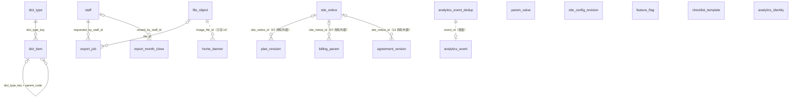

# 14 配置与数据（config、analytics、reports、exports）

| 项 | 内容 |
| --- | --- |
| 模块 | `config`（字典、参数、站点配置、Banner、规则变更公告、特性开关、清单模板；L0）、`analytics`（埋点；L4）、`reports`（报表月度快照；L4）、`exports`（导出任务；L4） |
| 表 | 13 张：`dict_type`、`dict_item`、`param_value`、`site_config_revision`、`home_banner`、`site_notice`、`feature_flag`、`checklist_template`、`analytics_event`、`analytics_event_dedup`、`analytics_identity`、`report_month_close`、`export_job` |
| 依据 | 草案 `docs/appendix/design/d6-notify-docs-data.md` 第 4、5、7.3 节（下文写作 d6:行号）；`d3-flow.md` 第 10.1、10.2 节（d3:行号，清单模板）；`d4-identity.md` 第 8.5 节（d4:行号，导出的授权规则）；`d5-media.md`（d5:行号，Banner 与导出文件）；`d7-platform.md` 第 3.2 节（d7:行号，开关键名）；裁决 M10、M14、M15、M19、M24、M33、M34、M35、M44，第二轮按 M46–M57、M60、M77、M92 修订，第三轮按 M101、M109、M110 与各分组第二轮的请求修订（见文末“修订记录”）；`catalogue.json` 的 conventions 与本分组 13 张表的 notes；`decisions.md` #20、#30、#31、#34 与第 7 节；主文档 `03-key-designs.md` 第 8.4 节（03:行号）；调研 `proto-admin-e.md`（画板 admin/OpsHome、OpsMall、SysDict、SysParams） |

## 1. 概览

这组表管两件事。

- **配置**（8 张，L0）：运营可改、读多写少、改动要留痕、两端都要读的数据。按结构与生效方式分几种存法：字典是行表（`dict_type`、`dict_item`）；参数的定义在代码里、值按生效时间追加（`param_value`）；商城配置与首页推荐位是整份 JSON 的修订（`site_config_revision`）；Banner 是带时间窗的行（`home_banner`）；规则变更公告在变更保存时同事务建立（`site_notice`）；特性开关是键、规则、值（`feature_flag`）；各类清单是带版本的模板（`checklist_template`）。
- **数据**（5 张，L4）：埋点事件（`analytics_event`，按月分区，配去重表 `analytics_event_dedup` 与匿名标识关联表 `analytics_identity`）、报表的月度快照（`report_month_close`）、异步导出任务（`export_job`）。

`config` 在 L0，不引用上层的表：员工、文件、被公告的变更都只存 id，不建外键。`analytics` 的三张表不建任何外键，将来可以整块迁到分析库（d6:1967、2208）。本分组的外键只有五条：字典项指向字典类型、字典项的同类型上级、月度快照与导出任务指向员工、导出任务指向文件。



`site_notice.ref_id` 反向指回被公告的变更（多态，只存 id），图里不画。业务表对 `dict_item.code`、`checklist_template (code, version_no)` 的引用都是按值引用，不建外键，见第 5 节。

## 2. 表定义

通用说明：

- `id` 为 UUID v7，由应用生成，不设数据库默认值。`param_value.seq` 是自增序号（`bigint`），出接口时转字符串。
- **时间列**。配置表与报表、导出表的 `created_at`、`updated_at` 及各业务时间都由应用时钟写入，不设数据库默认值；`updated_at` 不由触发器维护，每次 UPDATE 由写入方显式赋值。埋点的两张收件表（`analytics_event`、`analytics_event_dedup`）的 `received_at` 带默认值 `now()`（约定“时间”第 3 条允许收件类表使用）。
- **`created_at` 的三处例外**（约定“时间”的例外，第一轮提出，按 rulings 第七节视为接受）：`analytics_event`、`analytics_event_dedup` 的落库时间列叫 `received_at`，`analytics_identity` 的叫 `linked_at`，不再重复设 `created_at`。`param_value` 的行除 `cancelled_at` 外不可改，不设 `updated_at`。
- 出处里的“约定”指 `catalogue.json` 的 conventions；“补”表示草案没有、按约定或依赖方的要求补的列。
- 草案里的 `varchar(n)` 一律写成 `text`；有业务含义的长度上限写成 CHECK，其余由 Zod schema 校验。
- 员工列的命名与外键：操作人固定为员工的列叫 `<动作>_by_staff_id`（约定“操作人列”）。`config` 的 8 张表在 L0，不建外键；`report_month_close`、`export_job` 在 L4，建外键。
- 字典编码、参数键、开关键、事件名、导出键都是代码里登记的常量或运营维护的数据，数据库只校验写法，不逐值 CHECK；取值的唯一来源是 `packages/contract` 与 `packages/shared`。
- 本分组没有业务状态机（`state_machine` 全为 false）：各状态列都是配置生命周期或技术状态，不经 `flow.transition()`，不写 `status_transition`；改动留痕靠同事务的 `audit_log`。
- 本分组的表 `lock_rank` 全为 null：不与其他业务行同时加锁。表内的并发控制各节单独说明。
- 防改触发器：“不可删除”与“指定列创建后不可改”用公共函数 `lyx_forbid_delete()`、`lyx_forbid_column_change()`（M50）；不可删除的表同时拦 TRUNCATE（语句级触发器 `trg_<表>_no_truncate`）。本分组只定义公共文件没有的三个触发器函数 `lyx_14_status_transition`、`lyx_14_freeze_after`、`lyx_14_mutable_columns_only`，另有建分区的函数 `lyx_14_analytics_event_ensure_partition`。
- 各表“不变量”里的编码（`config.N7` 等）是登记到 15 分组 `invariant_violation` 的检查项编码，汇总见第 5.4 节。

### 2.1 `dict_type` 数据字典类型

一种字典一行：结构、编码规则、能否新增、停用策略、小程序是否可见、数据版本号。行由迁移播种，后台不提供新增与删除类型的入口；新增字典项时锁本行取顺序号。

归属：全局。主键：自然键 `type_key`（约定“主键”第 4 条 ①）。不是只增表。`lock_rank = null`：新增字典项的事务只锁本行（`SELECT … FOR UPDATE`，d6:1495），不同时锁其他业务行。

| 列 | 类型 | 空 | 默认 | 说明 | 出处 |
| --- | --- | --- | --- | --- | --- |
| `type_key` | text | 否 | — | 类型键，代码里登记的常量，如 `industry`、`region`、`genre`。小写蛇形，2–24 个字符 | d6:1471、1456 |
| `name` | text | 否 | — | 类型名称，如“行业品类” | d6:1471 |
| `structure` | text | 否 | — | 结构：`flat` 平铺、`tree` 树 | d6:1471 |
| `max_depth` | smallint | 否 | — | 最大层级。平铺为 1；树为 2（行业品类）或 3（行政区划） | d6:1471、1458-1459 |
| `code_prefix` | text | 可 | — | 顺序生成编码的前缀，1–4 个大写字母，如 `C`、`G`、`T`、`R`、`K`。不按顺序生成的类型为空（行政区划用国标码，系统枚举用代码常量） | d6:1471、1458-1465；补：可空 |
| `code_width` | smallint | 可 | — | 顺序号的位数（如 2，生成 `C01`）。与 `code_prefix` 同有同无 | d6:1471、1499 |
| `next_code_no` | integer | 否 | 1 | 下一个待发的一级编码序号。新增一级项时锁本行取号并加 1；二级项的序号取同一上级下的最大子序号加 1（d6:1498） | d6:1471、1497（原名 `next_seq`）；M34 |
| `is_system` | boolean | 否 | false | 是否系统枚举（`plan_tier`、`point_type`）：真相在代码，字典里只放显示名与说明，后台不出现新增与停用按钮 | d6:1467、1471 |
| `can_create` | boolean | 否 | true | 后台是否可新增字典项。行政区划（按国标导入）与系统枚举为 false | d6:1471（原名 `allow_create`） |
| `disable_policy` | text | 否 | — | 停用策略：`free` 可随时停用；`block_if_referenced` 有引用则不可停用（停用事务里调引用计数端口，d6:1507）；`never` 不可停用 | d6:1471 |
| `is_merchant_visible` | boolean | 否 | false | 小程序是否可读这个类型（`GET /m/dicts` 的过滤条件） | d6:1471、1512（原名 `merchant_visible`） |
| `version_no` | integer | 否 | 1 | 该类型的数据版本号。任一字典项新增、修改、启停时加 1；接口响应带它，小程序据此判断本地缓存是否过期 | d6:1471、1497、1513（原名 `version`） |
| `created_at` | timestamptz | 否 | — | 创建时间 | 补：约定“时间” |
| `updated_at` | timestamptz | 否 | — | 最近更新时间（取号或版本号加 1 时） | 补：约定“时间” |

**键与索引**

- 主键 `pk_dict_type (type_key)`。
- 外键：无。无其他索引（十余行）。

**手写约束**

| 约束名 | 规则 |
| --- | --- |
| `ck_dict_type_type_key` | `type_key` 匹配 `^[a-z][a-z0-9_]{1,23}$` |
| `ck_dict_type_structure` | `structure IN ('flat','tree')` |
| `ck_dict_type_disable_policy` | `disable_policy IN ('free','block_if_referenced','never')` |
| `ck_dict_type_max_depth` | 平铺时 `max_depth = 1`；树时 `max_depth` 为 2 或 3 |
| `ck_dict_type_code_rule` | `code_prefix` 与 `code_width` 同有同无；前缀匹配 `^[A-Z]{1,4}$`；位数 1–6 |
| `ck_dict_type_counters` | `next_code_no >= 1` 且 `version_no >= 1` |
| `ck_dict_type_system` | 系统枚举不可新增：`is_system` 为真时 `can_create` 为假 |

**播种的类型**（数据，不是表结构；由迁移写入）。“引用列”是按值引用该类型编码的业务列，也是不变量 `config.N7` 的检查范围（第 5.4 节）。

| `type_key` | 名称 | 结构 | 编码 | 可新增 | 停用策略 | 小程序可见 | 引用列（分组） | 出处 |
| --- | --- | --- | --- | --- | --- | --- | --- | --- |
| `industry` | 行业品类 | 树，2 级 | `C01` / `C0101` 顺序生成 | 是 | `block_if_referenced` | 是（只下发开放且启用的项） | 门店档案与资质轮次的行业、品类编码（04）；`drama.industry_codes`（05）；`analytics_event.category_code` | d6:1458 |
| `region` | 行政区划 | 树，3 级 | 国标区划码；功能区用 `F` 前缀自编码 | 否 | `block_if_referenced` | 是（只下发已开通的项） | 门店档案的省、市、区、功能区编码（04）；`assignment_pool_member.city_code`、`assignment_cursor.scope_key`（03）；`analytics_event.city_code` | d6:1459 |
| `genre` | 题材 | 平铺 | `G01` | 是 | `free` | 是 | `drama.genre_codes`（05）；`site_config_revision.content` 的 `genreCodes` | d6:1460 |
| `selling_tag` | 卖点标签（短剧） | 平铺 | `T01` | 是 | `free` | 是 | `drama.selling_tag_codes`（05） | d6:1461 |
| `reject_reason` | 驳回原因（按 `ext.scene` 分场景，各场景的播种项见下表） | 平铺 | `R01` | 是 | `free` | 否（只把选中的原因文本带给商家） | `approval_request.reason_codes`（03）；`channel_account.abnormal_reason_code`（11，场景 `account_verify`）；`transfer_proof.reject_reason_code`（08，场景 `transfer`）；`invoice_request.reject_reason_code`（08，场景 `invoice`） | d6:1462；03、08、11 的请求 |
| `ticket_type` | 工单类型 | 平铺 | `K01` | 是 | `free` | 是（扩展属性只下发 `isAfterSales`，4.1） | `service_ticket.type_code`（12） | d6:1463；A145 |
| `ticket_withdraw_reason` | 工单撤回原因；播种问题已解决、不再需要、重复提交、其他 | 平铺 | 顺序 | 是 | `free` | 是（商家在小程序撤回工单时必选，merchant/Ticket.dc.html:62） | `service_ticket.withdraw_reason_code`（12） | 12 的请求；画板 merchant/Ticket |
| `ticket_transfer_reason` | 工单分配与转派原因；播种需客服跟进、需交付侧评估、工作量调整、其他 | 平铺 | 顺序 | 是 | `free` | 否 | `status_transition.reason_code`（01 的表；只限 `machine = 'service_ticket'` 的 `assign`、`transfer` 行） | 12 的请求；画板 admin/ServiceDetail |
| `extend_reason` | 补偿延长原因 | 平铺 | 顺序 | 是 | `free` | 否 | `term_extension_request.reason_code`（07） | d6:1464；07 的请求 |
| `patrol_issue` | 巡检异常类型 | 平铺 | 顺序 | 是 | `free` | 否 | `patrol_task.abnormal_kind_code`（11） | d6:1464 |
| `custom_focus` | 定制重点 | 平铺 | 顺序 | 是 | `free` | 是 | `drama_order.focus_codes`（09） | d6:1464 |
| `asset_tag` | 素材标签：内容、用途、时效三组，由 `ext.dimension` 区分 | 平铺 | 顺序 | 是 | `free` | 是 | `store_asset_tag.tag_code`（06；该行的 `dimension` 等于编码的 `ext.dimension`） | d6:1464；06 的请求 |
| `ad_promo_point` | 广告宣传重点；播种品牌露出、优惠活动、团购、主推服务、到店引导 | 平铺 | 顺序 | 是 | `free` | 是 | `ad.promo_point_codes`（09） | PRD:492；09 的请求 |
| `reissue_reason` | 补发原因；播种错别字、广告版本、AI 标识、画面问题、其他 | 平铺 | 顺序 | 是 | `free` | 否 | `delivery_release.reason_code`、`delivery_reissue.reason_code`（10） | d3:1586；10 的请求 |
| `store_selling_point` | 门店核心卖点标签 | 平铺，可按品类过滤 | 顺序 | 是 | `free` | 是 | `store_profile.selling_point_codes`（04） | d9:805 ①；catalogue notes |
| `permit_type` | 行业许可证类型 | 平铺 | 顺序 | 是 | `block_if_referenced` | 是 | `qualification_doc.permit_type`（04）；`ocr_result.permit_type`（06）；`industry` 的 `ext.requiredCerts` | d9:805 ①；catalogue notes |
| `account_change_reason` | 账号变更原因 | 平铺 | 顺序 | 是 | `free` | 否 | `account_change_request.reason_code`（02） | 02 的请求 |
| `refund_reason` | 退款申请原因 | 平铺 | 顺序 | 是 | `free` | 否 | `refund_request.reason_code`（08；客服发起时必填，差异转入时为空） | 08 的请求 |
| `express_company` | 快递公司；播种顺丰速运、中国邮政 EMS、京东快递 | 平铺 | 顺序 | 是 | `free` | 否 | `invoice_doc.express_company`（08） | d2:1430；08 的请求 |
| `bank` | 付款行 | 平铺 | 顺序 | 是 | `free` | 否 | `payment_txn.payer_bank`（08） | 08 的请求 |
| `plan_tier` | 套餐版本 | 平铺，系统枚举 | 代码常量 | 否 | `never` | 是 | 无（业务显示名以 07 的 `plan.name` 为准，字典项名称只在字典页展示） | d6:1465、1467；07 的请求 |
| `point_type` | 积分账户与流水类型 | 树，2 级（积分账户、流水类型两组），系统枚举 | 代码常量 | 否 | `never` | 是 | 无 | d6:1465、1467；proto-admin-e.md:345 |

`reject_reason` 各场景的播种项（编码从 `R01` 起按下表顺序生成）。审核类审批单由员工驳回时至少要选 1 个原因（03 分组 `ck_approval_request_reject_reasons`），所以 `store_review`、`link_verify`、`account_verify` 三个场景在上线前都必须有启用的项；以各审核页弹窗的选项为准，字典页画板 admin/SysDict 的 R01–R10 是示意数据。

| 场景（`ext.scene`） | 播种项 | 引用列 | 出处 |
| --- | --- | --- | --- |
| `store_review` 资质审核 | 证照模糊、主体与档案不一致、证照过期、缺少行业许可证、其他 | `approval_request.reason_codes`（03） | admin/Review.dc.html:244；d9:523、805 ⑥（补“其他”） |
| `link_verify` 链接核验 | 集数不全、账号与授权书不一致、“广告”标识缺失、许可信息被遮挡、声明了原创、链接无法打开 | `approval_request.reason_codes`（03；11 分组的 `launch.return`） | admin/Verify.dc.html:191 |
| `account_verify` 账号核验 | 主页截图不完整、账号名称不一致、账号 ID 不一致、账号类型与截图不一致、认证主体与商家主体不一致、账号状态异常、其他 | `approval_request.reason_codes`（03）；`channel_account.abnormal_reason_code`（11） | admin/Accounts.dc.html:213 |
| `point_adjust` 积分调整 | 依据不足、数额有误、不符合调整规则、其他 | `approval_request.reason_codes`（03；原因可选） | admin/CreditAdjust.dc.html:250 |
| `transfer` 对公凭证 | 未到账、金额不符、户名与购买主体不一致、凭证无法识别、其他 | `transfer_proof.reject_reason_code`（08） | d2:280 |
| `invoice` 开票 | 开票信息有误、重复申请、其他 | `invoice_request.reject_reason_code`（08；只用于财务驳回） | admin/Invoices.dc.html:301，去掉“付款单已退款或退款中”：已退款由 `invoice_request.reject_kind = order_refunded` 表达（M55），退款中只暂停开具（`invoice_request.held_by_refund_request_id`），不驳回；08 的请求 |
| `cancel_refund` 取消与退款驳回 | 不符合退款规则、金额核算有误、说明不充分、其他 | `approval_request.reason_codes`（03；订购与广告取消申请的驳回、现金退款申请 `plan_refund` 的驳回；原因可选，0–1 项） | proto-admin-d.md:126；A156；a05-order-delivery.md 3.12 `CancelRejectBody`、a07-billing-finance.md:2432 |

不再播种（M55）：`cancel_reason`（取消原因，已是 `cancel_request`、`ad`、`order_item` 上 `reason_code` 的枚举）、`adjust_reason`（积分调整原因，已是 `point_adjustment_request.reason_code` 的枚举）、`close_reason`（客服工单关闭原因，12 分组用枚举）。这三组的显示名放在 `packages/contract` 的枚举标签里，后台不能新增或停用。d2:1430 的“参数” `invoice.express_companies` 默认值写作“字典”，即上表的 `express_company`，不登记为参数键。

接口契约阶段定的播种项（A145）。`food_business`、`brand_story` 是固定编码，由迁移写入，代码按编码引用；后台新增的项仍按顺序生成。

| 类型 | 播种项 | `ext` | 用处 | 出处 |
| --- | --- | --- | --- | --- |
| `permit_type` | `food_business` 食品经营许可证 | 见下表 | 资质识别与提交的字段清单；派生列映射（04） | m03-profile-asset 2.8；04-profile.md:605；d5:1866 |
| `asset_tag` | `brand_story` 品牌故事 | `{ dimension: 'content' }` | 新增门店复制“品牌故事”素材（06-media.md:1195）；素材库按该标签计数（m02、m03） | m03-profile-asset 3.20；m02-tenant 3.3 |
| `ticket_type` | K01–K10：交付进度、广告制作、内容修改、发布与上线、套餐与积分、数据问题、发票、取消与退款、投诉建议、其他 | `ext` 四个键都写全（4.1 要求必填）：默认 `{ defaultPriority: 'mid', transferable: true, notifyLead: false, isAfterSales: false }`；K08“取消与退款”另设 `isAfterSales: true`、`defaultPriority: 'high'`，K09“投诉建议”另设 `notifyLead: true`。名称以后台字典画板为准（它是唯一的完整列表）；商家端画板 merchant/Service.dc.html:118 只画了 9 类、把 K08 叫“退款”且没有“套餐与积分”，那里是示意，小程序按字典接口下发的项显示 | 小程序提交工单时，售后类另请求 `refund_result` 订阅槽位 | admin/SysDict.dc.html:136-138；m08-support-misc 2.2、3.2 |

`food_business` 的 `ext`（`PermitTypeExt`，结构见 4.1）：

| `fields[].key` | `label` | `sensitive` | `format` |
| --- | --- | --- | --- |
| `operatorName` | 经营者名称 | false | `text` |
| `certNo` | 许可证编号 | true | `cert_no` |
| `premises` | 经营场所 | false | `text` |
| `businessItems` | 经营项目 | false | `text` |
| `validTo` | 有效期至 | false | `date` |

其余键：`holderNameKey = 'operatorName'`、`certNoKey = 'certNo'`、`certNoPattern = '^JY[0-9]{14}$'`（JY 加 14 位数字）、`principalNameKey = null`、`validFromKey = null`、`validToKey = 'validTo'`。

**不变量**：没有需要每日校验的。

**相对草案的改动**

| 改动 | 依据 |
| --- | --- |
| 草案只有一行行内写法（d6:1471），本稿展开为字段表，类型落成 PostgreSQL 类型 | 写作规范 |
| `allow_create` → `can_create`，`merchant_visible` → `is_merchant_visible` | 约定“命名规则”：布尔列用 `is_` / `has_` / `can_` 前缀 |
| `version` → `version_no` | M34：版本、序号叫 `<含义>_no`；也避免与乐观锁列 `lock_version` 混淆 |
| `code_prefix`、`code_width` 定为可空并加同有同无的 CHECK | 行政区划与系统枚举不按顺序生成编码（d6:1459、1465） |
| 补 `created_at`、`updated_at` | 约定“时间” |
| 类型清单增加 `store_selling_point`、`permit_type`、`account_change_reason`、`refund_reason`、`express_company`、`bank`、`ad_promo_point`、`reissue_reason`；`asset_tag` 加 `ext.dimension`；对公凭证与开票的驳回原因并入 `reject_reason` 的 `transfer`、`invoice` 场景 | catalogue notes（d9:805 ①）；02、06、08、09、10 分组的请求；d6:1462。只是播种数据，不改表 |
| 类型清单去掉 `cancel_reason`、`adjust_reason`、`close_reason` | M55：状态机或账本依赖其取值的原因码用枚举加 CHECK |
| `point_type` 定为两级树（积分账户、流水类型） | 画板 admin/SysDict（proto-admin-e.md:345） |
| `next_seq` → `next_code_no` | M34：`seq` 只用于 uuid+seq 表的自增列，序号叫 `<含义>_no` |
| 类型清单增加 `ticket_withdraw_reason`、`ticket_transfer_reason`；写明 `reject_reason` 各场景的播种项 | 03、08、12 分组的请求；各审核页画板。只是播种数据，不改表 |
| `ticket_type` 对小程序下发扩展属性 `isAfterSales`（草案为不含扩展属性）；补播种项 `food_business`、`brand_story` 与 `ticket_type` 的 `isAfterSales` 取值 | A145；m03、m08 的请求。只是播种数据与下发的键，不改表 |

### 2.2 `dict_item` 数据字典项

字典项：列表或树，带按类型校验的扩展属性。业务表存不可变的 `code`，不存 `id`、不建外键（d6:1505）；字典项只停用、不删除，历史单据凭 `code` 永远查得到名称。

归属：全局。主键：`id uuid`。不是只增表。`lock_rank = null`：新增在持有 `dict_type` 行锁的事务里进行；编辑与启停用 `lock_version`。

| 列 | 类型 | 空 | 默认 | 说明 | 出处 |
| --- | --- | --- | --- | --- | --- |
| `id` | uuid | 否 | — | 主键 | d6:1477；约定“主键” |
| `dict_type_key` | text | 否 | — | 所属字典类型（`dict_type.type_key`）。创建后不可改 | d6:1478（原名 `type_key`）；M57 |
| `code` | text | 否 | — | 编码，业务表引用的就是它。1–16 个字符，字符集 `[A-Za-z0-9_-]`（与埋点契约里的编码格式一致，d6:1891）。保存后不可改 | d6:1479 |
| `parent_code` | text | 可 | — | 上级编码，同类型内自引用；一级项为空。创建后不可改（下级编码由上级编码加序号生成，d6:1498） | d6:1480 |
| `name` | text | 否 | — | 名称，1–20 个字；同级不重名 | d6:1481；admin/SysDict |
| `description` | text | 可 | — | 说明，不超过 40 个字；页面列名随类型显示为“适用场景”“默认规则”“当前配置” | d6:1482；proto-admin-e.md:333 |
| `is_enabled` | boolean | 否 | true | 是否启用。停用后不再出现在新的选择中（写接口调 `dicts.assertEnabled`），读历史数据不看它 | d6:1483、1506（原名 `enabled`） |
| `tags` | text[] | 否 | `{}` | 标记，如“特殊行业”“功能区” | d6:1484 |
| `ext` | jsonb | 否 | `{}` | 扩展属性，按类型的 Zod schema 校验。结构见第 4.1 节 | d6:1485、1456-1465 |
| `position` | integer | 否 | 0 | 同级内的排列顺序，从 0 起 | d6:1486（原名 `sort_no`）；M34 |
| `lock_version` | integer | 否 | 0 | 乐观锁版本号 | d6:1487（原名 `row_version`）；约定“乐观锁” |
| `created_by_staff_id` | uuid | 可 | — | 创建人（员工）。迁移播种的行为空。只存 id，不建外键：L0 不引用 `staff` | d6:1488；约定“操作人列” |
| `updated_by_staff_id` | uuid | 可 | — | 最近修改人（员工）。只存 id，不建外键 | d6:1488 |
| `created_at` | timestamptz | 否 | — | 创建时间 | d6:1488 |
| `updated_at` | timestamptz | 否 | — | 最近更新时间 | d6:1488 |

**键与索引**

- 主键 `pk_dict_item (id)`。
- 外键：`dict_type_key` → `dict_type.type_key`，RESTRICT（`fk_dict_item_dict_type_key`）；`(dict_type_key, parent_code)` → `dict_item (dict_type_key, code)`，RESTRICT（`fk_dict_item_parent_code`，上级为空时不校验）。
- 唯一：`uq_dict_item_dict_type_key_code (dict_type_key, code)`——按类型与编码取项；也是并发新增时防编码重复的最后一道（d6:2281）。
- 普通索引：`ix_dict_item_dict_type_key_parent_code_position (dict_type_key, parent_code, position)`——按类型取整份字典并按顺序排列；行政区划按上级懒加载（`?parent=510100`，d6:1514）。
- 只存 id、不建外键：`created_by_staff_id`、`updated_by_staff_id`。

**手写约束**

| 约束名 | 规则 |
| --- | --- |
| `tags` 补 NOT NULL | Prisma 的标量数组列建表时不带 NOT NULL，SQL 里补 `ALTER COLUMN tags SET NOT NULL` |
| `ck_dict_item_code` | `code` 匹配 `^[A-Za-z0-9_-]{1,16}$` |
| `ck_dict_item_parent_code` | 上级不能是自己 |
| `ck_dict_item_name` | `name` 长度 1–20 |
| `ck_dict_item_description` | `description` 不超过 40 个字 |
| `ck_dict_item_ext` | `ext` 是 JSON 对象 |
| `ck_dict_item_position` | `position >= 0` |
| `uq_dict_item_sibling_name` | 表达式唯一索引 `(dict_type_key, COALESCE(parent_code, ''), name)`：同级不重名 |
| `trg_dict_item_immutable` | 触发器：`dict_type_key`、`code`、`parent_code` 创建后不可改（`lyx_forbid_column_change`） |
| `trg_dict_item_no_delete` | 触发器：不可删除（`lyx_forbid_delete`） |
| `trg_dict_item_no_truncate` | 语句级触发器：禁止 TRUNCATE（`lyx_forbid_delete`） |

**不变量**

- `config.N7`（d6:2322 的 N7）：业务表里引用的字典编码都存在于 `dict_item`，且属于约定的类型。检查范围是 `packages/contract` 里的引用登记表 `DICT_REFS`（列 → 字典类型），初始内容即第 2.1 节播种表的“引用列”；引用方新增引用列时往登记表里加一行。`code` 不被修改由触发器保证。
- `config.N15`（补）：树的层级不超过所属类型的 `max_depth`。
- `config.N16`（补）：系统枚举类型（`plan_tier`、`point_type`）的项集合与代码枚举一致。

**相对草案的改动**

| 改动 | 依据 |
| --- | --- |
| `id bigint` → `uuid` | 约定“主键”（R1） |
| `enabled` → `is_enabled` | 约定“命名规则”：布尔列前缀 |
| `sort_no` → `position` | M34：同一父行下的排列顺序叫 `position` |
| `row_version` → `lock_version` | 约定“乐观锁” |
| `created_by`、`updated_by` → `created_by_staff_id`、`updated_by_staff_id`；不建外键；`created_by_staff_id` 可空 | 约定“操作人列”；L0 不引用 L1；播种行没有创建人 |
| “保存后不可改”的范围由 `code` 扩大到所属类型（`dict_type_key`）、`parent_code` | 编码由上级编码生成（d6:1498）；原型“编辑只能改名称与说明”（proto-admin-e.md:353） |
| `type_key` → `dict_type_key` | M57：指向自然键表的外键列用“被引用表全名 + `_key`” |
| 同类型内自引用写成复合外键 `(dict_type_key, parent_code)` | d6:1480“同 type 内自引用”落成约束 |
| 补不可删除的触发器（行级 DELETE 与 TRUNCATE） | d6:1505“字典项可以停用但从不删除”；M50 |

### 2.3 `param_value` 参数值

参数的定义（类型、范围、默认值、分组）在代码里（`packages/shared/src/params/defs.ts`，d6:1524），库里只存值。一行 = 某个键从某时刻起的值；改参数就是追加一行。库里没有的键用代码里的默认值。

归属：全局。主键：`id uuid` + `seq bigint`（自增，唯一）。`append_only = false`（M14）：与 `billing_param` 同类，触发器只放行“生效前把 `cancelled_at` 从空写一次”，其余列不可改、不可删。`lock_rank = null`。

| 列 | 类型 | 空 | 默认 | 说明 | 出处 |
| --- | --- | --- | --- | --- | --- |
| `id` | uuid | 否 | — | 主键 | d6:1564；约定“主键” |
| `seq` | bigint | 否 | 自增 | 自增序号，即参数修订号：保存接口的 `expectedRev`、单据快照里的 `revs` 都是它。出接口时转字符串 | d6:1564、1587；catalogue notes |
| `key` | text | 否 | — | 参数键，必须是代码里已定义的键。小写点分 2–6 段，总长不超过 64，如 `sla.ticket.sample_making`、`remind.offline.days` | d6:1565 |
| `value` | jsonb | 否 | — | 参数值；写入前按定义校验类型与范围。结构见第 4.2 节 | d6:1566 |
| `effective_at` | timestamptz | 否 | — | 生效时间：立即生效写保存时刻；可预约未来时刻 | d6:1567（原名 `effective_from`）；约定“命名规则”（时刻列以 `_at` 结尾） |
| `cancelled_at` | timestamptz | 可 | — | 撤销时间。只允许撤销尚未生效的行：服务层用带 10 分钟余量的条件更新（d6:1589），数据库保证早于 `effective_at` 且只写一次 | d6:1568 |
| `reason` | text | 可 | — | 变更原因，不超过 100 个字 | d6:1569 |
| `created_by_staff_id` | uuid | 否 | — | 保存人（员工）。只存 id，不建外键：L0 不引用 `staff` | d6:1570；约定“操作人列” |
| `created_at` | timestamptz | 否 | — | 创建时间 | d6:1570 |

**键与索引**

- 主键 `pk_param_value (id)`；唯一 `uq_param_value_seq (seq)`。
- 外键：无。只存 id、不建外键：`created_by_staff_id`。
- 其余索引见手写约束（部分唯一索引同时承担“取当前值”的查询）。

**手写约束**

| 约束名 | 规则 |
| --- | --- |
| `ck_param_value_key` | `key` 匹配 `^[a-z][a-z0-9_]*(\.[a-z0-9_]+){1,5}$` 且长度不超过 64 |
| `ck_param_value_cancel_before_effective` | `cancelled_at` 为空，或早于 `effective_at` |
| `ck_param_value_reason` | `reason` 不超过 100 个字 |
| `uq_param_value_key_effective_at` | 部分唯一索引 `(key, effective_at DESC) WHERE cancelled_at IS NULL`：同一个键在同一生效时刻只有一行未撤销的值。取当前全部参数的查询 `SELECT DISTINCT ON (key) … WHERE effective_at <= :now AND cancelled_at IS NULL ORDER BY key, effective_at DESC`（d6:1574-1577）走它 |
| `trg_param_value_write_once` | 触发器：只允许把 `cancelled_at` 从空写一次，其余列不可改，不可删（`lyx_write_once('cancelled_at')`） |
| `trg_param_value_no_truncate` | 触发器：禁止 TRUNCATE（`lyx_forbid_mutation`） |

授权（在授权迁移里，不在本分组 SQL）：应用角色 `lyx_app` 对本表只有 `INSERT`、`SELECT`，另对 `cancelled_at` 一列授列级 `UPDATE`，供撤销时写入（W0-06a）。

**生命周期**（没有状态列，由时间派生）

| 派生状态 | 条件 |
| --- | --- |
| 待生效 | `cancelled_at IS NULL` 且 `effective_at > now` |
| 生效中 | 未撤销的行里 `effective_at <= now` 且最大的那一行 |
| 已被取代 | 未撤销、已生效，但同键有更晚生效的行 |
| 已撤销 | `cancelled_at IS NOT NULL` |

唯一的更新是撤销：`UPDATE … SET cancelled_at = :now WHERE id = ? AND cancelled_at IS NULL AND effective_at > :now + 10 分钟`，影响 0 行即拒绝（d6:1589）。

**并发保存**：保存接口在单事务内逐项比对 `expectedRev` 再插入（d6:1587），冲突整批 409。部分唯一索引只挡“同一键、同一生效时刻”，立即生效的两次并发保存时刻不同，挡不住；所以保存事务先把本批的键按字典序排好，逐键取事务级咨询锁 `pg_advisory_xact_lock(hashtext('param_value:' || key))`，拿到锁之后再读该键最新一行未撤销值的 `seq` 与 `expectedRev` 比对。撤销预约同样先取该键的锁。与 `home_banner` 的咨询锁同一做法，不锁其他业务行，`lock_rank` 仍为 null。

**参数键的归属**（数据，不是表结构；M24、M35，decisions 第 7 节）。键的类型、单位、范围、默认值在代码的参数定义里；下表只登记键名，括号里是已知的默认值。

| 分组 | 键 | 出处 |
| --- | --- | --- |
| `sla`（时限策略，值形态 `sla_policy`，见第 4.2 节） | `sla.ticket.assign`（120 `work_minutes`）、`sla.ticket.plan_confirm`（1 `work_days`）、`sla.ticket.sample_making`（1 `work_days`）、`sla.ticket.batch_compose`（2 `work_days`）、`sla.ticket.delivering`（1080 `same_day_cutoff`，即当日 18:00，播种值 `{ amount: 1080, unit: 'same_day_cutoff' }`）、`sla.delivery.target`（6 `work_days`）、`sla.ad.first_version`（2 `work_days`）、`sla.ad.revision`（1 `work_days`）、`sla.review.qualification`（1 `work_days`，可调 1–5，d9:569）、`sla.review.channel_account`、`sla.review.launch_link`、`sla.review.store_asset`、`sla.review.refund_approve`、`sla.review.refund_execute`、`sla.review.transfer_proof`（各 1 `work_days`）、`sla.review.invoice_request`（无默认值，未配置即不计时）、`sla.takedown.check`（1 `work_days`）、`sla.service.first_response`（30 `work_minutes`）、`sla.service.solution`（24 `natural_hours`）、`sla.service.auto_resolve`（3 `natural_days`）、`sla.manager.first_contact`（1 `work_days`） | d3:3017-3036；03、06、08、09、10、11、12 分组的请求。各单据 `sla_snapshot.policy` 取键名去掉 `sla.` 的部分（M60） |
| `calendar` | `work.start`（09:00）、`work.end`（18:00）：即 d3:2999 的工作时间段 `workhours`；节假日在 `work_calendar_day` | d6:1548；01 的请求 |
| `remind` | `remind.plan_expiry.time`、`remind.launch.days`、`remind.offline.days`、`remind.sample.after_days`、`remind.copyright.days`、`remind.grace_hours` 等；`remind.cert_expiry.days`（默认 30） | d6:1549；d9:805 ② |
| `notify` | `notify.window.start` / `end`、`notify.sms.daily_cap`、`notify.sms.keepalive_days`、`notify.wx.quota_cap`、`notify.wx.field_fail_streak` 等 | d6:1550；13 的请求 |
| `general` | `package.link_ttl_days`（成片下载授权的有效天数，1–30，默认 7；10 分组 `valid_days` 取它的快照）、`audit.retention_years`、`trial.episodes`（V1.1）、`inbox.scope`、`home.banner.max_active`（默认 5） | d6:1551；10、13 的请求 |
| `billing`（三个时限键） | `billing.payment.order_timeout_minutes`（默认 30）、`billing.payment.transfer_valid_days`（默认 7）、`billing.upgrade_quote_valid_hours`（默认 48） | M24、M35；decisions 7.2；07、08 的请求 |
| `payment` / `refund` / `invoice` / `recon` | `payment.bank_transfer.min_fen`、`payment.wechat.advise_transfer_above_fen`、`payment.description_template.*`、`refund.original_route_safety_hours`、`refund.bill_wait_days`、`refund.points.auto_approve_before_production`、`refund.require_distinct_executor`（boolean，默认 false；为 true 时取消申请与现金退款申请的执行人不得是该单的审批人（a05 3.15、a07 现金退款执行），d4-identity.md:1501，原名 `sod.refund.distinct_executor` 作废；A156）、`invoice.item_name.*`、`invoice.apply_within_days`、`invoice.no_rules`、`recon.first_run_time`、`recon.alarm_time` | d2:1424-1433；decisions 7.3；08、09 的请求；A156 |
| `export` / `analytics` | `export.max_rows`、`export.xlsx_max_rows`、`export.max_concurrent_per_staff`、`export.retention_hours`（导出文件保留时长，默认 24）、`analytics.anon.daily_cap`、`analytics.retention_months`（默认 25） | d6:1553、1952；03:591 |
| `platform` | `platform.legal_entity`、`agreement.announce_min_days`（默认 30）、`docs.license.allow_stamp_only` | d6:1554；13 的请求 |
| `identity` / `tenant`（02） | `auth.dormant_days`、`auth.identity_remove_min_age_days`、`tenant.default_store_limit`、`tenant.default_member_limit`、`invitation.ttl_hours`、`invitation.require_phone`、`invitation.daily_cap` | 02 的请求（d4:2342-2361） |
| `staff` / `approval`（03） | `approval.remind_workdays`、`approval.escalate_workdays`、`admin.password_max_age_days` | 03 的请求 |
| `content`（05） | `content.permit.platform_check`、`content.placement.open_slots` | d8:645；05 的请求 |
| `media`（06） | `files.purge.mode`、`files.purge.max_objects`、`files.purge.max_bytes`、`files.retention.portrait_auth_adopted_years`（被采用过的素材删除后，其肖像授权材料的保留年数，默认 3，待法务确认；06 分组第 6 节第 5 项） | 06 的请求 |
| `order` / `ad`（09） | `order.start_delay_minutes`、`order.rejected_stale_days`（默认 7）、`ad.returned_stale_days`（默认 7） | d3:3045；09 的请求 |
| `delivery`（10） | `qc.episode.four_eyes` | 10 的请求 |
| `publish`（11） | `launch.partial_goes_live`、`launch.verify_revoke_window`、`patrol.weekly_sample`、`takedown.check_mode`（下架核查口径：默认逐条核查留证，可改为按比例抽查，抽查比例用万分比；值形态见第 4.2 节） | d3:1998、3398；11 的请求 |
| `support`（12） | `service.reopen_window_days`（已解决后可重新打开的天数，默认 7，0 即关闭） | d3:2514、2522；12 的请求 |

同一规则只有一个键：d6 的整数时限键（`sla.kf.first_response_min`、`sla.assign.hours`、`sla.plan.workdays`、`sla.sample.workdays`、`sla.delivery_target.workdays`）由上表 `sla` 组的同名策略取代；11 分组写的 `review.channel_account`、`review.launch_link`、`takedown.check` 是策略名，对应键 `sla.review.channel_account`、`sla.review.launch_link`、`sla.takedown.check`；10 分组的“下载授权有效天数”就是 `package.link_ttl_days`。

不在本表的键：计费规则参数（12 个）在 `billing_param`；广告制作中取消的扣除比例是 `billing_param` 的 `cancelDeductionBp.adInProduction`（09 初稿请求的 `ad.cancel_deduction_bp` 不登记，M24、M35）；购买入口策略、支付限额等受控配置在 `finance_config_revision`，不映射到本表（M24；d6:170、1552 把 `billing.purchase_policy` 落到参数服务的写法作废）；`refund.plan_window_hours` 不存在（退款窗口是 `billing_param` 的 `planRefundWindowHours`）；`portal.ticket_ttl_sec` 不登记（02 分组改为部署配置 `PORTAL_TICKET_TTL`，默认 120 秒；d4 附录 C：安全阈值不进参数页）；`invoice.express_companies` 是字典 `express_company`。

**不变量**

- `config.N8`（d6:2323 的 N8）：所有参数的当前值与待生效值都满足代码里的类型与范围（定义收紧后启动自检）。
- `config.N17`（补）：`key` 都是代码里已定义的键。

**相对草案的改动**

| 改动 | 依据 |
| --- | --- |
| `id bigint`（兼作修订号）拆成 `id uuid` + `seq bigint`；修订号是 `seq` | 约定“主键”第 2 条；catalogue notes |
| 表的定性由“只追加”改为受限更新：`append_only = false`，触发器只放行写一次 `cancelled_at` | M14 |
| `UNIQUE(key, effective_from)` 改为部分唯一索引（`WHERE cancelled_at IS NULL`） | 草案的写法下，一个预约被撤销后，同一生效时刻不能再保存新值；撤销行不应占用唯一 |
| 补 CHECK `cancelled_at < effective_at` | d6:1568“只允许取消尚未生效的行”落成约束 |
| `created_by` → `created_by_staff_id`，不建外键 | 约定“操作人列”；L0 不引用 L1 |
| 键清单：加入 M24 的三个时限键与 d9 的两个键；去掉 `billing.purchase_policy` 与 `refund.plan_window_hours` | M24、M35；catalogue notes；decisions 7.3 |
| `effective_from` → `effective_at` | 约定“命名规则”：时刻列以 `_at` 结尾；与 `billing_param`、`plan_revision` 同名 |
| 时限键改用 d3 §22.3 的 `sla.<策略> = { amount, unit }`，不用 d6 的整数键；登记各分组请求的键 | d3:3017-3036；03、06、08–12 分组的请求（各单据的 `sla_snapshot` 按这套键取值） |
| 保存事务按键取咨询锁再比对 `expectedRev` | 草案只写“单事务内逐项比对”，并发保存时比对挡不住后写覆盖先写 |

### 2.4 `site_config_revision` 站点配置修订

商城配置（`mall`）与首页推荐位（`home_recommend`）各是一份整体生效的 JSON。每次发布产生一个修订；回滚是以历史版内容新建草稿再发布，不改历史（d6:1655）。JSON 里引用的短剧 id、题材编码不建外键，发布前校验（短剧在架且可订经 `CatalogRefPort`，d8:582、a09-ops.md 2.7；题材编码存在且启用）。

归属：全局。主键：`id uuid`。不是只增表。`lock_rank = null`：发布事务只锁本表的行（先锁当前已发布行，再改草稿行，d6:1645）。

| 列 | 类型 | 空 | 默认 | 说明 | 出处 |
| --- | --- | --- | --- | --- | --- |
| `id` | uuid | 否 | — | 主键 | d6:1615；约定“主键” |
| `config_key` | text | 否 | — | 配置键：`mall` 商城配置、`home_recommend` 首页推荐位。V1.1 可加 `faq_categories` 等 | d6:1616 |
| `rev_no` | integer | 可 | — | 修订号。发布时取“当前已发布版的 `rev_no` + 1”；草稿期为空。播种的初始版为 1 | d6:1617、1649；补：草稿期为空 |
| `status` | text | 否 | — | 状态：`draft` 草稿、`published` 已发布、`archived` 已归档 | d6:1618 |
| `content` | jsonb | 否 | — | 整份配置内容，按 `config_key` 对应的 Zod schema 校验。结构见第 4.3 节 | d6:1619 |
| `base_rev_no` | integer | 可 | — | 草稿基于哪一版已发布内容（取页面加载时的已发布修订号）。发布时与当前已发布版的 `rev_no` 比对，不等返回 409（d6:1646）。播种的初始版为空 | d6:1620 |
| `note` | text | 可 | — | 备注，不超过 100 个字 | d6:1621 |
| `lock_version` | integer | 否 | 0 | 乐观锁版本号：草稿被整份覆盖时比对 | 补：约定“乐观锁”；d6:1774 |
| `created_by_staff_id` | uuid | 可 | — | 创建人（员工）；迁移播种的初始版为空。只存 id，不建外键 | d6:1622；约定“操作人列” |
| `published_by_staff_id` | uuid | 可 | — | 发布人（员工）；草稿与播种的初始版为空。只存 id，不建外键 | d6:1622；admin/OpsMall“最近发布时间、发布人” |
| `published_at` | timestamptz | 可 | — | 发布时间；草稿为空 | d6:1622 |
| `created_at` | timestamptz | 否 | — | 创建时间 | 补：约定“时间” |
| `updated_at` | timestamptz | 否 | — | 最近更新时间 | 补：约定“时间” |

**键与索引**

- 主键 `pk_site_config_revision (id)`。
- 外键：无。只存 id、不建外键：`created_by_staff_id`、`published_by_staff_id`。
- 唯一：`uq_site_config_revision_config_key_rev_no (config_key, rev_no)`——修订号不重复；后台“版本记录”按它倒序列出。草稿的 `rev_no` 为空，不参与唯一。

**手写约束**

| 约束名 | 规则 |
| --- | --- |
| `ck_site_config_revision_config_key` | `config_key IN ('mall','home_recommend')` |
| `ck_site_config_revision_status` | `status IN ('draft','published','archived')` |
| `ck_site_config_revision_published` | 草稿的 `rev_no`、`published_at`、`published_by_staff_id` 为空；已发布与已归档的 `rev_no`、`published_at` 必有 |
| `ck_site_config_revision_rev_no` | `rev_no >= 1`；`base_rev_no >= 1`；两者都有时 `rev_no > base_rev_no` |
| `ck_site_config_revision_content` | `content` 是 JSON 对象 |
| `ck_site_config_revision_note` | `note` 不超过 100 个字 |
| `uq_site_config_revision_draft` | 部分唯一索引 `(config_key) WHERE status = 'draft'`：每个配置键至多一份草稿 |
| `uq_site_config_revision_published` | 部分唯一索引 `(config_key) WHERE status = 'published'`：每个配置键至多一份已发布 |
| `trg_site_config_revision_no_delete` | 触发器：不可删除（`lyx_forbid_delete`） |
| `trg_site_config_revision_no_truncate` | 语句级触发器：禁止 TRUNCATE（`lyx_forbid_delete`） |
| `trg_site_config_revision_immutable` | 触发器：`config_key`、`created_by_staff_id`、`created_at` 不可改（`lyx_forbid_column_change`） |
| `trg_site_config_revision_status` | 触发器：状态只能 `draft → published → archived`（`lyx_14_status_transition`） |
| `trg_site_config_revision_freeze` | 触发器：离开草稿后内容冻结，只可改 `status`、`updated_at`、`lock_version`（`lyx_14_freeze_after`） |

**状态机**（配置生命周期，不写 `status_transition`；每次迁移同事务写审计）

| 当前状态 | 事件 | 新状态 | 守卫 | 触发者 |
| --- | --- | --- | --- | --- |
| —（无草稿） | 保存草稿 | `draft` | 权限点；`base_rev_no` 取页面加载时的已发布修订号 | 运营（员工） |
| `draft` | 再次保存草稿 | `draft`（整份覆盖） | `lock_version` 相符 | 运营 |
| `draft` | 发布 | `published` | 锁版本相符（接口裁决 A105）；锁当前已发布行；`base_rev_no` 等于它的 `rev_no`；Zod 校验与引用校验通过。写 `rev_no`、`published_at`、`published_by_staff_id` | 运营 |
| `published` | 新版本发布 | `archived` | 与上一行同一事务，先归档旧版再发布新版（两个部分唯一索引都是立即检查的） | 同一事务 |

原型的两个页面都是“保存即发布”：前端一次调用 `PUT draft` 与 `POST publish`（d6:1653-1654）。

**不变量**

- `config.N9` 的后半句（d6:2324）：每个 `config_key` 恰有一个 `published`。“至多一个”由索引保证，“至少一个”靠迁移播种初始版与本不变量。

**相对草案的改动**

| 改动 | 依据 |
| --- | --- |
| 表名 `config_revision` → `site_config_revision` | decisions 2.1；与 `finance_config_revision` 区分 |
| `id bigint` → `uuid` | 约定“主键” |
| `rev_no` 改为可空：草稿期为空，发布时取号 | d6:1649“draft 置 published，rev_no 加 1”：修订号在发布时才确定；草案的非空写法没有说明草稿期的取值 |
| 补 `lock_version`、`created_at`、`updated_at` | 约定“乐观锁”“时间”；草稿是多人会改的行 |
| `created_by`、`published_by` → `created_by_staff_id`、`published_by_staff_id`，不建外键，可空 | 约定“操作人列”；播种的初始版没有员工 |
| 补防删（含 TRUNCATE）与三个防改触发器 | d6:1655“回滚产生新修订号，不改历史”；M50 |

### 2.5 `home_banner` 首页 Banner

Banner 各有独立的时间窗与启停，保存即生效，到结束时间自动下线，不需要任务（d6:1662）。展示状态不落库。点击量不存计数列，从埋点事件 `banner_click` 聚合（d6:1677）。

归属：全局。主键：`id uuid`。不是只增表。`lock_rank = null`：新增、编辑、启用时用事务级咨询锁 `pg_advisory_xact_lock(hashtext('home_banner'))` 串行化，再做区间校验（d6:1667-1675）。

| 列 | 类型 | 空 | 默认 | 说明 | 出处 |
| --- | --- | --- | --- | --- | --- |
| `id` | uuid | 否 | — | 主键 | d6:1660；约定“主键” |
| `title` | text | 否 | — | 标题，后台识别用，1–30 个字 | d6:1660；admin/OpsHome |
| `image_file_id` | uuid | 否 | — | Banner 图片（690×280、JPG 或 PNG、不超过 1MB，在上传签名接口校验）。只存 id，不建外键：L0 不引用 `file_object`；经 `file_ref` 登记，`ref_type = home_banner`、`role = image` | d6:1660、1677；catalogue cross_module_fks |
| `jump_kind` | text | 否 | — | 跳转类型：`drama` 短剧详情、`mall` 商城分类、`page` 小程序页面、`none` 不跳转 | d6:1660；proto-admin-e.md:50 |
| `jump_target` | jsonb | 可 | — | 跳转目标；`none` 时为空。结构见第 4.4 节 | d6:1660 |
| `start_at` | timestamptz | 否 | — | 开始时间 | d6:1660 |
| `end_at` | timestamptz | 可 | — | 结束时间；为空表示长期有效 | d6:1660 |
| `is_enabled` | boolean | 否 | true | 是否启用 | d6:1660（原名 `enabled`） |
| `position` | integer | 否 | 0 | 轮播顺序，从 0 起；拖动排序时整组重写 | d6:1660（原名 `sort_no`）；M34 |
| `lock_version` | integer | 否 | 0 | 乐观锁版本号 | d6:1660（原名 `row_version`） |
| `created_by_staff_id` | uuid | 否 | — | 创建人（员工）。只存 id，不建外键 | d6:1660 |
| `updated_by_staff_id` | uuid | 可 | — | 最近修改人（员工）。只存 id，不建外键 | d6:1660 |
| `created_at` | timestamptz | 否 | — | 创建时间 | 补：约定“时间” |
| `updated_at` | timestamptz | 否 | — | 最近更新时间 | 补：约定“时间” |

**键与索引**

- 主键 `pk_home_banner (id)`。
- 外键：无。只存 id、不建外键：`image_file_id`、`created_by_staff_id`、`updated_by_staff_id`。
- 不建其他索引：全表几十行，读路径走配置缓存（d6:1685）。

**手写约束**

| 约束名 | 规则 |
| --- | --- |
| `ck_home_banner_jump_kind` | `jump_kind IN ('drama','mall','page','none')` |
| `ck_home_banner_jump_target` | `jump_kind = 'none'` 当且仅当 `jump_target` 为空；非空时是 JSON 对象 |
| `ck_home_banner_window` | `end_at` 为空，或晚于 `start_at` |
| `ck_home_banner_title` | `title` 长度 1–30 |
| `ck_home_banner_position` | `position >= 0` |

**派生状态**（不落库，d6:1662）

| 展示状态 | 条件 |
| --- | --- |
| 已停用 | `is_enabled = false` |
| 已排期 | 启用且 `now < start_at` |
| 生效中 | 启用且 `start_at <= now < COALESCE(end_at, ∞)` |
| 已结束 | 启用且 `now >= end_at` |

**不变量**

- `config.N9` 的前半句（d6:2324）：任意未来时刻启用中的 Banner 同时生效数不超过上限（参数 `home.banner.max_active`，默认 5）。上限是参数，数据库不写排他约束，由写入时的区间扫描与本不变量保证。

**相对草案的改动**

| 改动 | 依据 |
| --- | --- |
| 草案只有行内写法（d6:1660），本稿展开为字段表；`id` 定为 `uuid` | 写作规范；约定“主键” |
| `enabled` → `is_enabled`；`sort_no` → `position`；`row_version` → `lock_version` | 约定“命名规则”；M34；约定“乐观锁” |
| `created_by`、`updated_by` → `created_by_staff_id`、`updated_by_staff_id`，不建外键 | 约定“操作人列” |
| `image_file_id` 不建外键，经 `file_ref` 登记 | catalogue cross_module_fks |
| CHECK `(jump_kind = 'none' OR jump_target IS NOT NULL)` 收紧为“当且仅当” | 不跳转的 Banner 不应留着目标 |
| 补 `created_at`、`updated_at` | 约定“时间” |

### 2.6 `site_notice` 规则变更公告记录

价目修订、需公告的计费参数、协议版本这三类变更保存时，在同一事务里建一条公告记录（`notices.announce`，d6:1712）。它驱动三件事：给全部状态正常的主体的老板发站内消息、首页公告条、后台“调整与公告记录”。本表不可编辑，要改公告内容只能撤销变更重新保存（d6:1722）。同一变更至多一条 `announced` 的记录；撤回后再次公告新建一行，已撤回的行保留。

归属：全局。主键：`id uuid`。不是只增表（可撤回一次）。`lock_rank = null`：只在变更方的事务里插入或撤回。

| 列 | 类型 | 空 | 默认 | 说明 | 出处 |
| --- | --- | --- | --- | --- | --- |
| `id` | uuid | 否 | — | 主键。`plan_revision.site_notice_id`、`billing_param.site_notice_id`（07 分组）与 `agreement_version.site_notice_id`（13 分组）的外键指向它 | d6:1696；约定“主键”；M33 |
| `kind` | text | 否 | — | 公告类型，同时是 `ref_id` 的多态类型，取最终表名：`plan_revision` 价目修订、`billing_param` 计费参数变更、`agreement_version` 协议版本。V1.1 的人工公告 `ops` 启用时再登记 | d6:1697；M19 |
| `ref_id` | uuid | 否 | — | 被公告的变更，按 `kind` 多态：`plan_revision.id`；`billing_param.change_id`（同一次保存的各键共用的变更集标识，一次保存一条公告）；`agreement_version.id`。只存 id，不建外键：多态引用，且 L0 不引用上层表 | d6:1698；catalogue cross_module_fks；`07-billing-ledger.md` 的 `change_id` |
| `title` | text | 否 | — | 公告标题，1–40 个字，如“专业版套餐调整公告” | d6:1699 |
| `summary` | text | 否 | — | 变更摘要，1–200 个字，由操作人在保存变更时填写 | d6:1700 |
| `summary_no_price` | text | 可 | — | 不含价格数字的摘要，1–200 个字，与 `summary` 一起在保存变更时填写。购买入口模式为 `offline_contract`（`showPrice = false`）时，站内消息与首页公告条的正文用它；`plan_revision`、`billing_param` 必填，`agreement_version` 可空 | 补：d6:337（`m.rule_change_notice` 在 `offline_contract` 下正文不含价格数字）、1721（公告条按 `showPrice` 决定是否带价格数字） |
| `effective_at` | timestamptz | 否 | — | 规则生效时刻 | d6:1701 |
| `announced_at` | timestamptz | 否 | — | 公告时刻，取事务的应用时钟 | d6:1702 |
| `lead_days` | integer | 否 | — | 公告期天数 = `floor((effective_at − announced_at) / 1 天)`；审计与列表展示用 | d6:1703 |
| `short_notice_reason` | text | 可 | — | 公告期不足时的原因，1–100 个字。只可能来自协议版本（计费规则由 billing 硬校验，不足保存不了，d6:1719） | d6:1704 |
| `link` | jsonb | 否 | — | 深链 `{ route, params }`。结构见第 4.5 节 | d6:1705 |
| `bar_enabled` | boolean | 否 | true | 是否进首页公告条 | d6:1706（原名 `show_bar`） |
| `status` | text | 否 | `announced` | 状态：`announced` 已公告、`withdrawn` 已撤回 | d6:1707 |
| `created_by_staff_id` | uuid | 否 | — | 保存变更的员工。只存 id，不建外键 | d6:1708 |
| `withdrawn_by_staff_id` | uuid | 可 | — | 撤回人（员工）。只存 id，不建外键 | d6:1708 |
| `withdrawn_at` | timestamptz | 可 | — | 撤回时间 | d6:1708 |
| `created_at` | timestamptz | 否 | — | 创建时间 | 补：约定“时间” |
| `updated_at` | timestamptz | 否 | — | 最近更新时间（撤回时） | 补：约定“时间” |

**键与索引**

- 主键 `pk_site_notice (id)`。
- 外键：无。只存 id、不建外键：`ref_id`、`created_by_staff_id`、`withdrawn_by_staff_id`。
- 唯一：见手写约束 `uq_site_notice_kind_ref_id_announced`（部分唯一索引）。不另建普通索引：表很小（每年几十行），按变更查历史公告直接扫表。
- 部分索引见手写约束。

**手写约束**

| 约束名 | 规则 |
| --- | --- |
| `ck_site_notice_kind` | `kind IN ('plan_revision','billing_param','agreement_version')` |
| `ck_site_notice_status` | `status IN ('announced','withdrawn')` |
| `ck_site_notice_lead` | `lead_days >= 0` 且 `effective_at >= announced_at` |
| `ck_site_notice_short_notice` | `short_notice_reason` 非空时 `kind = 'agreement_version'`，长度 1–100 |
| `ck_site_notice_text` | `title` 长度 1–40；`summary` 长度 1–200 |
| `ck_site_notice_summary_no_price` | `kind` 为 `plan_revision`、`billing_param` 时 `summary_no_price` 必填；非空时长度 1–200 |
| `ck_site_notice_link` | `link` 是 JSON 对象且含 `route` 键 |
| `ck_site_notice_withdrawn` | `status = 'withdrawn'` 当且仅当 `withdrawn_at`、`withdrawn_by_staff_id` 非空 |
| `uq_site_notice_kind_ref_id_announced` | 部分唯一索引 `(kind, ref_id) WHERE status = 'announced'`：同一变更至多一条已公告的记录。`announce` 用 `ON CONFLICT (kind, ref_id) WHERE status = 'announced' DO NOTHING RETURNING id` 做幂等，无返回行时按同一条件查出已有 id（d6:1713）；已撤回的行不占唯一 |
| `ix_site_notice_bar` | 部分索引 `(announced_at DESC) WHERE status = 'announced' AND bar_enabled`：首页公告条取最新一条（d6:1721） |
| `trg_site_notice_no_delete` | 触发器：不可删除（`lyx_forbid_delete`） |
| `trg_site_notice_no_truncate` | 语句级触发器：禁止 TRUNCATE（`lyx_forbid_delete`） |
| `trg_site_notice_status` | 触发器：状态只能 `announced → withdrawn`（`lyx_14_status_transition`） |
| `trg_site_notice_mutable` | 触发器：只可改 `status`、`withdrawn_at`、`withdrawn_by_staff_id`、`updated_at`（`lyx_14_mutable_columns_only`） |
| `trg_site_notice_freeze` | 触发器：撤回后整行冻结（`lyx_14_freeze_after('announced')`） |

**状态机**（不写 `status_transition`；写出站事件）

| 当前状态 | 事件 | 新状态 | 守卫 | 触发者 |
| --- | --- | --- | --- | --- |
| —（该变更没有 `announced` 的行） | `notices.announce` | `announced` | 调用方事务内；同一 `(kind, ref_id)` 已有 `announced` 的行则返回它的 id，不新建；只有已撤回的行时新建一行。写出站事件 `site_notice.announced` | 保存变更的员工（经 billing 或 docs 的用例） |
| `announced` | `notices.withdraw` | `withdrawn` | 变更在生效前被撤销；`UPDATE … WHERE kind = ? AND ref_id = ? AND status = 'announced'`。写出站事件 `site_notice.withdrawn`（发“调整已取消”的站内消息，公告条随即消失） | 撤销变更的员工 |

**撤回后再公告**：三类变更撤销后都不复用原来的 `ref_id`。协议版本撤回是 `pending → withdrawn`，同事务调 `notices.withdraw`，并复制出一行新草稿（新 `id`）；重新编辑、再次保存为待生效时，`notices.announce` 以新行的 id 新建一条公告（13 分组 2.11 的状态机）。价目修订与计费参数重新保存是新的修订行或新的 `change_id`。所以 `(kind, ref_id)` 不会撞上已撤回的行；部分唯一索引只约束 `announced` 的行，已撤回的行不占唯一，不需要再改。

**计费参数的变更集**（07 分组 2.7）：`kind = billing_param` 时一条公告对应一个 `change_id`，公告只有一个 `effective_at`，所以同一变更集里需公告的键共用这一个生效时刻（07 的请求，由 07 在保存时保证）。逐键撤销时，只撤销一部分键，公告保留；需公告的键全部撤销时，07 在同一事务调 `notices.withdraw`。公告内容不可改，要改摘要只能整组撤销后重新保存。价目修订生效前撤销时，07 同样在同一事务调 `notices.withdraw`。

**正文与价格**：站内消息在派发时、公告条在读取时按当时的购买入口模式取正文：`offline_contract`（`showPrice = false`）用 `summary_no_price`，其余用 `summary`；`hidden` 模式不返回公告条（d6:337、1721）。协议版本的公告没有价格，`summary_no_price` 为空时一律用 `summary`。

首页公告条的取数条件：`status = 'announced' AND bar_enabled AND announced_at <= now < effective_at + 7 天` 中最新的一条（d6:1721）。

**不变量**

- `config.N13`（d6:2328 的 N13 中计费的部分）：每条生效时间在未来、未撤销的价目修订与需公告的计费参数变更，都有一条 `announced` 的公告记录，该变更上的 `site_notice_id` 指向这一行，且公告的 `effective_at` 等于变更的生效时刻。公告缺失是合规问题，告警。`member`、`points` 协议版本的部分由 13 分组登记为 `docs.N13`，本项不重复检查。
- `config.N18`（补）：`announced` 的公告，其 `ref_id` 指向的变更存在且未被撤销（计费参数为该变更集里需公告的键至少一个未撤销；多态引用没有外键，靠本项兜底）。

**相对草案的改动**

| 改动 | 依据 |
| --- | --- |
| `id bigint` → `uuid`；`ref_id varchar(40)` → `uuid` | 约定“主键”“命名规则”（不用 text 存其他表的 id） |
| `kind` 的取值 `agreement` → `agreement_version` | M19：多态引用的类型取值用最终表名；`ref_id` 指向的是协议版本 |
| `kind = billing_param` 时 `ref_id` 定为 `billing_param.change_id` | 07 分组把计费参数做成逐键一行、同一次保存共用 `change_id`；“同一变更只有一条公告”（d6:1698） |
| `show_bar` → `bar_enabled` | 约定“命名规则”：布尔列前后缀 |
| `created_by`、`withdrawn_by` → `created_by_staff_id`、`withdrawn_by_staff_id`，不建外键 | 约定“操作人列”；L0 不引用 L1 |
| `announced_at` 去掉默认值 `now()` | 约定“时间”：业务时间由应用时钟写入 |
| 补 `created_at`、`updated_at`；补状态与撤回字段一致的 CHECK；补防删（含 TRUNCATE）与三个防改触发器 | 约定“时间”；d6:1722“本表不可编辑”；M50 |
| `UNIQUE(kind, ref_id)` 改为部分唯一索引 `WHERE status = 'announced'`；`announce` 的幂等写法相应改为 `ON CONFLICT … WHERE status = 'announced'` | 草案的协议版本回退 `pending → draft → pending` 会用同一个 `ref_id` 再次公告（d6:1080-1081），整列唯一时第二次公告只拿回已撤回的旧行。13 分组已改为撤回时复制新行（新 `id`），这条路径不再出现；部分唯一索引保留，只约束 `announced` 的行，对现有各路径没有影响（13 分组的请求：`site_notice` 不用改） |
| 补 `summary_no_price` | d6:337、1721：`offline_contract` 模式下正文不含价格数字，而操作人填写的 `summary` 必然带价格 |

### 2.7 `feature_flag` 特性开关

线上不发版就要能切的开关：版本隐藏、内容形态、通道急停与版本下限（d6:1727-1733）。键必须在代码里登记（`packages/contract/config/flags.ts`，带类型与默认值）；库里的行由迁移按登记表播种，后台只改默认值与规则。购买入口不是开关（它是 `finance_config_revision` 里的规则表，d6:1735；M24）。

归属：全局。主键：自然键 `key`（约定“主键”第 4 条 ①）。不是只增表。`lock_rank = null`。

| 列 | 类型 | 空 | 默认 | 说明 | 出处 |
| --- | --- | --- | --- | --- | --- |
| `key` | text | 否 | — | 开关键，小写点分，不超过 48 个字符，如 `weapp.video.trailer.enabled` | d6:1741 |
| `value_type` | text | 否 | — | 值类型：`bool`、`enum`、`json`。版本号这类字符串值登记为 `json`，由登记表里的 schema 约束为 semver 字符串（d6:1733、1742 只有三种值类型） | d6:1742 |
| `default_value` | jsonb | 否 | — | 无规则命中时的值 | d6:1743 |
| `rules` | jsonb | 否 | `[]` | 有序规则数组，首条命中即返回。结构见第 4.6 节 | d6:1744 |
| `exposed_to` | text | 否 | — | 下发范围：`client` 下发给小程序与后台（`/m/bootstrap`）、`server` 只在服务端用 | d6:1745 |
| `description` | text | 可 | — | 说明 | d6:1746 |
| `lock_version` | integer | 否 | 0 | 乐观锁版本号 | d6:1746（原名 `rev`）；约定“乐观锁” |
| `updated_by_staff_id` | uuid | 可 | — | 最近修改人（员工）；播种后未改过的为空。只存 id，不建外键 | d6:1746 |
| `created_at` | timestamptz | 否 | — | 创建时间（播种时间） | 补：约定“时间” |
| `updated_at` | timestamptz | 否 | — | 最近更新时间 | d6:1746 |

**键与索引**：主键 `pk_feature_flag (key)`。外键：无。只存 id、不建外键：`updated_by_staff_id`。无其他索引（十余行，全量进配置缓存）。

**手写约束**

| 约束名 | 规则 |
| --- | --- |
| `ck_feature_flag_key` | `key` 匹配 `^[a-z][a-z0-9_]*(\.[a-z0-9_]+){1,5}$` 且长度不超过 48 |
| `ck_feature_flag_value_type` | `value_type IN ('bool','enum','json')` |
| `ck_feature_flag_exposed_to` | `exposed_to IN ('client','server')` |
| `ck_feature_flag_default_value` | `bool` 时 `default_value` 是 JSON 布尔；`enum` 时是 JSON 字符串；`json` 不限 |
| `ck_feature_flag_rules` | `rules` 是 JSON 数组 |

**播种的键与 V1.0 默认值**（数据，不是表结构）

| 键 | 类型 | 默认 | 出处 |
| --- | --- | --- | --- |
| `release.partner`、`release.notice_faq`、`release.trial_episodes`、`release.delegate_publish` | bool | 关 | d6:1731 |
| `weapp.video.trailer.enabled` | bool | **关**（d5:1489、d7:512 写的是开，按 ADR-028 改） | catalogue notes；04:195 |
| `weapp.video.sample.enabled` | bool | 关 | d7:513 |
| `weapp.video.ad.enabled` | bool | 开 | d7:514 |
| `weapp.trailer.autoplay`、`weapp.trailer.feed` | bool | 关 | d7:515-516 |
| `notify.sms.enabled`、`notify.wx.enabled`、`analytics.ingest.enabled`、`export.enabled` | bool | 开 | d6:1733 |
| `client.min_version` | json（字符串） | `"0.0.0"` | d7:518 |

**不变量**：`config.N19`（补）：库里的键都在代码登记表里，值类型与登记一致（启动自检，每日复核）。

**相对草案的改动**

| 改动 | 依据 |
| --- | --- |
| 表名 `feature_flags` → `feature_flag` | decisions #4（R2） |
| `rev` → `lock_version` | 约定“乐观锁” |
| `updated_by` → `updated_by_staff_id`，不建外键，可空 | 约定“操作人列”；播种行没有员工 |
| 补 `created_at`；`rules` 默认空数组 | 约定“时间” |
| `weapp.video.enabled` 拆成三个键；`weapp.video.trailer.enabled` 默认关 | d7:508-521；catalogue notes |

### 2.8 `checklist_template` 清单模板

清单是数据，不是代码（d3:1498）。质检、交付前检查、链接核验、巡检、下架核查、账号核验共用这一张表。编辑清单 = 新建一个版本并启用，旧版本置 `retired`；业务记录保存模板编码与版本号，事后能还原当时按哪一版清单检查。业务表用 `checklist_code`、`checklist_version_no` 两列按值引用本表的 `(code, version_no)`，不建外键（本表在 L0；M56）。

归属：全局。主键：`id uuid`。不是只增表。`lock_rank = null`：启用新版本的事务只锁本表同一编码的行。

| 列 | 类型 | 空 | 默认 | 说明 | 出处 |
| --- | --- | --- | --- | --- | --- |
| `id` | uuid | 否 | — | 主键 | d3:1468；约定“主键” |
| `code` | text | 否 | — | 模板编码，9 个取值，见第 3 节。创建后不可改 | d3:1469-1470 |
| `version_no` | integer | 否 | — | 版本号，同一编码内从 1 递增。创建后不可改 | d3:1471（原名 `version`）；M34 |
| `items` | jsonb | 否 | — | 条目数组 `[{ key, label, required, allowNa, merchantVisible, hint }]`。启用后不可改。结构见第 4.7 节 | d3:1472 |
| `status` | text | 否 | — | 状态：`draft` 草稿、`active` 启用中、`retired` 已停用 | d3:1473 |
| `activated_at` | timestamptz | 可 | — | 启用时间 | d3:1474 |
| `retired_at` | timestamptz | 可 | — | 停用时间；`retired` 时必有 | 补：约定“软删除”（生命周期列加时间戳）；与 `activated_at` 合成版本的生效区间，供“记录引用的版本当时确在启用”的校验 |
| `lock_version` | integer | 否 | 0 | 乐观锁版本号（草稿编辑时比对） | 补：约定“乐观锁” |
| `created_by_staff_id` | uuid | 可 | — | 创建人（员工）；迁移播种的初始模板为空。只存 id，不建外键 | d3:1475；约定“操作人列” |
| `created_at` | timestamptz | 否 | — | 创建时间 | 补：约定“时间” |
| `updated_at` | timestamptz | 否 | — | 最近更新时间 | 补：约定“时间” |

**键与索引**

- 主键 `pk_checklist_template (id)`。
- 外键：无。只存 id、不建外键：`created_by_staff_id`。
- 唯一：`uq_checklist_template_code_version_no (code, version_no)`——业务记录按编码与版本号取当时的清单。

**手写约束**

| 约束名 | 规则 |
| --- | --- |
| `ck_checklist_template_code` | `code` 取 9 个登记值之一 |
| `ck_checklist_template_status` | `status IN ('draft','active','retired')` |
| `ck_checklist_template_version_no` | `version_no >= 1` |
| `ck_checklist_template_items` | `items` 是 JSON 数组；非草稿时至少一个条目 |
| `ck_checklist_template_state_times` | 草稿没有启用与停用时间；启用中必有启用时间、没有停用时间；已停用必有停用时间且不早于启用时间 |
| `uq_checklist_template_active` | 部分唯一索引 `(code) WHERE status = 'active'`：每个编码至多一个启用中的版本 |
| `trg_checklist_template_no_delete` | 触发器：不可删除（`lyx_forbid_delete`） |
| `trg_checklist_template_no_truncate` | 语句级触发器：禁止 TRUNCATE（`lyx_forbid_delete`） |
| `trg_checklist_template_immutable` | 触发器：`code`、`version_no`、`created_by_staff_id`、`created_at` 不可改（`lyx_forbid_column_change`） |
| `trg_checklist_template_status` | 触发器：状态只能 `draft → active`、`draft → retired`、`active → retired`（`lyx_14_status_transition`） |
| `trg_checklist_template_freeze` | 触发器：离开草稿后条目冻结，只可改 `status`、`retired_at`、`updated_at`、`lock_version`（`lyx_14_freeze_after`） |

**状态机**（配置生命周期，不写 `status_transition`；同事务写审计）

| 当前状态 | 事件 | 新状态 | 守卫 | 触发者 |
| --- | --- | --- | --- | --- |
| —（无行） | 新建版本 | `draft` | 权限点 `flow.checklist.manage`；`version_no` 取同编码最大值加 1 | 内容运营或超级管理员 |
| `draft` | 启用 | `active` | 同一事务先把该编码当前的 `active` 行置 `retired`；写 `activated_at` | 同上 |
| `draft` | 放弃 | `retired` | 写 `retired_at`；`activated_at` 保持为空 | 同上 |
| `active` | 新版本启用 | `retired` | 与新版本的启用同一事务；写 `retired_at` | 同一事务 |

提交检查结果时，服务端按当前启用的版本校验；请求带的版本号已不是当前版时返回 `409 CHECKLIST_VERSION_STALE`（d3:1499）。初始模板（`qc.sample`、`qc.episode`、`qc.package`、`launch.verify` 的 v1 等）由迁移脚本以 `active` 状态写入（d3:1500-1507）。

**不变量**

- `config.N20`（补）：9 个编码每个恰有一个 `active` 版本（“至多一个”由索引保证）。
- 引用方的 `(checklist_code, checklist_version_no)` 都能在本表找到且该版本不是 `draft`：`approval_request`（03）、`qc_record`、`delivery_release`（10）、`patrol_task`、`takedown_task`（11）。由引用方在自己的命名空间登记（如 10 分组的 `delivery.I9`），`uq_checklist_template_code_version_no` 支撑这项查找。

**相对草案的改动**

| 改动 | 依据 |
| --- | --- |
| 归属由“交付”改为 `config`（L0） | decisions #20：账号核验与链接核验经 approval（L1）引用，留在 delivery 是下层引用上层 |
| `id bigint` → `uuid` | 约定“主键” |
| `version` → `version_no` | M34 |
| `created_by` → `created_by_staff_id`，不建外键，可空 | 约定“操作人列”；初始模板由迁移写入（d3:1500） |
| 补 `retired_at`、`lock_version`、`created_at`、`updated_at` | 约定“软删除”“乐观锁”“时间” |
| `code` 的 9 个取值写成 CHECK；补状态与时间一致的 CHECK；补防删（含 TRUNCATE）与三个防改触发器 | d3:1469-1470；d3:1498“事后能还原当时按哪一版清单检查”；M50 |

### 2.9 `analytics_event` 埋点事件

三种来源的埋点事件落在同一张表（d6:1825-1829）：端上批量上报（7 个事件）、从出站事件派生（11 个）、用例事务内直记（8 个），另有扩展事件。按 `occurred_at` 月度 RANGE 分区（月界取 Asia/Shanghai）：分区不是为查询性能，而是让按月归档与清理是一条 DDL（d6:1967）。

归属：门店维度（`entity_id`、`store_id` 可空，不建外键）。主键：复合 `(occurred_at, id)`——分区表的主键必须含分区键（约定“主键”第 4 条 ④）。只增表：应用角色只有 INSERT、SELECT 权限，另有触发器拦截 UPDATE、DELETE、TRUNCATE。`lock_rank = null`。

写入路径：L0 不直接写本表。`kernel/track` 定义端口，`analytics` 注册实现（M30 的同一做法；decisions #34）。直记事件与业务写同事务，写入函数先按契约校验，不合格的只记日志、不插入（d6:1919），所以数据库的 CHECK 只覆盖服务端自己填的列，不覆盖来自请求头的 `client_platform`、`client_version`。即使如此，`track.record` 在 `tx` 非空时仍用 `SAVEPOINT` 包住去重表与事件表的两条插入：任何一条失败（CHECK、去重冲突以外的错误）就回滚到保存点并记日志，不让埋点把业务事务带成中止状态（d6:1919-1921“不抛错、不影响业务事务”）。`tx` 为空时独立写入，失败只记日志。

| 列 | 类型 | 空 | 默认 | 说明 | 出处 |
| --- | --- | --- | --- | --- | --- |
| `occurred_at` | timestamptz | 否 | — | 分区键：服务端校正后的发生时间。端上事件 = 端上时间 + 时钟偏差，晚于当前时刻的截到当前；出站派生取出站事件的 `occurred_at`；直记取事务时间 | d6:1930、1874、1984-1991 |
| `id` | uuid | 否 | — | 行标识，UUID v7，应用生成 | d6:1931；catalogue notes |
| `event_id` | text | 否 | — | 事件去重标识，1–128 个字符。各来源的写法与最大长度：端上为 UUID（36）；出站派生为 `out-{出站事件 id}-{name}`（id 是 uuid，最长 81）；直记缺省为 `srv-{requestId}-{name}`，`package_download` 为 `srv-pkgdl-{releaseId}-{userId}-{方式}-{业务日}`（两个 uuid，约 100）。新增直记事件的去重键超过 128 时取摘要 `srv-<事件缩写>-<sha256 前 32 位>` | d6:1932、1920、1854；补：id 改为 uuid 后草案的 64 字符放不下 |
| `name` | text | 否 | — | 事件名，取值在事件注册表（`packages/contract/src/analytics/events.ts`），如 `app_launch`、`order_submit`。小写蛇形 | d6:1933、1831-1860 |
| `source` | text | 否 | — | 来源：`client` 端上上报、`outbox` 出站派生、`direct` 用例直记 | d6:1934 |
| `actor_type` | text | 否 | — | 操作人类型：`merchant`、`staff`、`system`、`partner`（V1.0 不写入 `partner`）。游客记 `merchant`，没有 `actor_id` | d6:1935（原名 `actor_kind`）；enums_shared；M44 |
| `actor_id` | uuid | 可 | — | 操作人 id：商家用户或员工；`system` 与游客为空。只存 id，不建外键 | 补：M44（操作人三列齐全） |
| `client` | text | 可 | — | 客户端来源：`weapp`、`portal`、`admin`；系统动作为空 | 补：M44；catalogue notes |
| `merchant_user_id` | uuid | 可 | — | 事件归属的商家用户（`merchant_user.id`）：商家自己的动作等于 `actor_id`；系统触发的取业务单据上的发起人快照；后台代办的记该主体的老板（d6:1887）；游客为空。只存 id，不建外键 | d6:1936（原名 `user_id`）；M33 |
| `anonymous_id` | uuid | 可 | — | 本机匿名标识（端上首次启动生成并持久化）；游客只有它 | d6:1936、1906 |
| `role` | text | 可 | — | 归属用户（`merchant_user_id`）在该主体的角色快照：`owner`、`clerk` | d6:1937；enums_shared `merchant_role` |
| `entity_id` | uuid | 可 | — | 所属主体。只存 id，不建外键 | d6:1938 |
| `store_id` | uuid | 可 | — | 所属门店（端上事件取请求的门店上下文，成员关系不合法则置空）。只存 id，不建外键 | d6:1938、1871 |
| `city_code` | text | 可 | — | 城市编码（字典 `region` 的市级编码），服务端按门店档案填 | d6:1939、1872 |
| `category_code` | text | 可 | — | 品类编码（字典 `industry` 的二级编码），服务端按门店档案填 | d6:1939、1872 |
| `client_platform` | text | 可 | — | 客户端平台，取自批次头或请求头 `X-Client-Platform`（`ios`、`android`、`harmony`、`windows`、`mac`、`devtools`）。不做 CHECK | d6:1940（原名 `platform`）、1908；d7:398 |
| `client_version` | text | 可 | — | 客户端版本 | d6:1940 |
| `session_id` | uuid | 可 | — | 会话标识，每次冷启动一个 | d6:1941、1907 |
| `scene` | integer | 可 | — | 微信场景值 | d6:1942 |
| `props` | jsonb | 否 | `{}` | 事件属性，按事件注册表里该事件的 schema 校验（`.strict()`，不允许自由字符串）。见第 4.8 节 | d6:1943、1914 |
| `received_at` | timestamptz | 否 | `now()` | 收件时间（落库时间） | d6:1944 |

**键与索引**

- 主键 `pk_analytics_event (occurred_at, id)`。
- 外键：无。只存 id、不建外键：`actor_id`、`merchant_user_id`、`entity_id`、`store_id`（L4 的 analytics 不与业务表建外键，M47 不适用）。
- 普通索引：`ix_analytics_event_name_occurred_at (name, occurred_at)`——漏斗与事件量按事件名加时间范围取数；N11 的逐日核对。
- 部分索引见手写约束。索引建在父表上，自动下推到各分区（d6:1946）。

**手写约束**

| 约束名 | 规则 |
| --- | --- |
| 分区改造 | M77 确认的例外。Prisma 表达不了分区表。SQL 以 Prisma 建出的表为模板（`LIKE … INCLUDING DEFAULTS INCLUDING CONSTRAINTS`）重建为 `PARTITION BY RANGE (occurred_at)` 的表，再补回 `pk_analytics_event` 与 `ix_analytics_event_name_occurred_at`。列定义不在 SQL 里重复 |
| `ix_analytics_event_entity_id_occurred_at` | 部分索引 `(entity_id, occurred_at) WHERE entity_id IS NOT NULL`：按主体看行为 |
| `ix_analytics_event_merchant_user_id_occurred_at` | 部分索引 `(merchant_user_id, occurred_at) WHERE merchant_user_id IS NOT NULL`：按用户看行为、漏斗去重 |
| `ix_analytics_event_anonymous_id_occurred_at` | 部分索引 `(anonymous_id, occurred_at) WHERE anonymous_id IS NOT NULL`：漏斗拼接时按匿名标识取登录前的访问事件（见 2.11） |
| `ck_analytics_event_event_id` | `event_id` 长度 1–128 |
| `ck_analytics_event_name` | `name` 匹配 `^[a-z][a-z0-9_]{1,39}$` |
| `ck_analytics_event_source` | `source IN ('client','outbox','direct')` |
| `ck_analytics_event_actor_type` | `actor_type IN ('merchant','staff','system','partner')` |
| `ck_analytics_event_client` | `client IN ('weapp','portal','admin')` |
| `ck_analytics_event_role` | `role IN ('owner','clerk')` |
| `ck_analytics_event_actor` | `system`：`actor_id`、`client` 都为空；`merchant`：`actor_id` 与 `anonymous_id` 至少有一个；`staff`、`partner`：`actor_id` 必有 |
| `ck_analytics_event_client_source` | `source = 'client'` 时 `actor_type = 'merchant'`、`client = 'weapp'`，且 `anonymous_id`、`session_id` 必有（批次头必带，d6:1904-1911） |
| `ck_analytics_event_scope` | 有 `store_id` 必有 `entity_id`；有 `role` 必有 `merchant_user_id` |
| `ck_analytics_event_props` | `props` 是 JSON 对象 |
| `trg_analytics_event_append_only` | 触发器：行级拦截 UPDATE、DELETE（`lyx_forbid_mutation`）；建在父表上，自动带到各分区 |
| `trg_analytics_event_no_truncate` | 触发器：禁止 TRUNCATE 父表（`lyx_forbid_mutation`） |
| `analytics_event_default` | 兜底分区（`DEFAULT`），带 `trg_analytics_event_default_no_truncate`。正常应为空 |
| `lyx_14_analytics_event_ensure_partition(date)` | 函数：建某个月的分区 `analytics_event_y<年>m<月>`（已存在则跳过），并给它加禁止 TRUNCATE 的语句级触发器（语句级触发器不会从父表带到分区）。迁移执行时预建当月与未来 3 个月 |

**分区运维**

- `analytics.partitions`（每月 20 日的周期任务）调用 `lyx_14_analytics_event_ensure_partition`，预建未来 3 个月的分区（d6:1952）。这是 DDL，用迁移账号执行。
- 原始事件保留 25 个月（参数 `analytics.retention_months`）：到期整分区导出到对象存储后 `DETACH` 再 `DROP`，不逐行删除。
- 兜底分区有数据之后的修复（d6:1954-1965）：脚本 `ops analytics:repartition <YYYY-MM>` 在同一事务里先 `ALTER TABLE analytics_event_default DISABLE TRIGGER trg_analytics_event_append_only`，把该月的行搬到新分区，再恢复触发器。只有迁移账号能做。

**不变量**

- `analytics.N11`（d6:2326 的 N11）：出站派生的埋点事件数 = 映射表所覆盖的出站事件数（如当日 `plan_purchase` + `points_topup` = 当日 `billing_order.paid` 数；草案名 `payment.paid` 按 x01 3.17 改名，A95）。直记事件与业务写同事务，不需要核对。
- `analytics.N14`（d6:2329 的 N14）：兜底分区为空。

**相对草案的改动**

| 改动 | 依据 |
| --- | --- |
| `id bigint identity` → `uuid`（应用生成），不另设 `seq` | catalogue notes；约定“主键” |
| `actor_kind` → `actor_type`，取值改用统一的四类操作人；补 `actor_id`、`client` | enums_shared；M44；catalogue notes |
| `user_id`、`entity_id`、`store_id` 由 `bigint` 改为 `uuid` | 约定“主键” |
| `user_id` → `merchant_user_id` | M33：引用列用被引用表全名加 `_id`；与 02、13 分组的 `merchant_user_id` 一致 |
| `event_id varchar(64)` → `text`，上限 128 | id 改为 uuid 后，`out-{uuid}-{name}` 最长 81，`package_download` 的直记键约 100，64 会让这些事件被 CHECK 拒绝 |
| 补 `ix_analytics_event_anonymous_id_occurred_at`；直记写入用 `SAVEPOINT` | 漏斗拼接按匿名标识取数（d6:1950）；d6:1919-1921 |
| `platform` → `client_platform` | 与 `outbox_event.client_platform` 同名；避免与新增的 `client` 列混淆 |
| `client_platform` 不写 CHECK | 取值随微信客户端增加；直记事件与业务写同事务，写不进会连带业务事务失败（与 01 分组对 `outbox_event` 的处理一致） |
| 补只增触发器与 TRUNCATE 触发器 | 约定“只增表”：草案只写了权限、没写触发器（d6:1098 一类） |
| 分区的建法：由 Prisma 建普通表，再由手写 SQL 换成分区表 | d6:1952“分区表与部分索引 Prisma schema 表达不了，由手写 SQL 迁移创建” |
| 不设 `created_at`：`received_at` 即落库时间 | 见第 2 节通用说明 |
| 埋点契约里业务 id 的数字串校验（`dramaId: /^\d{1,20}$/`）改为 UUID 校验 | catalogue notes（d6:1894、1914）。契约层的改动，不涉及表 |
| `profile_submit` 改由 `store.qualification.submitted` 派生并只计 `kind = initial`；`store_add_submit` 只在 `kind = new_store` 且 `round_no = 1` 的提交事务里直记 | catalogue notes（d9:488、805 ⑤）。事件来源的改动，不涉及表 |

### 2.10 `analytics_event_dedup` 埋点事件去重

分区表的唯一索引必须包含分区键，而重试的同一事件可能被校正到不同时间，所以去重单独用一张小表（d6:1948）。写入时先 `INSERT … ON CONFLICT DO NOTHING RETURNING event_id`，只把新出现的事件插进 `analytics_event`（d6:1994-1995）。

归属：全局。主键：自然键 `event_id`（约定“主键”第 4 条 ④）。不是只增表：`analytics.dedup_purge` 每日物理删除 8 天前的行（端上最多补报 7 天内的事件；约定“软删除”允许删除埋点去重行）。`lock_rank = null`。

| 列 | 类型 | 空 | 默认 | 说明 | 出处 |
| --- | --- | --- | --- | --- | --- |
| `event_id` | text | 否 | — | 事件去重标识，同 `analytics_event.event_id`，1–128 个字符 | d6:1948 |
| `received_at` | timestamptz | 否 | `now()` | 收件时间 | d6:1948 |

**键与索引**

- 主键 `pk_analytics_event_dedup (event_id)`。外键：无。
- 普通索引：`ix_analytics_event_dedup_received_at (received_at)`——每日清理按它删除 8 天前的行。

**手写约束**

| 约束名 | 规则 |
| --- | --- |
| `ck_analytics_event_dedup_event_id` | `event_id` 长度 1–128 |

**不变量**：没有需要每日校验的。

**相对草案的改动**

| 改动 | 依据 |
| --- | --- |
| 草案只有行内写法（d6:1948），本稿展开为字段表 | 写作规范 |
| 补 `ix_analytics_event_dedup_received_at` | 每日清理的查询需要 |
| `event_id` 上限 64 → 128 | 与 `analytics_event.event_id` 一致 |
| 不设 `created_at`：`received_at` 即落库时间 | 见第 2 节通用说明 |

### 2.11 `analytics_identity` 匿名标识与用户的关联

登录成功时把本机的 `anonymous_id` 关联到用户，用于“访问 → 登录”的漏斗拼接（d6:1950）。一个匿名标识只关联一次：同一台设备后来换了用户登录，保留首次的关联（`INSERT … ON CONFLICT DO NOTHING`）。

归属：全局。主键：自然键 `anonymous_id`（约定“主键”第 4 条 ④）。不是只增表。`lock_rank = null`。

| 列 | 类型 | 空 | 默认 | 说明 | 出处 |
| --- | --- | --- | --- | --- | --- |
| `anonymous_id` | uuid | 否 | — | 本机匿名标识 | d6:1950 |
| `merchant_user_id` | uuid | 否 | — | 关联到的商家用户（`merchant_user.id`）。只存 id，不建外键：`analytics` 不与业务表建外键；`merchant_user` 的行注销后不删 | d6:1950（原名 `user_id`）；M33 |
| `linked_at` | timestamptz | 否 | — | 关联时间（登录成功的时刻），应用时钟写入 | d6:1950 |

**键与索引**

- 主键 `pk_analytics_identity (anonymous_id)`。外键：无。
- 普通索引：`ix_analytics_identity_merchant_user_id (merchant_user_id)`——从用户反查其匿名标识，再经 `ix_analytics_event_anonymous_id_occurred_at` 取登录前的访问事件，并到该用户的漏斗里。

**手写约束**：无（SQL 文件里只留一行说明）。

**不变量**：没有需要每日校验的。

**相对草案的改动**

| 改动 | 依据 |
| --- | --- |
| 草案只有行内写法（d6:1950），本稿展开为字段表；`user_id bigint` → `merchant_user_id uuid` | 写作规范；约定“主键”；M33 |
| 补 `ix_analytics_identity_merchant_user_id` | 漏斗拼接从用户侧出发的查询需要 |
| 不设 `created_at`：`linked_at` 即落库时间 | 见第 2 节通用说明 |

### 2.12 `report_month_close` 报表月度快照

月结是财务动作，归 billing。本表在它的基础上只多做一件事：把经营概览这张跨域报表的整份结果固化（d6:2084）。积分与订阅类数字原样拷贝计费月结的结果，不重读、不重算；本模块自己算的只有收款、退款、订购部数、分布与比率（d6:2112）。快照内容不可改，重出产生新修订，旧行保留。

`billing_month_close` 上线时不建（M10），本表随首批迁移建表，首个月结前无数据。

归属：全局。主键：`id uuid`。不是只增表（旧修订可被标为 `superseded`）。`lock_rank = null`：固化与重出用咨询锁串行化（d6:2286）。

| 列 | 类型 | 空 | 默认 | 说明 | 出处 |
| --- | --- | --- | --- | --- | --- |
| `id` | uuid | 否 | — | 主键 | d6:2090；约定“主键” |
| `report_key` | text | 否 | — | 报表键。V1.0 只有 `overview`（经营概览）；V1.1 各报表按需增加 | d6:2091 |
| `month_date` | date | 否 | — | 月份，取当月 1 日（Asia/Shanghai） | d6:2092（原名 `month`） |
| `revision_no` | integer | 否 | — | 修订号：正常为 1；续费率定稿（到期满 7 天后）为 2；重出快照继续递增 | d6:2093（原名 `revision`）；M34 |
| `status` | text | 否 | — | 状态：`closed` 当前有效、`superseded` 已被新修订取代 | d6:2094 |
| `payload` | jsonb | 否 | — | 快照内容 `{ billing, cash, orders, cross }`，与报表接口响应同构。结构见第 4.9 节 | d6:2095 |
| `finality` | jsonb | 否 | — | 各指标是否最终值，如 `{"renewalRate":"provisional"}` | d6:2096 |
| `metric_def_version` | integer | 否 | — | 指标口径版本：代码常量 `METRIC_DEF_VERSION` 在固化时的值 | d6:2097、2047 |
| `cutoff_at` | timestamptz | 否 | — | 固化时刻。`cash` 只含渠道成功时间落在该月、且入账时间不晚于它（`payment_txn.applied_at <= cutoff_at`）的付款；之后才入账的计入下月的“上月调整”（d6:2113） | d6:2098；A145 |
| `billing_month_close_id` | uuid | 可 | — | 所拷贝的计费月结行。只存 id，不建外键：L4 → L2，且 `billing_month_close` 上线时不建（M10）。该表补建时核对本列 | d6:2099（原名 `billing_close_ref`，`varchar`）；M10、M33 |
| `closed_at` | timestamptz | 否 | — | 写入快照的时间 | d6:2100 |
| `closed_by_staff_id` | uuid | 可 | — | 触发重出快照的员工（仅“超级管理员 + 财务”）。系统固化（月结事件的订阅者、`reports.finalize` 的续费率定稿）为空 | d6:2100、2116 |
| `reason` | text | 可 | — | 重出快照的原因，不超过 100 个字；员工重出时必填 | d6:2100、2116 |
| `created_at` | timestamptz | 否 | — | 创建时间 | 补：约定“时间” |
| `updated_at` | timestamptz | 否 | — | 最近更新时间（被取代时） | 补：约定“时间” |

**键与索引**

- 主键 `pk_report_month_close (id)`。
- 外键：`closed_by_staff_id` → `staff.id`，RESTRICT（`fk_report_month_close_closed_by_staff_id`）。
- 只存 id、不建外键：`billing_month_close_id`。
- 唯一：`uq_report_month_close_report_key_month_date_revision_no (report_key, month_date, revision_no)`——月结事件重复消费时第二次写入无效（d6:2114）；后台按月列出各修订。

**手写约束**

| 约束名 | 规则 |
| --- | --- |
| `ck_report_month_close_report_key` | `report_key IN ('overview')` |
| `ck_report_month_close_status` | `status IN ('closed','superseded')` |
| `ck_report_month_close_month_date` | `month_date` 是某月 1 日 |
| `ck_report_month_close_numbers` | `revision_no >= 1` 且 `metric_def_version >= 1` |
| `ck_report_month_close_json` | `payload`、`finality` 都是 JSON 对象 |
| `ck_report_month_close_times` | `cutoff_at` 不早于次月 1 日零点（Asia/Shanghai）；`closed_at >= cutoff_at` |
| `ck_report_month_close_reason` | 有 `closed_by_staff_id` 时 `reason` 必填；`reason` 不超过 100 个字 |
| `uq_report_month_close_current` | 部分唯一索引 `(report_key, month_date) WHERE status = 'closed'`：同一报表同一月份至多一行当前有效的快照 |
| `trg_report_month_close_no_delete` | 触发器：不可删除（`lyx_forbid_delete`） |
| `trg_report_month_close_no_truncate` | 语句级触发器：禁止 TRUNCATE（`lyx_forbid_delete`） |
| `trg_report_month_close_status` | 触发器：状态只能 `closed → superseded`（`lyx_14_status_transition`） |
| `trg_report_month_close_mutable` | 触发器：只可改 `status`、`updated_at`，快照内容不可改（`lyx_14_mutable_columns_only`） |

**状态机**（不写 `status_transition`）

| 当前状态 | 事件 | 新状态 | 守卫 | 触发者 |
| --- | --- | --- | --- | --- |
| —（无行） | 消费 `billing.month_closed` | `closed`（`revision_no = 1`） | 咨询锁；唯一约束挡住重复消费；续费率标 `provisional` | `reports` 订阅者（系统） |
| `closed` | 续费率定稿，或重出快照 | `superseded` | 同一事务先把旧行置 `superseded`，再插入 `revision_no + 1` 的新行（部分唯一索引是立即检查的，顺序不能反） | `reports.finalize`（每日 00:30，系统）；或“超级管理员 + 财务”，须填原因并写审计 |

**不变量**

- `reports.N10`（d6:2325 的 N10）：已月结月份，`payload.billing` 等于计费月结的结果；`payload.cash` 等于按同一截止规则重算的结果：收款按 `payment_txn.channel_success_at` 落月、`payment_txn.applied_at <= cutoff_at` 截止（与 4.9 同一列，A145），退款取退款单。每周一次：d6:154、2115 的周期任务 `reports.verify` 不单设，登记为检查项 `every: 'week'`，由 15 分组的 `invariant.full` 调度（第 5.4 节）。
- `reports.N21`（补）：每个 `(report_key, month_date)` 只要有行，就恰有一行 `closed`。

**相对草案的改动**

| 改动 | 依据 |
| --- | --- |
| 表名 `report_month_closing` → `report_month_close` | decisions 2.1、#31 |
| `id bigint` → `uuid` | 约定“主键” |
| `month` → `month_date` | 约定“命名规则”：日期列以 `_date` 结尾 |
| `revision` → `revision_no` | M34 |
| `billing_close_ref varchar(40)` → `billing_month_close_id uuid`，可空，不建外键 | 约定“命名规则”（不用 text 存其他表的 id）；M33；M10 |
| `closed_by` → `closed_by_staff_id`，可空，建外键 | 约定“操作人列”；系统固化没有员工 |
| 补 `created_at`、`updated_at`；补“当前有效至多一行”的部分唯一索引；补防删（含 TRUNCATE）与两个防改触发器 | 约定“时间”；d6:2093-2094、2109、2116“旧行保留”；M50 |

### 2.13 `export_job` 导出任务

所有列表的导出走同一条异步路径（d6:2139）。导出与列表页共用同一个查询构造函数；worker 认领后按申请人**此刻**的状态、权限点与数据范围重查（R10；d4:1656），申请时的范围快照只作审计。申请、完成、每次下载都写审计。完成后发后台铃铛 `s.export_ready`。

归属：全局（员工的任务，没有主体与门店）。主键：`id uuid`。不是只增表。`lock_rank = null`：认领、续租、回收都是带原状态与认领序号条件的单行 UPDATE。

| 列 | 类型 | 空 | 默认 | 说明 | 出处 |
| --- | --- | --- | --- | --- | --- |
| `id` | uuid | 否 | — | 主键 | d6:2145；约定“主键” |
| `job_no` | text | 否 | — | 任务单号：`DC` + 8 位日期 + 流水（至少 3 位）；预发环境加 `T` 前缀。经 `biz_sequence` 取号 | d6:2145；约定“业务单号” |
| `export_key` | text | 否 | — | 导出键，导出注册表里的键，如 `report.overview`、`report.points`、`payments.list`、`audit_logs.list`。不超过 40 个字符 | d6:2146、2180 |
| `params` | jsonb | 否 | — | 筛选条件、月份等请求参数（与列表接口的查询参数同构） | d6:2147 |
| `params_hash` | text | 否 | — | 去重用哈希：`sha256(规范化后的 params + format + is_masked)`，十六进制小写 64 位 | d6:2148；补：哈希覆盖的范围 |
| `format` | text | 否 | — | 文件格式：`xlsx`、`csv`。申请时为请求的格式；`xlsx` 超过 `export.xlsx_max_rows` 时执行中改为 `csv`（d6:2182） | d6:2149 |
| `requested_by_staff_id` | uuid | 否 | — | 申请人（员工）。只有申请人本人能下载 | d6:2150（原名 `requested_by`） |
| `request_scope_snapshot` | jsonb | 否 | — | 申请时的数据范围与权限点快照；只作审计记录，执行时不用它。结构见第 4.10 节 | d6:2151（原名 `scope_at_request`）；约定“命名规则”（快照列后缀） |
| `is_masked` | boolean | 否 | true | 敏感列是否脱敏。不脱敏需要权限点 `export.unmasked`、原因与再验证 | d6:2152（原名 `masked`） |
| `reason` | text | 可 | — | 不脱敏导出的原因，不超过 100 个字；`is_masked = false` 时必填 | d6:2153 |
| `status` | text | 否 | `queued` | 状态：`queued` 排队、`running` 执行中、`succeeded` 成功、`failed` 失败、`expired` 文件已过期、`cancelled` 已取消。技术状态 | d6:2154 |
| `attempt_no` | smallint | 否 | 0 | 认领序号：每次认领加 1，最多 2（自动重试 1 次）。所有落库以它相符为条件 | d6:2155（原名 `attempt`）；M34 |
| `lease_until` | timestamptz | 可 | — | 租约到期时间（认领时写当前 + 2 分钟，每写完一批续租）；`running` 时必有 | d6:2155 |
| `row_count` | integer | 可 | — | 导出行数 | d6:2156 |
| `file_id` | uuid | 可 | — | 导出文件（`secure` 桶，文件分类 `export`）。成功时必有；过期后文件对象被删、行与本列保留 | d6:2156；catalogue cross_module_fks |
| `size_bytes` | bigint | 可 | — | 文件字节数；出接口时转字符串 | d6:2156（原名 `file_size`）；M15 |
| `sha256` | text | 可 | — | 文件内容的 sha256，十六进制小写 64 位；完成时与行数一起写进“导出完成”审计 | d6:2156、2188 |
| `error` | text | 可 | — | 失败原因摘要，不超过 200 个字，展示给申请人；`failed` 时必有 | d6:2157 |
| `expires_at` | timestamptz | 可 | — | 文件过期时间 = 完成时刻 + 保留时长（参数 `export.retention_hours`，默认 24 小时）。成功时必有；06 分组 `file_ref` 的 `keep_until` 取它 | d6:2158；03:591 |
| `download_count` | integer | 否 | 0 | 下载次数（签发读地址的次数） | d6:2159 |
| `last_downloaded_at` | timestamptz | 可 | — | 最近一次下载时间 | d6:2159 |
| `created_at` | timestamptz | 否 | — | 申请时间 | d6:2160 |
| `started_at` | timestamptz | 可 | — | 最近一次被认领的时间 | d6:2160 |
| `finished_at` | timestamptz | 可 | — | 进入 `succeeded`、`failed`、`cancelled` 的时间 | d6:2160 |
| `updated_at` | timestamptz | 否 | — | 最近更新时间 | 补：约定“时间” |

**键与索引**

- 主键 `pk_export_job (id)`。
- 外键：`requested_by_staff_id` → `staff.id`，RESTRICT（`fk_export_job_requested_by_staff_id`）；`file_id` → `file_object.id`，RESTRICT（`fk_export_job_file_id`）。
- 唯一：`uq_export_job_job_no (job_no)`。
- 普通索引：`ix_export_job_requested_by_staff_id_created_at (requested_by_staff_id, created_at DESC)`——“我的导出”列表；统计某员工进行中的任务数（并发上限 `export.max_concurrent_per_staff`）。`ix_export_job_file_id (file_id)`——文件清除复核时按文件反查任务。
- 部分索引见手写约束。

**手写约束**

| 约束名 | 规则 |
| --- | --- |
| `ck_export_job_job_no` | `job_no` 匹配 `^T?DC[0-9]{8}[0-9]{3,}$` |
| `ck_export_job_export_key` | `export_key` 小写点分 2–4 段，不超过 40 个字符 |
| `ck_export_job_format` | `format IN ('xlsx','csv')` |
| `ck_export_job_status` | `status IN ('queued','running','succeeded','failed','expired','cancelled')` |
| `ck_export_job_hashes` | `params_hash`、`sha256` 匹配 `^[0-9a-f]{64}$` |
| `ck_export_job_json` | `params`、`request_scope_snapshot` 都是 JSON 对象 |
| `ck_export_job_reason` | 不脱敏时 `reason` 必填且非空白；`reason` 不超过 100 个字 |
| `ck_export_job_counters` | `attempt_no` 在 0–2；`download_count`、`row_count`、`size_bytes` 非负 |
| `ck_export_job_state_fields` | 执行中必有租约、开始时间且 `attempt_no >= 1`；成功与过期必有文件、行数、字节数、哈希、过期时间；成功、失败、取消、过期必有结束时间；失败必有原因；其余状态没有文件 |
| `ck_export_job_error` | `error` 不超过 200 个字 |
| `ck_export_job_downloads` | `download_count = 0` 当且仅当 `last_downloaded_at` 为空 |
| `uq_export_job_inflight` | 部分唯一索引 `(requested_by_staff_id, export_key, params_hash) WHERE status IN ('queued','running')`：重复点击返回同一个任务（d6:2162） |
| `ix_export_job_queued` | 部分索引 `(created_at) WHERE status = 'queued'`：worker 按申请先后认领 |
| `ix_export_job_running_lease` | 部分索引 `(lease_until) WHERE status = 'running'`：`export.sweep` 回收过期租约 |
| `ix_export_job_expiry` | 部分索引 `(expires_at) WHERE status = 'succeeded'`：`export.sweep` 置过期并删文件 |
| `trg_export_job_immutable` | 触发器：申请时写入的列（`job_no`、`export_key`、`params`、`params_hash`、`requested_by_staff_id`、`request_scope_snapshot`、`is_masked`、`reason`、`created_at`）不可改（`lyx_forbid_column_change`）。`format` 例外 |
| `trg_export_job_no_delete` | 触发器：不可删除（`lyx_forbid_delete`） |
| `trg_export_job_no_truncate` | 语句级触发器：禁止 TRUNCATE（`lyx_forbid_delete`） |

**状态机**（技术状态，不写 `status_transition`；d6:2164-2176）

| 当前状态 | 事件 | 新状态 | 守卫 | 触发者 |
| --- | --- | --- | --- | --- |
| —（无行） | 申请 | `queued` | 权限点（`<模块>.export`；明文另需 `export.unmasked`、原因、再验证）；该员工进行中的任务数未超上限；同参数进行中任务已存在则返回它。同事务写“导出申请”审计 | 员工 |
| `queued` | 认领 | `running` | 条件更新 `WHERE status = 'queued'`；`attempt_no + 1`，租约 2 分钟，写 `started_at` | worker（`export` 队列并发 1） |
| `queued` | 取消 | `cancelled` | 申请人本人；写 `finished_at` | 员工 |
| `running` | 文件上传完成 | `succeeded` | 认领序号相符；写文件、行数、字节数、哈希、`expires_at`、`finished_at`；另写“导出完成”审计；同事务发出站事件 `export.succeeded`（聚合 `export_job`，x01 3.14） | worker |
| `running` | 租约过期且 `attempt_no < 2` | `queued` | `export.sweep`（每 5 分钟）回收 | 系统 |
| `running` | 出错、超时；租约过期且已重试过；执行时申请人已失效或已无权限 | `failed` | 写 `error`、`finished_at`；不生成文件；同事务发出站事件 `export.failed`（x01 3.14） | worker 或 `export.sweep` |
| `succeeded` | 到期；或下载时复核不通过 | `expired` | `expires_at < now`，或申请人已离职、已无权限时提前置过期；删除文件对象 | `export.sweep`；下载接口 |

**不变量**

- `exports.N12`（d6:2327 的 N12）：`succeeded` 且未过期的任务，文件存在且哈希一致；不存在 `running` 且租约过期超过 10 分钟的任务。

**相对草案的改动**

| 改动 | 依据 |
| --- | --- |
| 表名 `export_jobs` → `export_job` | decisions #4（R2） |
| `id bigint` → `uuid` | 约定“主键” |
| `requested_by` → `requested_by_staff_id` | 约定“操作人列” |
| `scope_at_request` → `request_scope_snapshot` | 约定“命名规则”：快照列以 `_snapshot` 结尾 |
| `masked` → `is_masked` | 约定“命名规则”：布尔列前缀 |
| `attempt` → `attempt_no` | M34 |
| `file_size` → `size_bytes`，`bigint` | M15 |
| `params_hash char(64)` → `text` 加格式 CHECK；说明哈希覆盖 `format` 与 `is_masked` | 只对 `params` 取哈希时，同条件的脱敏与明文申请会被当成同一个任务 |
| 文件保留期：草案写“脱敏 7 天、明文 24 小时”，本稿统一 24 小时，由参数 `export.retention_hours` 决定 | 03:591（主文档优先于草案）；d5:114、272 把导出文件的保留期统一为 24 小时，桶规则 2 天兜底（d5:327）。不影响表 |
| 补 `updated_at`；补按状态必填的 CHECK、三个部分索引、防改与防删（含 TRUNCATE）触发器 | 约定“时间”；d6:2188“留痕”；M50 |

## 3. 枚举汇总

### 3.1 枚举列

取值的唯一来源是 `packages/contract` 的 Zod enum。新增取值先声明、下一版再写入，CHECK 用 `NOT VALID` + `VALIDATE` 替换。

| 枚举（表.列） | 取值 | 含义 |
| --- | --- | --- |
| `dict_type.structure` | `flat`、`tree` | 平铺；树 |
| `dict_type.disable_policy` | `free`、`block_if_referenced`、`never` | 可随时停用；有引用则不可停用；不可停用 |
| `site_config_revision.config_key` | `mall`、`home_recommend` | 商城配置；首页推荐位。V1.1 可加 `faq_categories` 等 |
| `site_config_revision.status` | `draft`、`published`、`archived` | 草稿；已发布；已归档 |
| `home_banner.jump_kind` | `drama`、`mall`、`page`、`none` | 短剧详情；商城分类；小程序页面；不跳转 |
| `site_notice.kind` | `plan_revision`、`billing_param`、`agreement_version` | 价目修订；计费参数变更；协议版本。取值是最终表名（M19）。V1.1 加 `ops` |
| `site_notice.status` | `announced`、`withdrawn` | 已公告；已撤回 |
| `feature_flag.value_type` | `bool`、`enum`、`json` | 布尔；枚举字符串；任意 JSON |
| `feature_flag.exposed_to` | `client`、`server` | 下发给客户端；只在服务端用 |
| `checklist_template.code` | `qc.sample`、`qc.episode`、`qc.package`、`delivery.precheck`、`launch.verify`、`patrol.check`、`takedown.check`、`takedown.absence_check`、`account.verify` | 样片质检；单集质检；成片包质检；交付前检查；链接核验；巡检；下架核查；下架后不在架核查；账号核验 |
| `checklist_template.status` | `draft`、`active`、`retired` | 草稿；启用中；已停用 |
| `analytics_event.source` | `client`、`outbox`、`direct` | 端上上报；出站派生；用例直记 |
| `analytics_event.actor_type` | `merchant`、`staff`、`system`、`partner` | 见 catalogue enums_shared `actor_type` |
| `analytics_event.client` | `weapp`、`portal`、`admin` | 见 catalogue enums_shared `client` |
| `analytics_event.role` | `owner`、`clerk` | 见 catalogue enums_shared `merchant_role` |
| `report_month_close.report_key` | `overview` | 经营概览。V1.1 各报表按需增加 |
| `report_month_close.status` | `closed`、`superseded` | 当前有效；已被新修订取代 |
| `export_job.format` | `xlsx`、`csv` | — |
| `export_job.status` | `queued`、`running`、`succeeded`、`failed`、`expired`、`cancelled` | 排队；执行中；成功；失败；文件已过期；已取消 |

相对草案改掉的取值：`site_notice.kind` 的 `agreement` → `agreement_version`；`analytics_event` 的操作人类型列由草案的 `actor_kind` 改名为 `actor_type`，取值增加 `partner`（只声明）。

### 3.2 不是枚举的编码列

| 列 | 取值来源 | 数据库约束 |
| --- | --- | --- |
| `dict_type.type_key`、`dict_item.dict_type_key` | 代码登记的字典类型 | 只校验写法 |
| `dict_item.code`、`dict_item.parent_code` | 运营维护或导入 | 只校验写法；创建后不可改 |
| `param_value.key` | 代码里的参数定义 | 只校验写法；不变量校验已定义 |
| `feature_flag.key` | 代码里的开关登记表 | 只校验写法 |
| `analytics_event.name` | 事件注册表：PRD 的 26 个事件（d6:1831-1858）加扩展事件 `banner_click`、`playback_fallback`、`trailer_first_frame` | 只校验写法 |
| `analytics_event.city_code`、`category_code` | 字典 `region`、`industry` 的编码 | 不建外键 |
| `analytics_event.client_platform` | 请求头 `X-Client-Platform` | 不做 CHECK |
| `export_job.export_key` | 导出注册表 | 只校验写法 |

### 3.3 多态引用与本分组登记的引用类型

| 列或登记项 | 取值 | 说明 |
| --- | --- | --- |
| `site_notice.kind` + `ref_id` | `plan_revision`、`billing_param`、`agreement_version` | 最终表名（M19）。`billing_param` 一项的 `ref_id` 是 `billing_param.change_id`，不是主键。由本模块的 `notices.announce` 写入、取值少，按 M52 逐值 CHECK |
| `file_ref.ref_type`（06 分组的表） | `home_banner`（角色 `image`）、`export_job`（角色 `main`） | 本分组的两处文件引用，登记到 `FILE_REF_TYPES` |
| `outbox_event.aggregate_type`（01 分组的表） | `site_notice`、`export_job` | 事件 `site_notice.announced`、`site_notice.withdrawn`；`export.succeeded`、`export.failed`（接口阶段补，x01 3.14） |
| `timer.kind`（01 分组的表；周期任务行没有主体，M45） | `analytics.partitions`、`analytics.dedup_purge`、`export.sweep`、`reports.finalize` | 本分组的周期任务。d6 的 `reports.verify` 并入不变量检查（`reports.N10`，`every: 'week'`），不登记定时器 |
| `audit_log.target_type` / `target_key`（03 分组的表） | `dict_item`、`site_config_revision`、`home_banner`、`site_notice`、`checklist_template`、`export_job`、`report_month_close` 用 `target_id`；`dict_type`、`feature_flag`、参数键用 `target_key` | 自然键对象没有 uuid |

## 4. jsonb 快照结构

每个 jsonb 列对应 `packages/contract` 里的一个 Zod schema。键名用小驼峰。

### 4.1 `dict_item.ext`（按类型，`packages/contract/config/dict-ext.ts`）

| 字典类型 | 结构 | 出处 |
| --- | --- | --- |
| `industry` | `{ open: boolean, special: boolean, requiredCerts: string[] }`。`special = true` 的不可把 `open` 设为 true；`requiredCerts` 的元素是字典 `permit_type` 的编码 | d6:1458；d9:805 ① |
| `region` | `{ level: 1 \| 2 \| 3, functionalZone: boolean, opened: boolean }` | d6:1459 |
| `reject_reason` | `{ scene: 'store_review' \| 'link_verify' \| 'account_verify' \| 'invoice' \| 'point_adjust' \| 'transfer' \| 'cancel_refund' }` | d6:1462；`cancel_refund` 按 A156 补 |
| `ticket_type` | `{ defaultPriority: 'high' \| 'mid' \| 'low', transferable: boolean, notifyLead: boolean, isAfterSales: boolean }`。`isAfterSales` 标记售后类问题类型，是唯一对小程序下发的键（端上据此在提交工单时另请求 `refund_result` 订阅槽位）；其余三键只在后台用 | d6:1463；A145（m08-support-misc 3.2） |
| `asset_tag` | `{ dimension: 'content' \| 'usage' \| 'timeliness' }`：内容、用途、时效三组标签共用一个类型，按 `dimension` 过滤（`WHERE dict_type_key = 'asset_tag' AND ext->>'dimension' = :d`，字典整份进缓存）。同一编码只属于一个维度 | d5:905、1774-1777；06 的请求 |
| `permit_type` | `PermitTypeExt`：`{ fields: PermitFieldDef[], holderNameKey: string, certNoKey: string, certNoPattern: string \| null, principalNameKey: string \| null, validFromKey: string \| null, validToKey: string \| null }`；`PermitFieldDef = { key: string（小驼峰）, label: string, sensitive: boolean, format: 'text' \| 'date' \| 'cert_no' }`。`fields` 按展示顺序，是识别与提交只认的键；各 `*Key` 指向 `fields` 里的键，映射 `qualification_doc` 的派生列：经营者名称 → `holder_name`，编号 → `cert_no_enc`、`cert_no_bidx`、`cert_no_mask`，负责人 → `principal_name_enc`、`principal_name_mask`，有效期起止 → `valid_start_date`、`valid_end_date`；没有的为空。`certNoPattern` 是编号格式正则。全部键对小程序下发。播种项见 2.1 | d9:805 ①；A145（m03-profile-asset 2.8） |
| `store_selling_point` | `StoreSellingPointExt`：`{ categoryCodes: string[] }`，适用的二级品类编码（字典 `industry` 的二级），空数组 = 适用全部品类。对小程序下发，端上按门店品类过滤卖点候选；保存卖点时不按品类校验 | d9:805 ①；A145（m03-profile-asset 2.8） |
| `genre`、`selling_tag`、`plan_tier`、`point_type` 等 | `{}` | d6:1460-1465 |

### 4.2 `param_value.value`

值的 JSON 形态由参数定义的类型决定（d6:1539）：

| 定义类型 | JSON 形态 | 例 |
| --- | --- | --- |
| `int`、`bp` | number（整数） | `1`、`9000` |
| `int_list` | number 数组 | `[30, 7, 1, 0]` |
| `time_hm` | string，`HH:mm` | `"09:00"` |
| `bool` | boolean | `true` |
| `enum`、`text` | string | `"current_store"` |
| `json` | 按该键的 Zod schema | — |
| `sla_policy` | object `{ amount: integer, unit: 'work_minutes' \| 'work_days' \| 'natural_hours' \| 'natural_days' \| 'same_day_cutoff' }`。`same_day_cutoff` 的 `amount` 是截止时刻距零点的分钟数（18:00 = 1080） | `{ "amount": 1, "unit": "work_days" }`、`{ "amount": 1080, "unit": "same_day_cutoff" }` |

`sla.*` 键一律是 `sla_policy`（d3:3019）。算截止时间的单据把 `{ policy, amount, unit, calendarVersion, computedAt }` 存进自己的 `sla_snapshot`（M60、M101 的 `SlaSnapshot`，01 分组第 4 节定义，全仓共用）：`policy` 是键名去掉 `sla.`；`amount`、`unit` 原样取自参数值，`same_day_cutoff` 的 `amount` 同样是距当日零点的分钟数；`calendarVersion` 是整数，记计算时 `work_calendar_day` 全表最大的 `calendar_version`（批次号只在日历类型实际变化时升，`calendar.imported` 的负载带 `changedDays`；01 分组 2.7，M97）；`computedAt` 是 ISO 时间。

`json` 类型的键各有自己的 schema。例：`takedown.check_mode`（11 分组）为 `{ mode: 'evidence' }`（逐条核查留证，默认）或 `{ mode: 'sampled', sampleBp: integer }`（按比例抽查，`sampleBp` 是抽中比例，万分比，1–10000）。11 分组在商家确认下架方式的事务里按当时的值抽签，并写 `takedown_task.check_method`（`evidence` 或 `sampled_out`）；取哪种口径都不用改表（d3:1998、3398）。

`params.snapshot()` 存进单据的快照是 `{ values: { <key>: <value> }, revs: { <key>: <seq 的字符串> } }`（d6:1583-1584），所在列归各单据的分组。

### 4.3 `site_config_revision.content`

`config_key = mall`（`MallConfig`，d6:1627-1636；数值上限出自 admin/OpsMall）：

| 键 | 类型 | 含义 |
| --- | --- | --- |
| `categories` | 数组，至多 10 个：`{ key: string, name: string（不超过 4 个字，配置内不重名）, genreCodes: string[], visible: boolean, fixed: boolean }`。`key` 须合 `^[a-z][a-z0-9_]{0,23}$`，配置内唯一，改名不换 key；恰好一个 `fixed = true`，它的 `key = all`、排第一、`visible = true`、`genreCodes = []`；其余分类 `genreCodes` 至少 1 个、不重复 | 分类标签。“全部”固定且不可隐藏、不可删除，`genreCodes = []` 表示全部在架短剧（以后新增的题材自动计入）；`genreCodes` 是字典 `genre` 的编码；Banner 的商城跳转与 m04 的商城筛选按 `key` 引用（a09-ops.md 2.7 `MallCategory`） |
| `hotWords` | string 数组，至多 8 个，每个不超过 8 个字 | 热门搜索词 |
| `filters` | `{ genre: boolean, industry: boolean, episodes: boolean, price: boolean, episodeBands, priceBands }`；两个分档数组的元素为 `{ key: string, label: string, min: integer \| null, max: integer \| null }`：`key` 格式同分类 `key`、数组内唯一；`label` 1–10 字、数组内不重名；`min`、`max` 为闭区间、≥0，不能都为空，都有时 `min ≤ max`；每个数组至多 6 档，对应开关为 `true` 时至少 1 档 | 筛选项开关与集数（按 `drama.total_episodes`）、积分价（按标价）的分档；与 m04 读取的结构共用一个 schema（a09-ops.md 2.7 `MallBand`） |
| `sorts` | 枚举数组，至少 1 个：`composite`、`heat`、`price_asc`、`price_desc`、`newest` | 排序项（PRD 5 项，原型 4 项，d6 第 9 节冲突 19） |
| `defaultSort` | 上述枚举之一 | 默认排序 |
| `weights` | `{ heat: number, sales30d: number, freshness: number, manual: number }`，合计 100 | 综合排序权重；`manual` 对应 `drama.manual_boost` |

`config_key = home_recommend`（草案没有给出 schema，按画板 admin/OpsHome 补，proto-admin-e.md:52、66）：

| 键 | 类型 | 含义 |
| --- | --- | --- |
| `recommendCount` | number，3–12，默认 6 | “为你推荐”的展示数量 |
| `pins` | 数组：`{ industryCode: string, dramaId: string }`，每个行业至多 1 部 | 按行业置顶；`industryCode` 是字典 `industry` 的一级编码，`dramaId` 是短剧 id，发布前校验在架且可订（`content.getOrderability` 的 `visible` 为真：未上架、已停止订购、授权已到期都不行；a09-ops.md 2.7） |
| `defaultTab` | `hot` 或 `new` | 热门与新剧的默认页签 |
| `newDays` | number，7–90，默认 30 | 新剧范围（上架多少天内） |

### 4.4 `home_banner.jump_target`

按 `jump_kind`（草案只给了列类型，结构按画板补，proto-admin-e.md:50；深链写法与 `site_notice.link` 一致）：

| `jump_kind` | 结构 |
| --- | --- |
| `drama` | `{ dramaId: string }`；新增、编辑时校验短剧在架且可订（不合回 `BANNER_TARGET_INVALID`）（`content.getOrderability` 的 `visible` 为真，与 a04 `licenseFlag = orderable` 同口径；a09-ops.md 2.6） |
| `mall` | `{ categoryKey: string }`（商城配置里的分类 `key`） |
| `page` | `{ route: string, params?: object }` |
| `none` | 列为空 |

### 4.5 `site_notice.link`

`{ route: string, params?: object }`，如 `{ "route": "agreement.view", "params": { "key": "member" } }`、`{ "route": "wallet.plans" }`（d6:1705）。

### 4.6 `feature_flag.default_value` 与 `rules`

- `default_value`：`bool` 为 JSON 布尔；`enum` 为 JSON 字符串；`json` 按登记表里该键的 schema。
- `rules`：有序数组，首条命中即返回（d6:1744）：

```
[{ when: { platform?: string[],
           clientVersion?: string,                              // semver 范围
           envVersion?: ('develop' | 'trial' | 'release')[],
           entityIds?: string[] },                              // 主体白名单，uuid
   value: <与 default_value 同类型> }]
```

条件只有平台、客户端版本、环境、主体白名单四种；不做百分比灰度，不设“审核态”维度（d6:1758-1759）。

### 4.7 `checklist_template.items`

`[{ key: string, label: string, required: boolean, allowNa: boolean, merchantVisible: boolean, hint?: string }]`（d3:1472）。`key` 在同一模板内唯一；业务记录的结果数组按 `key` 对应（`[{ key, result: pass | fail | na, note }]`，在各引用方的表里）。向商家展示的质检结果取 `merchantVisible = true` 的条目（d3:1511）。

### 4.8 `analytics_event.props`

每个事件一个 schema，登记在 `packages/contract/src/analytics/events.ts`（d6:1890-1902）。一律 `.strict()`，字符串属性只能是枚举、id 或字典编码格式，不允许自由字符串。例：

| 事件 | 属性 |
| --- | --- |
| `trailer_play` | `{ dramaId: uuid, playMs: number, finished: boolean }` |
| `mall_view` | `{ category?: 编码, filters?: { genre?, industry?, episodes?, price? }, sort?: 排序枚举, mode: 'list' \| 'trailer' }` |
| `store_add_submit` | 取 `store_profile` 的 `copied_from_store_id`、`copy_options`（d9:488） |

其余事件的属性在契约阶段逐个定义。

### 4.9 `report_month_close.payload` 与 `finality`

`payload`（`report_key = overview`，与经营概览接口响应同构，d6:2095、2049-2063）：

| 键 | 内容 | 由谁算 |
| --- | --- | --- |
| `billing` | 计费月结结果的原样拷贝：付费主体数、MRR、新开通、续费、升级、续费率、升级率、加购率、积分消耗与消耗率、按版本的分布 | billing（本表只拷贝） |
| `cash` | 收款额（按类型、套餐版本、购买周期拆分）、每日收款额、退款额；`priorMonthAdjustment { amountFen, count }`：渠道成功时间属于上月、但上月月结之后才入账的付款，在本月单列为“上月调整”（d6:2113、2404） | 本模块，按 `payment_txn.channel_success_at` 落月、`payment_txn.applied_at <= cutoff_at`（入账时间截止；不用 `billing_order.paid_at`，它是渠道成功时间，补入账的收款会永远落在原月；A145） |
| `orders` | `startedItemCount`（当月开工的订单项数，即“订购部数”）、`submittedItemCount`（当月提交的订单项数）、`orderCount`（当月提交的订购单数）、`adCount`（当月广告条数：新广告加超额修改次数） | 本模块；副文案“订购单 305 · 广告 311 条”（proto-admin-d.md:357） |
| `cross` | 付费主体按行业的分布（前 4 名加其他）等跨域比率 | 本模块 |

金额键以 `Fen` 结尾；跨主体的汇总金额在 JSON 里用字符串。`billing` 的内部结构待 `billing_month_close` 的结构确定后回填（M10）。

`finality`：`{ <指标名>: 'final' | 'provisional' }`，如 `{ "renewalRate": "provisional" }`（d6:2096）。未列出的指标视为最终值。

### 4.10 `export_job.params` 与 `request_scope_snapshot`

- `params`：与对应列表接口的查询参数同构（筛选条件、月份等），按 `export_key` 在导出注册表里的 schema 校验。
- `request_scope_snapshot`：`{ permissionKeys: string[], dataScope: <authz 的数据范围对象> }`——申请那一刻申请人持有的相关权限点与数据范围（d6:2151、2188；d4:1655）。`dataScope` 的结构归 authz（03 分组的契约）。

## 5. 与其他分组的关系

### 5.1 本分组引用的外部表

| 外部表 | 分组 | 方式 | 本分组的列 |
| --- | --- | --- | --- |
| `staff` | 03 | 建外键 | `report_month_close.closed_by_staff_id`、`export_job.requested_by_staff_id` |
| `staff` | 03 | 只存 id，不建外键（`config` 在 L0） | `dict_item`、`param_value`、`site_config_revision`、`home_banner`、`site_notice`、`feature_flag`、`checklist_template` 的各 `*_by_staff_id` 列 |
| `file_object` | 06 | 建外键 | `export_job.file_id`（`file_ref`：`export_job` / `main`） |
| `file_object` | 06 | 只存 id，不建外键 | `home_banner.image_file_id`（`file_ref`：`home_banner` / `image`） |
| `plan_revision`、`billing_param` | 07 | 只存 id（多态） | `site_notice.ref_id` |
| `agreement_version` | 13 | 只存 id（多态） | `site_notice.ref_id` |
| `billing_month_close` | 07（上线时不建，M10） | 只存 id | `report_month_close.billing_month_close_id` |
| `merchant_user`、`entity`、`store` | 02 | 只存 id，不建外键 | `analytics_event.actor_id`、`merchant_user_id`、`entity_id`、`store_id`；`analytics_identity.merchant_user_id` |
| `drama` | 05 | JSON 里的 id，发布前经 `CatalogRefPort` 校验 | `site_config_revision.content`、`home_banner.jump_target` |
| `outbox_event`、`timer`、`audit_log`、`biz_sequence` | 01、03 | 经各自的写入函数 | 事件 `site_notice.*`、`export.*`；周期任务；审计；单号前缀 `DC` |

读侧（不落列）：`reports` 聚合 08 的付款单、交易与退款，09 的订购单、订单项与广告，07 的每日快照与月结结果（d6:2037）。07 分组提供的只读表：`billing_entity_daily`（主键 `biz_date` + `entity_id`；积分列 `plan_available_points`、`addon_available_points`、`held_points`、`liability_points`；金额列 `mrr_fen`、`liability_value_fen`、`deferred_plan_fee_fen`）、`point_entry_valuation`（主键 `point_ledger_entry_id` + `valuation_policy_version_no`；冗余列 `point_ledger_entry_seq`，取各批次最新一条估值行时按它排序；口径版本表 `valuation_policy` 的主键列是 `version_no`）、`subscription_event`（类型列 `type`，周期列 `subscription_term_id`）。

### 5.2 引用本分组的外部表

| 外部表 | 分组 | 方式 | 说明 |
| --- | --- | --- | --- |
| `plan_revision`、`billing_param` | 07 | 建外键 `site_notice_id` → `site_notice.id`（RESTRICT） | 保存变更时同事务先调 `notices.announce`，把返回的 id 写进去；价目修订生效前撤销、或变更集里需公告的键全部撤销时，同事务调 `notices.withdraw`（2.6） |
| `agreement_version` | 13 | 建外键 `site_notice_id` → `site_notice.id`（RESTRICT） | `member`、`points` 版本保存为待生效时公告；撤回（`pending → withdrawn`）时同事务撤回公告，并复制出新草稿行，重新保存时以新行的 id 公告（2.6） |
| `approval_request` | 03 | 按值引用 | `checklist_code` + `checklist_version_no` → `checklist_template (code, version_no)`；`reason_codes` → 字典 `reject_reason` |
| `qc_record`、`delivery_release` | 10 | 按值引用 | `checklist_code` + `checklist_version_no` → `checklist_template (code, version_no)`（`qc.*`、`delivery.precheck`） |
| `patrol_task`、`takedown_task` | 11 | 按值引用 | 同上（`patrol.check`、`takedown.check`、`takedown.absence_check`）；`account.verify`、`launch.verify` 经 `approval_request` 引用 |
| 各业务表的字典编码列 | 02–13 | 只存编码，不建外键 | → `dict_item.code`；逐列见第 2.1 节播种表的“引用列”，由不变量 `config.N7` 校验存在 |
| 各单据的参数快照列 | 各分组 | 值与修订号 | `params.snapshot()` 的结果，修订号是 `param_value.seq` |
| `file_ref` | 06 | 多态 | `ref_type` 取 `home_banner`、`export_job` |

### 5.3 端口

| 端口 | 定义方 | 实现方 | 用途 |
| --- | --- | --- | --- |
| `track.record` | kernel（L0） | analytics | 下层与同层在事务里直记埋点（M30 的同一做法） |
| 字典引用计数 | config | profile（`industry`、`region` → 门店数；`permit_type` → 证照行数）、content（`industry` → 未归档的剧中 `industry_codes` 含该编码的部数）、billing（`plan_tier` → 生效订阅数） | `disable_policy = block_if_referenced` 的停用校验（d6:1507；d9:741）：`industry` 有门店或未归档的剧在用即不可停用，计数取 profile 与 content 两方之和。`plan_tier` 是 `never`，它的计数不参与停用校验，只供字典页“生效商家”一列展示（admin/SysDict.dc.html:139）；`point_type` 不注册 |
| `CatalogRefPort.areListed` | config | content | 首页置顶、Banner 跳转短剧的“在架且可订”校验（d8:582）：按 `content.getOrderability` 的 `visible` 判定（未上架、已停止订购、授权已到期都不算），不只看在架；端口名沿用（a09-ops.md 2.6、2.7） |

### 5.4 不变量登记

登记到 15 分组的 `invariant_violation`，经 kernel 的 `invariants.report` 端口写入（M30）。编号沿用 d6 第 7.3 节的 N 号（N7–N14），本分组补的从 N15 起顺编，四个命名空间不重号。都是 P2（本分组没有资金类）。`subject_type` 用最终表名；自然键对象用 `subject_key`；全局性违规三列都为空。

登记方式按 15 分组 2.4 的 `InvariantCheck`：

- 调度：d6 的检查都是每日的，登记为 `modes: ['full']`、不写 `every`，随 `invariant.full` 每日运行；只有 `reports.N10` 是每周（d6:154、2115），加 `every: 'week'`，不再单设周期任务 `reports.verify`。
- 自愈：本分组的检查项都不能自愈（配置缺失、公告缺失、快照不符都要人看），`heal` 全部为 `none`。
- 主体：检查对象是全局配置、报表快照或员工的导出任务，都不属于某个主体，上报时不传 `entityId`。
- 告警：本分组不直接调告警端口 `alerts.raise`；公告缺失、兜底分区有数据、快照不符都经上面的违规记录与 15 分组的探针规则“不变量校验失败”告警。

| `code` | `module` | `subject_type` | 内容 | 调度 | 位置 |
| --- | --- | --- | --- | --- | --- |
| `config.N7` | config | 引用方表名 | 业务表里引用的字典编码都存在且属于约定的类型（按 `DICT_REFS` 逐列检查） | 每日 | 2.2 |
| `config.N8` | config | 空（`subject_key` = 参数键） | 当前值与待生效值满足参数定义 | 每日 | 2.3 |
| `config.N9` | config | `home_banner` 或 `site_config_revision`（无已发布行时 `subject_key` = `config_key`） | 未来任意时刻同时生效的 Banner 不超过上限；每个 `config_key` 恰有一个 `published` | 每日 | 2.4、2.5 |
| `config.N13` | config | 变更方表名（`plan_revision`、`billing_param`） | 未来生效、未撤销的价目修订与需公告的计费参数变更都有一条 `announced` 的公告，生效时刻一致。协议版本的部分是 13 分组的 `docs.N13` | 每日 | 2.6 |
| `config.N15` | config | `dict_item` | 树的层级不超过类型的 `max_depth` | 每日 | 2.2 |
| `config.N16` | config | 空（`subject_key` = `type_key`） | 系统枚举类型的项集合与代码枚举一致 | 每日 | 2.2 |
| `config.N17` | config | 空（`subject_key` = 参数键） | 参数键都在代码里定义过 | 每日 | 2.3 |
| `config.N18` | config | `site_notice` | `announced` 的公告所指的变更存在且未撤销 | 每日 | 2.6 |
| `config.N19` | config | 空（`subject_key` = 开关键） | 开关键都在登记表里，值类型一致 | 每日 | 2.7 |
| `config.N20` | config | 空（`subject_key` = 清单编码） | 每个清单编码恰有一个 `active` 版本 | 每日 | 2.8 |
| `analytics.N11` | analytics | 空（全局，按日） | 出站派生的埋点事件数等于所覆盖的出站事件数 | 每日 | 2.9 |
| `analytics.N14` | analytics | 空（全局） | 兜底分区为空 | 每日 | 2.9 |
| `reports.N10` | reports | `report_month_close` | 月度快照的 `billing` 等于计费月结、`cash` 等于重算结果 | 每周（`every: 'week'`） | 2.12 |
| `reports.N21` | reports | 空（`subject_key` = `report_key:month_date`） | 有行的月份恰有一行 `closed` | 每日 | 2.12 |
| `exports.N12` | exports | `export_job` | 成功且未过期的任务文件存在且哈希一致；没有租约过期超过 10 分钟的执行中任务 | 每日 | 2.13 |

清单模板的引用检查（引用的版本存在且不是草稿）由引用方登记（03、10、11），不在本表。

## 6. 待确认

只列需要业务、法务或主负责人决定、且会影响表结构的问题（M92）。第一稿的其余各项已由 rulings 定论或视为接受，结论写在正文：分区表由手写 SQL 重建（M77，2.9）；导出文件保留 24 小时、做成参数（2.13）；三处落库时间列不叫 `created_at`（第 2 节通用说明）；`client.min_version` 登记为 `json`（2.7）；`site_config_revision.rev_no` 草稿期为空（2.4）；Banner 不提供删除（2.5）；`plan_tier`、`point_type` 不可停用（2.1）；重出快照仅“超级管理员 + 财务”（2.12）；指标口径带版本号（2.12）；暂名的字典类型键已定名（2.1）。

| # | 问题 | 默认做法 | 由谁定 |
| --- | --- | --- | --- |
| 1 | V1.1 的人工公告（`site_notice.kind = ops`）没有被公告的变更 | V1.0 的 `ref_id` 非空、`kind` 不含 `ops`。V1.1 启用时把 `ref_id` 改为可空，`kind` 的 CHECK 加 `ops`，并加“`ops` 当且仅当 `ref_id` 为空”的 CHECK；部分唯一索引 `uq_site_notice_kind_ref_id_announced` 对空值不起作用，不用改 | 产品（V1.1） |
| 2 | 导出不脱敏是否需要审批，而不只是“权限点 + 原因 + 再验证”（d6 第 13 节第 19 项） | 不设审批流。若要审批，按 M12 新增一个审批类型，并在本表加可空的 `approval_request_id` | 业务、安全负责人 |

## 7. 修订记录

第二轮（2026-10-03）。依据：rulings 第六、七节；其他分组的配合请求（`xreq-14-config-data.md`）；复核员 A（来源）、B（约定与衔接）的意见。

| # | 改动 | 涉及 | 依据 |
| --- | --- | --- | --- |
| 1 | `site_notice` 的 `UNIQUE(kind, ref_id)` 改为部分唯一索引 `uq_site_notice_kind_ref_id_announced`（`WHERE status = 'announced'`）；`announce` 改用 `ON CONFLICT … WHERE status = 'announced'`，撤回后再公告新建一行；写明协议版本 `pending → draft → pending` 的处理 | 2.6；Prisma 去掉 `@@unique`；SQL | 复核 A、B（高） |
| 2 | `site_notice` 补 `summary_no_price` 与 `ck_site_notice_summary_no_price`；写明 `offline_contract` 下正文取它 | 2.6 | 复核 A；d6:337、1721 |
| 3 | `analytics_event.event_id`、`analytics_event_dedup.event_id` 上限 64 → 128，文档写明各来源的最大长度 | 2.9、2.10；SQL 两条 CHECK | 复核 A（高） |
| 4 | 时限键改用 d3 §22.3 的 `sla.<策略>`，第 4.2 节新增值形态 `sla_policy`；参数键归属表补登记 02、03、05、06、08–12 请求的键，写明重复键的归并 | 2.3、4.2 | 复核 A、B；01–13 分组的请求 |
| 5 | 不登记 `ad.cancel_deduction_bp`（属 `billing_param.cancelDeductionBp.adInProduction`）、`portal.ticket_ttl_sec`（02 改为部署配置） | 2.3 | M24、M35；09、02 分组现稿 |
| 6 | 字典类型去掉 `cancel_reason`、`adjust_reason`、`close_reason` | 2.1 | M55；07、09、12 的请求；复核 A、B |
| 7 | 字典类型补 `ad_promo_point`、`reissue_reason`、`refund_reason`、`express_company`、`bank`；对公凭证、开票的驳回原因并入 `reject_reason` 的 `transfer`、`invoice` 场景；`asset_tag` 加 `ext.dimension`；暂名定名；`point_type` 定为两级树；播种表加“引用列” | 2.1、4.1 | 06、08、09、10 的请求；复核 A、B |
| 8 | `dict_item` 的 `type_key` 改名为 `dict_type_key`，约束与索引改名为 `fk_dict_item_dict_type_key`、`uq_dict_item_dict_type_key_code`、`ix_dict_item_dict_type_key_parent_code_position`；自引用外键、表达式唯一索引、触发器参数同步 | 2.2；Prisma；SQL | M57；复核 A、B |
| 9 | `dict_type` 的 `next_seq` 改名为 `next_code_no` | 2.1；Prisma；SQL | M34；复核 B |
| 10 | `param_value` 的 `effective_from` 改名为 `effective_at`，`uq_param_value_key_effective_from` → `uq_param_value_key_effective_at` | 2.3；Prisma；SQL | 约定“命名规则”；复核 B |
| 11 | `analytics_event`、`analytics_identity` 的 `user_id` 改名为 `merchant_user_id`，索引改为 `ix_analytics_event_merchant_user_id_occurred_at`、`ix_analytics_identity_merchant_user_id`；`ck_analytics_event_scope` 同步 | 2.9、2.11；Prisma；SQL | M33；复核 B |
| 12 | 补 `ix_analytics_event_anonymous_id_occurred_at` | 2.9；SQL | 复核 B |
| 13 | 删除 `lyx_14_forbid_delete`、`lyx_14_forbid_column_change`，6 张表改用 `lyx_forbid_delete()`、`lyx_forbid_column_change()`，并各补 `trg_<表>_no_truncate` | 2.2、2.4、2.6、2.8、2.12、2.13；SQL | M50；复核 A、B |
| 14 | 清单模板的引用列按 M56 改写为 `checklist_code`、`checklist_version_no`，补 `delivery_release`、`patrol_task`、`takedown_task` | 2.8、5.2 | M56；复核 A、B |
| 15 | 外键列统一写 `site_notice_id`（07 已改名） | 第 1 节、2.6、5.2 | M33；复核 B |
| 16 | `report_month_close.payload` 补 `cash.priorMonthAdjustment`、`orders.orderCount`、`orders.adCount` | 4.9 | 复核 A；d6:2113、2404；proto-admin-d.md:357 |
| 17 | `param_value` 保存事务按键取咨询锁再比对 `expectedRev` | 2.3 | 复核 B |
| 18 | `track.record` 在 `tx` 非空时用 `SAVEPOINT` 包住两条插入 | 2.9 | 复核 B；d6:1919-1921 |
| 19 | 各表不变量写出编码，新增第 5.4 节“不变量登记”；`config.N7` 改为按引用登记表 `DICT_REFS` 检查 | 2.x、5.4 | 15 的请求；07 的请求（`term_extension_request.reason_code` 纳入）；复核 B |
| 20 | 字典引用计数端口去掉 `plan_tier`，补 `permit_type`（04）与 `industry` → 剧目数（05） | 5.3 | 复核 A；04、05 分组现稿 |
| 21 | 第 5.1 节读侧补 07 提供的只读表与列名 | 5.1 | 07 的请求 |
| 22 | 第 6 节按 M92 清理，只留 V1.1 人工公告与导出审批两项；表头“依据”补第二轮裁决 | 表头、第 6 节 | M77、M92；复核 B |

核对过、无需改动的项：M46（本分组没有放在手写 SQL 里的外键，也没有注释掉的关系字段；Prisma 模型 `DictItem` 的 `children` 是自关系的反向字段，按 M46 ③ 保留）；M47（L4 的 analytics 不建外键，其余表没有门店列）；M48（主键都已写 `pk_<表>`）；M49（`param_value.seq` 用 `autoincrement`，`dict_item.tags` 在 SQL 里 `SET NOT NULL`）；M52（`site_notice.kind` 由本模块写入、取值少，保留逐值 CHECK）；01 分组的出站事件与周期任务清单已含 `site_notice` 与本分组 5 个 `timer.kind`。

第三轮（2026-10-03，收尾）。依据：rulings 第八节（M101、M109、M110）；其他分组第二轮发来的请求（`xreq3-14-config-data.md`）；旧列名扫描（`stale-14-config-data.md`）。本轮没有表结构改动：Prisma 片段与 SQL 只在文件头注释里记了一行。

| # | 改动 | 涉及 | 依据 |
| --- | --- | --- | --- |
| 1 | 写明 `reject_reason` 六个场景的播种项，以各审核页弹窗为准；`store_review` 补“其他”；`invoice` 去掉“付款单已退款或退款中”，只剩 3 项 | 2.1 | 03、08 的请求；d9:523；admin/Review、Verify、Accounts、CreditAdjust、Invoices |
| 2 | 字典类型补 `ticket_withdraw_reason`、`ticket_transfer_reason`；前者对小程序可见（商家撤回工单时在小程序里选），后者不可见 | 2.1 | 12 的请求；merchant/Ticket.dc.html:62 |
| 3 | `refund_reason` 的引用列写明“客服发起必填、差异转入为空” | 2.1 | 08 的请求 |
| 4 | `sla.ticket.delivering` 的播种值写作 `{ amount: 1080, unit: 'same_day_cutoff' }` | 2.3 | 10 的请求；M101 |
| 5 | 参数键补 `files.retention.portrait_auth_adopted_years`（默认 3 年，待法务）；`portal.ticket_ttl_sec` 的说明补默认 120 秒 | 2.3 | 06、02 的请求 |
| 6 | `takedown.check_mode` 写明值形态：`{ mode: 'evidence' }` 或 `{ mode: 'sampled', sampleBp }`（万分比） | 2.3、4.2 | 11 的请求；d3:1998、3398 |
| 7 | 第 4.2 节写明 `SlaSnapshot.calendarVersion` 是整数，记计算时 `work_calendar_day` 全表最大的批次号；`same_day_cutoff` 的 `amount` 是分钟数 | 4.2 | 01 的请求；M97、M101 |
| 8 | 协议版本撤回改为 `pending → withdrawn` 并复制新行，“撤回后再公告”一段与 `site_notice` 部分唯一索引的理由随之改写；索引本身不改 | 2.6、5.2 | 13 的请求 |
| 9 | 确认计费参数同一变更集共用一个 `effective_at`，需公告的键全部撤销时由 07 在同一事务调 `notices.withdraw`；`config.N18` 写明计费参数的判定 | 2.6、5.2 | 07 的请求 |
| 10 | `config.N13` 只覆盖价目修订与计费参数，并核对生效时刻；协议版本的部分由 13 登记为 `docs.N13` | 2.6、5.4 | 13 的请求 |
| 11 | 第 5.4 节按 `InvariantCheck` 的 `every`、`heal` 写明登记方式：全部每日、`heal = none`、不传 `entityId`、不直接调告警端口；`reports.N10` 每周（`every: 'week'`），d6 的周期任务 `reports.verify` 不再单设 | 2.12、3.3、5.4 | 15 的请求（15 分组 2.4） |
| 12 | 第 5.1 节 07 的只读表改用第二轮列名：`point_entry_valuation` 的主键 `(point_ledger_entry_id, valuation_policy_version_no)`、冗余列 `point_ledger_entry_seq`，`valuation_policy` 的主键列 `version_no` | 5.1 | 07 的请求；M110 |
| 13 | 字典引用计数端口：content 的计数写明口径；接受 07 注册的 `plan_tier` → 生效订阅数，只供字典页展示，不参与停用校验 | 5.3 | 05、07 的请求；admin/SysDict.dc.html:139 |
| 14 | 旧列名扫描的 19 处：第 3.1 节与第二轮修订记录里提到旧列名的 6 处是改名记录，改写为“表的某列”的写法（内容不变），第二轮“核对过”一句里的 Prisma 字段 `children` 同样改写；其余是参数键、开关键、深链路由与出站事件名，不是列，不改 | 3.1、第 7 节 | `stale-14-config-data.md`；M110 |

核对过、无需改动的项：09 请求的 7 个参数键与字典 `ad_promo_point` 已登记，初稿请求的广告扣除比例键已按 M24、M35 不登记；12 请求的 `sla.service.*` 三个键与 `service.reopen_window_days` 已登记；06 请求的 `sla.review.store_asset` 已登记，`export_job` 的 `keep_until` 已写作取 `expires_at`；07 的 `site_notice_id` 改名第二轮已同步；`adjust_reason` 第二轮已去掉（M55）。M93–M100、M102–M108 与本分组的表无关。

**接口阶段回写（2026-10-03）**：按接口契约阶段的裁决（[../api/working/api-rulings.md](../api/working/api-rulings.md) 的 A95、A96、A105）改了本文少量说明；表结构未变。按 A145：`dict_item.ext` 的 `permit_type`、`store_selling_point` 按 m03 2.8 定稿，`ticket_type` 加 `isAfterSales`（唯一对小程序下发的键），补播种项 `food_business`、`brand_story` 与 K08“取消与退款”的 `isAfterSales = true`（2.1、4.1）；报表现金口径的截止条件改为 `payment_txn.applied_at <= cutoff_at`，`reports.N10` 同列（2.12、4.9）；表结构与约束未变。
第二批（2026-10-03）：按 a09 的请求（a09-ops.md 2.6、2.7）与 A156、A95：4.3 `categories` 写明 `key` 格式、唯一、改名不换，“全部”为 `key = all`、`genreCodes = []`（表示全部在架短剧），其余至少 1 个题材；`filters` 补分档元素 `{ key, label, min, max }`；首页置顶、4.4 drama 跳转与 5.3 `CatalogRefPort.areListed` 的校验改为“在架且可订”（`content.getOrderability` 的 `visible`）；2.1 `reject_reason` 补场景 `cancel_refund`“取消与退款驳回”及 4 个播种项，4.1 的 `ext.scene` 同步；2.3 参数键补 `refund.require_distinct_executor`（默认 false）；2.9 `analytics.N11` 的 `payment.paid` 按 x01 3.17 改为 `billing_order.paid`。表结构与约束未变。 另按 x01 3.14 登记导出任务的出站事件 `export.succeeded`、`export.failed`（聚合 `export_job`，01 分组 3.4 同步）：2.13 状态机、第 3 节、5.1。
